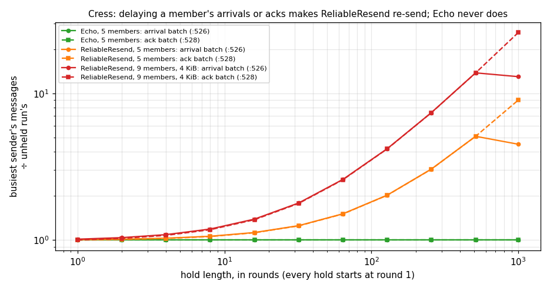
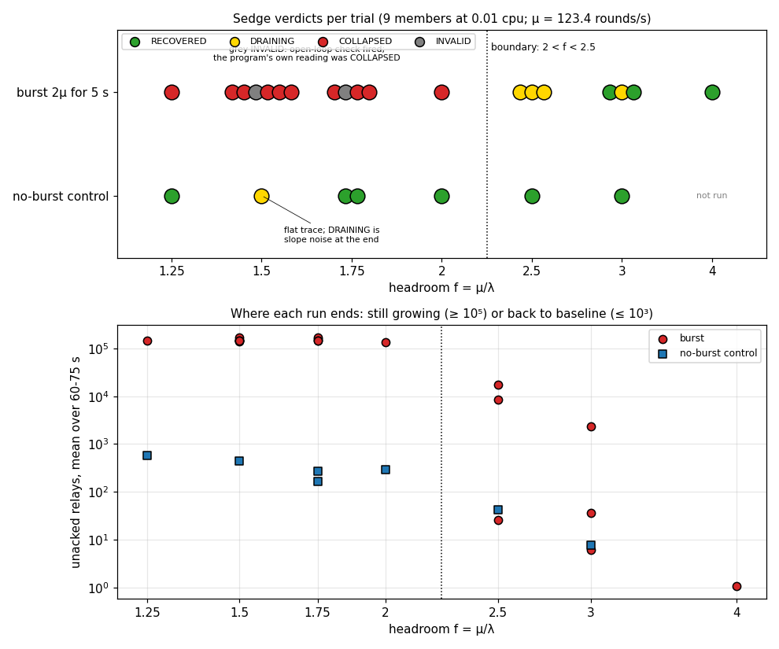
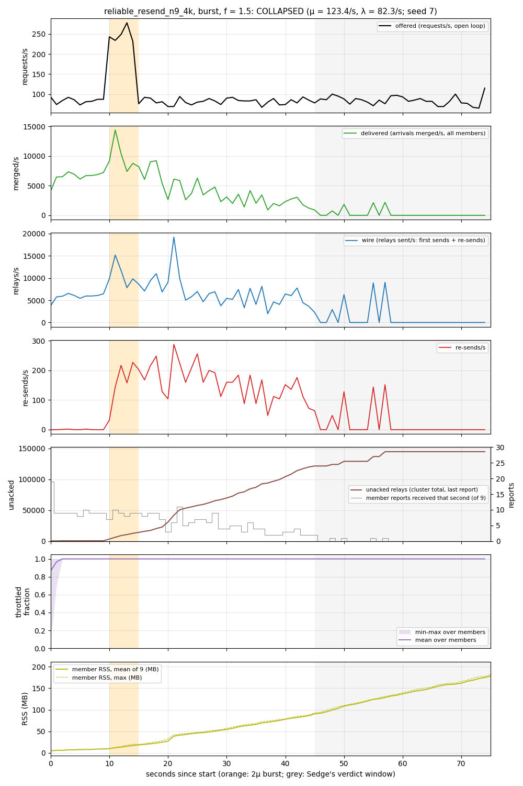
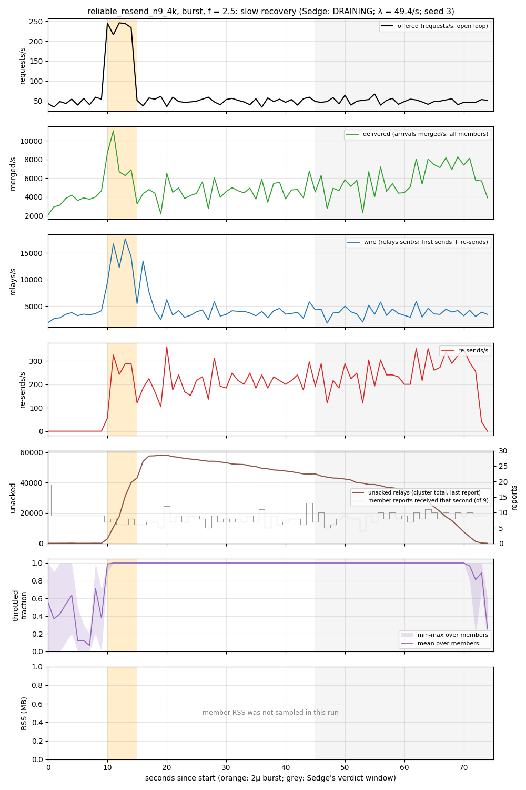
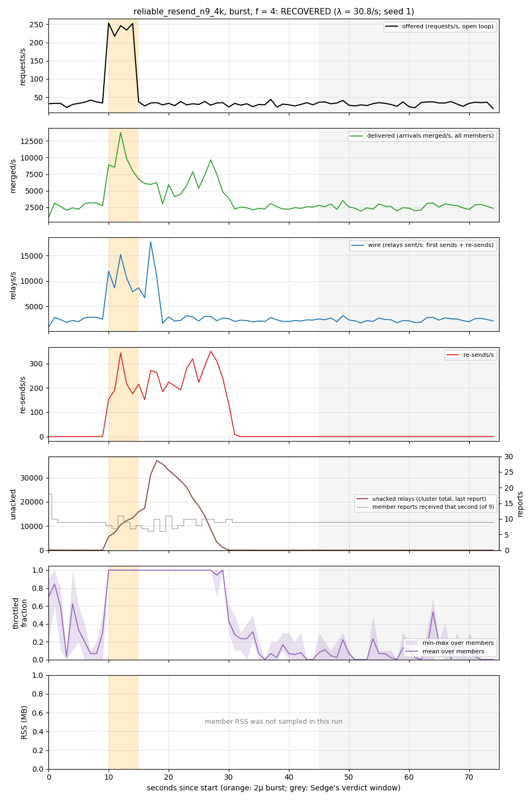
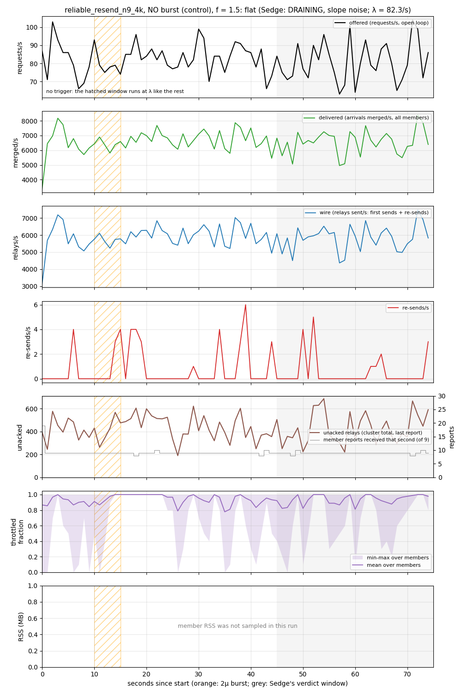

# Demo: `relay_broadcast` under HydroFrac, Cress and Sedge, with capacity imposed from outside

This demo runs one program, `hydro_test/src/cluster/relay_broadcast.rs`, through the three tools.
The program contains **no capacity code**. Each tool answers a different question:

- **HydroFrac** asks whether the members can end up disagreeing under crashes and lost messages.
  The `Echo` policy can: one lost echo plus a source crash is enough. `ReliableResend` fixes
  that, and HydroFrac finds no violation.
- **Cress** asks whether delay makes the program do extra work. It finds that the re-sending
  which makes `ReliableResend` correct is also a *retry amplifier*: `Echo` is BENIGN and
  `ReliableResend` is HAZARDOUS.
- **Sedge** deploys the program with each member's CPU capped from outside, and offers it an
  open-loop load with a short burst. `ReliableResend` is stable without the burst. After the
  burst it **collapses and stays collapsed** at headroom f ≤ 2, and **recovers** at f ≥ 2.5. That
  is a metastable failure.

The surprise is in *why* it stays collapsed. The re-sends start the collapse, but they die
down while the backlog keeps growing. What keeps it growing is per-tick work that is proportional to
the backlog, plus the member's outgoing messages starving behind it. Cress points at the right
source of the hazard, but does not see this second loop.

Contents:

1. [The program](#1-the-program)
2. [HydroFrac](#2-hydrofrac)
3. [Cress](#3-cress)
4. [Sedge](#4-sedge)
5. [Discussion](#5-discussion)

Everything here was produced on the branch `feat/hydrofrac-cress-sedge-e2e`. The host had 8 cores
(Intel Xeon Platinum 8375C), cgroup v1 and Docker 25. Raw data:

- [`relay_broadcast/results.tsv`](relay_broadcast/results.tsv): one Sedge row per trial.
- [`relay_broadcast/traces/`](relay_broadcast/traces/): per-second traces, 24 of them.
- [`relay_broadcast/mechanism/`](relay_broadcast/mechanism/): two extra runs with per-member
  memory sampled.
- [`demo_relay_broadcast/`](demo_relay_broadcast/): the HydroFrac and Cress output captured for
  this demo, and the plots.

The plots are made by [`plot_sedge.py`](demo_relay_broadcast/plot_sedge.py) and
[`plot_cress.py`](demo_relay_broadcast/plot_cress.py), which read only committed files. The PDF is
rendered with the `rpc_retry` demo's [`render_pdf.py`](demo_rpc_retry/render_pdf.py):

```sh
python3 -m pip install --target $TMPDIR/py matplotlib markdown-it-py "fpdf2<2.8"   # Python 3.7
export PYTHONPATH=$TMPDIR/py
python3 demo_relay_broadcast/plot_sedge.py relay_broadcast demo_relay_broadcast
python3 demo_relay_broadcast/plot_cress.py demo_relay_broadcast/cress demo_relay_broadcast
python3 demo_rpc_retry/render_pdf.py demo_relay_broadcast.md demo_relay_broadcast.pdf \
  $TMPDIR/py/matplotlib/mpl-data/fonts/ttf
```

All commands in this document run from `design_docs/sedge_outside_capacity/`, except the
`cargo`, `./scripts/cress` and `./scripts/sedge` commands, which run from the repository root.

**Terms used below.**

- **Tick:** one step of a Hydro location's dataflow. In one tick the location takes whatever
  input has arrived and processes it as a batch.
- **μ** (mu): the highest request rate the deployed system keeps up with.
- **λ** (lambda): the offered rate.
- **f = μ/λ:** the *headroom*. f = 2 means the system is offered half of what it can handle.
- **Open loop:** requests arrive on a fixed schedule, whether or not the system keeps up. In a
  closed loop, a slow system would slow its own callers down.
- **Throttled:** the kernel has stopped a capped container because it used up its CPU quota for
  the current period.

## 1. The program

`relay_broadcast` has one `Source` process and a cluster of `Member`s.

- The **source** broadcasts each request to every member. A request is an id, plus a body in
  the configurations used here.
- If the source crashes part-way through a broadcast, some members have the request and others
  never will. So the **members relay** what they receive to each other. `RelayPolicy` chooses
  how:
  - `None`: no relaying.
  - `Echo`: a member that gets a request *from the source* sends it on (echoes it) to every
    peer, once.
  - `EchoResend`: `Echo`, and each echo is re-sent until the peer acknowledges it.
  - `ReliableResend`: a member relays every request on its *first receipt from anyone*, source or
    peer. It keeps each relay in an *outstanding* table (the "unacked" relays) and re-sends it
    until the peer acknowledges it.

**The correctness claim.** `delivered`, the set of ids each member has received, is labelled
*eventually consistent*: in the end, every live member has the same set. The label is an
`assert_has_consistency_of` with a hand-written argument (`relay_broadcast.rs:482-495`):

```rust
let delivered = initial
    .clone()
    .weaken_consistency()
    .map(q!(|r| r.id))
    .merge_unordered(relays_in.clone().map(q!(|r| r.id)))
    .assert_has_consistency_of::<Cluster<'a, Member, EventualConsistency>>(manual_proof!(
        /** reliable broadcast + resend-until-ack (`ReliableResend`): a member relays every
        id to all peers on its first receipt from any sender, source or peer, and re-sends
        each relay until the peer acknowledges. A live member that received id has
        therefore relayed it to every peer, and re-sends past any omission until acked, so
        every live member eventually receives every id that any live member received.
        `None`, `Echo` and `EchoResend` share this label but not the argument: they relay
        only ids received from the source, which HydroFrac refutes */
    ));
```

HydroFrac's job is to check that argument.

**Why `Echo` is not enough.** An echo is sent once. If it is lost, nothing repairs it. If the
source also crashed before reaching that member, the member never learns the id. The program
has too little redundancy for a lossy network.

**The fix: `ReliableResend`.** Two kinds of redundancy are added:

- A member relays an id the first time it hears it *from anyone*. So if a relaying member
  crashes part-way through, any peer it did reach relays the id onward.
- Each relay is kept until acknowledged and re-sent on a timer. So a lost relay is repaired.

What a member relays (`relay_broadcast.rs:515-522`). The dedup is a top-level `unique`, which
keeps a persistent set:

```rust
let first_receipts = arrivals_in
    .clone()
    .filter_map(q!(move |a| if echo_enabled && (relay_any || a.relay_from.is_none()) {
        Some((a.id, a.body))
    } else {
        None
    }))
    .unique();
```

The re-send loop. Each tick, every acknowledged entry is dropped from the outstanding table. On
ticks where the 50 ms timer has fired (`pump`), the oldest entry per peer that has waited at
least `ack_timeout_ticks` timer ticks is re-sent (`relay_broadcast.rs:568-608`):

```rust
let acked_keys = acks.map(q!(|a| (a.from, a.id)));
let still_waiting = outstanding.filter_key_not_in(acked_keys);
let due = still_waiting
    .clone()
    .entries()
    .filter_if(pump.clone())
    .cross_singleton(now_cur.clone())
    .filter_map(q!(move |(((peer, id), (last_sent, body)), now)| {
        if ack_timeout_ticks > 0 && now - last_sent >= ack_timeout_ticks {
            Some((peer, (id, body)))
        } else {
            None
        }
    }))
    .into_keyed()
    .sort()
    .first()
    .entries()
    .sort();
// ...
let kept = still_waiting
    .filter_key_not_in(due.clone().map(q!(|(peer, (id, _))| (peer, id))))
    .into_keyed_stream();
// ...
outstanding = kept.chain(resent).chain(new_entries).first();
```

Note the last line. `outstanding` is tick-scoped state: it is rebuilt from `kept`, `resent` and
`new_entries` on **every** tick. `filter_key_not_in(acked_keys)` also runs over the whole table
every tick. That is a cost proportional to the number of unacked relays, paid on every tick, and
it is what §5 finds sustaining the collapse.

The Sedge configuration (`relay_broadcast.rs:420-431`):

```rust
#[cfg_attr(feature = "sedge", sedge::overload_check(
    name = reliable_resend_n9_4k,
    members = 9,
    config = RelayConfig { policy: RelayPolicy::ReliableResend { ack_timeout_ticks: 3 }, channel: RelayChannel::FailStop },
    mu = 500,
    cpus(Member = 0.01),
    cpu_period_us = 100_000,
    timers(timer = Duration::from_millis(50), report_tick = Duration::from_secs(1)),
    round_data = |round, inputs| {
        inputs.requests.send(Request::with_body(round as u64, 4096));
    },
))]
```

- `mu = 500` is only where the capacity probe starts. μ is measured.
- `cpus(Member = 0.01)` with `cpu_period_us = 100_000` gives each member 1 ms of CPU in every
  100 ms. The source has no cap.
- Each request carries a 4 KiB body.

**No capacity code.** An earlier version modelled each member's capacity inside the program: a
FIFO inbox from which at most `max_merges_per_tick` arrivals were merged per timer tick. That
knob is gone. A member now merges whatever has arrived, and its capacity is whatever the code
achieves on 1 % of a core. The 50 ms timer is only the protocol's re-send clock.

**Program changes made along the way.** Each change is protocol-neutral: it does not change what
is sent or when. HydroFrac, Cress and Sedge were re-run after each one.

1. **A payload body.** The request changed from a bare `u64` to `Request { id, body: Body }`,
   and `Relay` and `Arrival` carry the body too.
   - *Why:* with bare ids, a member's work per message was so small that, even at n = 13, the
     re-sends were at most about 8 % of the relay load. Re-sends could never dominate, and there
     was no metastable window (see the exploratory runs in §5).
   - A 4 KiB body makes every relay, stored copy and re-send cost real bytes and CPU. It lowered
     μ enough for re-sends to matter.
   - Every earlier configuration sends an empty body, so their results are unchanged.
2. **Dedup with `unique`.** The `relayed` set used to be a tick-scoped `KeyedSingleton`, rebuilt
   every tick.
   - *Why:* that cost O(ids seen so far) per tick, so members got slower and slower as a run went
     on. A no-burst control at f = 1.25 and f = 1.5 degraded on its own: throttling climbed from
     ~300 to ~850 ms/s over 75 s. That is a drift, not a metastable failure, and it would have
     made every verdict meaningless.
   - Now dedup is a top-level `.unique()`, which Hydro compiles to a persistent set with O(1)
     cost per arrival.
3. **Shared bodies.** `Body` wraps `bytes::Bytes`, and the `bytes` dependency now has `serde`
   enabled.
   - *Why:* a member keeps one copy of each relay per peer for re-sending. With `Vec<u8>` each
     copy was a 4 KiB memcpy. With `Bytes` a copy is a reference-count increment.
   - `Body`'s `Eq`/`Ord`/`Hash` ignore the bytes, because the id determines the body.
4. **Re-send scan on timer ticks only.** `due` is gated with `filter_if(pump)` before the table
   is scanned. The depth count is gated the same way and held between timer ticks.
   - *Why:* the scan over the whole outstanding table ran on every tick, including ticks that
     only merged arrivals.
   - This change alone raised μ from 56.6 to 123.4 rounds/s.
   - As a side effect, the `outstanding_depth` output emits only on timer ticks, and Cress now
     lists it as "shed".
   - The table *rebuild* (`outstanding = kept.chain(...)`) still runs every tick. See §5.

## 2. HydroFrac

HydroFrac (lineage-driven fault injection) searches for a set of faults (crashes and lost
messages) under which a collection labelled eventually consistent ends up different at different
members. When it finds one, it reports it as a **counterexample**. When its search runs out
without finding one, it reports "no violation found".

The setup comes from `hydro_test/src/cluster/relay_broadcast_ldfi.rs`:

- **Size and faults:** 3 members and 2 request ids. The source and every member can crash.
- **Channel:** the relay channel is `lossy_delayed_forever`, so any single relay may be lost.
  `None` uses `fail_stop` instead.
- **The run:** the test sends both requests and waits for the system to go quiet. It then
  declares the *end of finite failures*: no new crash or loss after this point, but crashes
  that already happened stay. Finally it fires `ack_timeout_ticks + 3` = 6 timer rounds at
  every member, which gives the re-sends time to repair things.
- **Schedules are sampled.** Each fault set is run with 8 randomly sampled schedules
  (`Exploration::Fuzz { instances: 8 }`), not all of them. Exhaustive exploration does not
  finish at this size: the simulator's estimate for the first fault set was still growing past
  16,000 schedules.

Fresh output, captured for this demo. Cut from it: compiler warnings, HydroFrac's per-run
search log (`ldfi: run #…`, several hundred lines per test), and the per-label search lines
except for the `Echo` counterexample's. Each test prints its results table twice, and it
appears here once. The full trimmed log is
[`demo_relay_broadcast/hydrofrac.txt`](demo_relay_broadcast/hydrofrac.txt).

```
$ export CMAKE=$TMPDIR/py/cmake/data/bin/cmake LIBCLANG_PATH=$TMPDIR/pyclang/clang/native
$ cargo test -p hydro_test --lib cluster::relay_broadcast_ldfi -- --nocapture --test-threads=1
running 6 tests
test cluster::relay_broadcast_ldfi::tests::relay_echo_lossy_diverges_under_a_source_crash_and_an_omitted_relay ...
LDFI: goal violated after 11 hypothesis run(s) by {omit(relay[0→1]:Relay { from: 0, id: 2, body: Body(b"") }), crash(source after bcast[→0]:Request { id: 2, body: Body(b"") })}
  omitted: {relay[0→1]:Relay { from: 0, id: 2, body: Body(b"") }}
  sends lost to crashes: {source#4, source#5}
relay_broadcast Echo over LossyDelayedForever: 2.9s
members (3 members)
  initial    relay_broadcast.rs:473  DIVERGES under crash(source after sending bcast Request { id: 2, body: Body(b"") } to member 1)
  delivered  :487                    DIVERGES under omit(relay Relay { from: 0, id: 2, body: Body(b"") } member 0→member 1) + crash(source after sending bcast Request { id: 2, body: Body(b"") } to member 0)
summary: 0 hold, 2 DIVERGE (members/initial, members/delivered)
ok
test cluster::relay_broadcast_ldfi::tests::relay_echo_resend_lossy_diverges_under_a_source_and_a_relayer_crash ...
relay_broadcast EchoResend { ack_timeout_ticks: 3 } over LossyDelayedForever: 4.9s
members (3 members)
  initial    relay_broadcast.rs:473  DIVERGES under crash(source after sending bcast Request { id: 2, body: Body(b"") } to member 1)
  delivered  :487                    DIVERGES under crash(member@0 after sending relay Relay { from: 0, id: 2, body: Body(b"") } to member 1) + crash(source after sending bcast Request { id: 2, body: Body(b"") } to member 0)
summary: 0 hold, 2 DIVERGE (members/initial, members/delivered)
ok
test cluster::relay_broadcast_ldfi::tests::relay_echo_resend_lossy_holds_under_one_crash ...
relay_broadcast EchoResend { ack_timeout_ticks: 3 } over LossyDelayedForever: 5.0s
members (3 members)
  initial    relay_broadcast.rs:473  DIVERGES under crash(source after sending bcast Request { id: 2, body: Body(b"") } to member 1)
  delivered  :487                    no violation found (18 fault sets, 8 sampled schedules each)
summary: 1 hold, 1 DIVERGE (members/initial)
ok
test cluster::relay_broadcast_ldfi::tests::relay_none_diverges_under_a_source_crash ...
relay_broadcast None over FailStop: 1.0s
members (3 members)
  initial    relay_broadcast.rs:473  DIVERGES under crash(source after sending bcast Request { id: 2, body: Body(b"") } to member 1)
  delivered  :487                    DIVERGES under crash(source after sending bcast Request { id: 2, body: Body(b"") } to member 1)
summary: 0 hold, 2 DIVERGE (members/initial, members/delivered)
ok
test cluster::relay_broadcast_ldfi::tests::relay_reliable_resend_lossy_holds_under_one_crash ...
relay_broadcast ReliableResend { ack_timeout_ticks: 3 } over LossyDelayedForever: 5.6s
members (3 members)
  initial    relay_broadcast.rs:473  DIVERGES under crash(source after sending bcast Request { id: 2, body: Body(b"") } to member 1)
  delivered  :487                    no violation found (18 fault sets, 8 sampled schedules each)
summary: 1 hold, 1 DIVERGE (members/initial)
ok
test cluster::relay_broadcast_ldfi::tests::relay_reliable_resend_lossy_holds_under_unbounded_crashes ...
relay_broadcast ReliableResend { ack_timeout_ticks: 3 } over LossyDelayedForever: 17.0s
members (3 members)
  initial    relay_broadcast.rs:473  DIVERGES under crash(source after sending bcast Request { id: 2, body: Body(b"") } to member 1)
  delivered  :487                    no violation found (65 fault sets, 8 sampled schedules each)
summary: 1 hold, 1 DIVERGE (members/initial)
ok

test result: ok. 6 passed; 0 failed; 0 ignored; 0 measured; 240 filtered out; finished in 145.86s
```

**Reading.**

- **`Echo`: counterexample.** The source sends id 2 to member 0 only, then crashes. Member 0
  echoes id 2 to its peers, but the echo to member 1 is lost. `Echo` never re-sends, so member 1
  never gets id 2, while members 0 and 2 have it. HydroFrac needed two faults, one crash and
  one loss, and found them in 11 tries.
- **`EchoResend`** survives any *one* crash (18 fault sets). It still fails with two: the source
  crashes after reaching only member 0, and member 0 crashes part-way through its echoes.
  Members echo only ids they got *from the source*, so nobody passes id 2 on. This is the gap in
  the hand-written argument that `ReliableResend` closes.
- **`ReliableResend`: no violation found.** It held under one crash (18 fault sets) and with
  crashes unbounded (65 fault sets: any combination of the source and the members crashing,
  plus lost relays before the cut). Each fault set ran with 8 sampled schedules. In the test's
  API this is a `Certificate`, but it is a certificate *for the sampled schedules*: it says no
  violation was found, not that none exists. It also only covers 3 members and 2 ids.
- **`initial` always diverges.** `initial` is the source's one-hop broadcast on its own, which
  is exactly what the relays exist to repair. It is reported as its own row.
- An earlier run of the unbounded test reported 55 fault sets. The program has changed since:
  it now has the body field, `unique` and the pump gate, and the universe of faults HydroFrac
  derives from the program's messages changed with it. The verdict did not change.

HydroFrac's Lamport diagrams for the failing runs are in
[`../relay_broadcast/hydrofrac/`](../relay_broadcast/hydrofrac/README.md).

## 3. Cress

Cress runs the program in the simulator and asks one question: **does delay cause extra work?**

- A *decision point* is each place where a location takes a batch of its waiting input (a
  `use::batch`) or reads a snapshot of some state (`use::snapshot`).
- Cress *holds* one decision point at a time for a range of lengths. While it is held, the
  input waits there.
- It then counts the messages each sender sends, against a run with no hold.
- A program where a hold only delays work is **BENIGN**. A program where a hold makes some
  sender send *more* is **HAZARDOUS**: in a deployment, a slow node then gets more work exactly
  when it is slow.

The setup comes from the `amplification_check` attributes (`relay_broadcast.rs:214-312`):

| configuration | members | policy | workload | body |
|---|---|---|---|---|
| `echo_only` | 5 | `Echo` | 1 request per round, rounds 0–124 | empty |
| `reliable_resend` | 5 | `ReliableResend { ack_timeout_ticks: 3 }` | 1 request per round, rounds 0–124 | empty |
| `reliable_resend_n9_4k` | 9 | `ReliableResend { ack_timeout_ticks: 3 }` | 1 request per round, rounds 0–39 | 4 KiB |

- **Common to all three:**
  - The relay channel is `FailStop`, with no faults.
  - The timers are the deployed ones, converted to rounds: the 50 ms re-send timer fires
    20 times per round, and the report tick once per round.
  - Each run lasts 1000 rounds.
- **Hold lengths:** 1, 2, 4, …, 512 and 999 rounds, all starting at round 1.
- **Decision points held:**
  - the members' timer batch (`:525`);
  - the arrival batch (`:526`);
  - the first-receipt batch (`:527`);
  - the ack batch (`:528`);
  - the metrics batches (`:657`–`:660`).

  The metrics snapshot (`:661`) cannot be held.

Fresh output, captured for this demo. Compiler warnings and the `Finished` lines are cut, and
each configuration took 10–27 minutes:

```
$ for c in echo_only reliable_resend reliable_resend_n9_4k; do ./scripts/cress --config $c hydro_test relay_broadcast; done
Checking relay_broadcast (echo_only)…
✓ BENIGN  relay_broadcast (echo_only)  growth: -  multiplier: -  location: -
    outputs: conserved: wire, merged, acks_sent, delivered; shed: outstanding_depth, metrics
Checking relay_broadcast (reliable_resend)…
! HAZARDOUS  relay_broadcast (reliable_resend)  growth: grows  multiplier: 8.98x  location: hydro_test/src/cluster/relay_broadcast.rs:526, batch of Arrival
    outputs: amplified: wire, merged, acks_sent, delivered; shed: outstanding_depth, metrics
Checking relay_broadcast (reliable_resend_n9_4k)…
! HAZARDOUS  relay_broadcast (reliable_resend_n9_4k)  growth: grows  multiplier: 25.95x  location: hydro_test/src/cluster/relay_broadcast.rs:526, batch of Arrival
    outputs: amplified: wire, merged, acks_sent, delivered; shed: outstanding_depth, metrics
```

The full report for `reliable_resend_n9_4k`, trimmed to the two decision points that react and
the verdict. The three reports are in
[`demo_relay_broadcast/cress/`](demo_relay_broadcast/cress/).

```
hydro_test::cluster::relay_broadcast relay_broadcast (reliable_resend_n9_4k) workload members=9 members, round_data closure, timer=20/round, report_tick=1/round, data in rounds 0..40

cress amplification check: 1000 rounds of workload, every hold begins at round 1
horizon: 999 rounds (the longest delay imposed; a hold of that length lasts to the end of the run)
run time: 1629.0 s including compilation
input: data in rounds 0..40, timers only afterwards; finite holds that outlast the input: 64, 128, 256, 512
unheld run: 201600 records admitted at decision points, 6120 network messages sent, 7 decision points had buffered input

hold length (rounds)                      1      2      4      8     16     32     64    128    256    512    999
hydro_test/src/cluster/relay_broadcast.rs:525, batch of (usize, ()): no extra work at any hold length
hydro_test/src/cluster/relay_broadcast.rs:526, batch of Arrival
    extra records admitted              180    540   1260   2700   5580  11340  22860  45900  91980 184140 134586
    extra messages, busiest sender        8     24     56    120    248    504   1016   2040   4088   8184   7672
    extra messages, all senders          72    216    504   1080   2232   4536   9144  18360  36792  73656  69048
    first reacted at a hold of 1 rounds with 180 extra; largest extra work 184140 in admitted records
    beyond the input (holds 64, 128, 256, 512): extra sends from Cluster(loc2v1) @8 keeps growing: rate 16.00 per round of delay, no ceiling within the run (rates 16.000, 16.000, 16.000)
    beyond the input (holds 64, 128, 256, 512): extra admitted records keeps growing: rate 360.00 per round of delay, no ceiling within the run (rates 360.000, 360.000, 360.000)
    multiplier: 13.79× the unheld run's 640 sends from Cluster(loc2v1) @8 (+8184 at a hold of 512 rounds)
    under a hold that never ends: +134586 admitted records (134.7 per round of the run)
hydro_test/src/cluster/relay_broadcast.rs:527, batch of (u64, Body): no extra work at any hold length
hydro_test/src/cluster/relay_broadcast.rs:528, batch of Ack
    extra records admitted                0    360   1080   2520   5400  11160  22680  45720  91800 183960 284616
    extra messages, busiest sender        0     16     48    112    240    496   1008   2032   4080   8176  15968
    extra messages, all senders           0    144    432   1008   2160   4464   9072  18288  36720  73584 143712
    first reacted at a hold of 2 rounds with 360 extra; largest extra work 284616 in admitted records
    beyond the input (holds 64, 128, 256, 512): extra sends from Cluster(loc2v1) @8 keeps growing: rate 16.00 per round of delay, no ceiling within the run (rates 16.000, 16.000, 16.000)
    beyond the input (holds 64, 128, 256, 512): extra admitted records keeps growing: rate 360.00 per round of delay, no ceiling within the run (rates 360.000, 360.000, 360.000)
    multiplier: 25.95× the unheld run's 640 sends from Cluster(loc2v1) @8 (+15968 at a hold of 999 rounds)
    under a hold that never ends: +284616 admitted records (284.9 per round of the run)
hydro_test/src/cluster/relay_broadcast.rs:657, batch of (usize, ()): no extra work at any hold length
hydro_test/src/cluster/relay_broadcast.rs:658, batch of Arrival: no extra work at any hold length
hydro_test/src/cluster/relay_broadcast.rs:659, batch of (u32, Relay): no extra work at any hold length
hydro_test/src/cluster/relay_broadcast.rs:661: not holdable (snapshot of an optional; the simulator cannot script it, so it follows the prompt schedule in every run)
...
verdict: hazardous
  decision point: hydro_test/src/cluster/relay_broadcast.rs:526, batch of Arrival
  first reacted at a hold of 1 rounds, with 180 extra admitted records there
  largest extra work over the curve: 184140 in admitted records
  decision points that admitted more records under that hold, at its peak:
    hydro_test/src/cluster/relay_broadcast.rs:526, batch of Arrival +36828
    hydro_test/src/cluster/relay_broadcast.rs:528, batch of Ack +36828
    hydro_test/src/cluster/relay_broadcast.rs:658, batch of Arrival +36828
    hydro_test/src/cluster/relay_broadcast.rs:659, batch of (u32, Relay) +36828
    hydro_test/src/cluster/relay_broadcast.rs:660, batch of (u32, (u64, Body)) +36828
growth: keeps growing. Once the hold outlasts the input, every further round of delay costs the same amount of extra work.
  worst shape, at hydro_test/src/cluster/relay_broadcast.rs:528, batch of Ack over holds 64, 128, 256, 512: extra sends from Cluster(loc2v1) @8 keeps growing: rate 16.00 per round of delay, no ceiling within the run (rates 16.000, 16.000, 16.000)
  largest multiplier, at hydro_test/src/cluster/relay_broadcast.rs:528, batch of Ack: 25.95× the unheld run's 640 sends from Cluster(loc2v1) @8 (+15968 at a hold of 999 rounds)
  largest stall reaction, at hydro_test/src/cluster/relay_broadcast.rs:528, batch of Ack: +284616 admitted records (284.9 per round of the run) under a hold that never ends
```



**Reading.**

- **`echo_only` is BENIGN.** No hold, at any length, makes any member send more. An echo is
  sent once, whenever it is sent. Every output is *conserved*: its count is fixed by the input.
- **`reliable_resend` is HAZARDOUS, at both sizes.**
  - Holding a member's arrival batch (`:526`) or its ack batch (`:528`) means its peers'
    relays go unacknowledged past the 3-tick timeout, and the peers re-send them.
  - The extra sends start at a hold of 1–2 rounds and grow in proportion to the hold:
    - with 9 members, 16 extra sends per round of delay from the busiest member (about two per
      peer per round);
    - with 5 members, 8.
  - "grows" means there is **no ceiling**: as long as the delay lasts, the re-sends continue.
    That is different from `rpc_retry`, whose three-attempt limit made the extra work stop at
    2.98×.
  - Delaying acks and delaying arrivals look the same to the sender. Both are "the member is
    slow to process what has arrived", which is what a CPU cap causes in a deployment.
- **The multiplier measures the hold, not the program.** Because the growth has no ceiling, the
  multiplier is about (unheld sends + 16 × hold) / unheld sends, at the longest hold Cress tried:
  (640 + 15968) / 640 = 25.95.
  - `n9_4k` reads 25.95× because its workload is short: 40 requests, so 640 unheld sends from
    the busiest member. It also has more peers per member.
  - `reliable_resend` (n = 5) reads 8.98× over 125 requests and 1000 unheld sends.
  - Neither number is a headroom threshold. Sedge's boundary is f ≈ 2–2.5 (§5).
  - An earlier record of the n = 5 configuration (`../relay_broadcast/README.md`) reads 8.97× at
    `relay_broadcast.rs:272`. That was the same check on an earlier layout of the file, before
    the program changes in §1.
- **The redundancy that earns the certificate is what Cress flags.** The re-send-until-acked
  loop is exactly what makes `ReliableResend` survive lost relays in HydroFrac. `Echo` has no
  such loop, which is why it is BENIGN and why HydroFrac breaks it.
- **What Cress counts.** Cress counts messages and admitted records, not CPU. It sees that a
  held member makes its peers re-send. It does not see that a member's per-tick cost grows with
  its unacked table. §5 shows that this second effect is what sustains the deployed collapse.

## 4. Sedge

### Configuration

- **Capacity from outside.**
  - Each deployed process runs in its own Docker container (`--network host`). All ten nodes
    run on core 7 (`--node-cpus 7`), and the harness (load generator, observer) runs on core 6
    (`--harness-cpus 6`).
  - Each of the **9 members** gets a CFS quota of 1 ms per 100 ms (0.01 cores). The quota is
    set at container start and stays fixed.
  - The **source** has no quota. It stands for the callers offering the load.
- **Release build.** The nodes are built with the workspace's `profile` profile (release with
  debug info), which is Sedge's default (`--deploy-profile`).
- **Open-loop workload.** Poisson arrivals at the profile's rate, each request with a 4 KiB body.
  - The generator queues each request at its scheduled time and never waits.
  - The nodes run with `HYDRO_DEPLOY_SEND_BUFFER=unbounded`, Sedge's default: every outgoing
    connection is an unbounded in-memory queue, so a slow member never stalls its senders.
  - Every trial checks this. A trial is INVALID if more than 0.1 % of requests entered the
    source more than 50 ms after their scheduled time.
- **μ is measured**, not assumed: μ = **123.4 rounds/s** on this host, core and build. The probe
  found that 123.4/s keeps up and 134.5/s falls behind.
- **Profile.**
  - 10 s at λ = μ/f;
  - a **burst** at 2μ (≈ 247/s) for 5 s, from 10 s to 15 s;
  - 60 s at λ again (`--tail 60`).

  The verdict compares the window [45 s, 75 s) with the baseline [5 s, 10 s). The burst is the
  only trigger: there is no CPU dip.
- **No-burst controls** run the same profile with the burst set to λ (`--trigger-multiple 1/f`).
  If a control degrades on its own, the program is drifting, and a "collapse" would mean
  nothing.
- **Timers:** the members' 50 ms re-send timer and the 1 s report tick run in-process.
- **What Sedge watches.** Each member reports four counters once a second: arrivals merged
  (`delivered`), relays put on the wire (`wire`), re-sends (`resent`), and its count of
  unacked relays (`unacked`). Sedge sums them over the members. The program has no per-request
  completion, so Sedge's "goodput" column is not meaningful here (it reads 100 % throughout).
  The verdicts rest on the unacked level and the re-send rate.

### Commands

```sh
# Cress first: Sedge reads each output stream's kind (level, work, …) from Cress's table.
./scripts/cress --config reliable_resend_n9_4k hydro_test relay_broadcast

# Burst runs (seed = trial + 1 unless --seed is given):
./scripts/sedge --config reliable_resend_n9_4k --factors 1.5,1.75 --trials 4 --tail 60 \
  --harness-cpus 6 --node-cpus 7 hydro_test relay_broadcast                    # burst_key
./scripts/sedge --config reliable_resend_n9_4k --factors 1.25,2,4 --trials 1 --tail 60 \
  --harness-cpus 6 --node-cpus 7 hydro_test relay_broadcast                    # burst_other
./scripts/sedge --config reliable_resend_n9_4k --factors 2.5,3 --trials 3 --tail 60 \
  --harness-cpus 6 --node-cpus 7 hydro_test relay_broadcast                    # burst_bisect
./scripts/sedge --config reliable_resend_n9_4k --factors 1.5 --trials 1 --seed 7 --tail 60 \
  --harness-cpus 6 --node-cpus 7 hydro_test relay_broadcast                    # mech_f1.5 (and --seed 8)

# No-burst control at factor F: the trigger window runs at λ = μ/F.
./scripts/sedge --config reliable_resend_n9_4k --factors F --trials 1 \
  --trigger-multiple $(python3 -c "print(1/F)") --tail 60 \
  --harness-cpus 6 --node-cpus 7 hydro_test relay_broadcast                    # ctl_fF
```

During the two `mech_f1.5` runs,
[`mechanism/sampler.py`](relay_broadcast/mechanism/sampler.py) sampled each member's RSS (the
memory it actually holds) and CPU time from `/proc` once a second.

### Results

The run-time console logs were not kept. Here is Sedge's own row for every trial, verbatim from
`results.tsv`, with each reason cut at 64 characters. The seed is trial + 1, except 7 and 8
for the two `mech_f1.5` runs:

```
$ awk -F'\t' 'BEGIN{OFS="\t"} {print $1,$5,$6,$11,$20,substr($29,1,64)}' relay_broadcast/results.tsv | column -t -s$'\t'
run           factor  trial  outcome    max_levels      reason
ctl_f1.5_a    1.5     0      DRAINING   unacked=686     goodput at 100% of baseline; unacked rising
burst_key     1.5     0      COLLAPSED  unacked=152729  resent at 17.6/s against 1.8/s through the tail, goodput at 100%
burst_key     1.5     1      COLLAPSED  unacked=152292  resent at 26.9/s against 1.6/s through the tail, goodput at 100%
burst_key     1.5     2      INVALID    unacked=140333  not open-loop: 2 of 6888 records entered the program more than 5
burst_key     1.5     3      COLLAPSED  unacked=172097  resent at 18.9/s against 1.6/s through the tail, goodput at 100%
burst_key     1.75    0      COLLAPSED  unacked=168761  resent at 54.1/s against 0.0/s through the tail, goodput at 100%
burst_key     1.75    1      INVALID    unacked=167186  not open-loop: 108 of 6225 records entered the program more than
burst_key     1.75    2      COLLAPSED  unacked=154808  resent at 36.5/s against 2.4/s through the tail, goodput at 100%
burst_key     1.75    3      COLLAPSED  unacked=151644  resent at 44.8/s against 1.8/s through the tail, goodput at 100%
burst_other   1.25    0      COLLAPSED  unacked=147898  resent at 15.7/s against 0.2/s through the tail, goodput at 100%
burst_other   2       0      COLLAPSED  unacked=140770  resent at 65.6/s against 2.2/s through the tail, goodput at 100%
burst_other   4       0      RECOVERED  unacked=36966   tail goodput is 100% of baseline, no abandonments, wire at 2309.
ctl_f1.75     1.75    0      RECOVERED  unacked=568     tail goodput is 100% of baseline, no abandonments, wire at 4957.
ctl_f1.75     1.75    1      RECOVERED  unacked=616     tail goodput is 100% of baseline, no abandonments, delivered at 
ctl_f1.25     1.25    0      RECOVERED  unacked=953     tail goodput is 100% of baseline, no abandonments, wire at 6961.
ctl_f2        2       0      RECOVERED  unacked=504     tail goodput is 100% of baseline, no abandonments, wire at 4426.
mech_f1.5     1.5     0      COLLAPSED  unacked=144683  resent at 17.9/s against 0.4/s through the tail, goodput at 100%
mech_f1.5_b   1.5     0      COLLAPSED  unacked=144437  resent at 8.3/s against 0.4/s through the tail, goodput at 100% 
burst_bisect  2.5     0      DRAINING   unacked=55626   goodput at 100% of baseline; unacked falling at 2067/s, about 4s
burst_bisect  2.5     1      DRAINING   unacked=48367   goodput at 100% of baseline; unacked rising
burst_bisect  2.5     2      DRAINING   unacked=58163   goodput at 100% of baseline; unacked falling at 1546/s, about 11
burst_bisect  3       0      RECOVERED  unacked=51430   tail goodput is 100% of baseline, no abandonments, wire at 2905.
burst_bisect  3       1      DRAINING   unacked=62869   goodput at 100% of baseline; unacked falling at 2114/s, about 1s
burst_bisect  3       2      RECOVERED  unacked=46081   tail goodput is 100% of baseline, no abandonments, delivered at 
ctl_f2.5      2.5     0      RECOVERED  unacked=192     tail goodput is 100% of baseline, no abandonments, wire at 3596.
ctl_f3        3       0      RECOVERED  unacked=97      tail goodput is 100% of baseline, no abandonments, delivered at 
```

`max_levels` is the highest cluster-wide unacked count Sedge saw. The two INVALID reasons
continue: "…(the program's own reading was COLLAPSED: resent at 26.7/s against 0.0/s through the
tail, goodput at 100% of baseline, unacked still rising)" for f = 1.5 trial 2, and the same
reading, with re-sends at 21.9/s, for f = 1.75 trial 1.

By headroom. The per-trial numbers are computed from the traces:

| f | λ (/s) | burst trials | unacked: peak → 60–75 s | reports in [45, 75) s, of 270 | no-burst control (peak unacked) |
|---|---|---|---|---|---|
| 1.25 | 98.7 | COLLAPSED ×1 | 148 k → 148 k, rising | 3 | RECOVERED (953) |
| 1.5 | 82.3 | COLLAPSED ×5¹, INVALID ×1² | 140–172 k → same, rising | 3–7 | DRAINING³ (686) |
| 1.75 | 70.5 | COLLAPSED ×3, INVALID ×1² | 152–169 k → same, rising | 10–21 | RECOVERED ×2 (568, 616) |
| 2 | 61.7 | COLLAPSED ×1 | 141 k → 141 k, rising | 39 | RECOVERED (504) |
| 2.5 | 49.4 | DRAINING ×3⁴ | 48–58 k → 0.04–17 k; ≤ 40 at 75 s | 254–270 | RECOVERED (192) |
| 3 | 41.1 | RECOVERED ×2, DRAINING ×1⁴ | 46–63 k → ≤ 2.3 k; ≤ 61 at 75 s | 265–270 | RECOVERED (97) |
| 4 | 30.8 | RECOVERED ×1 | 37 k → ≤ 9 (empty from 30 s) | 270 | not run |

"Reports" counts the members' once-a-second metric reports that reached Sedge in the verdict
window. 270 means all 9 members reported every second. Fewer means the reports were stuck in
the members' send queues (see the caveat under the time series).

1. Including the two `mech_f1.5` runs (seeds 7 and 8).
2. INVALID means the open-loop check fired: some requests entered the source more than 50 ms
   late. At f = 1.5 it was 2 of 6888 requests, the worst 77 ms late. At f = 1.75 trial 1 the
   whole run went wrong: every node, the source included, averaged 0.003 cores, and requests
   were up to 228 s late. In both cases the program's own reading was COLLAPSED.
3. Sedge labels the f = 1.5 control DRAINING ("unacked rising") because of slope noise at the end
   of the run. The trace is flat between 200 and 700 for the whole 75 s (plot below).
4. At f = 2.5 and f = 3 every trial empties its backlog within the run. DRAINING only means the
   backlog had not finished draining inside the verdict window, or (f = 2.5 trial 1) that a
   near-empty level of 84–89 read as "rising".



The top panel shows every trial's verdict, and the bottom panel shows where each run ends. The
burst runs fall into two groups with nothing in between:

- At f ≤ 2 every run ends with over 10⁵ unacked relays, still rising.
- At f ≥ 2.5 every run ends at or near the control's level. The two f = 2.5 runs above 10³
  are still draining fast, and both are down to a few dozen by 75 s.

The controls stay below 10³ at every f.

### Time series

All four plots share the layout. Orange is the 2μ burst ([10 s, 15 s)), and grey is the verdict
window. The panels, top to bottom:

1. Offered load: requests per second entering the source.
2. `delivered`: arrivals merged per second, summed over the 9 members, duplicates included.
   Each request reaches each member 9 times (once from the source, once from each of the 8
   peers), so the cluster merges ~81 arrivals per request: 82/s × 81 ≈ 6.6 k/s at f = 1.5.
3. `wire`: relays put on the wire per second, first sends and re-sends. Each member relays
   each request to its 8 peers, so that is ~72 per request.
4. Re-sends per second.
5. Unacked relays, the cluster total. Grey, on the right axis: how many member reports arrived
   that second. 9 means every member reported.
6. The fraction of each member's 100 ms CFS periods in which the kernel throttled it: the mean
   over the 9 members, with the min–max range shaded.
7. Member RSS, sampled from `/proc` once a second. This was sampled only in the `mech_f1.5`
   runs. The sampler's clock is aligned to the trace's by the members' first CPU use, to within
   about a second.

**A caveat that applies to every plot.** The counters reach Sedge as messages from the members,
on the same outgoing queues that starve during a collapse. When a member's report does not
arrive, that second's counts are missing, so the rates read 0, and the unacked gauge holds its
last reported value. The grey line in panel 5 shows when this happens. In a collapse, "0
delivered/s" after ~45 s means *no reports*, not *no work*. Memory keeps growing through the
same seconds.

**COLLAPSED: burst, f = 1.5** (λ = 82/s against μ = 123/s; `mech_f1.5`, seed 7).

- Before the burst, the cluster merges ~7 k arrivals/s, about 500 relays are unacked, and there
  are no re-sends. The members are already throttled in almost every period: at f = 1.5,
  1 ms per 100 ms is nearly all used.
- The burst starts re-sends (150–290/s) and the unacked count climbs.
- After the burst the offered load is back at λ, yet unacked keeps climbing, at 3–4 k/s
  between 20 s and 45 s.
  The re-sends fall back to 50–180/s by 35–45 s, so they are *not* what keeps it climbing.
- Member reports thin out from ~20 s and stop by ~45 s.
- Member RSS grows steadily from 8 MB to ~180 MB by the end of the run (190–233 MB by teardown at
  ~95 s), about 2.5 MB/s per member.



**Slow recovery: burst, f = 2.5** (λ = 49/s; `burst_bisect` trial 2, Sedge: DRAINING).

- The same burst builds up 58 k unacked relays and the same re-send rate (~200–350/s).
- With more headroom the members keep reporting, and the backlog shrinks by ~1.5 k/s, slowly at
  first and faster as it empties: the smaller the table, the cheaper each tick.
- It is empty at ~73 s, just after the verdict window's slope was taken.



**RECOVERED: burst, f = 4** (λ = 31/s).

- The backlog peaks at 37 k and is gone by 30 s.
- The re-sends stop when the backlog does. Throttling drops from 100 % to 0–30 %.



**Control: no burst, f = 1.5** (λ = 82/s). The hatched window marks where the burst would be.

- With the same load and no trigger, the system is flat for 75 s: unacked stays at 200–700, there
  are ≤ 6 re-sends/s, and every member reports every second.
- It runs at 80–100 % throttled, which is close to capacity but stable.



## 5. Discussion

**This is a metastable failure.** All four parts of the definition were observed:

1. **Stable without a trigger.** Every no-burst control from f = 1.25 to f = 3 is flat for 75 s:
   unacked stays bounded, there are almost no re-sends, and throttling does not trend upward.
2. **A transient trigger.** Five seconds at 2μ.
3. **Sustained collapse below capacity.** At f ≤ 2 the load returns to λ < μ (as low as half
   of μ), and the system does not come back. The backlog keeps growing by thousands of relays
   per second through the 60 s tail, as far as the starved reports show it, and the members stay pinned at their quota.
4. **Recovery with enough headroom.** At f ≥ 2.5 the same burst's backlog (40–60 k) drains: in
   15–50 s at f = 3 and 4, and in 30–60 s at f = 2.5.

**The boundary is between f = 2 and f = 2.5, and nothing was mixed.**

- All 10 valid burst runs at f ≤ 2 collapsed, and so did the program's own reading in both
  INVALID runs.
- All 7 burst runs at f ≥ 2.5 drained to empty within the run.
- No factor produced both outcomes, so this is a fairly sharp threshold, not a probability that
  shifts gradually. It was not bisected further: f = 2.25 was not run.

**What sustains it: not (mainly) the retry storm.** The design premise was a retry storm: delay
causes re-sends, and re-sends cause more delay. The traces say that loop *triggers* the collapse
but does not *sustain* it:

- **Re-sends decay while the backlog grows.** Re-sends peak at 150–290/s during and just after
  the burst, then fall (to 8–66/s in Sedge's tail window) while unacked keeps rising. They are
  bounded by design: one per peer per timer tick, and when a member is starved its timer
  elements bunch into fewer ticks, so it re-sends *less*.
- **Per-tick work grows with the backlog.**
  - Every tick rebuilds the whole `outstanding` table and filters it against the acks (§1). That
    costs O(unacked) per tick, on every tick, timer or not.
  - At ~17 k entries per member, the estimate is 2–4 ms per tick, against a quota of 1 ms per
    100 ms. Once the table passes a few thousand entries per member, a single tick costs more
    than a whole period's quota.
- **Outgoing messages starve.**
  - Each member is one thread. Its dataflow and its socket writers share that thread and its 1 ms
    per 100 ms.
  - When ticks eat the quota, queued sends (acks, relays, metric reports) are not written, and the
    queues are unbounded, so they grow in memory. That is the RSS growth: 2.5–3 MB/s per member,
    of which the unacked table itself accounts for only ~10–20 MB (~17 k entries per member, with
    the bodies shared through `Bytes`).
  - It is also why member reports stop arriving.
- **The loop closes.** Acks are not sent, so peers' tables stop shrinking. Their ticks get more
  expensive, so they send fewer acks too.
  - At f ≥ 2.5 the burst's backlog does not stay above the line for long enough, and the loop
    unwinds.
  - At f ≤ 2 it does not unwind.

This attribution is **inferred, not profiled**:

- There is no `perf` on the host.
- The members' socket queues are inside their containers and could not be read from outside.

The evidence is the RSS growth, the decaying re-send rate, the missing reports, and the per-tick
cost estimate. The cleanest test would be to change the table's representation and see whether
the collapse goes away (see next steps).

**What this means for Cress.**

- Cress's flag is correct about the *source* of the hazard. Holding the members' arrival batch
  makes `ReliableResend` re-send, and re-sending is exactly what turns the 5 s burst into a
  backlog that outlasts it. `Echo`, which has no re-send, is BENIGN, and has no table to grow.
- Cress does not see the *sustaining* loop. It counts messages, not the CPU a tick costs. A
  tick that rebuilds a 17 k-entry table sends no more messages than one that rebuilds a 17-entry
  table, so the O(unacked) cost, and the starvation of the send queues, are invisible to it.
- The multiplier does not predict the threshold here either: 25.95× is far from the measured
  boundary of 2–2.5. The "recovers iff f > A" reading from the `rpc_retry` demo applies to a
  growth that *stops* at a plateau, and this one *grows*.

**The redundancy trade-off.** The re-sending that HydroFrac needs to find no violation is the
same code that Cress flags and Sedge collapses. Removing it brings back the `Echo`
counterexample. The repair for the collapse should keep the redundancy and change its cost. A
production implementation would keep the table per peer or in a timer wheel, and would not pay
O(table) on every tick. It would also cap or back off re-sends under load.

**Issues found along the way.** Each one, uncaught, would have produced a wrong verdict.

- **Debug builds.**
  - The first runs deployed debug builds, where every per-tick cost is several times larger and μ
    is not the program's real capacity.
  - The exploratory runs below are debug builds. The final runs use the release `profile` build.
- **The `relayed` drift** (change 2 in §1). The no-burst controls degraded on their own, because
  the dedup set was rebuilt every tick and grew with the run. A control is what caught it.
- **Payload copying** (change 3). Every per-peer copy of a 4 KiB body was a memcpy.
- **Per-tick scans** (change 4). The re-send scan ran on every tick, not just timer ticks.
  Gating it more than doubled μ, from 56.6 to 123.4/s. The table rebuild is the same kind of
  cost, and it is still there.
- **No metastability with bare ids.** With n = 13 and empty bodies, μ = 493.5 rounds/s, about
  the same as n = 5.
  - The re-send cap (20/s per peer) is at most ~8 % of the per-peer relay load, so cluster size
    alone could not make re-sends matter.
  - The 4 KiB body, by lowering μ, did. These runs are in
    [`relay_broadcast/exploratory/`](relay_broadcast/exploratory/).

**Limitations.**

- **One host, one core.** All nine members and the source shared core 7 of a single 8-core host.
  μ was measured there and is specific to that host, core and build.
- **Few trials at some factors.** f = 1.25, 2 and 4 have one burst trial each. Most controls
  have one trial, and f = 4 has no control. The f = 1.5 and 1.75 results (4–6 trials each) are
  the solid ones. Seeds are fixed (trial + 1, plus 7 and 8).
- **The boundary is coarse.** It lies somewhere in (2, 2.5).
- **The metrics travel through the starved path.** In a collapse the rate panels read 0 because
  the reports stop, and the unacked gauge holds a stale value. The final unacked counts are
  therefore lower bounds on the collapsed runs' backlogs.
- **The mechanism is not directly measured.** RSS was sampled in only two runs, there is no CPU
  profile, and the socket queues were not read. The 2–4 ms per-tick figure is an estimate.
- **Sedge's labels need reading.**
  - DRAINING at f = 2.5 and 3 means "not finished inside the window", not "stuck".
  - The f = 1.5 control's DRAINING is slope noise on a flat trace.
  - Goodput is not defined for this program.
- **HydroFrac's result is sampled and small.** 8 schedules per fault set, with 3 members and
  2 ids.

**Next steps.**

1. **Test the inferred mechanism directly.** Keep the outstanding table as persistent per-peer
   state, so a tick costs O(arrivals + acks) and not O(table), and rerun the same sweep. If the
   collapse at f ≤ 2 goes away, or the boundary moves well below 2, the attribution is confirmed.
2. **Observe out of band.** Have members write their per-second counters, and the time each tick
   took, to a local file or a channel that does not share the starved send queue. Then the
   collapsed runs' rates are measured, not missing.
3. **Bisect and repeat.** Run f = 2.25, more trials at f = 1.25, 2 and 4, and a control at
   f = 4.
4. **Teach Cress about state cost.** Alongside extra messages, count the records each tick
   touches under a hold. A program whose per-tick work grows with a held backlog would then
   be flagged as well as one whose sends do.
