# Demo: `relay_broadcast` under HydroFrac, Cress and Sedge, with capacity imposed from outside

This demo runs one program, `hydro_test/src/cluster/relay_broadcast.rs`, through the three tools.
The program contains **no capacity code**. Each tool answers a different question:

- **HydroFrac** asks whether the members can end up disagreeing under crashes and lost messages.
  The `Echo` policy can, because it has too little redundancy: one lost echo plus a source crash
  is enough. The redundant fix, `ReliableResendPerEntry`, which re-sends every relay until it
  is acknowledged, is certified by HydroFrac, but only when retries are unlimited.
- **Cress** asks whether delay makes the program do extra work. It finds that the fix's
  re-sends are a *retry amplifier*: late acknowledgements cause re-sends, and each re-send is
  more wire, merge and acknowledgement work. The fix is HAZARDOUS, with a 175.60× multiplier.
- **Sedge** deploys the program with each member's CPU capped from outside, and offers it an
  open-loop load with a short burst.
  - **Outcome.** Without a burst, `ReliableResendPerEntry` is stable at every f tried (37
    no-burst controls across rounds, every one clear by the outside counters). After a burst it
    falls into a **re-send storm**, and the storm either drains or ends in a **black hole**: the
    members' CPU stays pinned at the quota, they write almost nothing to the kernel, and
    nothing is acknowledged again.
    - On isolated cores at f = 4 (round 3, 5 seeds per trigger), whether it gets stuck
      depends on the size of the burst. 2μ for 1 s and 1.5μ for 1.5 s: 5/5 stuck. 1.5μ for
      1 s: 4/5. 2μ for 0.5 s: 5/5 stuck after 60 s, 3/5 still stuck after 180 s.
    - After a 2μ, 5 s burst it is stuck at every f from 1.5 to 8 (round 1, and 9/9 at f = 2,
      4 and 8 in round 2).
  - **Evidence.** Seed 34 of the 2μ, 0.5 s trigger (the headline figure, §4) shows both
    phases. First comes about 150 s of storm *on the wire*: kernel writes are 3.3× the
    pre-trigger rate, sends handed to the send queues 13×, about 150 k re-sends/s in band.
    Then comes the black hole: writes 2–3 % of baseline, attempted sends 31×, 99.9 % dropped
    at a full queue. These are Cress's `wire` re-sends.
  - **Caveat.** In the black hole the amplification is *not* in wire bytes. It shows in the
    attempted sends counted by the transport, and in CPU pinned at the quota. The storm phase
    before it is where the amplified traffic is on the wire.
  - **The capped variant.** `max_attempts: 3` (which HydroFrac refutes) storms after the same
    burst, but its storms end. Their length grows steeply with 3λ/μ, the re-send load if every
    relay is sent three times: about 5 s at 0.9 and 18–39 s at 1.35. At 1.5 they outlast a
    60 s tail, and in five 180 s tails they ended within 16–66 s, at 2.1–2.2× baseline
    kernel writes while they lasted. With a retry cap of 3 the storm always drained; it never
    got stuck in 180 s. Given the μ uncertainty
    (654–778 rounds/s), the regime where the storm outlasts the trigger flips at
    3λ/μ ≈ 1.0–1.35.

**What changed since the previous version of this demo.** The previous version reported a
collapse of the per-peer `ReliableResend` policy at f ≤ 2. That collapse was **not** sustained
by retries. It was sustained by the program rebuilding its whole table of unacknowledged
relays on every tick, which costs work proportional to the backlog. With that table made
persistent state, the per-peer policy recovers from the same burst at every f tried. Its
re-sends are about 4 % of normal traffic, a bounded, additive load
(`relay_broadcast_amplification/README.md`, Part 1). This version therefore uses
`ReliableResendPerEntry`, whose retry load grows with the backlog, and asks whether *that*
amplification sustains a collapse.

Contents:

1. [The program](#1-the-program)
2. [HydroFrac](#2-hydrofrac)
3. [Cress](#3-cress)
4. [Sedge](#4-sedge)
5. [Discussion](#5-discussion)

Everything here was produced on the branch `feat/hydrofrac-cress-sedge-e2e`. The Sedge runs
used one host: 16 cores (Intel Xeon Platinum 8375C @ 2.90 GHz), cgroup v1, Docker 25.0.14.
Round 1 ran with the harness on cpus 5–6 and the nodes on cpus 7–8. Round 3 used two isolated
slots (§4, Methods).

Raw data, all under [`relay_broadcast_lossy/`](relay_broadcast_lossy/) (its
[`README.md`](relay_broadcast_lossy/README.md) describes every file):

- `runs/<group>/`: Sedge's `results.tsv` row and per-second trace for every trial, with the
  out-of-band columns (`wchar_kb_*`, `rss_mb_*`, `cpu_*`, `nr_throttled_*`, `throttled_ms_*`,
  `sendq_attempted[_kb]_*`, `sendq_dropped[_kb]_*`). There are 106 groups.
  - Round 1: `p_pe_*` (`per_entry_n9_4k`), `p_pe3_*` (`per_entry3_n9_4k`) and `p_rr_*`
    (`reliable_resend_n9_4k`), each as `burst_fF` and `ctl_fF`.
  - Round 2: `r2_*`. Only its large-margin groups, `r2_C_rr_*` and `r2_D_pe_*`, are used here.
  - Round 3: `r3_S1_pe3_f<F>[_t180]_s5[_ctl]` and `r3_S2_pe_f4_{m<M>,ctl}_d<D>[_t180]_s5`, where
    the trigger is M·μ for D s.
- [`commands.txt`](relay_broadcast_lossy/commands.txt): the exact Sedge arguments and slot of
  every group.
- `probes.tsv`, `calibration.tsv`, `calibration_per_slot/`, `calibration_smt_isolated/`,
  [`calibration_index.tsv`](relay_broadcast_lossy/calibration_index.tsv) and
  `probes_index.tsv`: the μ probes.
- `cress/`: the three Cress reports and `console.txt` with their verdict lines.
- `earlier/`: the unbounded and `bounded:Member` runs that ruled out those deployments.
- [`demo_relay_broadcast/hydrofrac.txt`](demo_relay_broadcast/hydrofrac.txt): the HydroFrac
  verdicts (16 tests, re-run on commit `52597a61df`).
- [`relay_broadcast_amplification/`](relay_broadcast_amplification/): the earlier per-peer and
  unbounded-buffer study that §5 refers to, with the scripts `summarize.py` and `analyze2.py`.

The plots are made by the scripts in [`demo_relay_broadcast/`](demo_relay_broadcast/), which
read only committed traces. The PDF is rendered with the `rpc_retry` demo's
[`render_pdf.py`](demo_rpc_retry/render_pdf.py):

```sh
python3 -m pip install --target $TMPDIR/py matplotlib markdown-it-py "fpdf2<2.8"   # Python 3.7
export PYTHONPATH=$TMPDIR/py
R=relay_broadcast_lossy/runs
tr() { ls $R/$1/*.factor$2.trial$3.tsv; }   # group, factor, trial -> trace
# Round 1: one call per burst run, each with the no-burst control of the same factor and length.
for p in "pe 4" "pe3 2" "pe3 4" "rr 4"; do set -- $p
  python3 demo_relay_broadcast/plot_amplification.py \
    --burst $(tr p_$1_burst_f$2 $2 0) --control $(tr p_$1_ctl_f$2 $2 0) \
    --out demo_relay_broadcast --prefix $1_f$2 --memory-mb 400 --quota 0.05 --period-us 20000
done
python3 demo_relay_broadcast/plot_summary.py $R demo_relay_broadcast/lossy_summary.png p_
# The headline: seed 34 (stuck) and seed 32 (drained), each with its matched control.
for p in "3 34" "1 32"; do set -- $p
  python3 demo_relay_broadcast/plot_headline.py \
    --burst $(tr r3_S2_pe_f4_m2_d0.5_t180_s5 4 $1) --control $(tr r3_S2_pe_f4_ctl_d0.5_t180_s5 4 $1) \
    --out demo_relay_broadcast/headline_pe_f4_seed$2.png
done
# Round-3 outcome fractions (also prints the two tables).
python3 demo_relay_broadcast/plot_outcomes.py $R demo_relay_broadcast/r3_outcomes.png
python3 demo_rpc_retry/render_pdf.py demo_relay_broadcast.md demo_relay_broadcast.pdf \
  $TMPDIR/py/matplotlib/mpl-data/fonts/ttf
```

All commands in this document run from `design_docs/sedge_outside_capacity/`, except the
`cargo`, `./scripts/cress` and `./scripts/sedge` commands, which run from the repository root.

**Terms used below.**

- **Tick:** one step of a Hydro location's dataflow. In one tick the location takes whatever
  input has arrived and processes it as a batch.
- **Timer tick:** a tick that saw an element of the members' 50 ms protocol timer. Re-sends
  are judged only on timer ticks.
- **μ** (mu): the highest request rate the deployed system keeps up with.
- **λ** (lambda): the offered rate.
- **f = μ/λ:** the *headroom*. f = 2 means the system is offered half of what it can handle.
- **Open loop:** requests arrive on a fixed schedule, whether or not the system keeps up.
- **Throttled:** the kernel has stopped a capped container because it used up its CPU quota for
  the current period.
- **In band / out of band:** the members' own once-a-second reports, which travel the same
  queues as their traffic (in band), against kernel counters that Sedge reads from outside the
  members (out of band).

## 1. The program

`relay_broadcast` has one `Source` process and a cluster of `Member`s.

- The **source** broadcasts each request (an id and a 4 KiB body) to every member.
- If the source crashes part-way through a broadcast, some members have the request and others
  never will. So the **members relay** what they receive to each other. `RelayPolicy` chooses
  how:
  - `None`: no relaying.
  - `Echo`: a member that gets a request *from the source* sends it on (echoes it) to every
    peer, once.
  - `EchoResend`: `Echo`, and each echo is re-sent until the peer acknowledges it.
  - `ReliableResend`: a member relays every request on its *first receipt from anyone*. It keeps
    each relay in an *outstanding* table until the peer acknowledges it, and re-sends at most
    one overdue relay per peer per timer tick.
  - `ReliableResendPerEntry { ack_timeout_ticks, max_attempts }`: the same relaying, but
    *every* relay whose acknowledgement is `ack_timeout_ticks` timer ticks overdue is re-sent
    on each timer tick, with no per-peer or per-tick cap. After `max_attempts` sends (`None`:
    never) the relay is given up.

**The correctness claim.** `delivered`, the set of ids each member has received, is labelled
*eventually consistent*: in the end, every live member has the same set. The label is an
`assert_has_consistency_of` with a hand-written argument. HydroFrac's job is to check that
argument.

The label (`relay_broadcast.rs:571-583`):

```rust
let delivered = initial
    .clone()
    .weaken_consistency()
    .map(q!(|r| r.id))
    .merge_unordered(relays_in.clone().map(q!(|r| r.id)))
    .assert_has_consistency_of::<Cluster<'a, Member, EventualConsistency>>(manual_proof!(
        /** reliable broadcast + resend-until-ack (`ReliableResend`): a member relays every
        id to all peers on its first receipt from any sender, source or peer, and re-sends
        each relay until the peer acknowledges. A live member that received id has
        therefore relayed it to every peer, and re-sends past any omission until acked, so
        every live member eventually receives every id that any live member received.
        `None`, `Echo` and `EchoResend` share this label but not the argument: they relay
        only ids received from the source, which HydroFrac refutes */
    ));
```

**Why `Echo` is not enough.** An echo is sent once. If it is lost, nothing repairs it. If the
source also crashed before reaching that member, the member never learns the id.

**The fix: `ReliableResendPerEntry`.** Two kinds of redundancy are added:

- A member relays an id the first time it hears it *from anyone*. So if a relaying member
  crashes part-way through, any peer it did reach relays the id onward.
- Each relay has its own retry timer and is re-sent until acknowledged. So a lost relay is
  repaired, however many times it is lost.

The re-send loop is the outstanding table's `Pump` event (`relay_broadcast.rs:933-961`). On a
timer tick, every relay whose deadline has passed is re-sent, in deadline order, and its
deadline restarts:

```rust
TableEvent::Pump { now } => {
    let mut out = Vec::new();
    if ack_timeout_ticks > 0 && per_entry {
        // Every relay whose deadline has passed, in deadline order.
        while let Some(&(deadline, peer, id)) = self.due.first() {
            if deadline > now {
                break;
            }
            self.due.pop_first();
            let e = self
                .entries
                .get_mut(&(peer, id))
                .expect("every deadline has its entry");
            e.attempts += 1;
            out.push(TableOut::Wire {
                peer,
                id,
                body: e.body.clone(),
                resend: true,
            });
            if max_attempts > 0 && e.attempts >= max_attempts {
                // The last attempt: give the relay up.
                self.entries.remove(&(peer, id));
                self.len -= 1;
            } else {
                e.deadline = now + ack_timeout_ticks;
                self.due.insert((e.deadline, peer, id));
            }
        }
    }
    // ...
}
```

The number of re-sends on a timer tick is the number of overdue relays. When acks are late
across the board, that is the whole backlog, so the retry load grows with the backlog. The
per-peer policy's load, by contrast, is capped at one per peer.

**The table is persistent state.** It is one top-level `scan` over a stream of table events
(acks, first receipts, timer ticks), and each event is applied in place:

- an ack is one `remove`;
- a first receipt is one `insert` per peer;
- a timer tick costs O(due entries).

Nothing is copied or rescanned between ticks. The dedup of first receipts (a `HashSet` of ids)
lives in the same `scan`.

The `scan` is at `relay_broadcast.rs:672-673`, `TableEvent` (`Ack`, `Receipt`, `Pump`) at
`:802`, and the members' four `use::batch` decision points (timer, arrivals, first receipts,
acks) at `:615-618`.

The Sedge configuration (`relay_broadcast.rs:487-498`):

```rust
#[cfg_attr(feature = "sedge", sedge::overload_check(
    name = per_entry_n9_4k,
    members = 9,
    config = RelayConfig { policy: RelayPolicy::ReliableResendPerEntry { ack_timeout_ticks: 3, max_attempts: None }, channel: RelayChannel::FailStop },
    mu = 150,
    cpus(Member = 0.01),
    cpu_period_us = 100_000,
    timers(timer = Duration::from_millis(50), report_tick = Duration::from_secs(1)),
    round_data = |round, inputs| {
        inputs.requests.send(Request::with_body(round as u64, 4096));
    },
))]
```

- `mu = 150` is only where the capacity probe starts. μ is measured.
- `cpus(Member = 0.01)` with `cpu_period_us = 100_000` is the check's default, 1 ms of CPU in
  every 100 ms. **The runs below override it** from the command line to 0.05 cpu per 20 ms
  (1 ms in every 20 ms, `--cpus Member=0.05 --cpu-period-us 20000`). Under the old cap a
  throttled member froze for 80–95 ms at a time, longer than the protocol's 50 ms timer and
  its 150 ms ack timeout, so every freeze looked like a lost ack. The new cap freezes for
  under 20 ms at a time (§4). The source has no cap and is fed open-loop.
- The timers run inside the program. The 50 ms `timer` is the protocol's re-send clock, and
  `report_tick` is the members' once-a-second report.

**No capacity code.** A member merges whatever has arrived. Its capacity is whatever the code
achieves on 5 % of a core. There are no per-tick budgets, filler load or harness-driven timers.

**Program changes since the previous version of this demo.** HydroFrac, Cress and Sedge were
re-run after each one.

1. **Persistent outstanding table.** It replaces a tick-scoped `KeyedSingleton` that was rebuilt
   and filtered in full on every tick. This removed the per-tick cost proportional to the
   backlog that sustained the previous version's collapse (§5).
2. **Dedup by id only, inside the table's `scan`.** The old top-level `unique` over
   `(id, body)` kept every received body alive, a slow RSS creep of about 0.3 MB/s even
   without a burst.
3. **`ReliableResendPerEntry`**, the policy described above.

## 2. HydroFrac

HydroFrac (lineage-driven fault injection) searches for a set of faults (crashes and lost
messages) under which a collection labelled eventually consistent ends up different at different
members. When it finds one, it reports it as a **counterexample**. When its search runs out
without finding one, it reports "no violation found".

The setup comes from `hydro_test/src/cluster/relay_broadcast_ldfi.rs`:

- **Size and faults:** 3 members and 2 request ids. The source and every member can crash.
- **Channel:** `lossy_delayed_forever`, so any single relay may be lost.
- **Two schedules for the timer.**
  - *Standard:* the test sends both requests, waits for quiet, declares the end of finite
    failures (the *cut*: no new crash or loss after it) and then fires the timers. Every retry
    after the cut is delivered.
  - *Stricter:* `3 · max_attempts + 1` timer rounds fire *before* the cut, so HydroFrac can omit
    the retries as well as the first sends.
- **Schedules are sampled:** 8 per fault set (`Exploration::Fuzz { instances: 8 }`).

The excerpts below are from the committed log,
[`demo_relay_broadcast/hydrofrac.txt`](demo_relay_broadcast/hydrofrac.txt), of a re-run on
commit `52597a61df`: 16 tests (12 HydroFrac tests and 4 unit tests of the outstanding table),
all passing. `...` marks cuts. Each test prints its verdict lines just before its header line.

```
$ cargo test -j 6 -p hydro_test --lib cluster::relay_broadcast -- --nocapture --test-threads=3
  delivered  :576                    DIVERGES under omit(relay Relay { from: 0, id: 2, body: Body(b"") } member 0→member 1) + crash(source after sending bcast Request { id: 2, body: Body(b"") } to member 0)
relay_broadcast Echo over LossyDelayedForever, 0 timer rounds before the cut: 2.8s
...
  delivered  :576                    DIVERGES under omit(relay Relay { from: 0, id: 2, body: Body(b"") } member 0→member 1) + omit(relay Relay { from: 0, id: 2, body: Body(b"") } member 0→member 2) + crash(source after sending bcast Request { id: 2, body: Body(b"") } to member 0)
relay_broadcast ReliableResendPerEntry { ack_timeout_ticks: 3, max_attempts: Some(3) } over LossyDelayedForever, 10 timer rounds before the cut: 12.0s
...
  delivered  :576                    DIVERGES under omit(relay Relay { from: 0, id: 2, body: Body(b"") } member 0→member 1) + omit(relay Relay { from: 0, id: 2, body: Body(b"") } member 0→member 2) + crash(source after sending bcast Request { id: 2, body: Body(b"") } to member 0)
relay_broadcast ReliableResendPerEntry { ack_timeout_ticks: 3, max_attempts: Some(5) } over LossyDelayedForever, 16 timer rounds before the cut: 15.3s
...
  delivered  :576                    no violation found (249 fault sets, 8 sampled schedules each)
relay_broadcast ReliableResendPerEntry { ack_timeout_ticks: 3, max_attempts: None } over LossyDelayedForever, 0 timer rounds before the cut: 167.5s
...
  delivered  :576                    no violation found (243 fault sets, 8 sampled schedules each)
relay_broadcast ReliableResendPerEntry { ack_timeout_ticks: 3, max_attempts: None } over LossyDelayedForever, 10 timer rounds before the cut: 197.3s
...
  delivered  :576                    no violation found (311 fault sets, 8 sampled schedules each)
relay_broadcast ReliableResend { ack_timeout_ticks: 3 } over LossyDelayedForever, 0 timer rounds before the cut: 226.6s
...
test result: ok. 16 passed; 0 failed; 0 ignored; 0 measured; 240 filtered out; finished in 509.31s
```

| policy | timer rounds before the cut | result |
|---|---|---|
| `Echo` | 0 | counterexample: omit relay 0→1 of id 2, plus a source crash |
| PerEntry, max_attempts 3 / 5 / none, unbounded crashes | 0 | no violation (253 / 248 / 249 fault sets) |
| PerEntry, max_attempts 3 | 10 | counterexample |
| PerEntry, max_attempts 5 | 16 | counterexample |
| PerEntry, max_attempts none | 10 | no violation (243 fault sets) |
| `ReliableResend`, unbounded crashes / 1 crash | 0 | no violation (311 / 160 fault sets) |

The fault-set counts differ by a few between runs, because the schedules are sampled; the
previous run found, for example, 247 and 239 for the two `max_attempts: None` rows. The verdicts
were the same in every run.

**Reading.**

- **`Echo`: counterexample.** The source sends id 2 to member 0 only, then crashes. Member 0
  echoes id 2 to its peers, but the echo to member 1 is lost. `Echo` never re-sends, so member 1
  never gets id 2, while members 0 and 2 have it. Two faults are enough: one crash and one loss.
- **A retry limit is a hole.** In the stricter setup the source again crashes after reaching
  only member 0, and every attempt of member 0's relays of id 2 to members 1 and 2 is omitted.
  Once member 0 has used up its attempts it gives the relays up. Re-sends are identical bytes,
  so one omission covers every copy.
- **Only unlimited retries are certified.** `max_attempts: None` holds in both setups, and it
  is the configuration deployed below. "No violation found" covers the sampled schedules, at 3
  members and 2 ids. It does not prove that no violation exists.
- **The redundancy is the hazard.** HydroFrac's argument for unlimited retries is exactly
  "keep re-sending until acknowledged". §3 shows that this is what Cress flags.

## 3. Cress

Cress runs the program in the simulator and asks one question: **does delay cause extra work?**
It *holds* one decision point at a time (a `use::batch` or `use::snapshot`) for a range of
lengths, and counts every output stream and every message against the unheld run.

```sh
./scripts/cress --config per_entry_n9_4k hydro_test relay_broadcast
```

```
! HAZARDOUS  relay_broadcast (per_entry_n9_4k)  growth: grows  multiplier: 175.60x  location: hydro_test/src/cluster/relay_broadcast.rs:616, batch of Arrival
    outputs: amplified: wire, merged, acks_sent, delivered; shed: outstanding_depth, metrics
```

The full report is in
[`relay_broadcast_amplification/cress/per_entry_n9_4k.txt`](relay_broadcast_amplification/cress/per_entry_n9_4k.txt).
The two decision points that react are the members' batch of arrivals (`:616`) and their batch
of acks (`:618`):

```
hold length (rounds)                      1      2      4      8     16     32     64    128    199
hydro_test/src/cluster/relay_broadcast.rs:618, batch of Ack
    extra records admitted                0    432   2592  12096  42768 104976 229392 478224 627912
    extra messages, busiest sender        0     16     96    448   1584   3888   8496  17712  27936
    extra messages, all senders           0    144    864   4032  14256  34992  76464 159408 251424
    first reacted at a hold of 2 rounds with 432 extra; largest extra work 627912 in admitted records
    beyond the input (holds 16, 32, 64, 128): extra sends from Cluster(loc2v1) @8 keeps growing: rate 144.00 per round of delay, no ceiling within the run (rates 144.000, 144.000, 144.000)
    beyond the input (holds 16, 32, 64, 128): extra admitted records keeps growing: rate 3888.00 per round of delay, no ceiling within the run (rates 3888.000, 3888.000, 3888.000)
    multiplier: 175.60× the unheld run's 160 sends from Cluster(loc2v1) @8 (+27936 at a hold of 199 rounds)
    under a hold that never ends: +627912 admitted records (3155.3 per round of the run)
```

**Reading.**

- **Late acks cause re-sends.** Holding a member's acks makes every relay it sent look
  overdue, so it re-sends all of them every three timer ticks. Holding its arrivals has the same
  effect on its peers, because the acks for those arrivals are not sent.
- **The amplified streams** are `wire` (the re-sends themselves), `merged` and `delivered`
  (each re-send is received and merged again) and `acks_sent` (each merged duplicate is
  acknowledged again). §4 measures the same four streams in deployment.
- **It grows with the backlog.** The busiest member gains 144 extra sends per round of delay,
  with no ceiling within the run. The per-peer `ReliableResend` gains 16 at a 25.95×
  multiplier, because it re-sends at most one relay per peer per timer tick.
- **The workload was reduced** to 10 rounds, a horizon of 200 and *empty bodies*. With
  40 rounds, a horizon of 1000 and 4 KiB bodies the simulator, which keeps every buffered
  re-send, grew to 10.5 GB and was killed. Cress counts messages, not bytes, so body size does
  not change its counts. The Sedge configuration keeps 4 KiB bodies.
- **The other two policies deployed in §4** (verdicts only; the full report lines are in the
  report files):
  - `per_entry3_n9_4k`: HAZARDOUS, growth *stops*, multiplier 2.80×;
  - `reliable_resend_n9_4k`: HAZARDOUS, growth *grows*, multiplier 25.95×.

  Cress was re-run on the final tree for all three configurations; the verdict lines are in
  [`relay_broadcast_lossy/cress/console.txt`](relay_broadcast_lossy/cress/console.txt):

  ```
  ! HAZARDOUS  relay_broadcast (per_entry_n9_4k)  growth: grows  multiplier: 175.60x  location: hydro_test/src/cluster/relay_broadcast.rs:616, batch of Arrival
  ! HAZARDOUS  relay_broadcast (per_entry3_n9_4k)  growth: stops  multiplier: 2.80x  location: hydro_test/src/cluster/relay_broadcast.rs:616, batch of Arrival
  ! HAZARDOUS  relay_broadcast (reliable_resend_n9_4k)  growth: grows  multiplier: 25.95x  location: hydro_test/src/cluster/relay_broadcast.rs:616, batch of Arrival
  ```

  - `per_entry3_n9_4k` (`max_attempts: Some(3)`) is HAZARDOUS, but its growth **stops**: a
    relay is sent at most three times, so no hold can cost more than about 3× the sends.
  - `reliable_resend_n9_4k` (per peer) is HAZARDOUS and grows at a 25.95× multiplier, but by
    16 sends per round of delay, not 144.
  - The full reports for all three are in [`relay_broadcast_lossy/cress/`](relay_broadcast_lossy/cress/).
    `per_entry` and `per_entry3` use the reduced workload below. `reliable_resend` runs 40
    rounds, a horizon of 1000 and 4 KiB bodies.
- **Cress models delays, not loss, and that is enough here.** The Sedge runs below give the
  members *lossy* send queues: a send that finds the queue full is dropped. Cress never drops
  a message; it only holds one. But under a retry policy, a dropped relay followed by its
  re-send looks to every other part of the program exactly like a relay that was delayed until
  the re-send. The same holds for a dropped ack: the relay is re-sent until a later ack gets
  through. So every run of the lossy deployment is also a run of Cress's delay model, and
  Cress's verdict carries over to it. The lossy queue is a deployment option, not a program
  change. It needs no Cress check of its own.

## 4. Sedge

### Configuration

- Three configurations, each 9 members with 4 KiB bodies and `ack_timeout_ticks: 3`:
  - `per_entry_n9_4k`: `ReliableResendPerEntry { max_attempts: None }`, the subject;
  - `per_entry3_n9_4k`: `ReliableResendPerEntry { max_attempts: Some(3) }`, the same re-send
    loop with a retry limit (which HydroFrac refutes, §2);
  - `reliable_resend_n9_4k`: the per-peer policy, at most one re-send per peer per timer tick.
- **CPU cap: 0.05 cpu per 20 ms period** for each member, in its own container (`--cpus
  Member=0.05 --cpu-period-us 20000`). The source is uncapped and open-loop.
  - The check's default, 0.01 per 100 ms, gave 80–95 ms freezes, longer than the 50 ms timer
    and the 150 ms ack timeout, so a single freeze could make every outstanding relay overdue.
  - Under the new cap a member at baseline freezes for 7–14 ms at a time, and a fully
    throttled member for about 20 ms (`throttled_ms / nr_throttled` in the traces).
- Release build (`--deploy-profile profile`). The harness and the nodes are on separate cpus:
  round 1 put the nodes on cpus 7–8, and round 3 used the isolated slots described under
  Methods.
- Memory limit: 400 MB per member, 2000 MB for the source. A node that dies makes the trial
  **INVALID**: Sedge reads `State.OOMKilled` and the exit code of every node before teardown.
  An OOM kill is a crash, not a collapse.
- Out-of-band counters, read by Sedge, never by the members:
  - `wchar_kb_*`, `rss_mb_*`: `/proc/<pid>/io` and `VmRSS` of every member's processes, read
    from a sampler container four times a second. `wchar / 4120 B` is the number of relays a
    member actually wrote to its sockets.
  - `cpu_*`, `nr_throttled_*`, `throttled_ms_*`: the containers' cgroup CPU accounting.
  - `sendq_attempted[_kb]_*`, `sendq_dropped[_kb]_*`: counted in the transport (hydro_deploy's
    lossy send queue), outside the program's dataflow. They are the sends the dataflow handed
    the queue and the ones the queue dropped because it was full. Each member publishes them
    to a file five times a second, and Sedge reads them once a second. A starved member
    publishes late, so one second can read 0 and the next carries two seconds' worth. Window
    means are exact; the plots smooth these two series over 3 s.
- **Send buffers: `--send-buffer lossy:1024:Member`.** Each member's outgoing connection
  queues at most 1024 messages, and a send that finds the queue full is dropped and counted.
  The source's feed stays open-loop and unbounded. The other options failed:
  - `unbounded` (the default; `relay_broadcast_lossy/earlier/n_*`, same cap): a 2μ, 5 s burst
    fills each member's queues with first relays while its writers starve, and a member is
    OOM-killed at 400 MB, at every f from 1.5 to 4. Those trials are INVALID: a crash, not a
    collapse, and the memory comes from the burst itself, not from re-sends.
  - `bounded:Member`, where a full queue pushes back on the member's own dataflow
    (`earlier/e1_bounded_ctl_f2`, `earlier/bounded_member_calibration_old_cap.txt`). Below μ it
    behaves like the unbounded run. Above μ the members deadlock at 0 % CPU and 0 bytes
    written: each is blocked sending to a peer that is itself blocked sending, so no one reads.
    The source's queue then grows until the source is OOM-killed. There is no work done, so
    there is no amplification to see.

  A dropped send is a lost message, which is the fault model HydroFrac already checked (§2)
  and, with retries, a delay in Cress's model (§3).
- **Open loop held.** No request entered the program more than 50 ms late in any round-1 or
  round-3 trial (`feed_late` = 0 in all 147 of them; the worst lag, `feed_max_lag_ms`, was
  48.4 ms). Of the 32 round-2 trials used here, one fails the check (§4, round 2) and is
  INVALID.
- **μ = 565.7 rounds/s** for this cap and send-buffer mode in rounds 1 and 2, passed with
  `--mu`. It was measured for `per_entry_n9_4k` with the nodes on cpus 3–4
  ([`relay_broadcast_lossy/probes.tsv`](relay_broadcast_lossy/probes.tsv),
  `calibration.tsv`): 565.7/s kept up, while 616.9/s fell behind with `unacked` rising. Other
  core pairs gave other values (`calibration_per_slot/`, `calibration_index.tsv`). Round 3
  measured μ on each of its slots (Methods).
- **Trigger.** Rounds 1 and 2: a load burst at 2μ for 5 s starting at 10 s, then a 60 s tail.
  Sedge's verdict window is the second half of the tail, [45, 75) s. Round 3 also varies the
  burst (1.5μ or 2μ, for 0.5–1.5 s) and the tail (60 or 180 s).
- **Controls.** Each burst run has a no-burst control of the same factor and length: the
  trigger window runs at λ = μ/f, so the load never changes.

### Methods: isolation, μ, verdicts and counters

**SMT isolation (round 3).** The host has 8 physical cores with 2 hardware threads each. Logical
cpus n and n + 8 are siblings: they share one core's execution units and caches. Round 3 runs
in two *slots*. Each slot is a harness cpu plus two node cpus. Their siblings (9–11 and 13–15)
are left idle, and cpu 0 and its sibling 8 are used only for builds, Cress and analysis
(`relay_broadcast_lossy/README.md`):

| slot | harness cpu | node cpus | μ (rounds/s), calibrations | μ used |
|---|---|---|---|---|
| S1 | 1 | 2–3 | 654.3, 654.3, 713.5 | 654.3 |
| S2 | 5 | 6–7 | 713.5, 654.3, 778.1 | 713.5 |

- **Round 2 had no such isolation.** Its slots shared physical cores (SMT siblings) with each
  other's load, so a node's capacity depended on what its sibling was running. Its boundary
  numbers are therefore not used here. Only its large-margin results are: a 2μ, 5 s burst,
  and 180 s or 300 s tails.
- **Round 1 also predates the isolation.** Its nodes ran on cpus 7–8, the siblings of 15 and 0.
  Its outcomes have large margins, but its numbers near a boundary should be read with that in
  mind.
- **μ is uncertain by about 19 %.** The probe steps through rates about 9 % apart, and three
  calibrations on the same slot gave 654.3–778.1
  ([`calibration_smt_isolated/`](relay_broadcast_lossy/calibration_smt_isolated/)). Core pairs
  whose siblings were busy gave 462–733 (`calibration_index.tsv`, `calibration_per_slot/`).
  Near capacity a probe can itself start `per_entry`'s re-send storm, so its outcome there is
  not repeatable. Every ratio to μ below is therefore given over that range, and f
  is computed from the μ the slot used.

**The silent-tail rule.** The members' in-band reports travel the same queues as their
traffic, so in a black hole they stop reaching Sedge, and the program's own levels carry their
last value forward. The build that ran round 3 applies one rule to every trial:

- if more than 20 % of the tail's seconds have no in-band record at all, the tail is judged
  from outside;
- if the capped nodes' kernel writes (`wchar`) over the second half of the tail are at most
  50 % of their pre-trigger rate, the outcome is **COLLAPSED**;
- otherwise it is **INVALID**: the program cannot be read, and its writes are not low enough to
  call it collapsed.

Applying the rule uniformly changed 4 earlier runs from INVALID to COLLAPSED, all from round 2
(so large-margin only). Their outside writes, whole tail → second half of the tail
(`relay_broadcast_amplification/rescore_silent.py`):

- `r2_A_pe_f4_m1.5_d1.5_s5`, trials 1, 2 and 3: 0.51 → 0.03, 0.52 → 0.03, 0.76 → 0.04;
- `r2_A_pe_f4_m2_d0.5_t180_s5`, trial 2 (seed 13): 0.63 → 0.01.

Read over the whole tail, the storm before the black hole raises the mean above the 50 %
threshold. The second half sees only the black hole. Two round-3 trials stay INVALID under it. Both are still storming on the wire, with
reports missing for 13 and 49 tail seconds and writes at about 60 % and 100 % of baseline.

**Outcome fractions use one outside classification.** Sedge's labels mix in-band and outside
readings, and DRAINING is often slope noise on a flat level (§4, footnote 1). The fraction
tables therefore also classify every trial, including controls, the same way, from the outside
counters over the second half of the tail ([`plot_outcomes.py`](demo_relay_broadcast/plot_outcomes.py)):

- **black hole:** kernel writes below 0.2× the pre-trigger mean [5, 10) s, with member CPU
  above 0.9 of the quota;
- **storm:** sends handed to the lossy queues above 1.5× the pre-trigger mean;
- **clear:** otherwise.

"Stuck" means black hole or storm. All 50 round-3 controls are clear.

**The lossy transport.** `--send-buffer lossy:1024:Member` is a hydro_deploy transport
option. Each outgoing connection gets a queue of at most 1024 messages and a writer task, and a
send that finds the queue full is dropped (see Configuration). The transport counts every send
it is handed and every drop, in messages and bytes, and publishes the counts for Sedge. These
counters are inside the member process but outside the program's dataflow. They keep counting
when the program's reports are dropped.

**The counter-recording fix.** A member's in-band counters (`resent`, `wire`, …) arrive as one
increment per report. Sedge used to record an increment of n as n separate records. When a
starved member's report finally arrived carrying a backlog of millions of re-sends, that loop
stalled the harness task that also paces the open-loop feed, for hundreds of milliseconds.
That could make the feed late, and the trial INVALID, in exactly the runs that matter. Sedge now
keeps an increment as one entry that stands for n records (`sedge/src/trace.rs`,
`a_large_counter_report_is_one_entry`).

### Commands

```sh
# Cress first, on every new configuration.
./scripts/cress --config per_entry_n9_4k hydro_test relay_broadcast
./scripts/cress --config per_entry3_n9_4k hydro_test relay_broadcast
./scripts/cress --config reliable_resend_n9_4k hydro_test relay_broadcast
# Burst runs (C = per_entry_n9_4k, per_entry3_n9_4k or reliable_resend_n9_4k).
./scripts/sedge --config C --deploy-profile profile \
  --cpus Member=0.05 --cpu-period-us 20000 --send-buffer lossy:1024:Member \
  --memory-mb Member=400 --memory-mb Source=2000 --mu 565.7 \
  --harness-cpus 5-6 --node-cpus 7-8 --factors F --trials 1 --tail 60 \
  hydro_test relay_broadcast
# The no-burst control at factor F.
./scripts/sedge ... --trigger-multiple $(python3 -c "print(1/F)") ...
# One line per run: the verdict and the tail against the baseline, in band and outside.
python3 relay_broadcast_amplification/summarize.py --quota=0.05 RUN_DIR ...
```

Round 1 used seed 1 for every trial. Round 3 used slot S1 (`--harness-cpus 1 --node-cpus
2-3 --mu 654.3`) and S2 (`--harness-cpus 5 --node-cpus 6-7 --mu 713.5`), 5 trials per point
(seeds 21–25 with a 60 s tail, 31–35 with a 180 s tail), with `--trigger-multiple M --trigger
D` for the per_entry trigger map. Every group's exact arguments and slot are in
[`relay_broadcast_lossy/commands.txt`](relay_broadcast_lossy/commands.txt).

### Headline: one trigger, two endings

`per_entry_n9_4k` at f = 4 on slot S2 (μ = 713.5, λ = 178.4), a 2μ burst lasting only 0.5 s,
then a 180 s tail. Each burst run is drawn against the no-burst control with the same seed
and length (`r3_S2_pe_f4_m2_d0.5_t180_s5`, `r3_S2_pe_f4_ctl_d0.5_t180_s5`). Every ratio is
against the run's own pre-trigger mean over [5, 10) s.
[`plot_headline.py`](demo_relay_broadcast/plot_headline.py) finds the phases from the outside
counters alone. A storm is attempted sends above 1.5× that mean; a black hole is kernel writes
below 0.1× it.

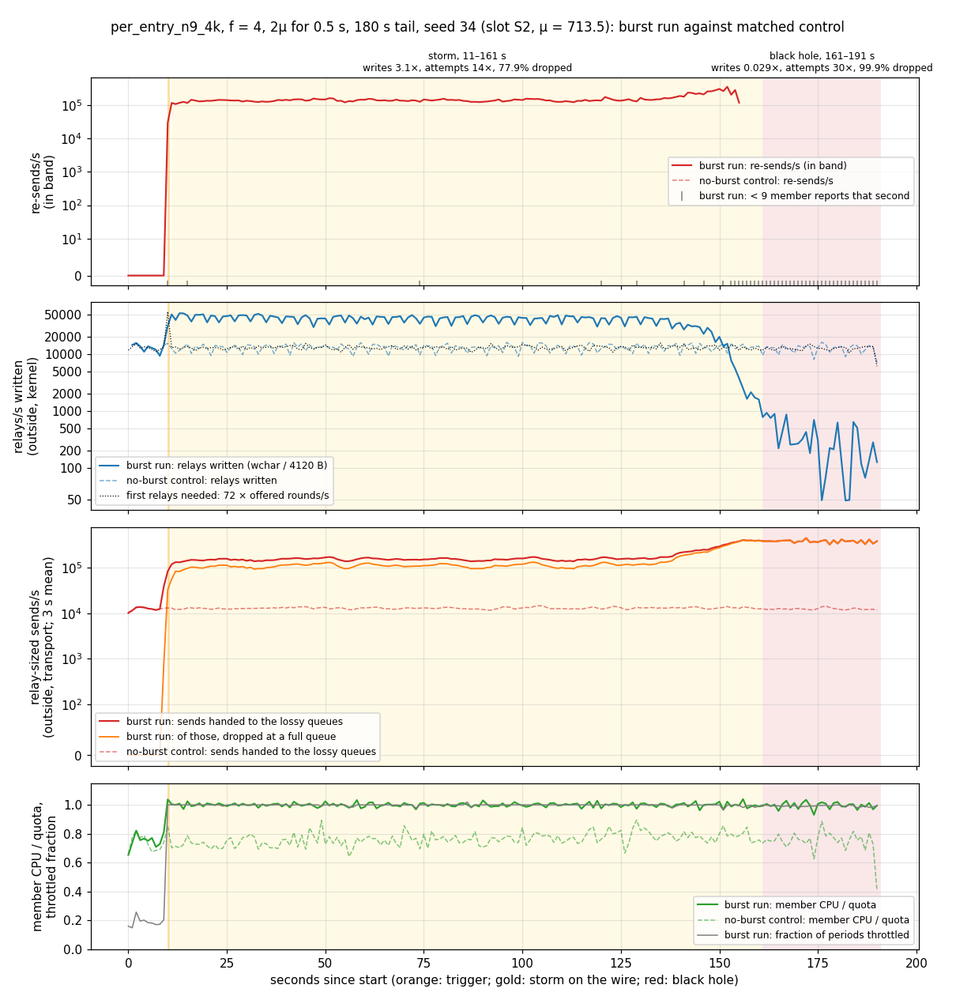

**Seed 34.**

- **Storm on the wire, 11–161 s.** Re-sends run at about 152 k/s in band, and the reports
  keep arriving. Over [20, 150) the members write **3.3×** their baseline relays to the
  kernel and hand their send queues 13×, of which 75 % are dropped. CPU is at the quota.
  This is Cress's amplification, on the wire.
- **Black hole, 161–191 s.** Over [165, 190) kernel writes are **2.4 %** of baseline,
  attempted sends are **31×**, and **99.9 %** of them are dropped at a full queue. The
  in-band reports stop, and CPU stays at the quota.
- Sedge's verdict: COLLAPSED ("resent at 106 489/s … unacked still rising"). The control,
  with the same seed, is clear throughout.

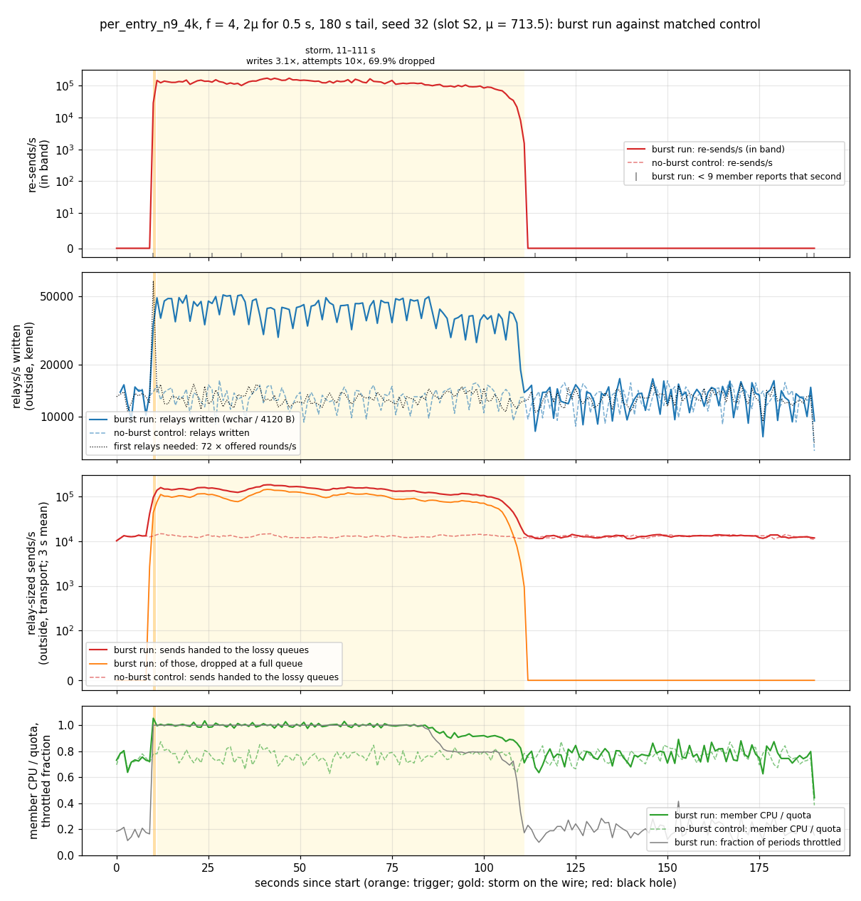

**Seed 32** has the same trigger and a storm of the same kind: writes 3.1×, attempts 10×, 70 %
dropped, from 11 to 111 s. Then it drains. Re-sends fall to 0, attempts and writes return to
the control's level, and CPU falls back to the control's 0.75 of the quota. Sedge's verdict:
DRAINING, with its unacked still falling.

So the black hole is not the burst's direct effect. It is a state the storm can fall into,
after more than two minutes of storming in seed 34 (and at about 52 s in seed 31).

### Round 3: outcome fractions (isolated slots, 5 seeds per point)

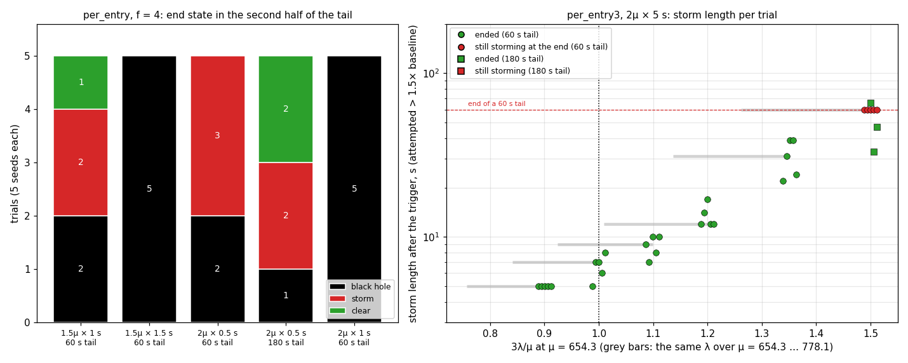

**`per_entry_n9_4k`, f = 4, slot S2** (μ = 713.5). End states use the outside classification
under Methods:

| trigger | tail | trials | black hole | storm | clear | stuck | Sedge |
|---|---|---|---|---|---|---|---|
| 2μ × 0.5 s | 60 s | 5 | 2 | 3 | 0 | 5/5 | C4, I1 |
| 2μ × 0.5 s | 180 s | 5 | 1 | 2 | 2 | 3/5 | C2, I1, D2 |
| 1.5μ × 1 s | 60 s | 5 | 2 | 2 | 1 | 4/5 | C4, R1 |
| 1.5μ × 1.5 s | 60 s | 5 | 5 | 0 | 0 | 5/5 | C5 |
| 2μ × 1 s | 60 s | 5 | 5 | 0 | 0 | 5/5 | C5 |
| no burst (4 groups) | 60 / 180 s | 20 | 0 | 0 | 20 | 0/20 | R11, D9 |

Sedge's verdicts: C = COLLAPSED, I = INVALID, D = DRAINING, R = RECOVERED, with counts.

- **A larger burst sticks more often.** Every trigger of at least 1.5μ for 1.5 s, or 2μ for
  1 s, ends in a black hole in 5/5 trials within 60 s.
- **The smallest trigger does not decide the outcome by itself.** 2μ for 0.5 s leaves every trial stuck
  at 60 s (two already in the black hole, three still storming), but after 180 s two of five
  seeds (32, 33) have drained, and three are stuck. One (31) fell into the black hole at
  about 52 s. The other two (34, 35) were still storming until 140–157 s, and then fell in.
- **Neither label is a gauge artefact.** The black holes are dark in band and are read
  entirely from outside. The storms have their reports and their writes.

**`per_entry3_n9_4k`** (`max_attempts: Some(3)`), 2μ for 5 s, slot S1 (μ = 654.3). 3λ/μ is the
re-send load relative to capacity if every relay is sent three times, the most the policy
allows. Storm length is the time after the trigger in which attempted sends stay above 1.5×
baseline (3 s mean):

| f | 3λ/μ at μ = 654.3 | at μ = 778.1 | tail | trials | still storming at the end | storm length (s) | Sedge |
|---|---|---|---|---|---|---|---|
| 2 | 1.50 | 1.26 | 60 s | 5 | 5 | ≥ 60 (all) | C2, D3 |
| 2 | 1.50 | 1.26 | 180 s | 5 | 0 | 16, 33, 47, 49, 66 | R4, D1 |
| 2.22 | 1.35 | 1.14 | 60 s | 5 | 0 | 22, 24, 31, 39, 39 | D5 |
| 2.22 | 1.35 | 1.14 | 180 s | 5 | 0 | 18, 20, 22, 24, 26 | R1, D4 |
| 2.5 | 1.20 | 1.01 | 60 s | 5 | 0 | 12, 12, 12, 14, 17 | R4, D1 |
| 2.73 | 1.10 | 0.92 | 60 s | 5 | 0 | 7, 8, 9, 10, 10 | R3, D2 |
| 3 | 1.00 | 0.84 | 60 s | 5 | 0 | 5, 6, 7, 7, 8 | R4, D1 |
| 3.33 | 0.90 | 0.76 | 60 s | 5 | 0 | 5 (all) | R2, D3 |

Sedge's verdicts: C = COLLAPSED, I = INVALID, D = DRAINING, R = RECOVERED, with counts.

- **With a retry cap of 3 the storm always drains. It never got stuck in 180 s.** No
  `per_entry3` trial reached a black hole. At f = 2 a 60 s tail is too short to see the end.
  In each of the five 180 s tails (seeds 31–35) the storm ended 16–66 s after the trigger,
  with re-sends at 36–43 k/s and kernel writes at 2.1–2.2× baseline while it lasted, and
  writes at 0.95–1.01× after it. At f = 2.22 the five 180 s storms ended after 18–26 s
  (writes 2.3–2.5× while they lasted), and the tails were back at baseline (0.95–1.01×).
- **The DRAINING labels on these runs are flat tails.** The 180 s runs are labelled R4, D1
  at f = 2 and R1, D4 at f = 2.22. Every one is clear by the outside counters, and so are
  all 40 S1 controls.
- **The storm's length grows steeply with 3λ/μ.** After the trigger it lasts 5 s at 0.9 (the
  burst's own backlog), 5–8 s at 1.0, 7–10 s at 1.1, 12–17 s at 1.2, 18–39 s at 1.35, and
  16 s to more than 60 s at 1.5 (all five 60 s tails end while still storming). Given the μ uncertainty (654–778), the regime where the storm outlasts the
  trigger flips at 3λ/μ ≈ 1.0–1.35.
- **f = 2.22 at the end of its 60 s tail.** Every storm at f = 2.22 had ended by 37–54 s:
  attempted sends were back under 1.5× baseline, and in-band re-sends reached 0 by 40–57 s. Over [45, 65) the
  five trials average 2, 45, 1 529, 11 261 and 14 667 re-sends/s and 0.92–1.59× baseline
  writes, because that window straddles the end of the storm for three of them. Over [65, 75)
  they average 8–21 re-sends/s and 0.91–1.04× writes.

### Round 2: large-margin results only

Round 2 shared physical cores between slots (see Methods), so only results far from any
boundary are used:

| configuration | f | trigger, tail | trials | end state (outside) | Sedge |
|---|---|---|---|---|---|
| per_entry | 2, 4, 8 | 2μ × 5 s, 60 s | 3 each | black hole 9/9 | C9 |
| per_entry, no burst | 2, 4, 8 | 60 s | 3 each | clear 9/9 | R3, D6 |
| per_entry, no burst | 2, 4 | 300 s | 1 each | clear 2/2 | R2 |
| reliable_resend | 1.5, 2, 4 | 2μ × 5 s, 180 s | 1, 4, 1 | clear 6/6 | R5, I1¹ |
| reliable_resend, no burst | 1.5, 2, 4 | 180 s | 1, 4, 1 | clear 6/6 | R3, D3 |

Sedge's verdicts: C = COLLAPSED, I = INVALID, D = DRAINING, R = RECOVERED, with counts.

1. Not open loop: 2 of 59 534 requests entered more than 50 ms late (worst 53 ms). The
   program's own reading was RECOVERED.

The black holes have the same signature as round 1: writes 0.9–4.6 % of baseline, attempted
sends 18× (f = 2), 37–39× (f = 4) and 72–77× (f = 8), 99.9 % dropped. With a 180 s tail, the
per-peer `reliable_resend` that round 1 left DRAINING after 60 s recovers, at every f tried.

### Round 1: three policies across f

Round 1: one trial per point, one host, cores not isolated. Tail rates are means over [45, 75) s, summed over the
9 members; "×" is against the same run's pre-trigger baseline [5, 10) s. "Attempted" is the
relay-sized sends the members handed to their send queues; "written" is the relays they wrote
to the kernel. Both are read from outside.

**`per_entry_n9_4k`** (`max_attempts: None`):

| f | λ | burst run | control | tail attempted/s | tail written/s | dropped |
|---|---|---|---|---|---|---|
| 1.5 | 377.1 | COLLAPSED | DRAINING¹ | 348 k (12.7×) | 173 (0.006×) | 100.0 % |
| 2 | 282.9 | COLLAPSED | DRAINING¹ | 371 k (16.7×) | 185 (0.008×) | 99.9 % |
| 3 | 188.6 | COLLAPSED | RECOVERED | 373 k (27.1×) | 188 (0.014×) | 100.0 % |
| 4 | 141.4 | COLLAPSED | RECOVERED | 386 k (40.0×) | 225 (0.022×) | 99.9 % |
| 6 | 94.3 | COLLAPSED | RECOVERED | 384 k (58.0×) | 255 (0.038×) | 99.9 % |
| 8 | 70.7 | COLLAPSED | RECOVERED | 395 k (79.3×) | 247 (0.050×) | 99.9 % |

In every collapsed run, member CPU is 0.99–1.00 of the quota with 99 % of periods throttled,
and member RSS at 75 s is 95–98 MB. The uncapped source's RSS at 75 s is 722, 529, 323, 221,
120 and 98 MB at f = 1.5 … 8 (see the caveats in §5).

**`per_entry3_n9_4k`** (`max_attempts: Some(3)`):

| f | λ | burst run | control | tail attempted/s | tail written/s | dropped |
|---|---|---|---|---|---|---|
| 2 | 282.9 | DRAINING² | RECOVERED | 58.8 k (2.80×) | 47.8 k (2.25×) | 19.5 % |
| 3 | 188.6 | RECOVERED | RECOVERED | 13.5 k (0.99×) | 13.6 k (0.98×) | 0 |
| 4 | 141.4 | RECOVERED | RECOVERED | 10.3 k (1.14×) | 10.3 k (1.04×) | 0 |

Member CPU against quota, throttled fraction, RSS at 75 s: 1.00, 0.99, 47 MB at f = 2; 0.87,
0.32, 45 MB at f = 3; 0.72, 0.17, 46 MB at f = 4.

**`reliable_resend_n9_4k`** (per peer):

| f | λ | burst run | control | tail attempted/s | tail written/s | dropped |
|---|---|---|---|---|---|---|
| 2 | 282.9 | DRAINING³ | DRAINING¹ | 21.7 k (1.05×) | 21.8 k (1.03×) | 0 |
| 4 | 141.4 | DRAINING³ | DRAINING¹ | 11.6 k (1.26×) | 11.7 k (1.17×) | 0 |

Member CPU against quota, throttled fraction, RSS at 75 s: 0.98, 0.77, 55 MB at f = 2; 0.84,
0.26, 56 MB at f = 4.

1. **Not a real drain.** Sedge's "unacked rising" is slope noise on a flat level. Through the
   whole run, the control's unacked stays at 50–400 relays, outside writes are 0.95–1.02× of
   the 72 first relays per request, and nothing is dropped. These controls are stable.
2. **A stable, degraded state.** Unacked falls slowly, from about 6.4 k at 20–30 s to 5.2 k at
   75 s (Sedge: falling at 23/s). Re-sends hold at 38.5 k/s against 20.2 k first
   relays/s, so nearly every relay is sent three times, the most `max_attempts: 3` allows.
   Members stay at the quota, but in-band reports keep arriving (9 per second) and goodput is
   100 %. Round 3 shows that this storm ends within 16–66 s at f = 2, given a 180 s tail.
3. **Draining at the per-peer cap.** Re-sends run at 1384–1415/s, which is the policy's cap:
   one per peer per 50 ms timer tick, or 9 × 8 × 20 = 1440/s. Unacked is 34 k (f = 2) and
   30 k (f = 4) at 75 s and falling at about 1.4 k/s.
   The 60 s tail is too short to see it finish. Round 2's 180 s tails show it recover.

- **Controls.** Every control is stable at every f tried (footnote 1). The load alone is never
  too much.
- **Burst runs.** `per_entry` collapses at every f from 1.5 to 8. No recovery boundary was found
  in round 1. The two capped policies do not collapse anywhere: `per_entry3` recovers at
  f ≥ 3 and settles into the bounded 3× state at f = 2, and `reliable_resend` drains at the
  per-peer cap. Rounds 2 and 3 repeat these with more seeds and look for `per_entry`'s
  boundary in the size of the burst.
- **INVALID trials.** None in round 1. No node was OOM-killed or exited.

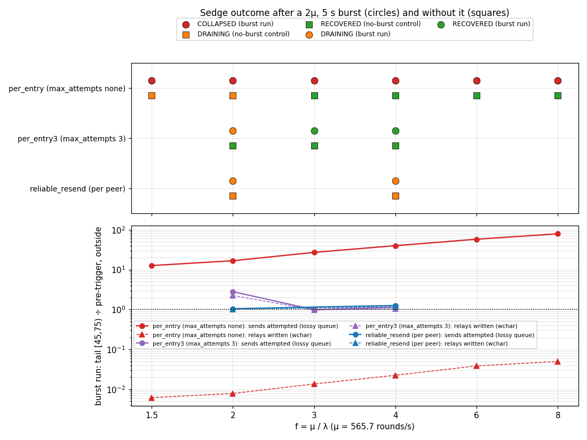

### Is the collapse sustained by the amplification?

The question this demo has to answer is whether the collapsed tail runs on the streams Cress
reports, not just whether something collapsed. For each run, the tail is compared with the same
run's pre-trigger baseline and with its no-burst control (`plot_amplification.py`'s table).

**`per_entry_n9_4k`, f = 4, collapsed.** No member report reached Sedge in the tail (0 of 9
per second), so the in-band rows are dark:

| stream | burst: pre-trigger /s | burst: tail /s | burst: ratio | control: pre-trigger /s | control: tail /s | control: ratio |
|---|---|---|---|---|---|---|
| re-sends | 5.2 | – | dark | – | – | – |
| wire (in band) | 9659.6 | – | dark | 9660.8 | 10094.1 | 1.04× |
| merged = delivered (in band) | 10861.6 | – | dark | 10865.2 | 11355.3 | 1.05× |
| acks_sent (derived) | 9635.8 | – | dark | 9639.4 | 10101.9 | 1.05× |
| wire, outside (wchar) | 10029.9 | 225.2 | 0.02× | 10023.1 | 10175.0 | 1.02× |
| sends attempted, outside (lossy queue) | 9651.2 | 385724.5 | 39.97× | 9767.8 | 10074.3 | 1.03× |
| sends dropped, outside (lossy queue) | 0.0 | 385478.9 | – | 0.0 | 0.0 | – |

**`per_entry3_n9_4k`, f = 2, bounded.** All 9 reports arrive, so the in-band rows are live:

| stream | burst: pre-trigger /s | burst: tail /s | burst: ratio | control: pre-trigger /s | control: tail /s | control: ratio |
|---|---|---|---|---|---|---|
| re-sends | 33.8 | 38489.9 | 1139× | – | – | – |
| wire (in band) | 21313.8 | 58819.5 | 2.76× | 20809.6 | 20135.5 | 0.97× |
| merged = delivered (in band) | 23965.0 | 50156.2 | 2.09× | 23414.6 | 22650.8 | 0.97× |
| acks_sent (derived) | 21355.0 | 47611.9 | 2.23× | 20804.6 | 20134.1 | 0.97× |
| wire, outside (wchar) | 21245.4 | 47813.4 | 2.25× | 21360.7 | 20095.3 | 0.94× |
| sends attempted, outside (lossy queue) | 20964.1 | 58782.1 | 2.80× | 20660.9 | 20226.7 | 0.98× |
| sends dropped, outside (lossy queue) | 0.0 | 11489.9 | – | 0.0 | 0.0 | – |

**`reliable_resend_n9_4k`, f = 4, draining**, for contrast:

| stream | burst: pre-trigger /s | burst: tail /s | burst: ratio | control: pre-trigger /s | control: tail /s | control: ratio |
|---|---|---|---|---|---|---|
| re-sends | 0.4 | 1414.9 | 3537× | – | – | – |
| wire (in band) | 9674.0 | 11603.1 | 1.20× | 9659.2 | 10057.1 | 1.04× |
| merged = delivered (in band) | 10898.8 | 12877.6 | 1.18× | 10864.6 | 11313.9 | 1.04× |
| acks_sent (derived) | 9673.0 | 11602.3 | 1.20× | 9638.8 | 10060.5 | 1.04× |
| wire, outside (wchar) | 9949.4 | 11681.3 | 1.17× | 9941.5 | 10115.0 | 1.02× |
| sends attempted, outside (lossy queue) | 9184.2 | 11607.6 | 1.26× | 9825.5 | 10068.4 | 1.02× |
| sends dropped, outside (lossy queue) | 0.0 | 0.0 | – | 0.0 | 0.0 | – |

The controls report no re-sends in band at all (their `resent_n` column is empty), shown as
"–".

**The criteria set before the runs, one by one**, for the collapsed `per_entry` runs:

- *Re-sends stay far above baseline.* **Yes, read from outside.** The in-band count is dark,
  but the members hand their send queues 350–395 k relay-sized sends per second, 13–79× the
  baseline (which is the 72 first relays per offered request). In bytes, almost every
  attempted send is relay-sized (`sendq_attempted_kb / 4120 B` ≈ `sendq_attempted`), so these
  are relays, not acks or reports. The only relays a member sends after the burst, apart from
  first relays, are re-sends.
- *Wire traffic measured outside stays far above the 72 first relays per request.* **No.**
  Kernel writes fall to 0.6–5 % of baseline. The re-sends are produced, but 99.9 % of them
  are dropped at a full queue before they reach the kernel. The queues are full because the
  peers they write to are themselves at the quota, and so read slowly.
- *Merged and acks_sent rise with it.* **Not observable.** Both are in-band only, and the
  in-band reports are dark. `rchar` does not count the members' socket reads.
- *Member CPU stays at the quota and RSS below the limit.* **Yes.** CPU is 0.99–1.00 of the
  quota and 99 % of periods are throttled, at every f, including f = 8, where the same members
  use 39 % of the quota without the burst. RSS settles near 95 MB, a quarter of the limit, and
  creeps by about 0.5 MB/s. No member was OOM-killed.
- *The controls at the same f are stable.* **Yes** (footnote 1).
- *The in-band reports stop, and only Sedge's reading of a gauge says "collapsed".* **The
  reports do stop.** For f ≤ 6 the program's own stale reading was RECOVERED, and Sedge's
  COLLAPSED comes from its outside reading ("went silent in band; … its capped nodes wrote
  1–7 % of their baseline bytes per second through the tail, at 99–100 % of their CPU
  quota"). The verdict does not rest on a gauge, though. The outside send-queue counters show
  what the CPU is spent on.

**The policy comparison is the strongest evidence.** The three configurations share the
deployment, the cap, the queues and the burst. Only the retry policy differs, and only the
policy whose re-sends grow with the backlog collapses:

- `per_entry` re-sends every overdue relay on every timer tick. Once the burst fills the
  queues, acks are dropped with everything else, so no relay is ever acknowledged. The whole
  backlog stays overdue and is re-sent every three timer ticks, using the whole quota. The
  loop sustains itself. Cress's verdict for it is *grows*, 175.60×.
- `per_entry3` gives a relay up after three sends, so its re-sends are capped at 2× the first
  relays. It settles at 2.80× attempted sends and 2.25× kernel writes, inside the 2.80× ceiling
  Cress reports for it (*growth stops*), with 19.5 % of sends dropped. This is the one run in
  which the amplification shows on the wire. It is degraded but not collapsed: the reports
  keep arriving and goodput is 100 %. The cost is correctness: under loss it gives relays up,
  which is the hole HydroFrac found.
- `reliable_resend` re-sends at most one relay per peer per timer tick, 1440/s across the
  cluster. That is about 7 % of the baseline at f = 2, and the backlog drains.

### Time series

`per_entry_n9_4k`, f = 4, collapsed:

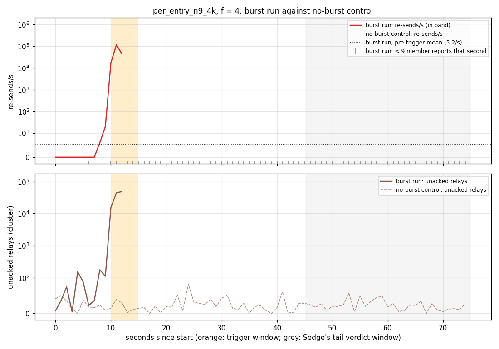

The in-band series stop about 2 s into the burst: after that no member report reaches Sedge.

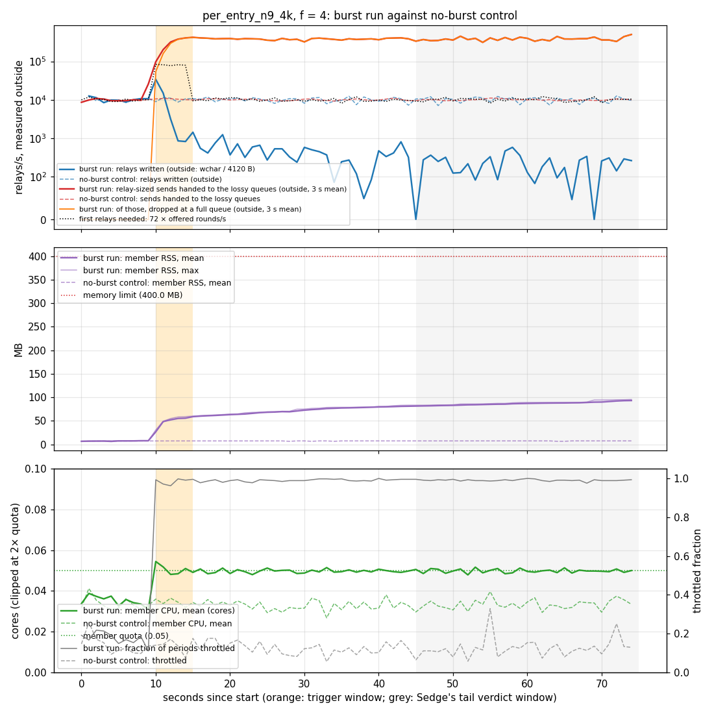

The top panel is the core of the argument. Attempted sends (red) jump to about 380 k/s in the
burst and stay there. Nearly all of them are dropped (orange), and kernel writes (blue) fall
two orders of magnitude below the first relays the load needs (dotted). CPU stays at the quota,
and RSS stays at a quarter of the limit.

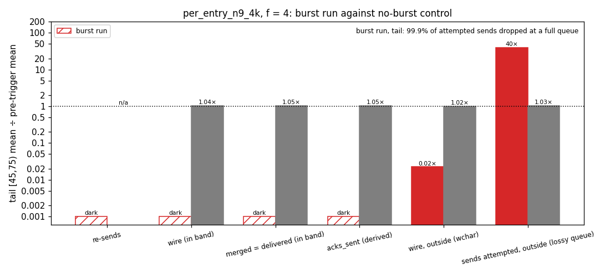

`per_entry3_n9_4k`, f = 2, the bounded 3× state:

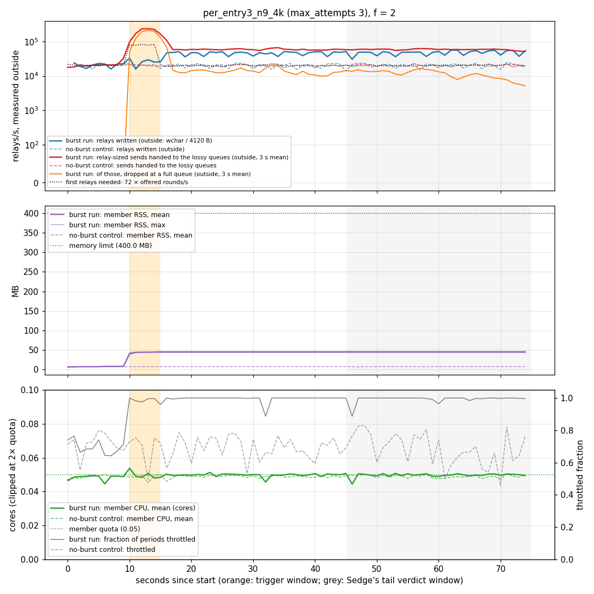

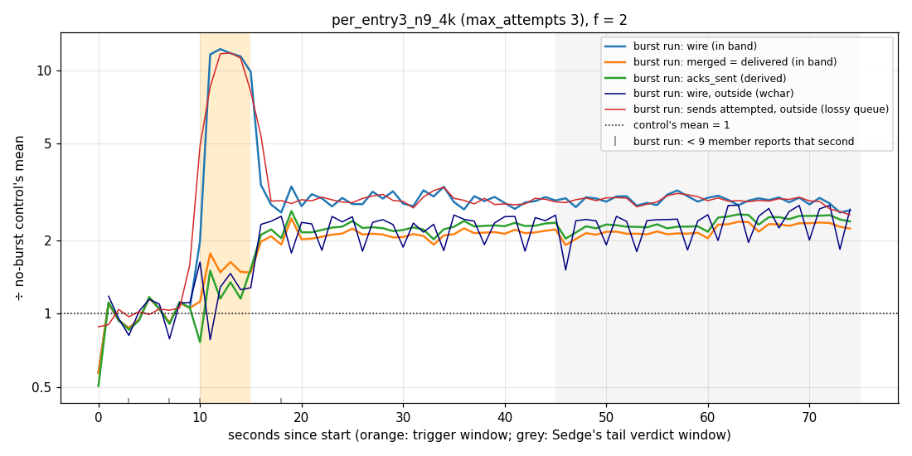

`per_entry3_n9_4k`, f = 4, and `reliable_resend_n9_4k`, f = 4, for contrast:

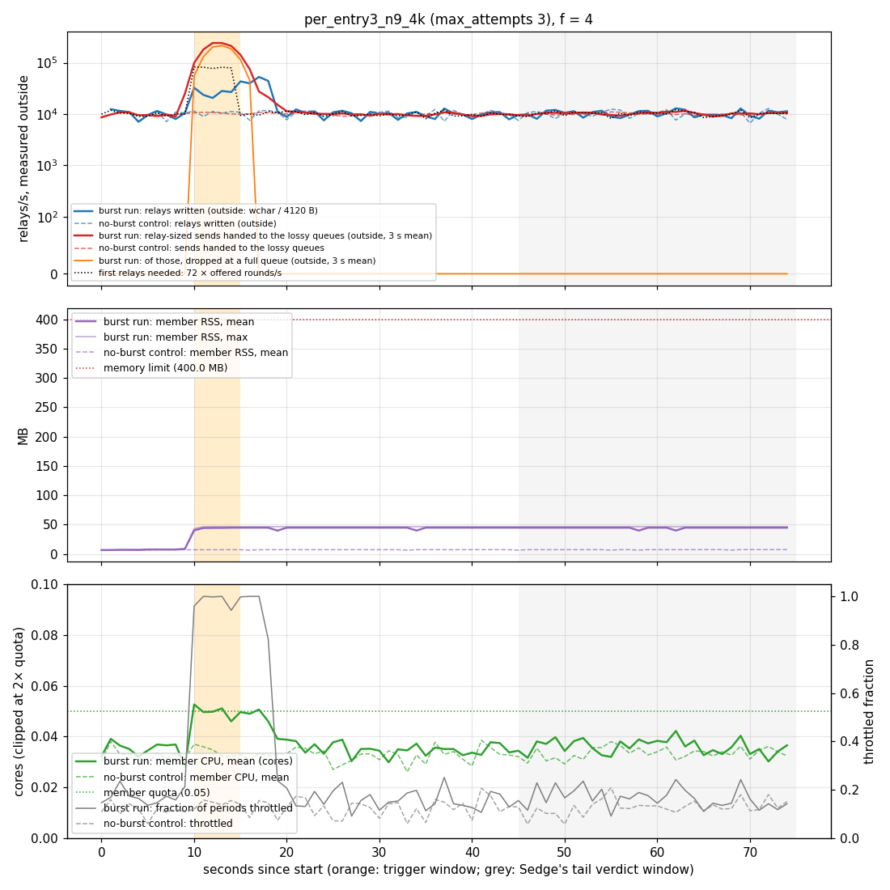

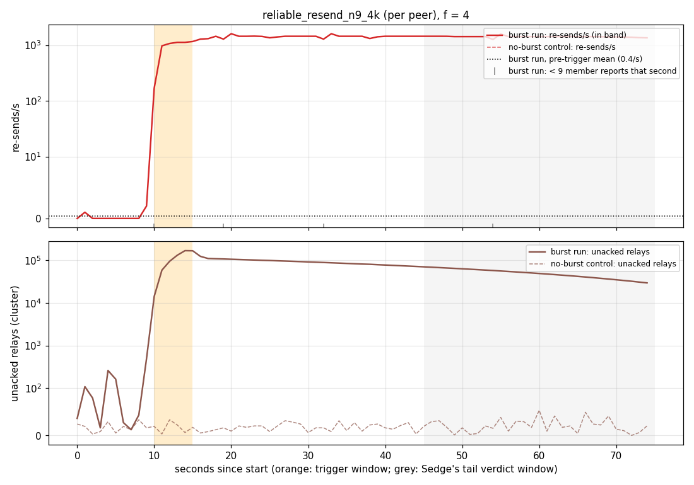

The remaining figures (`*_streams.png`, `*_tail.png` and `*_resends.png` for every pair) are in
[`demo_relay_broadcast/`](demo_relay_broadcast/).

### CPU headroom at baseline

A member's cost per round falls as load rises, because each tick handles a larger batch. So
under a fixed quota it uses nearly all of the quota at low f. Under the old cap (0.01 per
100 ms, unbounded buffers) the mean throttled fraction at baseline was 0.98–1.0 at f = 1.5–2,
0.80–0.94 at f = 3 and 0.60–0.85 at f = 4.

The new cap (0.05 per 20 ms) gives real headroom from f = 3 on. From the `per_entry` controls,
over 30–75 s (`summarize.py`'s tail):

| f | λ | member CPU / quota | throttled fraction | mean freeze |
|---|---|---|---|---|
| 1.5 | 377.1 | 1.00 | 0.86 | 13.5 ms |
| 2 | 282.9 | 0.97 | 0.60 | 10.0 ms |
| 3 | 188.6 | 0.82 | 0.25 | 7.8 ms |
| 4 | 141.4 | 0.66 | 0.12 | 7.2 ms |
| 6 | 94.3 | 0.51 | 0.07 | 7.2 ms |
| 8 | 70.7 | 0.39 | 0.03 | 7.5 ms |

At f ≤ 2 the members are still near the quota at baseline. Real headroom there was not
achieved under this cap. The collapse does not need it to be absent, though: at f = 8 a member
uses 39 % of its quota without the burst, and after the burst it is pinned at 100 %.

## 5. Discussion

**The previous collapse was not caused by retries.** The previous version of this demo found
`ReliableResend` collapsing at f ≤ 2 after a burst, and its own analysis already saw the
re-sends die down while the backlog kept growing. The cause was the program's state, not its
retry policy. The outstanding table was tick-scoped state, rebuilt and filtered in full on
every tick, so every tick cost work proportional to the backlog, and the members' outgoing
messages starved behind it. With the table made persistent (old cap, unbounded buffers):

- the same configuration and burst recover at every f tried (1.25, 1.5, 2 and 4);
- they also recover from a burst four times as long, which builds a 250 k-entry backlog;
- re-sends, capped at one per peer per timer tick, add about 270/s across the cluster, about
  4 % of normal traffic, far below the headroom.

Cress does not model per-tick cost, since it counts messages, so it could not have seen this.
Data: `relay_broadcast_amplification/README.md`, Part 1. Under this demo's deployment the
per-peer policy still does not collapse: it drains at its cap (§4).

**Retries that grow with the backlog, with unbounded buffers: a crash.**
`ReliableResendPerEntry` re-sends every overdue relay. After a burst, with unbounded send
buffers, it fell into a re-send storm of 6–10 k/s at every f from 1.5 to 4. But the storm piled
up in user-space send buffers instead of on the wire, and members were OOM-killed at 400 MB
30–45 s after the burst. Those runs are crashes, not collapses, and are reported as INVALID.
Bounded, back-pressuring buffers deadlocked the members instead.

**With lossy buffers: a collapse that holds without a crash.** With `lossy:1024:Member`, the
storm is no longer stored. It is produced and thrown away. Member RSS settles near 95 MB, no
node dies, and the collapsed state holds through the whole 60 s tail at every f. The storm is
still not on the wire in bytes: the kernel writes fall to 0.6–5 % of baseline. What is
amplified is the work of producing re-sends: 350–395 k relay-sized sends per second across the
cluster, about 40× baseline at f = 4, which uses the whole CPU quota. The queues drop them
because every peer is busy doing the same thing.

**The boundary is in the trigger, not in f.** Round 1 found no f at which a 2μ, 5 s burst
leaves `per_entry` unstuck, from f = 1.5 to 8, and round 2 repeats that at f = 2, 4 and 8
(9/9). On isolated cores at f = 4, the trigger has to be made small before any trial escapes:
4/5 stuck at 1.5μ for 1 s, and 3/5 still stuck after 180 s at 2μ for 0.5 s. The same small
trigger produces both endings: seed 32 storms on the wire for 100 s and drains, and seed 34
storms for 150 s and falls into the black hole (§4, headline).

**The capped variant storms but does not stick.** `per_entry3` caps each relay at three
sends. With a retry cap of 3 the storm always drained: it never got stuck in 180 s, and no
trial reached a black hole. How long the storm lasts depends on 3λ/μ, the re-send load at the
cap relative to capacity. It lasts a few seconds below 1, 18–39 s at 1.35, and 16 s to more
than 60 s at 1.5. Given the μ
uncertainty, the regime where the storm outlasts the trigger flips at 3λ/μ ≈ 1.0–1.35.

**Conclusion.** The amplification Cress identifies is what the members spend their capacity
on after the burst, and it sustains the collapse:

- In the storm, the amplified re-sends are on the wire: about 3× the kernel writes for as long
  as 150 s.
- In the black hole, the same loop runs, but almost all of its output is dropped at full
  queues. The acks that would end it are lost with everything else, so it never ends within
  the run.
- Changing only the retry policy changes the outcome. Capped growth (`per_entry3`, Cress
  *growth stops*) storms and ends, and the per-peer cap recovers (round 2, 180 s tails).

What this evidence does **not** show is amplified bytes on the wire *in the black hole*. There
the kernel writes fall to a few percent, and the amplification is visible only in the
transport's attempted-send counters and in CPU pinned at the quota.

**Caveats.**

- **One host.** Round 1 ran each point once, round 2 3 times at most, and round 3 5 times.
  Rounds 1 and 2 did not isolate SMT siblings. Each round-3 boundary rests on 5 seeds of one
  slot.
- **μ is uncertain by about 19 %** (654–778 on one slot), so every boundary in units of μ is a
  range.
- **Kernel writes fall.** In the `per_entry` collapse the members write 0.6–5 % of their
  baseline bytes. The amplified sends are counted by the transport's lossy queue, inside the
  member process but outside the program's dataflow. They are not counted by the kernel.
- **The in-band reports go dark** in every `per_entry` collapse, so Cress's `merged` and
  `acks_sent` streams cannot be measured there.
- **The source's backlog grows.** The collapsed members read slowly, so the source's sends to
  them queue in the uncapped source. In round 1 its RSS reaches 722 MB at f = 1.5 by 75 s
  (limit 2000 MB), and it hands the members only 18–49 % of the offered requests at f ≤ 4
  (`summarize.py`'s `intake`). It keeps growing while a black hole lasts: in the longest one
  (seed 31, 180 s tail) it reached 552 MB. No node died in any of the final runs.
- **`per_entry3` at f = 2 storms for longer than a 60 s tail.** In five 180 s tails it ended
  within 16–66 s.
- Cress's verdict was computed on a reduced workload with empty bodies, and it models delay,
  not loss (§3).
- HydroFrac's "no violation found" covers sampled schedules at 3 members and 2 ids.
