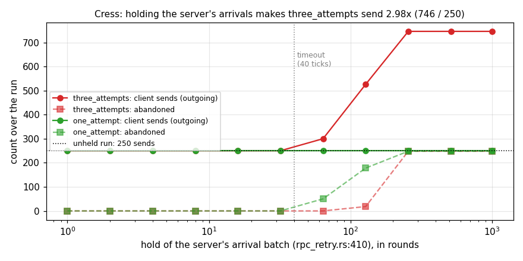
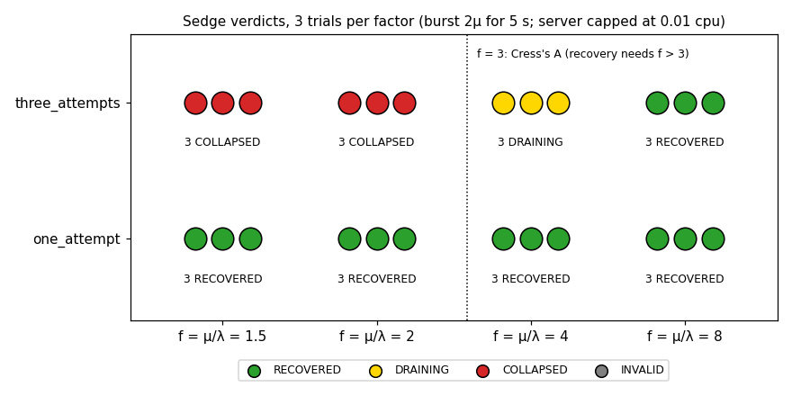
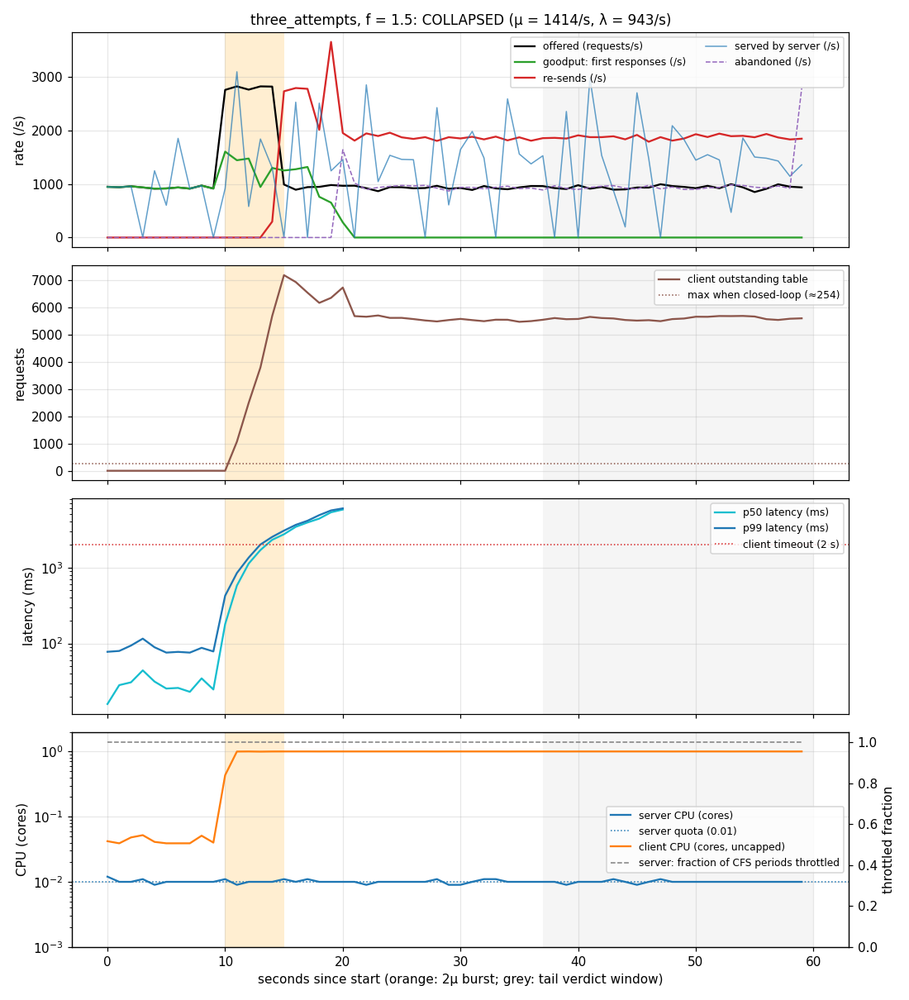
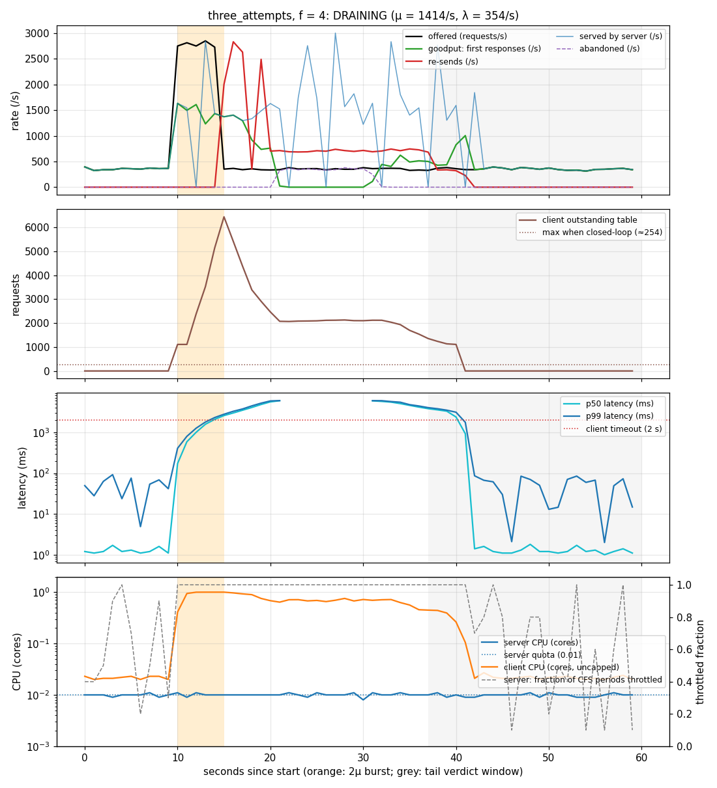
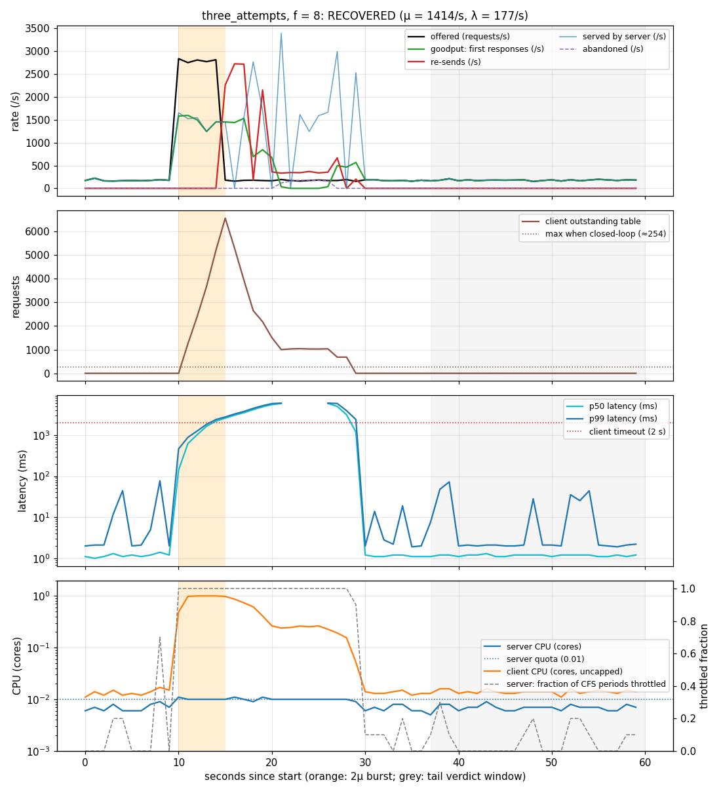
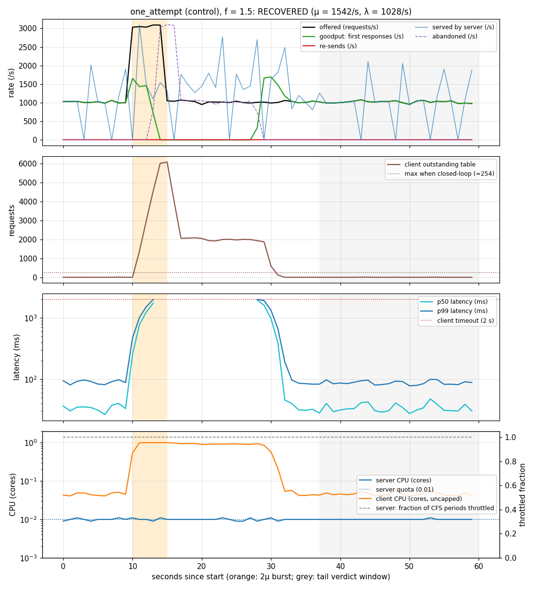

# Demo: `rpc_retry` under HydroFrac, Cress and Sedge, with capacity imposed from outside

This demo runs one program, `hydro_test/src/cluster/rpc_retry.rs`, through the three tools. The
program contains **no capacity code**. Sedge gives the server a CPU quota from outside, in a Docker
container, and offers the client an open-loop workload. Cress predicts from the program's text
that the retry policy amplifies delay by about 3×. Sedge confirms it: under a load burst the
three-attempt policy collapses below headroom 3 and recovers above it, and the one-attempt control
always recovers.

Contents:

1. [The program](#1-the-program)
2. [HydroFrac](#2-hydrofrac)
3. [Cress](#3-cress)
4. [Sedge](#4-sedge)
5. [Discussion](#5-discussion)

Everything here was produced on the branch `feat/hydrofrac-cress-sedge-e2e`. The host was 8 cores
(Intel Xeon Platinum 8375C), cgroup v1 and Docker 25. Raw data:
[`rpc_retry/results.tsv`](rpc_retry/results.tsv), [`rpc_retry/probes.tsv`](rpc_retry/probes.tsv),
[`rpc_retry/traces/`](rpc_retry/traces/) (24 per-second traces), and
[`demo_rpc_retry/cress/`](demo_rpc_retry/cress/) (Cress's reports). The plots are made by
[`plot_sedge.py`](demo_rpc_retry/plot_sedge.py) and [`plot_cress.py`](demo_rpc_retry/plot_cress.py).

## 1. The program

`rpc_with_retries` is a request/response service with a client-side timeout-and-retry policy:

- **Client.** It receives application requests and gives each one an id. It sends each request to
  the server and records it in an *outstanding* table. On every tick of its logical clock (50 ms
  when deployed) it judges every outstanding request:
    - answered: complete it;
    - waiting less than `timeout_ticks` (40 ticks = 2 s): keep waiting;
    - otherwise, if it has been sent fewer than `max_attempts` times: send it again;
    - otherwise: abandon it.
- **Server.** On each tick it answers every request that has arrived, in arrival order, with a
  real handler: a SipHash digest of the request body (a checksum service). There is no queue, no
  per-tick cap and no simulated service time.
- **Configurations.**
    - `three_attempts` (`max_attempts: 3`) is the subject.
    - `one_attempt` (`max_attempts: 1`, never re-send) is the control.

Time enters only through stream parameters (`client_clock` and the two report ticks). The same
code therefore runs in the simulator (Cress, HydroFrac) and deployed (Sedge), where Sedge binds
the clocks to in-process `source_interval`s.

The client's timeout and retry decision (`rpc_retry.rs:331-350`):

```rust
// Everything still waiting is judged against the timeout exactly once per tick.
let judged = outstanding
    .filter_key_not_in(responded_ids)
    .into_keyed_stream()
    .cross_singleton(now_cur.clone())
    .map(q!(move |(inflight, now)| {
        if now - inflight.last_sent < timeout_ticks {
            Verdict::Keep(inflight)
        } else if inflight.attempt < max_attempts {
            Verdict::Retry(InFlight {
                body: inflight.body,
                first_sent: inflight.first_sent,
                last_sent: now,
                attempt: inflight.attempt + 1,
            })
        } else {
            Verdict::Abandon(inflight)
        }
    }));
```

The server: every arrival, every tick, through the handler (`rpc_retry.rs:404-419`, `:61-69`):

```rust
let incoming = outgoing.clone().send(server, TCP.fail_stop().bincode());

let processed = sliced! {
    let arrivals = use::batch(incoming, nondet!(/** batching only affects how many requests share a tick */));
    arrivals
};

responses_complete.complete(
    processed
        .clone()
        .map(q!(|req| crate::cluster::rpc_retry::handle(&req)))
        .send(client, TCP.fail_stop().bincode()),
);

/// The server's request handler: a SipHash digest of the whole body (a checksum service).
pub fn handle<T: std::hash::Hash>(req: &Request<T>) -> Response {
    use std::hash::{BuildHasher, BuildHasherDefault};
    let digest = BuildHasherDefault::<std::collections::hash_map::DefaultHasher>::default()
        .hash_one(&req.body);
    Response { id: req.id, digest }
}
```

The Sedge attribute (`rpc_retry.rs:246-259`). The `one_attempt` attribute is the same except for
`max_attempts: 1`:

```rust
#[cfg_attr(feature = "sedge", sedge::overload_check(
    name = three_attempts,
    T = Payload<4096>,                   // 4 KiB request bodies: the size of the offered load
    load = requests,
    mu = 1000,                           // only where the capacity probe starts
    cpus(Client = none, Server = 0.01),  // only the server gets a quota
    cpu_period_us = 100_000,             // 1 ms of CPU every 100 ms
    timers(
        client_clock = Duration::from_millis(50),
        client_report_tick = Duration::from_secs(1),
        server_report_tick = Duration::from_secs(1),
    ),
    policy = RetryPolicy { timeout_ticks: 40, max_attempts: 3 },
))]
```

**No capacity code.** An earlier version modelled the server's capacity inside the program: a
`ServerConfig { max_per_tick, service_time }` that served at most 50 requests per tick from an
in-program FIFO and burned 2 ms of CPU per request in a spin-loop. All of that is gone. What is
left is the protocol and a real handler. The server's capacity is whatever this code achieves on
the CPU the harness gives it: 1 % of a core.

## 2. HydroFrac

**There is no HydroFrac test for `rpc_retry` in the corpus, and HydroFrac has nothing to check
in it.**

- HydroFrac searches for fault sets (crashes, message omissions) that break a collection the
  program labels `EventualConsistency`. Those labels live on cluster-located collections: a
  `broadcast`, or an `assert_has_consistency_of`.
- `rpc_with_retries` is two processes and labels nothing. Its question is about load, not
  agreement under faults.

To show what HydroFrac produces for it, this demo adds `hydro_test/src/cluster/rpc_retry_ldfi.rs`.
The test runs HydroFrac against the automatic specification (`Spec::all_labels`) with both
processes crashable and asserts that no collection is labelled:

```
$ cargo test -p hydro_test --lib cluster::rpc_retry_ldfi -- --nocapture
...
hydrofrac: EventualConsistency results

rpc_with_retries under HydroFrac: 0.0s, 0 labelled collection(s)

test cluster::rpc_retry_ldfi::tests::rpc_retry_has_no_labels_for_hydrofrac ... ok

test result: ok. 1 passed; 0 failed; 0 ignored; 0 measured; 245 filtered out; finished in 49.35s
```

HydroFrac produces no plots for this program, because it has no counterexamples to draw.

One finding along the way: with the simulator's provenance rewrite on (`.with_provenance()`, which
the `relay_broadcast` searches use for their diagrams), compiling this program panics on its keyed
join:

```
thread 'cluster::rpc_retry_ldfi::tests::rpc_retry_has_no_labels_for_hydrofrac' panicked at hydro_lang/src/sim/provenance.rs:1053:21:
assertion `left == right` failed: provenance rewrite: keyed join output
  left: Keyed
 right: Flat
```

The test therefore runs without provenance. The provenance rewrite's support for
`join_keyed_singleton` is a gap to fix in HydroFrac.

## 3. Cress

Cress runs the program in the simulator and asks whether delay causes extra work. It holds each
decision point (each `use::batch` / `use::snapshot`) for a range of lengths and counts the extra
messages against the unheld run.

The setup comes from the `amplification_check` attributes (`rpc_retry.rs:232-245`):

- Two configurations: `three_attempts` and `one_attempt`, both with `timeout_ticks: 40`.
- Workload: 2 requests per round for the first 125 rounds (250 requests), and timer elements
  only after that. The run lasts 1000 rounds.
- Hooks: the client's clock, request and response batches (`:302`, `:304`, `:305`), the server's
  arrival batch (`:410`), the metrics batches (`:423`-`:449`), and one snapshot (`:452`, not
  holdable).
- Hold lengths: 1, 2, 4, …, 512 and 999 rounds, each starting at round 1.

```
$ ./scripts/cress hydro_test rpc_with_retries
Checking rpc_with_retries (one_attempt)…
Checking rpc_with_retries (three_attempts)…
✓ BENIGN  rpc_with_retries (one_attempt)  growth: -  multiplier: -  location: -
    outputs: conserved: outgoing, processed; amplified: abandoned; level: outstanding_trace; shed: completed, client_metrics, server_metrics
! HAZARDOUS  rpc_with_retries (three_attempts)  growth: stops  multiplier: 2.98x  location: hydro_test/src/cluster/rpc_retry.rs:410, batch of Request<u64>
    outputs: amplified: abandoned, outgoing, processed; level: outstanding_trace; shed: completed, client_metrics, server_metrics
```

The full report for `three_attempts`, trimmed to the two hooks that react (the file is
[`demo_rpc_retry/cress/`](demo_rpc_retry/cress/)`hydro_test.rpc_with_retries.three_attempts.*.txt`):

```
hold length (rounds)                      1      2      4      8     16     32     64    128    256    512    999
hydro_test/src/cluster/rpc_retry.rs:302, batch of (usize, ()): no extra work at any hold length
hydro_test/src/cluster/rpc_retry.rs:304, batch of (usize, u64): no extra work at any hold length
hydro_test/src/cluster/rpc_retry.rs:305, batch of Response
    extra records admitted                0      0      0      0      0      0    240   1360   2480   2480   1736
    extra messages, busiest sender        0      0      0      0      0      0     48    272    496    496    496
    extra messages, all senders           0      0      0      0      0      0     96    544    992    992    992
    first reacted at a hold of 64 rounds with 240 extra; ...
    multiplier: 2.98× the unheld run's 250 sends from Process(loc2v1) (+496 at a hold of 999 rounds)
hydro_test/src/cluster/rpc_retry.rs:410, batch of Request<u64>
    extra records admitted                0      0      0      0      0      0    250   1380   2480   2480    248
    extra messages, busiest sender        0      0      0      0      0      0     50    276    496    496    496
    extra messages, all senders           0      0      0      0      0      0    100    552    992    992    248
    first reacted at a hold of 64 rounds with 250 extra; ...
    beyond the input (holds 128, 256, 512): extra sends from Process(loc2v1) stops: ceiling 496 from a hold of 256 rounds, ...
    multiplier: 2.98× the unheld run's 250 sends from Process(loc2v1) (+496 at a hold of 512 rounds)
...
outgoing (amplified, unheld 250)
    hydro_test/src/cluster/rpc_retry.rs:410, batch of Request<u64>    250    250    250    250    250    250    300    526    746    746    746
```



**Reading.**

- **`three_attempts` is HAZARDOUS.** Holding the server's arrival batch (`rpc_retry.rs:410`, the
  `use::batch(incoming, …)` above) for longer than the 40-tick timeout makes the client re-send.
    - Below a hold of 64 rounds nothing happens.
    - At 64 the first requests time out.
    - From 256 rounds on, every one of the 248 requests stuck behind the hold is sent twice more:
      250 + 2 × 248 = 746 sends, **2.98×** the unheld 250.
    - The growth *stops* at that ceiling because each request is sent at most three times. That is
      the multiplier A = 3 that Sedge's prediction uses.
    - The client's response batch (`:305`) shows the same shape: delaying responses is
      indistinguishable from delaying requests.
- **`one_attempt` is BENIGN.** The same holds only make it abandon requests; it never sends
  more.
- **Location.** Before the rewrite, Cress reported the same hook at `rpc_retry.rs:391`. The line
  moved because the file changed; the hook (the server's arrival batch), the verdict and the
  multiplier did not. Removing the capacity code did not change Cress's answer, because Cress
  counts work, not time.
- One shape did change: a hold of 128 now adds 276 sends instead of 496. Without a capacity, the
  server answers the whole held batch the moment it is released, so only requests held past two
  timeouts are re-sent twice.

## 4. Sedge

### Configuration

- **Capacity from outside.**
    - Each deployed process runs in its own Docker container (`--network host`) on cores 4-7.
    - The **server** gets a CFS quota of 1 ms per 100 ms (0.01 cores). The quota is set at
      container start and stays fixed for the run.
    - The **client** gets **no quota**. It stands for the callers offering the load.
    - The load generator, the observer and the relay run on cores 0-3.
- **μ is measured.** Before the sweep, a probe deploys each configuration at constant rates and
  searches for the highest one at which goodput is at least 95 %, the outstanding table stays
  flat, and every request enters the client on time:
    - `one_attempt`: μ = 1542 requests/s;
    - `three_attempts`: μ = 1414 requests/s.

  The results are cached in `calibration.tsv` ([`probes.tsv`](rpc_retry/probes.tsv)).
- **Open-loop workload.** Poisson arrivals at the profile's rate, each request a 4 KiB body.
    - The generator queues each request at its scheduled time on an unbounded channel and never
      waits.
    - The program's nodes run with `HYDRO_DEPLOY_SEND_BUFFER=unbounded`: every outgoing connection
      is an unbounded in-memory queue. A slow server therefore never stalls the client, the client
      takes every request into its outstanding table on schedule, and the backlog forms *behind*
      the client's timeout.
    - Every trial checks this: the lag between a request's scheduled arrival and its write into the
      client was at most 15 ms in every trial.
- **Profile** (defaults):
    - 10 s at λ = μ/f;
    - a **burst** at 2μ for 5 s;
    - 45 s at λ again.

  The verdict compares the second half of the tail ([37.5 s, 60 s)) with the baseline
  ([5 s, 10 s)). The burst is the trigger; no CPU dip is used.
- **Timers.** The client's 50 ms clock and the report ticks run in-process.

### The sweep (published table)

```
$ ./scripts/cress hydro_test rpc_with_retries
$ ./scripts/sedge --recalibrate --probe-start 1000 --factors 1.5,2,4,8 --trials 3 hydro_test rpc_with_retries
```

```
function                 configuration    trigger      factor        μ    μ from        λ recovered draining collapsed invalid
rpc_with_retries         one_attempt      burst           1.5   1542.2  measured   1028.1         3        0         0       0
rpc_with_retries         one_attempt      burst             2   1542.2  measured    771.1         3        0         0       0
rpc_with_retries         one_attempt      burst             4   1542.2  measured    385.6         3        0         0       0
rpc_with_retries         one_attempt      burst             8   1542.2  measured    192.8         3        0         0       0
rpc_with_retries         three_attempts   burst           1.5   1414.2  measured    942.8         0        0         3       0
rpc_with_retries         three_attempts   burst             2   1414.2  measured    707.1         0        0         3       0
rpc_with_retries         three_attempts   burst             4   1414.2  measured    353.6         0        3         0       0
rpc_with_retries         three_attempts   burst             8   1414.2  measured    176.8         3        0         0       0
limits: Client: uncapped on cpus 4-7; Server: 0.010 cpu (1000us/100000us) on cpus 4-7
```

Per trial, from the traces (CPU is the mean over the run and the peak one-second value; "server throttled" is the largest fraction of its CFS periods in which the kernel throttled it):

| config | f | outcome | re-sends in the run | peak outstanding | client CPU mean / peak | server throttled |
|---|---|---|---|---|---|---|
| `three_attempts` | 1.5 | 3 × COLLAPSED | 89 k – 91 k | 7.0 k – 7.4 k | 0.80 / 1.00 cores | 100 % of periods |
| `three_attempts` | 2 | 3 × COLLAPSED | 68 k – 71 k | 6.8 k – 7.4 k | 0.80 / 1.00 | 100 % |
| `three_attempts` | 4 | 3 × DRAINING | 24 k – 28 k | 6.4 k – 6.8 k | 0.36–0.41 / 1.00 | 80–85 % |
| `three_attempts` | 8 | 3 × RECOVERED | 13 k – 18 k (all in the burst) | 6.6 k – 7.2 k | 0.17–0.20 / 1.00 | 39–44 % |
| `one_attempt` | 1.5, 2 | 6 × RECOVERED | 0 | 6.0 k – 6.1 k | 0.22–0.37 / 1.00 | 99–100 % |
| `one_attempt` | 4, 8 | 6 × RECOVERED | 0 | 6.0 k – 6.1 k | 0.11–0.14 / 1.00 | 25–88 % |

In every trial, the server is the only node the kernel throttled; the client was never throttled.



### A showcase run, verbatim

Four trials: f = 1.5 and f = 8, one trial each, with μ taken from the cache (no `--recalibrate`).
The console output is trimmed only of the per-node launch lines and the compiler warnings from
building the deployed binaries, and the end-of-run reprint of every verdict is cut (`...`):

```
$ ./scripts/sedge --factors 1.5,8 --trials 1 hydro_test rpc_with_retries
  harness pinned to cpus 0-3
Running rpc_with_retries (one_attempt) at factors [1.5, 8.0], 1 trial(s) each…
  μ = 1542.2 rounds/s, cached for docker;Client=-,Server=1000/100000;cpuset=4-7;mem=- on dev-dsk-palvarox-2a-f73e3c71.us-west-2.amazon.com/8c/Intel(R) Xeon(R) Platinum 8375C CPU @ 2.90GHz
  factor 1.5, trial 0: μ = 1542.2 rounds/s (cached), λ = 1028.1 rounds/s, trigger 5s of burst 2×μ, tail 45s
  stream kinds from /tmp/.tmpJJqznj/target/cress/conservation.tsv: abandoned=amplified, client_metrics=work, completed=work, outgoing=conserved, outstanding_trace=level, processed=conserved, server_metrics=work
  [burst] DRAINING: goodput at 100% of baseline; outstanding falling at 75/s, about 1s from empty; served at 1131.0/s against 1043.2/s
  baseline [5s, 10s): offered 5075 completed 5075 (100.0%) abandoned 0 outstanding 0 p50 101.0ms p99 323.7ms
    outstanding (level): mean 152 in the first half, 162 in the second
    retried (work): 0.0/s
    sent (work): 1011.6/s
    served (work): 1043.2/s
  tail [37s, 60s): offered 23476 completed 23423 (99.8%) abandoned 53 outstanding 0 p50 65.6ms p99 1897.5ms
    outstanding (level): mean 932 in the first half, 69 in the second
    retried (work): 0.0/s
    sent (work): 1019.2/s
    served (work): 1131.0/s
  outstanding at end: 0
    open loop: yes; 0 records entered late, worst lag 20.2 ms; max levels: outstanding=6038
    Client (uncapped on cpus 4-7): 0.526 cores mean, throttled in 0% of periods (0 ms)
    Server (0.010 cpu (1000us/100000us) on cpus 4-7): 0.010 cores mean, throttled in 99% of periods (61601 ms)
  factor 8, trial 0: μ = 1542.2 rounds/s (cached), λ = 192.8 rounds/s, trigger 5s of burst 2×μ, tail 45s
  stream kinds from /tmp/.tmpJJqznj/target/cress/conservation.tsv: abandoned=amplified, client_metrics=work, completed=work, outgoing=conserved, outstanding_trace=level, processed=conserved, server_metrics=work
  [burst] RECOVERED: tail goodput is 100% of baseline, median latency 1ms against 1ms, no abandonments, sent at 183.8/s against 153.4/s
  baseline [5s, 10s): offered 970 completed 970 (100.0%) abandoned 0 outstanding 0 p50 1.3ms p99 51.9ms
    outstanding (level): mean 0 in the first half, 0 in the second
    retried (work): 0.0/s
    sent (work): 153.4/s
    served (work): 194.4/s
  tail [37s, 60s): offered 4416 completed 4416 (100.0%) abandoned 0 outstanding 0 p50 1.5ms p99 58.9ms
    outstanding (level): mean 0 in the first half, 0 in the second
    retried (work): 0.0/s
    sent (work): 183.8/s
    served (work): 192.0/s
  outstanding at end: 0
    open loop: yes; 0 records entered late, worst lag 27.7 ms; max levels: outstanding=5989
    Client (uncapped on cpus 4-7): 0.123 cores mean, throttled in 0% of periods (0 ms)
    Server (0.010 cpu (1000us/100000us) on cpus 4-7): 0.009 cores mean, throttled in 57% of periods (21283 ms)
Running rpc_with_retries (three_attempts) at factors [1.5, 8.0], 1 trial(s) each…
  μ = 1414.2 rounds/s, cached for docker;Client=-,Server=1000/100000;cpuset=4-7;mem=- on dev-dsk-palvarox-2a-f73e3c71.us-west-2.amazon.com/8c/Intel(R) Xeon(R) Platinum 8375C CPU @ 2.90GHz
  factor 1.5, trial 0: μ = 1414.2 rounds/s (cached), λ = 942.8 rounds/s, trigger 5s of burst 2×μ, tail 45s
  stream kinds from /tmp/.tmpJJqznj/target/cress/conservation.tsv: abandoned=amplified, client_metrics=work, completed=work, outgoing=amplified, outstanding_trace=level, processed=amplified, server_metrics=work
  [burst] INVALID: not open-loop: 124 of 65573 records entered the program more than 50 ms after their scheduled arrival (worst 94 ms), so the offered load was paced by the program (the program's own reading was COLLAPSED: retried at 1876.5/s against 0.0/s through the tail, goodput at 0% of baseline, median latency - against 39ms)
  baseline [5s, 10s): offered 4659 completed 4659 (100.0%) abandoned 0 outstanding 0 p50 38.5ms p99 112.1ms
    outstanding (level): mean 7 in the first half, 13 in the second
    retried (work): 0.0/s
    sent (work): 931.8/s
    served (work): 939.2/s
  tail [37s, 60s): offered 21603 completed 0 (0.0%) abandoned 17790 outstanding 3813 p50 - p99 -
    outstanding (level): mean 5568 in the first half, 5630 in the second
    retried (work): 1876.5/s
    sent (work): 2817.5/s
    served (work): 889.0/s
  outstanding at end: 3813
    open loop: NO; 124 records entered late, worst lag 93.6 ms; max levels: outstanding=8697
    Client (uncapped on cpus 4-7): 0.816 cores mean, throttled in 0% of periods (0 ms)
    Server (0.010 cpu (1000us/100000us) on cpus 4-7): 0.010 cores mean, throttled in 100% of periods (55351 ms)
  factor 8, trial 0: μ = 1414.2 rounds/s (cached), λ = 176.8 rounds/s, trigger 5s of burst 2×μ, tail 45s
  stream kinds from /tmp/.tmpJJqznj/target/cress/conservation.tsv: abandoned=amplified, client_metrics=work, completed=work, outgoing=amplified, outstanding_trace=level, processed=amplified, server_metrics=work
  [burst] DRAINING: goodput at 36% of baseline; outstanding falling at 6/s, about 176s from empty; retried at 350.3/s against 0.0/s
  baseline [5s, 10s): offered 878 completed 878 (100.0%) abandoned 0 outstanding 0 p50 1.4ms p99 24.2ms
    outstanding (level): mean 0 in the first half, 0 in the second
    retried (work): 0.0/s
    sent (work): 175.6/s
    served (work): 175.6/s
  tail [37s, 60s): offered 4114 completed 1497 (36.4%) abandoned 2617 outstanding 0 p50 3801.0ms p99 5904.8ms
    outstanding (level): mean 1054 in the first half, 990 in the second
    retried (work): 350.3/s
    sent (work): 529.1/s
    served (work): 1118.3/s
  outstanding at end: 0
    open loop: yes; 0 records entered late, worst lag 42.1 ms; max levels: outstanding=8998
    Client (uncapped on cpus 4-7): 0.363 cores mean, throttled in 0% of periods (0 ms)
    Server (0.010 cpu (1000us/100000us) on cpus 4-7): 0.010 cores mean, throttled in 87% of periods (51455 ms)
...
function                 configuration    trigger      factor        μ    μ from        λ recovered draining collapsed invalid
rpc_with_retries         one_attempt      burst           1.5   1542.2    cached   1028.1         0        1         0       0
rpc_with_retries         one_attempt      burst             8   1542.2    cached    192.8         1        0         0       0
rpc_with_retries         three_attempts   burst           1.5   1414.2    cached    942.8         0        0         0       1
rpc_with_retries         three_attempts   burst             8   1414.2    cached    176.8         0        1         0       0
limits: Client: uncapped on cpus 4-7; Server: 0.010 cpu (1000us/100000us) on cpus 4-7
host: dev-dsk-palvarox-2a-f73e3c71.us-west-2.amazon.com/8c/Intel(R) Xeon(R) Platinum 8375C CPU @ 2.90GHz
```

Raw data: [`demo_rpc_retry/showcase/`](demo_rpc_retry/showcase/).

**This showcase disagrees with the published sweep, and the disagreement is itself a finding.**

- It ran right after a one-time rebuild of the deployed binaries, on a shared host that was busy:
  load average 6.9–7.5 against about 1 when the sweep ran, and `vmstat` showing 40 % user CPU
  from other jobs.
- It reused the *cached* μ, which had been measured on the quiet host.
- Under the load, the server's 1 ms of CPU per 100 ms did less work. Baseline latency at
  `one_attempt` f = 1.5 was 101 ms here, against 33 ms in the sweep. So the true headroom was
  below the nominal f, and the outcomes moved accordingly:
  - `three_attempts` f = 8 re-sent 350/s through the tail and read DRAINING (36 % goodput),
    instead of RECOVERED;
  - `one_attempt` f = 1.5 was still draining at 60 s.
- `three_attempts` f = 1.5 still collapsed: 1877 re-sends/s, 0 % goodput, 3813 outstanding at
  the end. But the open-loop check marked it **INVALID**: the client, near its one-core ceiling,
  let 124 of 65 573 requests (0.19 %, against a 0.1 % limit) enter more than 50 ms late, the worst
  by 94 ms.

The lessons: re-measure μ (`--recalibrate`) whenever the host's state may have changed, and treat
the open-loop check as a real gate. The published table above was taken on a quiet host with a
freshly measured μ.


### Time series

All four plots share the layout. The orange band is the 2μ burst ([10 s, 15 s)), and the grey band
is the verdict's tail window. The panels, top to bottom:

1. Rates: offered, goodput (first responses), re-sends, served by the server, and abandoned.
2. The client's outstanding table.
3. Completion latency, p50 and p99.
4. CPU: the server against its quota, the client (uncapped), and the fraction of the server's CFS
   periods that were throttled.

The server's "served" line is jagged because the server reports once a second and runs only 1 ms
in every 100 ms.

**COLLAPSED: `three_attempts`, f = 1.5** (λ = 943/s against μ = 1414/s).

- The burst fills the client's table to about 7 k requests, and latency passes the 2 s timeout.
- Re-sends start at 14 s and never stop: about 1900/s through the tail, against 0 in the
  baseline.
- Offered load plus re-sends (≈ 2850/s) is twice what the server can serve (≈ 1400/s, its line
  through the tail). Every request is sent three times and then abandoned, so goodput is 0 from
  21 s on, and the load stays at 943/s.



**DRAINING: `three_attempts`, f = 4** (λ = 354/s).

- The burst triggers the same re-sends.
- With 4× headroom, the server works through original requests and re-sends faster than they
  arrive. Goodput returns, and the outstanding table falls through the tail.
- A few re-sends (83–222/s) are still in flight at the end of the 45 s tail, so the verdict is
  DRAINING. A longer tail would read RECOVERED.



**RECOVERED: `three_attempts`, f = 8** (λ = 177/s). The re-sends are confined to the burst and the
few seconds after it. By about 25 s the system is back at baseline.



**Control: `one_attempt`, f = 1.5** (λ = 1028/s against μ = 1542/s).

- The same burst, at an even higher baseline, fills the table to 6 k requests. Requests time out
  and are abandoned; none is re-sent.
- The server catches up by about 30 s, and latency and goodput return to baseline.
- The client's CPU peaks at 1 core during the burst, as it does in the collapsed run, and drops
  back.



## 5. Discussion

**Why it collapses.**

- The burst puts more requests in the client's table than the server can answer before the 2 s
  timeout. The client re-sends them.
- Re-sends are requests too: they join the same queue in front of the server and push latency
  further past the timeout, which causes more re-sends.
- With three sends per request, the server is offered up to 3λ. Below headroom f = μ/λ = 3 that
  is more than it can serve, so the loop sustains itself after the burst ends. Every request then
  times out three times and is abandoned.
- Above f = 3 the server can absorb 3λ, so the backlog drains (slowly at f = 4, quickly at f = 8).
- The control never re-sends and always recovers, at every headroom.

This is the classic retry-storm metastable failure. Here it comes out of the protocol alone,
running on a slow machine.

**The closed-loop finding.** The first attempt at this experiment did not collapse at any
headroom, and it did not re-send a single request.

- The cause: by default, Hydro's TCP channels push back. When the server's socket fills, the
  client's dataflow waits for it. The client then stops reading its own input, and the generator
  blocks.
- The whole client side was therefore rate-limited by the server, and the workload was closed
  loop. The burst's backlog, about 70 k requests, waited *in front of* the client, where no
  timeout runs. The client's outstanding table never passed about 254 entries.
- The old program collapsed only because its in-program FIFO accepted everything behind the
  client's timer.

The fix is in the harness and the environment, not in the program:

- an open-loop feed that never waits on a socket;
- unbounded send queues in the deployment's network layer, the way RPC stacks buffer sends;
- a per-trial check that every request entered the client within 50 ms of its scheduled arrival.

With those in place the outstanding table reaches 6–7 k entries and the collapse appears. **A
closed-loop load generator hides metastable failures.**

**Why only the server is capped.**

- The question is what happens when the *server* is short of capacity. The client stands for the
  callers, and capping it would make it a second, artificial bottleneck.
- The server's quota is the only thing the kernel throttled. It was throttled in 96–100 % of its
  periods whenever it was busy, while the client was throttled in none.

**Caveat: the client's own cost.**

- The client is uncapped, but it is single-threaded: Hydro deploys each process on a
  current-thread runtime. With thousands of requests outstanding, it rebuilds and re-judges its
  whole table, 4 KiB bodies included, on every tick. It averages 0.8 cores during the collapse
  and peaks at its 1-core ceiling.
- The control shows the same peaks and still recovers, so the client's cost is not what collapses
  the system.
- But it limits the experiment. At a higher server capacity (μ ≈ 6 k/s, server at 0.04 cores),
  the client, not the server, becomes the bottleneck. The open-loop check then flags the runs as
  INVALID, because requests can no longer enter the client on time. Experiments with higher μ
  need a cheaper client table (for example, keeping request bodies out of the per-tick state) or
  several client processes.

**Agreement with Cress.**

- Cress predicted, from the simulator alone, that `three_attempts` amplifies delay with
  multiplier A = 2.98 ≈ 3 at the server's arrival batch, and that `one_attempt` does not.
- Cress's prediction for a plateau shape is that a deployment recovers iff f > A.
- Sedge, against measured μ, finds: collapse at f = 1.5 and 2, slow draining at f = 4 (just above
  3), recovery at f = 8, and the control recovering everywhere.
- Cress's verdicts and multiplier were the same before and after the capacity code was removed.

**Limitations.**

- Sampled, not certified:
    - three trials per factor;
    - one host, shared with other jobs (calibration noise between the two configurations' μ was
      about 9 %);
    - one request size (4 KiB) and one timeout.
- The 100 ms CFS period is needed for a quota below 0.1 cores, because the kernel's smallest
  quota is 1 ms. It makes the server bursty within a period (it runs for 1 ms, then waits up
  to 99 ms), which is still well below the 2 s timeout.
- f = 4 needs a tail longer than 45 s to reach a verdict.
- Memory grows during a collapse: the client's outstanding table and its unbounded send queue to
  the server peaked at about 360 MiB in a 60 s trial (`docker stats`, sampled every 10 s).
  Longer runs need a memory limit, and an OOM would itself be a collapse mode.
- HydroFrac does not apply to this program (no consistency labels), and its provenance rewrite
  does not yet support its keyed join.

**Next steps.**

1. Make the client's per-tick work independent of request size, so that higher μ can be tested
   without the client becoming the bottleneck.
2. An adaptive tail that stops a decided trial early, which would cut the sweep's ~30 minutes of
   trials roughly in half.
3. Apply the same treatment (remove the in-program capacity, cap only the resource under test,
   open-loop feed) to the rest of the corpus, and publish a before/after table of verdicts.
