# Hydrofrac on the EC corpus: worked examples

This document is a gallery. It walks through every protocol in the `EventualConsistency` corpus, shows what `Spec::all_labels` reports on each labelled collection, and reproduces the counterexample diagrams so that the verdicts can be read rather than taken on faith. For how to write and run a harness see [hydrofrac.md](hydrofrac.md); for why the search is shaped the way it is see [hydrofrac-retrospective.md](hydrofrac-retrospective.md); for the renderer itself see [molly-viz.md](molly-viz.md).

Every transcript below is quoted verbatim from `molly-viz-samples/ec/output/*.txt`, one file per test. Every diagram is a committed file under `molly-viz-samples/`. Hypothesis counts include the failure-free probe; under `Fuzz` they vary by one or two between runs, and each such difference is noted.

## How to read a counterexample

A search ends in one of six verdicts: **Certified** (no admissible fault set breaks the generated check under any explored schedule), **Violated** (a concrete fault set and a concrete failing run), **No violation under `Fuzz`** (evidence, printed as `CERTIFICATE … sampled schedules`, not a proof), **Budget** (the hypothesis cap was hit; says nothing), **Vacuous** (the failure-free probe held no facts; a statement about the harness, not the protocol) and **Not checked** (the collection is outside the generated specification's class, with the reason printed). The judgement table in [hydrofrac.md](hydrofrac.md) says what each is worth.

A verdict line names the collection by the source location where the label enters or exits the type, the cluster it lives on, the IR operator, and whether the node is where the label is introduced (`minted`), where it leaves the labelled region (`delivered`), or both:

```
EventualConsistency at reliable_broadcast.rs:149 (Cluster(loc2v1), Unique, delivered): CERTIFICATE, 36 hypotheses, exhaustive
```

A `VIOLATED` line names the fault set. A crash is `crash(node after channel[from→to]:payload)`: the node performs every send up to and including that one and nothing after. An omission is `omit(channel[from→to]:payload)`: every byte-identical copy on that channel is dropped while finite failures last.

The failing run is drawn as a Lamport diagram, `failing.png` in the counterexample's gallery directory. One lane per node, time downward, one arrow per message:

- A solid black arrow is a delivered message, labelled `channel: payload`.
- A **red dashed** arrow ending in `✗` is an **omission** on a lossy channel.
- A **gray dashed** arrow ending in `✗` is a send **lost because the sender had crashed**.
- `☠ crashed` ends a lane at the crash point; what the dead node would still have done continues on a faint dotted line.
- A boxed `⇒ …` on a member's lane is that member's output of a fact on the checked collection. The payload is shown as a hex prefix of its wire bytes (`⇒ 01000000` is `Item(1)`), a known limit of the renderer.
- A dashed horizontal `EFF` rule is the end of finite failures: nothing below it can fail.
- `★` marks the goal's support in a *witness* diagram (the last run in which the goal held), which the EC entries do not include.

Nodes the harness did not register as crashable appear under their location, `Process(locNvM)`, because the search only has names for the nodes it may crash. Each gallery directory also holds `failing.dot` (render with `neato -n2 -Tpng`) and `report.md`, the same run as a Mermaid sequence diagram with the hypothesis and schedule counts in its header.

To read a violation, find the `⇒` marks on the correct members and compare them. In every EC counterexample some fact appears on one correct lane and not on another, and the gray or red `✗` above it is why.

## Single-hop `broadcast_closed`

### Process → cluster

**Harness:** `ec_ldfi.rs::ec_broadcast_closed_all_labels` · **Topology:** one source process, three members · **Transport:** `TCP.fail_stop()` · **Faults:** source and every member crashable, no budget, exhaustive · **Verdict:** Violated · **Hypotheses:** 5

The simplest program in the corpus: one process broadcasts two items to a cluster of three. The members' side of the `broadcast_closed` is the only labelled collection, both the introducing node and, through the test's `weaken_consistency().sim_cluster_output()`, the exit.

```rust
let at_members = items.broadcast_closed(&members, TCP.fail_stop().name("bcast").bincode());
let _out = at_members.weaken_consistency().sim_cluster_output();
let spec = Spec::all_labels(&mut flow);
// ...
let results = Ldfi::new()
    .level(Level::Precise)
    .crashable("source", &source)
    .crashable_cluster("member", &members, 0..3)
    .spec(&spec)
    .search_all_labels(&compiled, async |_run| {
        send.send(Item(1));
        send.send(Item(2));
        hydro_lang::sim::quiesce().await;
    });
```

The search prints the bounds it works under, then the verdict:

```
ldfi: crash bounds: crashes unbounded; not all 4 nodes at once; at most 1 of the checked cluster's 3 crashable member(s)
EventualConsistency at ec_ldfi.rs:270 (Cluster(loc2v1), AssertIsConsistent, minted and delivered): VIOLATED by {crash(source after bcast[→1]:Item(2))}, 5 hypotheses
```

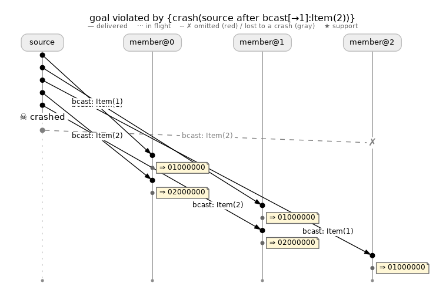

*`molly-viz-samples/ec/ec_broadcast_closed_all_labels`, 5 hypotheses, 5 schedules. The source delivers `Item(1)` and `Item(2)` to members 0 and 1, then `☠ crashed` ends its lane after `bcast[→1]:Item(2)`. Its `Item(2)` to member 2 is gray dashed to a `✗`; `Item(1)` to member 2, sent earlier, still arrives. Members 0 and 1 output `02000000`; member 2 never does.*

The five hypotheses are the failure-free probe, each member crashed before any send (three hypotheses that hold, since a crashed member owes nothing), and then the source crashed between two sends of one fan-out. That last hypothesis is the counterexample.

This is the pattern every single-hop `broadcast_closed` in the corpus fails to. The transport grants `EventualConsistency` on the reasoning that a failed connection stops all future deliveries to that recipient, which models the recipient as having failed (`hydro_lang/src/networking/mod.rs`, `FailStop`). That is a statement about recipients and says nothing about the sender. One sender crash in the middle of a fan-out leaves two members with an item and one without, and on a single hop nothing retransmits it. Later sections call this **the sender's mid-fan-out crash** and do not re-derive it.

### Cluster → cluster

**Harness:** `ec_ldfi.rs::ec_broadcast_closed_cluster_to_cluster_breaks_under_a_source_crash` · **Topology:** two sources, three members · **Transport:** `TCP.fail_stop()` · **Faults:** both clusters crashable, no budget, exhaustive · **Verdict:** Violated · **Hypotheses:** 5

A cluster of two sources, each broadcasting its own item. The receiving side of a cluster → cluster broadcast is keyed by the sending member, and the harness drops the key with `.values()`. This test uses the hand-written `.search` form over the same generated specification, so it prints the search's own verdict line rather than a per-label one:

```
ldfi: crash bounds: crashes unbounded; not all 5 nodes at once; at most 1 of the checked cluster's 3 crashable member(s)
LDFI: goal violated after 5 hypothesis run(s) by {crash(source@0 after bcast[0→1]:Item(10))}
```

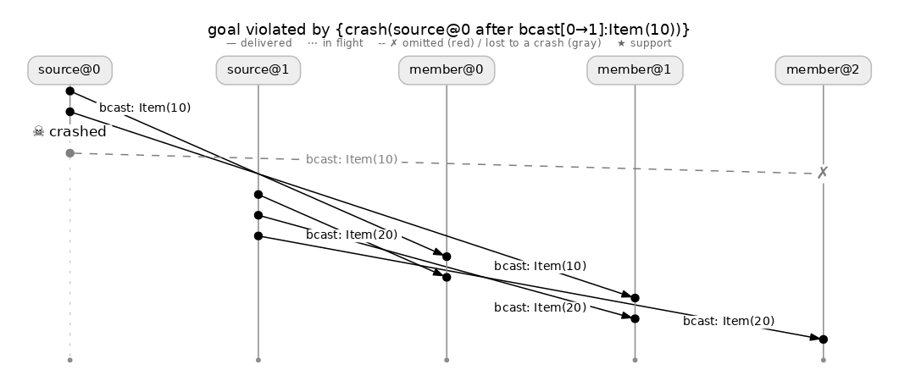

*`molly-viz-samples/ec/ec_broadcast_closed_cluster_to_cluster`, 5 hypotheses, 5 schedules. `source@0` delivers `Item(10)` to members 0 and 1 and dies; its send to member 2 is gray dashed. `source@1` completes its fan-out of `Item(20)`. Every member holds `Item(20)`; member 2 lacks `Item(10)`.*

Each source member is its own single-hop broadcaster, so a cluster of `n` sources is `n` copies of the sender's mid-fan-out crash. One crash in any of them suffices.

### Over a lossy channel

**Harness:** `ec_ldfi.rs::ec_broadcast_closed_lossy_delayed_forever_breaks_under_one_omission` · **Topology:** one source, three members · **Transport:** `TCP.lossy_delayed_forever()` · **Faults:** omission on the channel, every node crashable, exhaustive · **Verdict:** Violated · **Hypotheses:** 2

The same program over a transport that also grants the label but admits omission. The search needs no crash: the first hypothesis after the probe drops one copy of one item.

```
LDFI: goal violated after 2 hypothesis run(s) by {omit(bcast[→0]:Item(1))}
  delivered in the failing schedule: {bcast[→1]:Item(1), bcast[→2]:Item(1), bcast[→0]:Item(2), bcast[→1]:Item(2), bcast[→2]:Item(2)}
  omitted: {bcast[→0]:Item(1)}
```

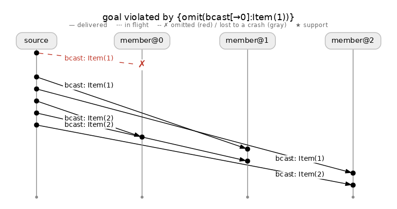

*`molly-viz-samples/ec/ec_broadcast_closed_lossy`, 2 hypotheses, 2 schedules. The only EC entry with an omission: `bcast: Item(1)` to member 0 is the red dashed `✗`. Every other send arrives. Members 1 and 2 hold `Item(1)`; member 0 does not, and nothing retransmits.*

This is the omission analogue of the sender's crash. "Delayed forever" makes a dropped message indistinguishable from a late one, which is what lets the transport grant the label; it does not make the surviving recipients converge when nothing retransmits.

### The remaining single-hop producers

Two more producers of the label behave identically and have no figures:

| Harness | Program | Verdict |
|---|---|---|
| `ec_demos_ldfi.rs::ec_demo_broadcast_live_breaks_under_a_sender_crash` | `broadcast_live_from_process` (`hydro_std`) | Violated, 5 hypotheses, `crash(source after bcast[→1]:2)` |
| `ec_demos_ldfi.rs::ec_demo_leader_merge_breaks_under_a_leader_crash` | `leader_merge_broadcast`: writers send to a leader, which broadcasts the merge | Violated, 2 hypotheses, `crash(leader after merged[→1]:…)`; the demo documents leader survival as an assumption |

`broadcast_live_from_process` is the `hydro_std` fan-out wrapper over the same `demux` plus `manual_proof!` and inherits the same premise. `leader_merge_broadcast` was compiled without provenance, so its transcript opens with the search noting that it is replaying every record at `Precise`; the verdict is the same.

## Reliable broadcast: inner hops violated, delivered set certified

**Harness:** `ec_demos_ldfi.rs::ec_demo_reliable_broadcast_all_labels` · **Topology:** one source, three members · **Transport:** `TCP.fail_stop()` on both hops · **Faults:** source and members crashable, no budget, exhaustive · **Verdicts:** Violated, Violated, Certified · **Hypotheses:** 5, 3, 36

`reliable_broadcast_closed` builds a reliable delivered set from two unreliable hops: the source's `broadcast_closed` to the members, and the members' echo `broadcast_closed` to each other. Both hops introduce `EventualConsistency`; the delivered set after `merge_unordered` and `unique` inherits it and leaves the labelled region at the test's `weaken_consistency`.

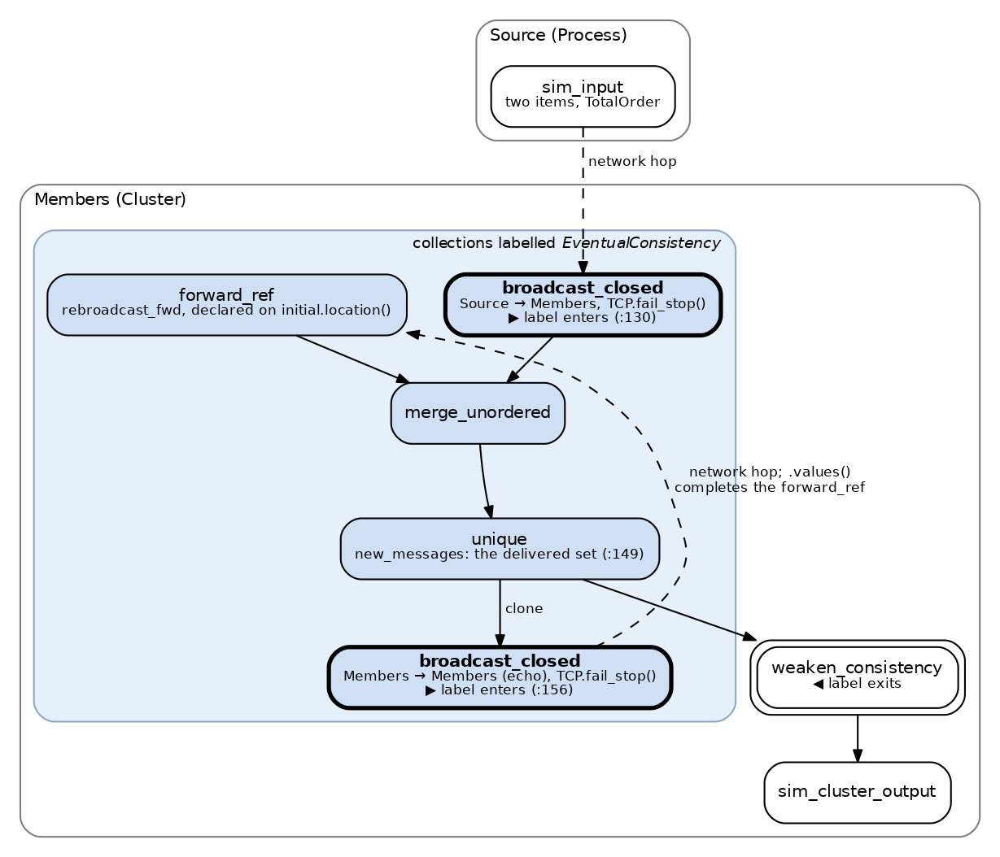

*`reliable_broadcast_closed` as `Spec::all_labels` sees it (`molly-viz-samples/figures/reliable_broadcast_regions.dot`). The shaded region carries `EventualConsistency`. The source's and the members' `broadcast_closed` are the two introducing nodes, bold; `forward_ref`, `merge_unordered` and `unique` inherit the label; the delivered set exits at the test's `weaken_consistency`, double-bordered. One verdict per node.*

```rust
let delivered = reliable_broadcast_closed(items, &members);   // labelled EventualConsistency
delivered.weaken_consistency().sim_cluster_output();           // the exit all_labels reports as "delivered"
let spec = Spec::all_labels(&mut flow);
```

One line per labelled collection:

```
EventualConsistency at reliable_broadcast.rs:130 (Cluster(loc2v1), AssertIsConsistent, minted): VIOLATED by {crash(source after reliable_broadcast.rs:130[→1]:2)}, 5 hypotheses
EventualConsistency at reliable_broadcast.rs:156 (Cluster(loc2v1), AssertIsConsistent, minted): VIOLATED by {crash(member@0 after reliable_broadcast.rs:156[0→1]:2)}, 3 hypotheses
EventualConsistency at reliable_broadcast.rs:149 (Cluster(loc2v1), Unique, delivered): CERTIFICATE, 36 hypotheses, exhaustive
```

The two violations are not defects. They are the premise the protocol exists to discharge, and the certified exit is the search showing the protocol doing its job: inner collections violated, delivered set certified.

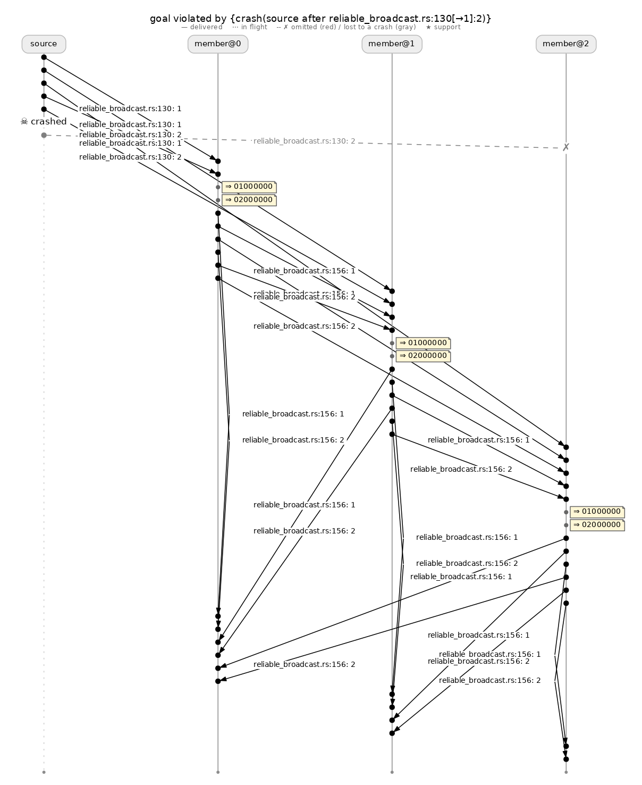

*The source's single hop (`molly-viz-samples/ec/ec_reliable_broadcast_inner_source_hop`), 5 hypotheses, 5 schedules. The sender's mid-fan-out crash: `1` and `2` reach members 0 and 1, the source dies, its `2` to member 2 is lost. Member 2 receives `2` through the echoes, and its `⇒` shows both items, but on the hop alone it holds only `1`.*

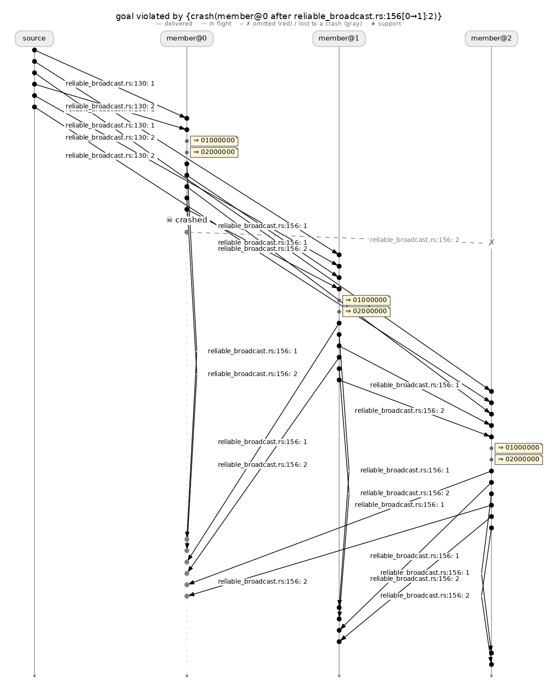

*The members' echo, keyed by echoer (`molly-viz-samples/ec/ec_reliable_broadcast_inner_echo`), 3 hypotheses, 3 schedules. Member 0 echoes `1` and `2` to member 1, dies, and its echo of `2` to member 2 is lost. Member 1 holds (member 0, `2`) and member 2 does not, while the merged delivered set is complete at both. The echo repairs the merged set, not the keyed record of who echoed.*

The echo hop is violated by a *member's* crash, not the source's: the label on the echo collection is keyed by the echoing member, and a correct member that echoed to one peer and not another leaves the two peers with different keyed records. Every cluster → cluster echo in the corpus (multi-Paxos's learners below) fails the same way.

The certificate took 36 hypotheses. Under a budget of one crash it was 10; with crashes unbounded the search also runs every admissible pair, a source crash point together with one member's crash (a second member would exceed the checked cluster's cap), and each pair survives and adds a hypothesis. The measurement is in [ldfi-level-ablation.md](ldfi-level-ablation.md#unbounded-crash-budget-with-vacuity-constraints).

Two companion tests check the delivered set alone through the hand-written `.search` form. `ec_demo_reliable_broadcast_certifies` certifies `reliable_broadcast_closed` and `reliable_broadcast_live` in 36 hypotheses each. `ec_generated_spec_separates_plain_from_reliable_broadcast` runs the `hydro_test` echo broadcast and its plain variant under one specification:

```
LDFI: goal violated after 2 hypothesis run(s) by {crash(broadcaster after initial[→1]:Payload(42))}
...
LDFI: no fault set within bounds violates the goal under any schedule (21 hypothesis run(s))
```

The plain broadcast is the sender's mid-fan-out crash in 2 hypotheses; the echo variant certifies in 21.

## Uniform broadcast

**Harness:** `ec_demos_ldfi.rs::ec_demo_uniform_broadcast` · **Topology:** one source, three members · **Transport:** `TCP.fail_stop()` · **Faults:** source and members crashable, no budget, `Fuzz { instances: 8 }` · **Verdict:** No violation under `Fuzz` · **Hypotheses:** 105 at each threshold

`uniform_reliable_broadcast_closed` keeps the echo cycle of reliable broadcast and changes only the delivery rule: a member delivers an item once it holds a threshold of echoes for it, so that a member that delivers and then crashes cannot leave the others without the item. The harness runs thresholds 1 and 2 over the delivered set:

```
uniform(1): LDFI: no fault set within bounds violated the goal in 8 sampled schedule(s) per hypothesis (105 hypothesis run(s)); not a proof
uniform(2): LDFI: no fault set within bounds violated the goal in 8 sampled schedule(s) per hypothesis (105 hypothesis run(s)); not a proof
```

The count was 28 under a budget of one crash. The unbounded search also runs every admissible pair of a source crash point with one member's crash, and all of them hold. There is no figure: the search found nothing to draw.

## Multi-Paxos: every label

**Harness:** `ec_demos_ldfi.rs::ec_demo_multi_paxos_all_labels` · **Topology:** 1 proposer, 3 acceptors, 3 learners · **Transport:** `TCP.fail_stop()` throughout · **Faults:** every cluster crashable, `.crash_budget(1)`, `Fuzz { instances: 8 }` · **Verdicts:** 5 Violated, 4 no violation under `Fuzz`, 1 Not checked · **Hypotheses:** 5 to 26 per label

The body tells proposer 0 to lead round 1, quiesces, sends commands 7 and 8, and quiesces. This is the one EC harness with an explicit crash budget. `f = 1` of three acceptors is the protocol's stated fault model, and the unbounded search of the `learned` set over seven crashable nodes does not finish (a proposer crash point, up to three acceptor crash points and a learner crash remain admissible together, and each such set survives and adds a hypothesis; the 256-hypothesis budget was hit at 212 s and 659 hypotheses in half an hour produced no verdict).

```rust
let outputs = multi_paxos(&acceptors, &learners, 2, leads, commands);
let _learned = outputs.learned.weaken_consistency().sim_cluster_output();
let spec = Spec::all_labels(&mut flow);
// ...
let results = Ldfi::new()
    .level(Level::Precise)
    .exploration(Exploration::Fuzz { instances: 8 })
    .crashable_cluster("proposer", &proposers, 0..1)
    .crashable_cluster("acceptor", &acceptors, 0..3)
    .crashable_cluster("learner", &learners, 0..3)
    .crash_budget(1)   // the protocol's fault model
    .spec(&spec)
    .search_all_labels(&compiled, async |_run| {
        lead.send(0, 1);
        hydro_lang::sim::quiesce().await;
        command.send(0, 7);
        command.send(0, 8);
        hydro_lang::sim::quiesce().await;
    });
```

Ten collections are reported (line numbers into `hydro_std/src/ec_inference_demos/multi_paxos.rs`):

```
EventualConsistency at multi_paxos.rs:281 (Cluster(loc2v1), AssertIsConsistent, minted and delivered): VIOLATED by {crash(proposer@0 after multi_paxos.rs:281[0→1]:Ts { round: 1, writer: Legacy { raw_id: 0 } })}, 5 hypotheses
EventualConsistency at multi_paxos.rs:286 (Cluster(loc2v1), CycleSource, delivered): VIOLATED by {crash(proposer@0 after multi_paxos.rs:549[0→1]:(Ts { round: 1, writer: Legacy { raw_id: 0 } }, 0, 1, Some(8)))}, 8 hypotheses
EventualConsistency at multi_paxos.rs:549 (Cluster(loc2v1), AssertIsConsistent, minted): VIOLATED by {crash(proposer@0 after multi_paxos.rs:549[0→1]:(Ts { round: 1, writer: Legacy { raw_id: 0 } }, 0, 1, Some(8)))}, 8 hypotheses
EventualConsistency at multi_paxos.rs:569 (Cluster(loc1v1), AssertIsConsistent, minted): CERTIFICATE, 6 hypotheses, 8 sampled schedules
EventualConsistency at multi_paxos.rs:570 (Cluster(loc1v1), Map, delivered): CERTIFICATE, 6 hypotheses, 8 sampled schedules
EventualConsistency at multi_paxos.rs:582 (Cluster(loc3v1), AssertIsConsistent, minted): VIOLATED by {crash(proposer@0 after multi_paxos.rs:582[0→1]:(1, 0, 0, Some(7)))}, 11 hypotheses
EventualConsistency at multi_paxos.rs:588 (Cluster(loc3v1), Unique, delivered): CERTIFICATE, 25 hypotheses, 8 sampled schedules
EventualConsistency at multi_paxos.rs:591 (Cluster(loc3v1), AssertIsConsistent, minted): VIOLATED by {crash(learner@0 after multi_paxos.rs:591[0→1]:(1, 0, 0, Some(7)))}, 9 hypotheses
EventualConsistency at multi_paxos.rs:608 (Cluster(loc3v1), FlatMap, delivered): CERTIFICATE, 26 hypotheses, 8 sampled schedules
EventualConsistency at epoch_splice.rs:190 (Cluster(loc3v1), AssertIsConsistent, minted): not checked: Singleton (not a set-valued collection)
```

Reading the ten lines as three groups:

**Violated, by one crash each.** The proposer's `broadcast_closed` of prepares (`:281`), of phase-2 accepts (`:549`) and of chosen decrees to the learners (`:582`) are each the sender's mid-fan-out crash. The `forward_ref` that carries the accepts into the acceptor's tick (`:286`) inherits `:549`'s verdict by the same crash, since nothing between the broadcast and the batch retransmits. The learners' echo keyed by echoer (`:591`) is violated by a learner's crash, as the reliable-broadcast echo was.

**No violation under 8 sampled schedules.** The chosen-slot broadcast among proposers (`:569`) and its `.values()` (`:570`) hold trivially: the proposer cluster has one member, so its cap is zero crashes and the proposer never crashes under its own labels. The delivered `learned` set (`:588`) and its `SpliceFact` map (`:608`) hold because every learner that receives a decree echoes it to every learner, and one crash leaves at least one echoer per decree.

**Not checked.** The `fold` into a `Singleton<SpliceState>` in `epoch_splice.rs` is not a stream.

Two counts moved relative to earlier runs. `:569`/`:570` were 17–19 hypotheses and are now 6, because the vacuity fix stops the search from re-running supersets of a proposer crash under which nothing was chosen. `:582` is 11 in this transcript and 10 in the gallery run, the run-to-run variation `Fuzz` produces. The test asserts that `:588`'s exit certifies and that no label hits the budget.

The crash bounds the search logs are `at most 1 crash(es); not all 7 nodes at once; at most 1 of the checked cluster's 3 crashable member(s)` for the acceptor and learner labels, and `at most 0 of the checked cluster's 1 crashable member(s)` for the proposer labels.

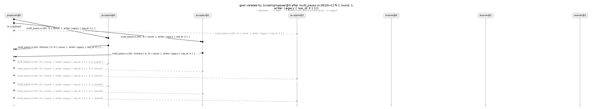

*`:281`, prepares (`molly-viz-samples/ec/ec_multi_paxos_labels_281_prepares`), 5 hypotheses, 40 schedules. The round-1 prepare reaches acceptors 0 and 1, the proposer dies, acceptor 2's copy is lost. Two promises come back, and every phase-2 send below is gray dashed because its sender is dead.*

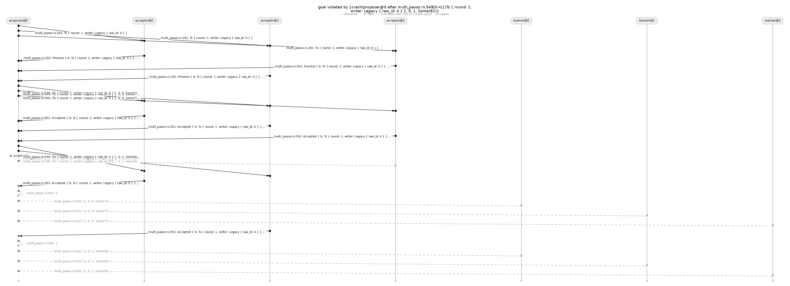

*`:549`, phase-2 accepts (`molly-viz-samples/ec/ec_multi_paxos_labels_549_accepts`), 8 hypotheses, 64 schedules. The accept for slot 0 reaches all three acceptors; the accept for slot 1 reaches acceptors 0 and 1, the proposer dies, and acceptor 2 never sees slot 1. The same run is `:286`'s counterexample (`molly-viz-samples/ec/ec_multi_paxos_labels_286_accepts_fwd`).*

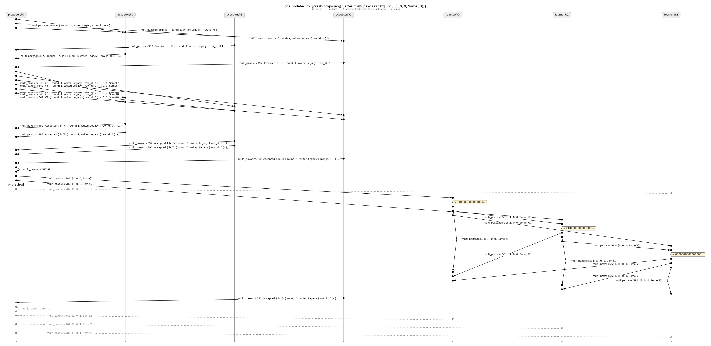

*`:582`, chosen decrees to the learners (`molly-viz-samples/ec/ec_multi_paxos_labels_582_learner_hop`), 10 hypotheses, 80 schedules in the gallery run (11 in the transcript). Slot 0's decree reaches learners 0 and 1, the proposer dies, learner 2's copy and all of slot 1 are lost. The learners' echo carries slot 0 to learner 2 anyway, as its `⇒` shows; on the hop alone learner 2 holds nothing.*

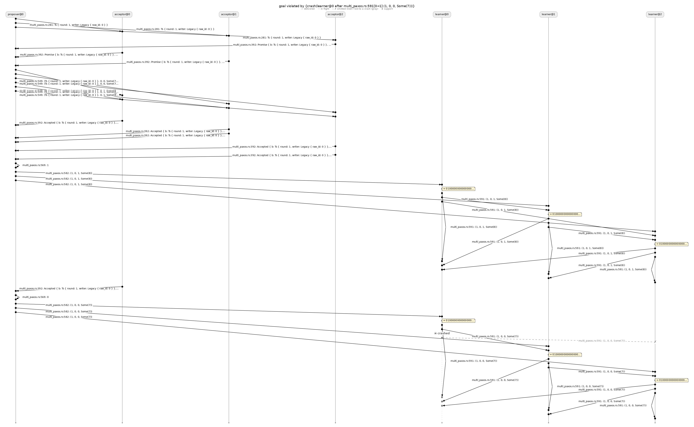

*`:591`, the learners' echo keyed by echoer (`molly-viz-samples/ec/ec_multi_paxos_labels_591_learner_echo`), 9 hypotheses, 72 schedules. Learner 0 echoes slot 0 to learner 1 and dies before echoing it to learner 2. Under learner 0's key that echo is at learner 1 and not at learner 2, while the merged `learned` set is complete at both.*

The `learned` set is also checked by hand in `ec_demo_multi_paxos_learned_under_one_crash` (`Spec::new`, same body and budget): no violation in 25 hypotheses under 8 sampled schedules. The `all_labels` run of the same collection takes 25–26 because its observer carries every label's facts.

## ISR replication

**Harness:** `isr_replication.rs::ldfi_all_labels_break_under_a_sender_crash` · **Topology:** 1 client, 1 ZooKeeper, 3 replicas · **Transport:** `TCP.fail_stop()` · **Faults:** client, ZooKeeper and replicas crashable, no budget, `Fuzz { instances: 8 }`, `EFF` after round 0 · **Verdicts:** 3 Violated · **Hypotheses:** 2, 8, 8

The body sends one write and quiesces, then runs four rounds of replica heartbeats and a ZooKeeper view recomputation, and calls `run.end_of_finite_failures()` at the end of round 0:

```rust
async |run| {
    for w in 1..=writes {
        h.write_send.send(Write(w));
    }
    hydro_lang::sim::quiesce().await;
    for round in 0..rounds {
        h.replica_timer.send_many((0..members).map(|m| (m, ())));
        hydro_lang::sim::quiesce().await;
        h.zk_timer.send(());
        hydro_lang::sim::quiesce().await;
        if round == 0 {
            run.end_of_finite_failures();   // faults may fall anywhere up to here
        }
    }
}
```

Everything before the call is where faults may land; the remaining three rounds are failure-free recovery. The protocol labels three collections: the client's write broadcast (`:343`, introduced and delivered), the replication `forward_ref` at the replicas (`:360`, delivered) and ZooKeeper's view broadcast (`:564`, introduced).

```
ldfi: crash bounds: crashes unbounded; not all 5 nodes at once; at most 1 of the checked cluster's 3 crashable member(s)
EventualConsistency at isr_replication.rs:343 (Cluster(loc3v1), AssertIsConsistent, minted and delivered): VIOLATED by {crash(client after write[→1]:Write(1))}, 2 hypotheses
EventualConsistency at isr_replication.rs:360 (Cluster(loc3v1), CycleSource, delivered): VIOLATED by {crash(zk after view[→1]:View { leader: Some(0), isr: [0, 1, 2] })}, 8 hypotheses
EventualConsistency at isr_replication.rs:564 (Cluster(loc3v1), AssertIsConsistent, minted): VIOLATED by {crash(zk after view[→1]:View { leader: Some(0), isr: [0, 1, 2] })}, 8 hypotheses
```

Each is the sender's mid-fan-out crash: the client's for the write, ZooKeeper's for the view. The replication cycle (`:360`) is fed by the view, and the difference in views carries through to it. Unbounded crashes change nothing here: the replicas are the checked cluster and the cap holds them to one, while the client and ZooKeeper each have one crash point that is fatal on its own.

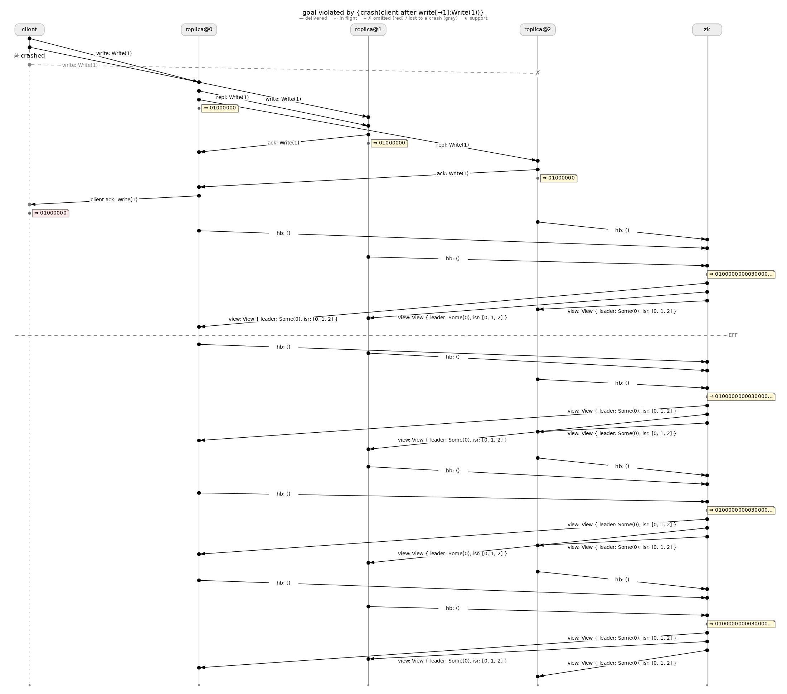

*`:343`, the write broadcast (`molly-viz-samples/ec/ec_isr_all_labels_343_write`), 2 hypotheses, 16 schedules. `Write(1)` reaches replicas 0 and 1, the client dies, replica 2's copy is lost. The leader's `repl` carries the write to replica 2 anyway and the `client-ack` is suppressed at the dead client; heartbeats, views and the `EFF` rule follow failure-free. On the write broadcast itself, replica 2 holds nothing.*

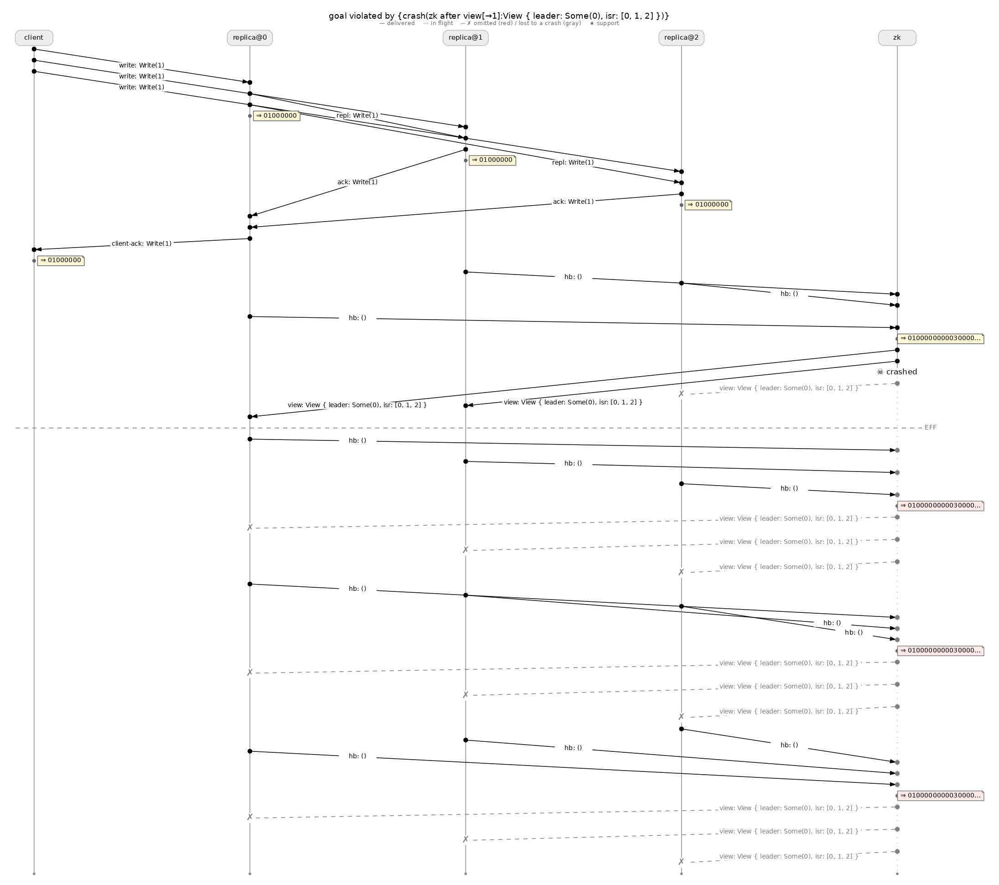

*`:564`, the view broadcast (`molly-viz-samples/ec/ec_isr_all_labels_564_view`), 8 hypotheses, 64 schedules. The first view reaches replicas 1 and 0, ZooKeeper dies, replica 2's copy is lost. Below the `EFF` rule every view ZooKeeper would have sent in the three later rounds is gray dashed. The same run is `:360`'s counterexample (`molly-viz-samples/ec/ec_isr_all_labels_360_replication_fwd`).*

Two companion configurations show how the harness's choices decide the verdict:

| Variant | `:343` | `:360` | `:564` |
|---|---|---|---|
| `ldfi_all_labels_with_the_harness_fault_model`: client and ZooKeeper held correct | no violation, 4 | no violation, 7 | no violation, 7 |
| `EFF` moved to just after the write (an earlier version of the body) | Violated, 2 | no violation, 5 | no violation, 5 |

With the client and ZooKeeper correct, no crashable node sends on any of the three collections, and the only hypotheses are replica crashes, which hold. With `EFF` right after the write, every ZooKeeper send lies after the cut, so no ZooKeeper crash point is admissible and the view labels cannot be violated. The harness that cannot lose a message cannot test the protocol's handling of its loss; [hydrofrac.md](hydrofrac.md) discusses where the cut belongs.

## Two-phase commit

**Harness:** `two_pc_ldfi.rs::ldfi_all_labels_with_the_harness_fault_model`, `compile_all_labels(2, true, true, 8)` · **Topology:** 1 coordinator, 2 participants · **Transport:** `TCP.fail_stop()` · **Faults:** coordinator and participants crashable, no budget, exhaustive · **Verdicts:** 2 Violated, 2 Vacuous · **Hypotheses:** 2, 2

One transaction with cooperative termination. Four collections: the coordinator's prepare broadcast (`:86`) and commit broadcast (`:92`), each introduced and delivered, and the participants' peer channel (`:98` `forward_ref`, `:161` broadcast).

```
ldfi: crash bounds: crashes unbounded; not all 3 nodes at once; at most 0 of the checked cluster's 2 crashable member(s)
EventualConsistency at two_pc_ldfi.rs:86 (Cluster(loc2v1), AssertIsConsistent, minted and delivered): VIOLATED by {crash(coordinator after prepare[→0]:Txn(1))}, 2 hypotheses
EventualConsistency at two_pc_ldfi.rs:92 (Cluster(loc2v1), AssertIsConsistent, minted and delivered): VIOLATED by {crash(coordinator after commit[→0]:Txn(1))}, 2 hypotheses
EventualConsistency at two_pc_ldfi.rs:98 (Cluster(loc2v1), CycleSource, delivered): VACUOUS (nothing held in the failure-free run)
EventualConsistency at two_pc_ldfi.rs:161 (Cluster(loc2v1), AssertIsConsistent, minted): VACUOUS (nothing held in the failure-free run)
```

The bounds line shows the cluster cap at its limit. Two participants give `|C| − 2 = 0`, so no participant may crash under these labels; the coordinator is the only node left to the search, and its mid-fan-out crash is the counterexample on both hops. The peer channel is **Vacuous** because the failure-free run carries no peer traffic: the termination timers fire after every decision is known, so no participant queries a peer, and a collection with no facts gives the specification nothing to protect.

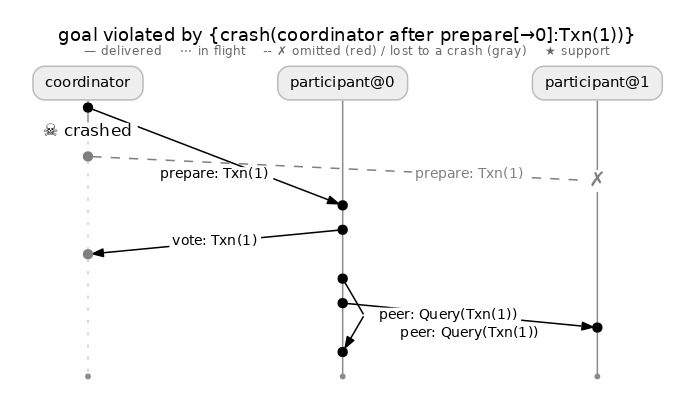

*`:86`, the prepare broadcast (`molly-viz-samples/ec/ec_two_pc_all_labels_86_prepare`), 2 hypotheses, 20 schedules. The prepare reaches participant 0, the coordinator dies, participant 1's copy is lost. Participant 0 votes and queries its peer. Participant 1 never sees a prepare.*

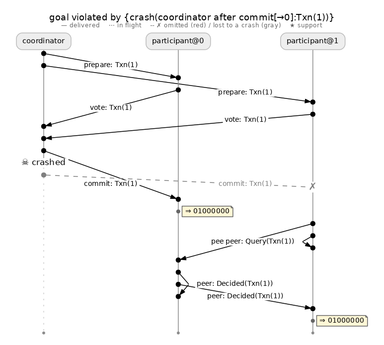

*`:92`, the commit broadcast (`molly-viz-samples/ec/ec_two_pc_all_labels_92_commit`), 2 hypotheses, 64 schedules. Both prepares and both votes complete, the commit reaches participant 0, the coordinator dies, participant 1's copy is lost. Participant 1 queries, participant 0 answers `Decided`, and participant 1 commits too, its `⇒` at the bottom. Cooperative termination repairs the decision; the commit hop is still a hop.*

The companion `ldfi_all_labels_with_the_coordinator_correct` (`compile_all_labels(2, true, false, 8)`) is the same cap with nothing left: participants capped at zero, coordinator not crashable, so no fault set is admissible and the failure-free run is the certificate.

```
EventualConsistency at two_pc_ldfi.rs:86 (Cluster(loc2v1), AssertIsConsistent, minted and delivered): CERTIFICATE, 1 hypotheses, exhaustive
EventualConsistency at two_pc_ldfi.rs:92 (Cluster(loc2v1), AssertIsConsistent, minted and delivered): CERTIFICATE, 1 hypotheses, exhaustive
```

Under the former budget of one crash the same two labels certified in 3 and 5 hypotheses by running each participant's crash and finding that it held, which it had to: a crashed participant owes nothing and the survivor agrees with itself. The cap states that outright.

## ABD

**Harness:** `abd.rs::all_labels_reports_the_register_as_not_a_stream` (`hydro_std/src/ec_inference_demos/abd.rs`) · **Topology:** 1 client, 3 replicas · **Transport:** `TCP.fail_stop()` · **Faults:** client and replicas crashable, no budget, `Fuzz { instances: 8 }` · **Verdicts:** 4 Violated, 1 Not checked · **Hypotheses:** 2 each

One write. The query broadcast (`:141`), the phase-2 `forward_ref` (`:150`), the writes filtered from it (`:161`) and the write broadcast (`:314`) are each one hop from the client. The register `fold` (`:165`) is a `Singleton`.

```
EventualConsistency at abd.rs:141 (Cluster(loc1v1), AssertIsConsistent, minted and delivered): VIOLATED by {crash(client@0 after abd.rs:141[0→1]:Query { rid: 1 })}, 2 hypotheses
EventualConsistency at abd.rs:150 (Cluster(loc1v1), CycleSource, delivered): VIOLATED by {crash(client@0 after abd.rs:314[0→1]:Write { rid: 1, ts: Ts { round: 1, writer: Legacy { raw_id: 0 } }, value: 10 })}, 2 hypotheses
EventualConsistency at abd.rs:161 (Cluster(loc1v1), FilterMap, delivered): VIOLATED by {crash(client@0 after abd.rs:314[0→1]:Write { rid: 1, ts: Ts { round: 1, writer: Legacy { raw_id: 0 } }, value: 10 })}, 2 hypotheses
EventualConsistency at abd.rs:314 (Cluster(loc1v1), AssertIsConsistent, minted): VIOLATED by {crash(client@0 after abd.rs:314[0→1]:Write { rid: 1, ts: Ts { round: 1, writer: Legacy { raw_id: 0 } }, value: 10 })}, 2 hypotheses
EventualConsistency at abd.rs:165 (Cluster(loc1v1), AssertIsConsistent, minted and delivered): not checked: Singleton (not a set-valued collection)
```

Four instances of the sender's mid-fan-out crash, by the client between two sends of its query or of its write. In each search the first hypothesis after the probe is a client crash point, so each is found in 2. The register is the class boundary of the next section. No figure was produced for ABD.

## Class boundaries: what `all_labels` does not check

The generated specification is a universal over a fixed fact domain: a failure-free probe collects every fact seen at any member into `FACTS`, and under every later hypothesis each fact present at some correct member must be present at every correct member. That form needs a set-valued stream whose end-of-run contents can be compared across members. Four kinds of labelled collection fall outside it and are reported as `not checked` with a reason (`NotCheckedReason` in `hydro_lang/src/sim/observe.rs`), never silently skipped:

- **Not a stream.** A `Singleton`, `Optional` or `KeyedSingleton` such as ABD's register `fold` or multi-Paxos's `SpliceState` in `epoch_splice.rs`: a lattice value, which the set-based specification does not observe correctly. Printed as `Singleton (not a set-valued collection)`.
- **Inside a tick.** The labelling node lives inside a tick, so its bounded per-tick contents are not "the collection's contents". Printed as `inside a tick`.
- **Local inputs only.** No network channel feeds the collection, so no fault in the model can withhold an input from some members.
- **Excluded by the test** with `Spec::all_labels_except`.

**Harness:** `ec_all_labels_classes.rs::all_labels_reports_a_label_inside_a_tick` · **Topology:** one source, three members · **Faults:** every node crashable, exhaustive · **Verdicts:** Violated, Not checked, Violated · **Hypotheses:** 5, –, 5

The test pins the tick boundary. A `fail_stop` broadcast is batched into the members' tick and labelled there by `assert_has_consistency_of`; the `all_ticks` after it carries the label back out.

```
EventualConsistency at ec_all_labels_classes.rs:31 (Cluster(loc2v1), AssertIsConsistent, minted and delivered): VIOLATED by {crash(source after bcast[→1]:2)}, 5 hypotheses
EventualConsistency at ec_all_labels_classes.rs:36 (Cluster(loc2v1), AssertIsConsistent, minted): not checked: inside a tick
EventualConsistency at ec_all_labels_classes.rs:41 (Cluster(loc2v1), YieldConcat, delivered): VIOLATED by {crash(source after bcast[→1]:2)}, 5 hypotheses
```

The broadcast before the tick and the `all_ticks` after it are both searched and both fail to the sender's mid-fan-out crash; the label inside the tick is reported and left alone. An element type that is not `Clone + Serialize` is a further boundary, hit at compile time rather than reported: it fails the generated crate's compilation and has to be excluded with `Spec::all_labels_except`.

## The rest of the corpus

Set-valued demos without figures, under the default crash bounds unless a budget is noted:

| Harness | Program | Verdict |
|---|---|---|
| `ec_demo_g_set_gossip_certifies` | `g_set_gossip`, `g_set_gossip_live`: three members, each broadcasts its own element and gossips its set | No violation, 13 hypotheses, 8 sampled schedules; the crashable set is the checked cluster, so the unbounded search is the one-crash enumeration |
| `ec_demo_multi_paxos_learned_under_one_crash` | multi-Paxos `learned`, by hand, `.crash_budget(1)` | No violation, 25 hypotheses, 8 sampled schedules |
| `ec_demo_reliable_broadcast_certifies` | `reliable_broadcast_closed`, `reliable_broadcast_live`, by hand | Certified, 36 hypotheses each, exhaustive |

Across the corpus the pattern is uniform. Every single-hop introducing node is violated by its sender's mid-fan-out crash or, on a lossy channel, by one omission. Every cluster → cluster echo keyed by echoer is violated by an echoer's crash. Every delivered set after an echo cycle, gossip round or cooperative-termination query certifies or survives sampling. A transport label alone does not establish eventual consistency for the program using it; the echo, the gossip or the termination protocol does, and the per-label verdicts record where each program's labelled collections fall on that line.

## Bugs found with hand-written specifications

The hand-written path (`Spec::new`, `spec.pre(..)`, `spec.post(..)`, `Ldfi::search`) checks properties the types do not express: agreement, durability, "the leader has every acknowledged write". Its certificates are graded RELATIVE, with the caveat explained in [hydrofrac.md](hydrofrac.md). Its counterexamples are as concrete as the generated path's. This section records what it has found, with the diagrams where the gallery has them.

### Injected bugs

Each was a fault set the search proposed from the derivations it had seen, under which `PRE` held and `POST` did not.

**Plain two-phase commit.** Property: if any participant commits `Txn(1)`, every correct participant commits it. Broken by one coordinator crash between two `commit` sends, in 2 hypotheses at every size. With cooperative termination the protocol certifies under one crash in 9 / 13 / 18 / 23 hypotheses at `n = 2/2/3/4` and breaks under two: the coordinator after one commit, then the participant that received it. This is the case that motivated removing the default crash budget; see [ldfi-level-ablation.md](ldfi-level-ablation.md#2pc).

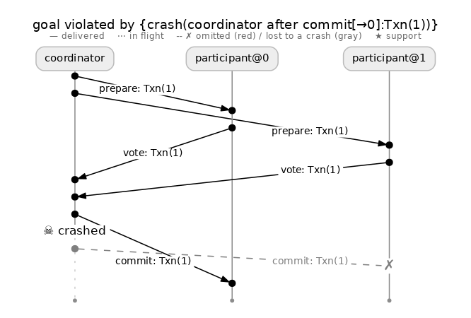

*Plain 2PC (`molly-viz-samples/two_pc`), 2 hypotheses, 24 schedules. Both participants prepare and vote, the coordinator sends `commit: Txn(1)` to participant 0, `☠ crashed` ends its lane, and the commit to participant 1 is gray dashed to a `✗`. Participant 0 commits; participant 1 blocks.*

**Plain broadcast.** Property: if any member delivers `m`, every correct member delivers it. The `hydro_test` broadcast without echo is the sender's mid-fan-out crash in 2 hypotheses; its echo variant certifies in 21.

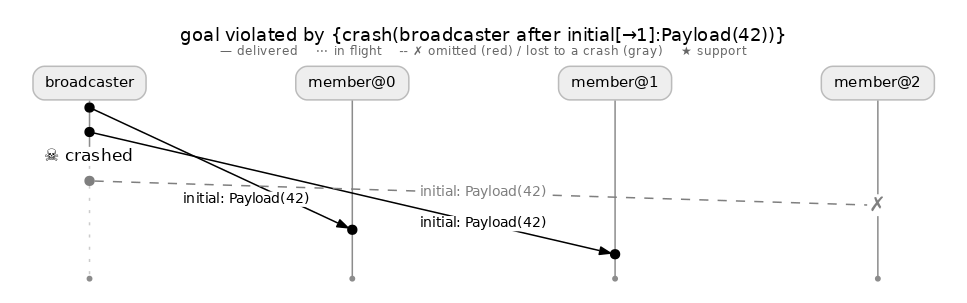

*Plain broadcast (`molly-viz-samples/plain_broadcast`), 2 hypotheses, 8 schedules. The broadcaster delivers `Payload(42)` to members 0 and 1, dies after `initial[→1]`, and its send to member 2 is lost. Members 0 and 1 deliver; member 2 never does.*

**ISR unclean election.** Kafka's bug: a replica that never saw an acknowledged write wins the election. Property: if the client was acknowledged for `Write(1)` and ZooKeeper's final view names a leader, that leader's log holds `Write(1)`. The counterexample is `{omit(repl[0→1]), crash(replica@0 after client-ack)}`, found in 9 (closure encoding) or 12 (dataflow) hypotheses at `Precise` and 14 at `Execution`; see [ldfi-level-ablation.md](ldfi-level-ablation.md#isr-replication).

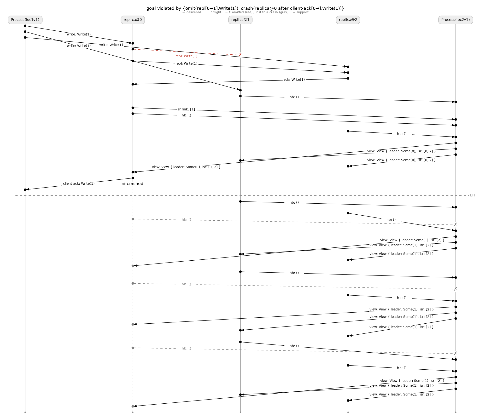

*ISR (`molly-viz-samples/isr_unclean_election`), 14 hypotheses, 112 schedules. `repl[0→1]: Write(1)` is the red `✗`. Replica 0 shrinks replica 1 out of the ISR, is acknowledged by replica 2, answers the client with `client-ack`, and dies. Below the `EFF` rule ZooKeeper's view promotes the stale replica 1 (`leader: Some(1)`).*

**Raft election restriction.** Raft with index-only log comparison passes all thirteen of `raft.rs`'s behavioural tests. The search finds it in 90 hypotheses with four omissions and no crash, about thirty minutes at four sampled schedules per hypothesis. Member 0 wins term 1 and appends `r0`, lost on both links; member 1 wins term 2, appends `r1` at the same index and commits it, its replication to member 0 lost twice; in the heal phase member 0 campaigns with `(index 1, term 1)`, wins under the index-only check, and overwrites the committed `r1`. Correct Raft certifies RELATIVE in 235 hypotheses, about an hour, under the same body.

An earlier report of 17 hypotheses for this bug is withdrawn. It came from a body that staged the scenario by hand (elected member 1, raced member 0's timer against a request, fired member 1's timer twice after the cut), so the search only had to find two omissions inside a scenario its author had arranged. The 90 / 235 figures are from a generic body shaped only by what correct Raft needs to converge.

**Core Paxos with a commit quorum of `f`.** `f` acknowledgements instead of `f + 1`, which every unit test passes. Property: if proposer 0 chose `x`, no two chosen `(slot, value)` pairs disagree at a slot. First found in 12–43 hypotheses across eight runs, but only under the schedule in which the new leader's P1b quorum missed acceptor 0, because the body's cut preceded the new leader's first ballot and that P1b was not a fault point.

After the cut was moved past the first ballot the counterexample became the three omissions `{p2a(x)→1, p2a(x)→2, p1b(acceptor 0)→proposer 1}`, schedule-independent, and correct Paxos certifies under that body in 372 hypotheses. The ablation's own harness finds the bug with two P2a omissions and certifies the correct variant at `Precise` in 230 hypotheses where `Execution` runs out at 256.

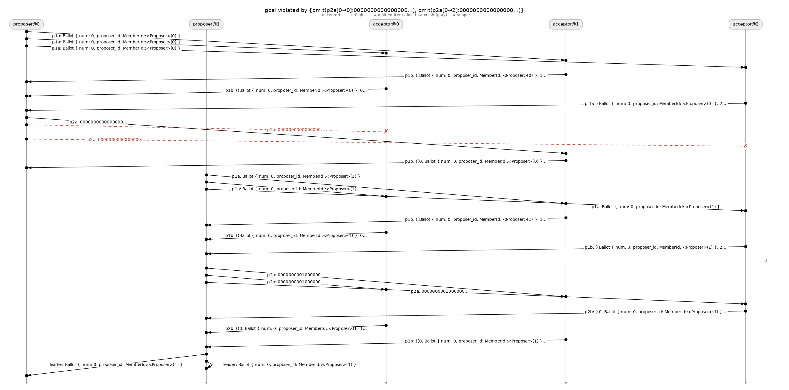

*The ablation harness's counterexample (`molly-viz-samples/paxos_commit_quorum`), 37 hypotheses, 148 schedules. Proposer 0's `p2a` to acceptors 0 and 2 are the two red `✗`; only acceptor 1 accepts `x`, and its lone `p2b` is counted as a commit quorum (the injected bug). After the `EFF` rule proposer 1's P1b quorum misses `x` and it chooses `y` at slot 0.*

**Compartmentalized Paxos** (two proposers, two proxy leaders, a 2 × 2 acceptor grid, eight nodes) with a write quorum one acceptor short of a row: 3 hypotheses. The correct variant certifies in 568.

**`hydro_std::quorum::collect_quorum`** between a coordinator and three retransmitting responders over lossy channels. The quorum claim certifies for a deduplicating caller in 28 hypotheses and breaks in 5 for the caller that feeds the library every reply: silence two responders and the third's retransmitted reply is counted twice.

**Reliable delivery that gives up.** The LDFI paper's first example, a sender over a lossy link that retries twice and then stops (`distributed::reliable_delivery`). Property: if the sender sends and not every copy is dropped, the receiver eventually has it. The search loses both attempts before `EFF` in 3 hypotheses. It is in the gallery for completeness rather than as a bug the corpus found.

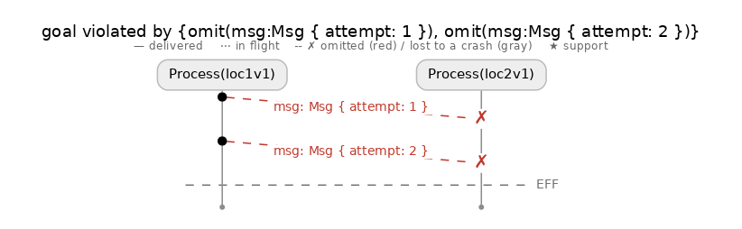

*Reliable delivery (`molly-viz-samples/reliable_delivery_gives_up`), 3 hypotheses, 3 schedules. `msg: Msg { attempt: 1 }` and `attempt: 2` are both red `✗` omissions above the `EFF` rule. Nothing is left to deliver once the network heals.*

The three corrected Paxos certificates (372 for core Paxos, 301 for the replicated key-value store over it, 568 for compartmentalized Paxos) take about forty-five minutes together at four sampled schedules per hypothesis.

### Defects in the production Paxos code that were not injected

`hydro_test/src/cluster/paxos.rs` had never run in the simulator; its leader liveness is on the wall clock. Once the harness made the timers inputs, three real defects came out. For each, what the bug was and which instrument found it.

**A message loop in the leader change.** The values a new leader recommits were re-sent on every later tick, and each round of P2bs triggered the next tick, so once a recommit was needed the proposer and the acceptors exchanged the same P2as and P2bs forever. This was not a lineage counterexample: the run under hydrofrac's first faulty hypothesis never quiesced, and the loop was found by reading why. Any fault injection that drove a leader change with a partially replicated slot would have found it; hydrofrac's contribution was the fault. The fix gates the recommit on the tick the proposer becomes leader.

**Compartmentalized Paxos's read quorum counted rows, not columns.** The leader election accepted any `rows` P1bs of the `rows × cols` acceptor grid, so a proposer could be elected on one row's P1bs, which does not intersect the other row, the write quorum of half the slots. Hydrofrac reported a violation of agreement on the *correct* variant in 8 hypotheses, but the failing schedule needed no fault: proposer 1's quorum was row 1 while `x` had been chosen on row 0, and only the P1b arrival order made it so. The simulator's schedule exploration found it; hydrofrac supplied the observer and the report that named the schedule. The fix has P1bs name their acceptor and the proposer count per column.

**The P1b quorum counted replies, not distinct acceptors.** A proposer whose check finds no leader re-sends the P1a of the same ballot, an acceptor answers every P1a it receives, and the election counted P1bs per `(ballot, column)` without naming the acceptor, so two replies from one acceptor made a quorum of two.

This one is an LDFI counterexample: lose the first-round P1bs of the two acceptors holding `x`, let the third acceptor's first and second replies make the quorum, and `y` is proposed at the slot `x` was chosen in. A violation of agreement on correct Paxos in 48 hypotheses and on correct compartmentalized Paxos in 18. It was invisible until the harness moved `EFF` after proposer 1's first check, so that the first-round P1bs became omission candidates. Loss is not even needed: two slow acceptors and one fast one, a timeout and a retry, and the fast one's two replies are a quorum. The fix keeps one P1b per `(ballot, acceptor)` before counting.

All three are defects of the kind the simulator finds given a scenario that drives a leader change; what hydrofrac added is the scenario's faults and, for the second and third, the report that named the schedule or the lost messages.

Two further findings made while writing harnesses are outside hydrofrac's contribution and are listed so they are not re-attributed to it. `collect_quorum_with_response` was not a function of its input despite its `nondet!` justification, found by the simulator's exhaustive exploration with no faults. Hydro's Maelstrom backend shared one untagged message type across every cluster-to-cluster channel, found by the first Maelstrom run of the Raft comparison.

## Reproducing the gallery

**Transcripts.** Each file under `molly-viz-samples/ec/output/` opens with the exact `cargo test` command that produced it, for example:

```sh
cargo test -p hydro_test --lib cluster::ec_demos_ldfi::tests::ec_demo_multi_paxos_all_labels -- --nocapture --test-threads=1 --exact
```

The `ldfi` feature needs cmake and libclang for the HiGHS solver bindings. The transcript contains the `ldfi: crash bounds:` line, one `ldfi: run #N {faults}: …` line per hypothesis with its derivations, the universe after each run, and the per-label verdict lines at the end. `Fuzz` runs vary by a hypothesis or two between invocations; exhaustive runs are deterministic.

**Lamport diagrams.** A search's outcome exposes its pictures through `Outcome::viz()`, which returns a `Counterexample` with `lamport_dot()` and `lamport_mermaid()` for the failing run, `support_lamport_dot()` / `support_lamport_mermaid()` for the witness (only when the search ran under `Ldfi::with_traces()`), and `markdown()` for the report. The `hydro_test` gallery tests wrap this in `ldfi_viz::write_gallery` and are no-ops unless `MOLLY_VIZ_OUT` is set:

```sh
MOLLY_VIZ_OUT=/tmp/gallery cargo test -p hydro_test gallery_ -- --test-threads=1
for f in /tmp/gallery/*/*.dot; do
  if grep -q layout=neato "$f"; then neato -n2 -Tpng -Gdpi=110 "$f" -o "${f%.dot}.png"
  else dot -Tpng -Gdpi=96 "$f" -o "${f%.dot}.png"; fi
done
```

The committed gallery tests are `gallery_two_pc`, `gallery_isr_unclean_election` and `gallery_paxos_commit_quorum` in `hydro_test/src/cluster/ldfi_viz.rs`, `gallery_plain_broadcast` in `cluster/reliable_broadcast.rs`, `gallery_reliable_delivery_gives_up` in `distributed/reliable_delivery.rs`, and `gallery_ec_broadcast_closed_all_labels` in `cluster/ec_ldfi.rs`. The last one is the template for an `all_labels` entry: run the search with `.with_traces().with_provenance_graphs()`, pick the violated label's outcome from `results.searched()`, and hand it to `write_gallery`. The other fourteen `ec/` entries were produced the same way from each violated label of the tests above and do not have a committed gallery test of their own; regenerating them means adding one per entry on that template.

**What each directory contains.** The five hand-written entries have `failing`, `witness_{execution,record}` and `provenance_{execution,record}` as `.dot` and `.png`, plus `report.md`. The fifteen `ec/` entries have `failing.dot`, `failing.png` and `report.md` only. `ec/PRINT.md` describes `failing-print.png`, a 160 dpi re-render with larger labels for the wide diagrams, and the recipe to produce one.

**The dataflow figure.** `molly-viz-samples/figures/reliable_broadcast_regions.dot` is a hand-written Graphviz rendering of the `reliable_broadcast_closed` IR with the labelled region shaded; render with `dot -Tpng -Gdpi=150`.

**The PDF.** `docs/design/render-inventory.py` renders a Markdown file in this directory to PDF, wrapping each image plus its italic caption into a figure, placing each figure from its natural size, and substituting `failing-print.png` where one exists. Its `SRC` and `OUT` constants name the input and output files. The placement rules are in `ec/PRINT.md`.
