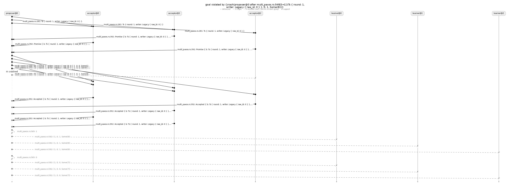
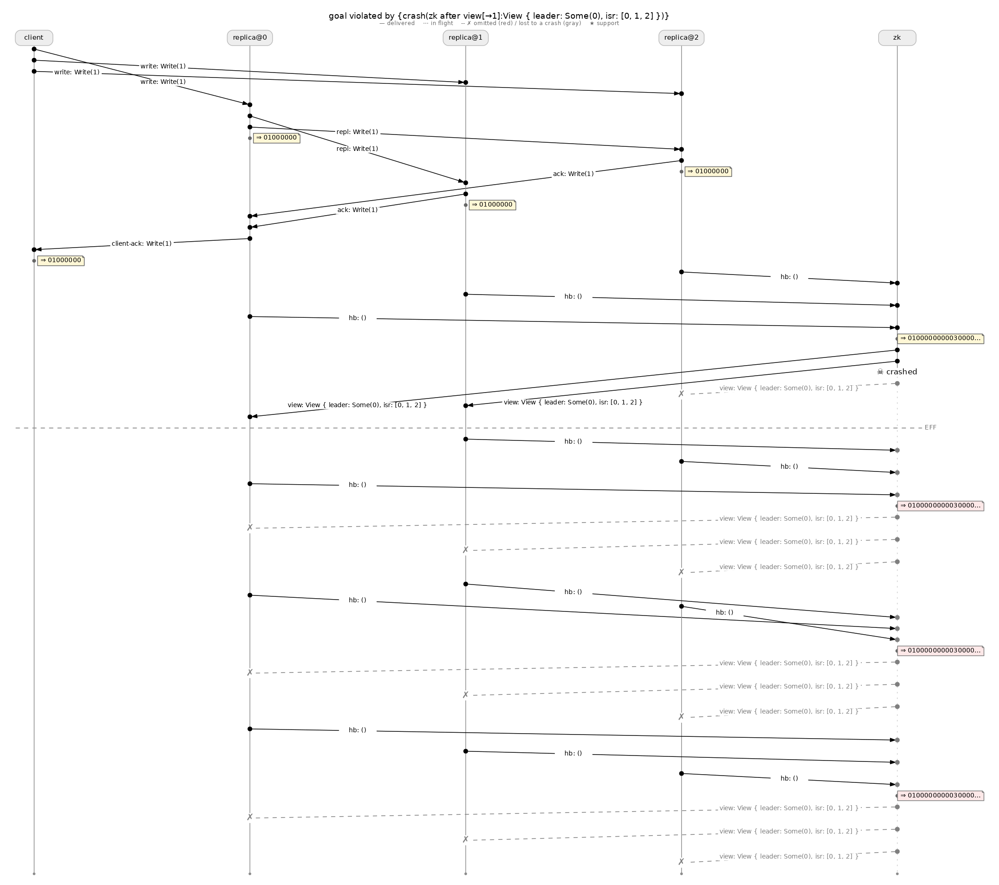

# Hydrofrac user guide

Hydrofrac tests whether a Hydro program keeps its eventual-consistency promises when machines crash and messages are lost. It runs the program in the Hydro simulator, injects faults, and looks for a run that ends with two surviving replicas holding different data. When it finds one, it reports the faults and shows the run. When it cannot find one, it reports how much of the fault space it covered.

This guide has four parts:

1. The problem hydrofrac solves.
2. How it works.
3. How to use it, with every example in the test corpus, its output, and its cost compared with brute-force search.
4. Limitations.

Everything here describes the code on the `docs/hydrofrac-inventory` branch.

## 1. The problem

Hydro lets you mark a collection on a cluster as `EventualConsistency`. The mark says that all replicas will end up with the same contents.

That promise has two halves:

1. **Same inputs, same result.** If two replicas receive the same messages, they compute the same contents, whatever order the messages arrive in.
2. **Same inputs.** Faults do not leave surviving replicas with permanently different inputs.

Hydro's type system checks the first half. It knows which operators are insensitive to order and duplication, and it refuses to label a collection unless its computation qualifies.

The type system cannot check the second half. Whether every survivor gets every input depends on how much redundancy the protocol has: whether someone retransmits, echoes, or gossips a message after its sender dies. That is a property of the protocol's behavior under faults, not of its types. So today an `EventualConsistency` label is only half-checked.

A small example shows the gap. A process sends two items to three replicas, and each replica adds what it receives to a set. Set insertion is order-insensitive, so the type system is satisfied. But if the sender crashes after sending the second item to two of the replicas and before sending it to the third, the third replica never gets it. Nothing in the program sends it again. The replicas disagree forever.

Hydrofrac checks the second half. For each collection labeled `EventualConsistency`, it searches for faults that leave survivors with different contents.

## 2. How it works

Hydrofrac is an implementation of lineage-driven fault injection (LDFI), the technique introduced by the Molly tool (Alvaro, Rosen and Hellerstein, SIGMOD 2015). The idea of LDFI is to work backwards from success. Run the program, record why it succeeded, and then try faults that would remove those reasons. If the program still succeeds by some other route, record that route as well, and try faults that remove both. Stop when a fault set breaks the program, or when no fault set can remove every recorded reason.

Hydrofrac simplifies Molly in several ways:

- It runs the real Hydro program in the simulator. Molly required the program to be rewritten in a logic language.
- It inserts fault points itself, at every network send. The test does not list channels.
- It generates the correctness check from the `EventualConsistency` labels. The test does not write a specification.
- It names faults by messages, not by logical clock times.

It also adds a few things:

- It explores message interleavings under each fault set. Molly ran a single interleaving.
- It records the reasons for success at two levels of detail, described in section 2.3.
- It writes the correctness check as a Hydro dataflow, so it can trace the check the same way it traces the program.

The rest of this section covers each piece.

### 2.1 Faults: omissions and crashes

The simulator compiles the distributed program into a single process in which network channels are queues. On the sending side of every network channel, the generated code passes each message through a filter before the message enters the queue. The filter decides whether the message is delivered, dropped, or blocked because its sender has crashed. (The filter call is generated in `hydro_lang/src/sim/builder.rs`; the filter itself is `FaultState::filter` in `hydro_lang/src/sim/runtime/lineage.rs`.)

The filter applies two kinds of fault:

- **Omission.** Drop one message. A message is identified by its channel, sender, receiver, and serialized bytes. An identical retransmission is the same message, so it is dropped too.
- **Crash.** Written `crash(node after m)`. The node performs every send up to and including message `m`. Every later send from that node is dropped, and its outputs to the outside world are suppressed. A crash can also happen before the node's first send. A crash is a pattern of omissions: everything after one point.

Naming a crash by a message, rather than by a time or a send count, keeps its meaning stable across runs. It also lets a crash fall between two sends of one broadcast, which is how most of the bugs in section 3 happen.

The program's transport declarations decide which faults are allowed:

- On a lossy channel (`lossy_delayed_forever`), messages can be omitted.
- On a `fail_stop` channel, messages cannot be omitted. They are lost only when their sender crashes.

The test decides which nodes may crash. It registers them with `.crashable(..)` and `.crashable_cluster(..)`. Nodes that are not registered never crash.

#### When faults may happen

A test body can call `run.end_of_finite_failures()`. After that point no new fault happens: omissions stop, and crashes that have not happened yet never will. A node that has already crashed stays crashed. The rest of the run is a recovery window in which the protocol is expected to catch up. This follows Molly's fault model, in which all failures happen before a fixed time.

The call is optional. Without it, faults may happen at any point in the run. That is right for a one-shot broadcast, which has no way to recover. A protocol that recovers by retrying needs the call, followed by timer firings that give it a chance to retry. Without a recovery window, every retry can be lost, and no retry-based protocol can pass.

#### How many crashes

By default there is no limit on how many registered nodes may crash in one fault set. Two kinds of fault set are skipped because they cannot reveal a disagreement:

- every node in the program crashing; and
- every replica of the checked cluster crashing, or all but one. A single survivor always agrees with itself.

A test can set an explicit limit with `.crash_budget(k)`. This is meant for protocols with a stated tolerance, such as "survives one crash out of three acceptors", and for searches that are too slow without a limit. In the corpus, only multi-Paxos uses it.

Hydrofrac tries small fault sets first. The search prints the limits it is using before the first run:

```text
ldfi: crash bounds: crashes unbounded; not all 4 nodes at once; at most 1 of the checked cluster's 3 crashable member(s)
```

### 2.2 Interleavings

Two searches happen together:

- Hydrofrac chooses a **fault set**.
- The simulator explores the possible **interleavings** of message deliveries and computation steps under that fault set.

For each fault set, the test chooses one of two modes:

- `Exploration::Exhaustive` (the default) runs every interleaving the simulator can produce. If no fault set and no interleaving breaks the check, the result is a certificate.
- `Exploration::Fuzz { instances: n }` runs `n` random interleavings per fault set. If none breaks the check, the result is "no violation found". It is evidence, not a proof.

In both modes, one failing interleaving is enough for a counterexample.

**Is one interleaving enough?** For many programs, yes. The `EventualConsistency` label guarantees that the labeled collection's contents do not depend on arrival order. If everything that feeds the collection is also order-insensitive, then under a fixed fault set every interleaving delivers the same messages and produces the same result. The simple broadcasts in section 3 are like this: under exhaustive exploration they ran exactly one interleaving per fault set. Across the earlier measurements, a single interleaving per fault set gave the same verdicts as eight on every protocol without timing-sensitive behavior.

One interleaving is not enough in general, for two reasons:

- **The label covers the collection, not what feeds it.** Code before the labeled collection may depend on arrival order. Examples are leader election, counting the first quorum of replies, and terms in Raft. In those protocols, which messages are sent at all can depend on the interleaving.
- **Crash points interact with send order.** A crash after message `m` cuts off whatever the node had not yet sent. If the node's send order varies between interleavings, the same crash cuts off different messages.

Examples from the hand-written test harnesses (not the generated EC check):

- The Raft harness runs four interleavings per fault set, because who wins an election under a fixed fault set depends on which replica runs next.
- One injected Paxos bug appeared only in the interleaving in which the new leader's quorum missed a particular acceptor.
- A real bug in compartmentalized Paxos showed up with no fault at all. Only the arrival order of replies triggered it.

In the EC corpus itself, no verdict has changed between interleavings. The multi-Paxos, ISR, gossip, uniform broadcast, and ABD examples use `Fuzz` only because the number of interleavings is too large to enumerate.

### 2.3 Lineage, at two levels of detail

**Lineage** is the record of which message deliveries an output depended on. Hydrofrac reads lineage from successful runs and uses it to choose the next fault set.

The search works like this:

1. Run without faults. Record the lineage of the successful result. This is one *derivation*: one set of deliveries that together produced the result.
2. A fault set can break the result only if it removes at least one delivery from every known derivation. A fault set with this property is called a *hitting set*. Ask a solver (HiGHS, an integer linear programming solver) for the smallest hitting set that obeys the crash limits.
3. Run that fault set.
4. If the check fails, report a counterexample.
5. If it passes, the program succeeded by another route. Record the new derivation and go back to step 2.
6. If the solver finds no hitting set, every allowed fault set leaves some derivation intact. Report a certificate.

The quality of the lineage decides how fast this converges. If lineage includes deliveries that did not actually matter, the solver wastes runs on faults that cannot break anything. If lineage misses a delivery that did matter, the search may skip the fault that would break the program, and a certificate would be wrong. So hydrofrac always errs toward including too much.

Hydrofrac records lineage at two levels, chosen with `.level(..)`:

- **`Level::Execution`.** The simulator runs the program as a sequence of steps, each one a run of a node's code. At this level, an output depends on every message delivered to the step that produced it, and on every earlier step at the same node, which stands in for whatever state the node keeps. This needs nothing from the program and is always safe, but it is coarse.
- **`Level::Precise`** (the default). Each data element carries the ids of the deliveries it was computed from. To get this, compile the program with `.with_provenance()`, which rewrites the dataflow to carry the ids. Some elements come out of user closures that the rewrite cannot see into. For those, and for programs compiled without provenance, hydrofrac uses *counterfactual replay*: it re-runs the node with its deliveries removed one at a time, and keeps the deliveries without which the node no longer produces the element. If replay does not give a clear answer, it falls back to the execution level.

Both levels matter:

- `Precise` pays off when a node handles unrelated traffic alongside the messages that matter. On two-phase commit with four participants and eight transactions, it cut a search from 101 runs to 23.
- `Execution` wins when the program packs its logic into one big closure per step. Raft is written that way, and there the execution level certified in 59 runs where `Precise` needed 107.

Both levels give the same verdicts. They differ only in cost. Because of this, running a search at both levels doubles as a correctness check on the lineage code: in one case it exposed a lineage bug.

### 2.4 The check is generated from the label

By default the test writes no specification. `Spec::all_labels(&mut flow)` finds every collection the program labels `EventualConsistency`, and `Ldfi::search_all_labels` runs one search per collection.

For each collection, the generated check is:

1. Run once without faults, and record every element any replica holds. Call these the *facts*. The set of facts is fixed for the rest of the search.
2. In every later run, look only at the replicas that did not crash.
3. If any surviving replica holds a fact, every surviving replica must hold it.

The check is made at the end of the run, once the test body has finished driving it.

| Final contents at three surviving replicas | Result |
|---|---|
| `{1, 2}`, `{1, 2}`, `{1, 2}` | Passes |
| `{1}`, `{1}`, `{1}` | Passes |
| `{1, 2}`, `{1, 2}`, `{1}` | Fails |

The second row passes. A fault may have kept item `2` out of the system entirely, and the survivors still agree. The third row is the bug hydrofrac looks for.

If the fault-free run produces no facts, there is nothing to protect, and the result is *vacuous*.

#### What the check is, exactly

The check is the **agreement** property of reliable broadcast: if one correct node delivers a message, every correct node does. It does not include reliable broadcast's other properties:

- **No validity.** Reliable broadcast also requires that a message sent by a correct sender is delivered. The generated check does not. If the sender crashes before anyone receives an item, no survivor has it, and the check passes.
- **No integrity.** Duplicate or invented elements are not detected. The check compares sets, and it ignores elements that did not appear in the fault-free run.
- **Not uniform.** Crashed replicas are ignored. Whatever a replica held before it crashed does not count.

Where the label is placed changes what the check means. A label is introduced where a message is received, for example the receiving side of a broadcast, or where a programmer asserts it. At that point the check says "every survivor received the same inputs", which is the half of eventual consistency the type system cannot check. A labeled collection further downstream is checked the same way, but on outputs. Different outputs prove the inputs differed. The same outputs do not prove the inputs were the same.

#### Reliable or uniform reliable broadcast?

"All replicas agree" leaves open whether crashed replicas count:

- If a replica cannot affect anything outside itself before it crashes, the non-uniform check above is enough. Crashed replicas drop out, and the survivors' agreement is the whole guarantee.
- If a replica can act on an element before crashing, for example by answering a client or writing to storage it reads back when it restarts, the outside world may have seen an element that the survivors never receive. Ruling that out requires **uniform** agreement: any element delivered by any replica, even one that later crashed, must reach every survivor.

The generated check covers only the non-uniform case. Uniform agreement can be written as a hand-written specification (section 2.6).

<!-- TODO: uniform-agreement test results -->

#### Which collections are checked

Hydrofrac reports two kinds of labeled collection:

- **Minted:** where the label enters the program. This is either the receiving side of a broadcast over a transport that grants the label (`broadcast_closed` over `fail_stop` or `lossy_delayed_forever`, and the `fan_out` family in `hydro_std::ec_inference_demos`), or a programmer's `assert_has_consistency_of(manual_proof!(..))`.
- **Delivered:** where the labeled collection leaves the labeled part of the program, at `weaken_consistency()` or a program output.

Both are reported because they can disagree. In reliable broadcast, the first one-hop broadcast is broken by a sender crash, but the delivered set after the echo is correct. Section 3 shows this.

Some labeled collections are reported but not searched, with a reason:

| Reason | Meaning |
|---|---|
| `local inputs only` | No network channel feeds the collection, so no fault can withhold an input. |
| `Singleton (not a set-valued collection)` | The collection holds a single value, not a set. The generated check works on sets. |
| `inside a tick` | The collection's contents are per step, not the collection's final contents. |
| `excluded by the test` | The test excluded it with `Spec::all_labels_except`. |

To check one collection by hand with the same generated check, use `Spec::new`, `spec.observe_cluster(collection)`, `spec.correct_members(&cluster, 0..n)`, and `spec.eventual_consistency(observed, correct)`, then call `Ldfi::search`. Several examples in section 3 do this.

### 2.5 Verdicts

| Verdict | Printed as | Meaning |
|---|---|---|
| Counterexample | `VIOLATED by {faults}, N hypotheses` | A fault set and an interleaving under which survivors disagree at the end of the run. The failing run is kept and can be drawn. |
| Certificate | `CERTIFICATE, N hypotheses, exhaustive` | No allowed fault set breaks the check under any interleaving, for this test's topology, inputs, recovery window, and crash limits. |
| No violation found | `... in 8 sampled schedule(s) per hypothesis ...; not a proof` | Like a certificate, but only the sampled interleavings were run. `search_all_labels` prints this as `CERTIFICATE, N hypotheses, 8 sampled schedules`. Read that as "no violation found". |
| Budget | `Budget` | The search reached its limit on fault sets (`.max_hypotheses(n)`, default 256). Says nothing about the program. |
| Vacuous | `VACUOUS (nothing held in the failure-free run)` | The fault-free run produced nothing to check. Says something about the test, not the program. |
| Not checked | `not checked: <reason>` | The collection is outside what the generated check handles (table above). |

A *hypothesis* is one fault set tried by the search. The count includes the fault-free first run.

A certificate covers one collection, one test, and the stated limits. It says nothing about other inputs, other cluster sizes, or longer runs. If a protocol would converge after more retry rounds than the test provides, hydrofrac reports a counterexample. Only the failing run shows whether the protocol is wrong or the test is too short.

In code, `search_all_labels` returns `LabelResults`:

- `results.at("file.rs:149")` gives the verdicts for the collections created at one source line.
- `results.counterexamples()` lists the counterexamples.
- `results.all_certified_or_not_checked()` checks the whole result at once.

Each verdict is either `Searched(outcome)` or `NotChecked(reason)`.

### 2.6 Hand-written specifications

Tests can still check properties the label does not express, such as uniform agreement, durability of acknowledged writes, or atomic commit. The test writes the property as a small Hydro dataflow at an observer process:

- `spec.observe(stream)` and `spec.observe_cluster(stream)` send a stream to the observer.
- `spec.correct_members(&cluster, 0..n)` gives the members the current fault set did not crash.
- `spec.pre(view)` says when the run is relevant.
- `spec.post(view)` says what must then hold.

A run in which `pre` holds and `post` does not is a counterexample. Here, from `hydro_test/src/cluster/ldfi_ablation_broadcast.rs`, is the property "if any correct member delivered payload 42, every correct member did":

```rust
let mut spec = Spec::new(&mut flow);
let delivered = spec.observe_cluster(deliveries);
let correct = spec.correct_members(&members, 0..members_n);
let delivered_42 = delivered.filter(q!(|(_, p)| p.0 == 42));
spec.pre(delivered_42.clone().first());
let delivering = delivered_42.map(q!(|(m, _)| (m, ()))).unique();
let correct_delivering = correct.clone().map(q!(|m| (m, ()))).join(delivering).count();
spec.post(correct_delivering.zip(correct.count()).filter(q!(|(d, c)| d == c)));
```

Then call `Ldfi::new()...spec(&spec).search(&compiled, body)`.

A certificate for a hand-written specification is printed as **RELATIVE**. The search's reasoning ("a fault set that leaves this derivation intact cannot break the property") is only sound when adding facts can never make the property fail. The generated check has that form by construction. Many hand-written properties do not: agreement can be broken by an extra conflicting fact, which no derivation mentions. So a hand-written certificate means "no fault set removed every recorded derivation". It does not claim that no fault set breaks the property.

## 3. Using hydrofrac

### 3.1 Setup

Hydrofrac is behind the `ldfi` Cargo feature of `hydro_lang`. `hydro_test` already enables it in its dev-dependencies.

The feature builds the HiGHS solver from source, which needs:

- a C++ compiler;
- `cmake`; and
- `libclang`, used to generate the Rust bindings.

If `cmake` and `libclang` are not installed, the Python packages work:

```sh
python3 -m venv ~/hf-venv
~/hf-venv/bin/pip install cmake libclang
export PATH="$(echo ~/hf-venv/lib/python3*/site-packages/cmake/data/bin):$PATH"
export LIBCLANG_PATH="$(echo ~/hf-venv/lib/python3*/site-packages/clang/native)"
```

All commands below are run from the repository root with the `docs/hydrofrac-inventory` branch checked out. Every test runs alone with its output shown:

```sh
cargo test -p hydro_test --lib <module path>::tests::<test name> -- --nocapture --test-threads=1 --exact
```

### 3.2 A first test

This test sends two items from one process to three replicas, and lets every node crash. It is `ec_broadcast_closed_all_labels` in `hydro_test/src/cluster/ec_ldfi.rs`:

```rust
let mut flow = FlowBuilder::new();
let source = flow.process::<Source>();
let members = flow.cluster::<Member>();
let (send, items) = source.sim_input::<Item, TotalOrder, ExactlyOnce>();

// The transport labels this collection EventualConsistency.
let at_members = items.broadcast_closed(&members, TCP.fail_stop().name("bcast").bincode());
let _out = at_members.weaken_consistency().sim_cluster_output();

let spec = Spec::all_labels(&mut flow); // finds the labeled collection

let compiled = flow.sim()
    .skip_consistency_assertions()
    .with_cluster_size(&members, 3)
    .with_provenance()
    .compiled();

let results = Ldfi::new()
    .crashable("source", &source)
    .crashable_cluster("member", &members, 0..3)
    .spec(&spec)
    .search_all_labels(&compiled, async |_run| {
        send.send(Item(1));
        send.send(Item(2));
        hydro_lang::sim::quiesce().await;
    });
println!("{results}");
```

The test supplies four things:

- the program;
- the cluster size;
- which nodes may crash;
- a body that sends inputs and waits for the program to go idle (`quiesce`).

It does not name the collection to check or say what to check about it.

### 3.3 Reading the output

The output of the first test, lightly trimmed:

```text
hydrofrac: searching EventualConsistency at ec_ldfi.rs:270 (Cluster(loc2v1))
ldfi: fact domain learned from the failure-free run: 2 fact(s)
ldfi: crash bounds: crashes unbounded; not all 4 nodes at once; at most 1 of the checked cluster's 3 crashable member(s)
ldfi: specification is generated (EventualConsistency)
ldfi: run #1 {}: 1 schedule(s), goal held; derivations {{bcast[→0]:Item(1)←source#0, ..., bcast[→2]:Item(2)←source#5, ...}}
ldfi: run #2 {crash(member@0 before any send)}: 1 schedule(s), goal held; derivations {...}
ldfi: run #3 {crash(member@1 before any send)}: 1 schedule(s), goal held; derivations {...}
ldfi: run #4 {crash(member@2 before any send)}: 1 schedule(s), goal held; derivations {...}
ldfi: run #5 {crash(source after bcast[→1]:Item(2))}: 1 schedule(s), goal VIOLATED; derivations {}
LDFI: goal violated after 5 hypothesis run(s) by {crash(source after bcast[→1]:Item(2))}
  delivered in the failing schedule: {bcast[→0]:Item(1), bcast[→1]:Item(1), bcast[→2]:Item(1), bcast[→0]:Item(2), bcast[→1]:Item(2)}
  sends lost to crashes: {source#5}

EventualConsistency at ec_ldfi.rs:270 (Cluster(loc2v1), AssertIsConsistent, minted and delivered): VIOLATED by {crash(source after bcast[→1]:Item(2))}, 5 hypotheses
```

Line by line:

- **`searching EventualConsistency at ec_ldfi.rs:270`**: the labeled collection, named by the source line that created it.
- **`fact domain ... 2 fact(s)`**: the fault-free run delivered two items. These are the facts every survivor must agree on.
- **`crash bounds`**: the limits from section 2.1. There are four nodes and three replicas, so at most one replica may crash.
- **`run #1 {}`**: the fault-free run. Its derivation lists the six source-to-replica deliveries (`bcast[→i]:Item(n)`) that produced the result. `←source#5` means the source's sixth send.
- **`run #2` to `run #4`**: the solver's first guesses each crash one replica before it does anything. Each guess removes part of the derivation. None breaks agreement, because a crashed replica does not count.
- **`run #5`**: the source crashes right after sending `Item(2)` to replica 1, so its send of `Item(2)` to replica 2 never happens. Replicas 0 and 1 hold `Item(2)`, and replica 2 does not. The check fails.
- **Last line**: the summary for this collection. `minted and delivered` means the label starts and ends at this one collection.

`ldfi: universe {...}` lines, omitted above, list the faults the search currently considers. A fault enters this set once some derivation depends on a message it could remove.

### 3.4 Drawing the failing run

Committed Lamport diagrams exist for 15 failing runs, under `docs/design/molly-viz-samples/ec/`. Each directory holds:

- `failing.dot` and `failing.png`: one vertical lane per node, time going down;
- `report.md`: the same run as a Mermaid sequence diagram, plus the derivation of the last passing run.

Lost messages are drawn as dashed lines ending in `✗`, and a crash ends a lane with `☠`.

To draw diagrams, run a gallery test with `MOLLY_VIZ_OUT` set, then render the `.dot` files with Graphviz:

```sh
MOLLY_VIZ_OUT=/tmp/gallery cargo test -p hydro_test --lib \
  cluster::ec_ldfi::tests::gallery_ec_broadcast_closed_all_labels -- --test-threads=1 --exact
for f in /tmp/gallery/*/*.dot; do neato -n2 -Tpng -Gdpi=110 "$f" -o "${f%.dot}.png"; done
```

Only one gallery test for the EC corpus is committed: the one above. The other 14 EC diagrams were produced from the same template, which is the `gallery_ec_broadcast_closed_all_labels` function in `ec_ldfi.rs`. To regenerate one, copy that function and point it at the test you want:

1. Add `.with_traces().with_provenance_graphs()` to the builder.
2. Pick the counterexample out of the results.
3. Call `ldfi_viz::write_gallery`.

### 3.5 The examples

The corpus is 19 tests. Together they cover every place in the codebase that grants the `EventualConsistency` label, plus the labeled outputs of the demos in `hydro_std::ec_inference_demos`.

Each example below gives:

- what it tests;
- the test code (trimmed to what differs from the first test);
- the command;
- the output (verdict lines only; the full output is in `docs/design/molly-viz-samples/ec/output/`);
- the diagram, if one exists;
- the cost of hydrofrac's search compared with brute force.

**About the cost numbers.** Every test was run twice: once with hydrofrac's lineage-driven search, and once with brute force. Brute force is `Strategy::Blind`. It uses the same fault vocabulary and the same crash limits, and it tries untried fault sets smallest first, without lineage. In code you select it with `.strategy(Strategy::Blind)`. For these measurements, an environment-variable override was added in a local patch that is not committed.

For each search the tables give:

- the number of fault sets tried (hypotheses);
- the time spent in the search itself, excluding compilation.

When brute force finds no violation, it has tried every allowed fault set, so its count is the size of the whole fault space.

Each test was run once. Times can be off by about 20%. Hypothesis counts are exact for exhaustive searches. Searches with sampled interleavings can vary by one or two between runs, so a count in a table may differ slightly from the committed output.

#### Group A: one-hop broadcasts

These programs send each message once, with nothing that repairs a loss. All of them fail, which is the correct outcome: one crash or one omission leaves survivors disagreeing. They show that a transport's label alone does not make a collection eventually consistent.

##### A1. `broadcast_closed`, process to cluster

The first test, covered in 3.2 and 3.3.

```sh
cargo test -p hydro_test --lib cluster::ec_ldfi::tests::ec_broadcast_closed_all_labels -- --nocapture --test-threads=1 --exact
```

```text
EventualConsistency at ec_ldfi.rs:270 (Cluster(loc2v1), AssertIsConsistent, minted and delivered): VIOLATED by {crash(source after bcast[→1]:Item(2))}, 5 hypotheses
```


| | Hypotheses | Search time |
|---|---|---|
| Hydrofrac | 5 | 0.04 s |
| Brute force | 2 | 0.01 s |

Brute force wins here. Its second guess is a crash of the source, which happens to be the answer. Hydrofrac first tries crashing each of the three replicas. Each of those removes part of the derivation, but none can break agreement.

##### A2. The same broadcast, checked by hand

The same program as A1, checking the one collection explicitly instead of through `all_labels`:

```rust
let mut spec = Spec::new(&mut flow);
let correct = spec.correct_members(&members, 0..3);
let observed = spec.observe_cluster(at_members.weaken_consistency());
spec.eventual_consistency(observed, correct);
// ... Ldfi::new()...spec(&spec).search(&compiled, body)
```

```sh
cargo test -p hydro_test --lib cluster::ec_ldfi::tests::ec_broadcast_closed_fail_stop_breaks_under_a_sender_crash -- --nocapture --test-threads=1 --exact
```

```text
LDFI: goal violated after 5 hypothesis run(s) by {crash(source after bcast[→1]:Item(2))}
```

The failing run is the same as A1's, and so is the diagram.

| | Hypotheses | Search time |
|---|---|---|
| Hydrofrac | 5 | 0.04 s |
| Brute force | 2 | 0.01 s |

##### A3. `broadcast_closed`, cluster to cluster

Two senders, each broadcasting one item to three replicas.

```rust
let sources = flow.cluster::<Source>();   // 2 members
let members = flow.cluster::<Member>();   // 3 members
let at_members = items.broadcast_closed(&members, TCP.fail_stop().name("bcast").bincode()).values();
// ... .crashable_cluster("source", &sources, 0..2).crashable_cluster("member", &members, 0..3)
// body: send.send(0, Item(10)); send.send(1, Item(20)); quiesce
```

```sh
cargo test -p hydro_test --lib cluster::ec_ldfi::tests::ec_broadcast_closed_cluster_to_cluster_breaks_under_a_source_crash -- --nocapture --test-threads=1 --exact
```

```text
LDFI: goal violated after 5 hypothesis run(s) by {crash(source@0 after bcast[0→1]:Item(10))}
```


| | Hypotheses | Search time |
|---|---|---|
| Hydrofrac | 5 | 0.04 s |
| Brute force | 2 | 0.01 s |

##### A4. `broadcast_closed` over a lossy channel

The same broadcast as A2, over `lossy_delayed_forever`, which allows omissions:

```rust
let at_members = items.broadcast_closed(&members, TCP.lossy_delayed_forever().name("bcast").bincode());
```

```sh
cargo test -p hydro_test --lib cluster::ec_ldfi::tests::ec_broadcast_closed_lossy_delayed_forever_breaks_under_one_omission -- --nocapture --test-threads=1 --exact
```

```text
LDFI: goal violated after 2 hypothesis run(s) by {omit(bcast[→0]:Item(1))}
```


| | Hypotheses | Search time |
|---|---|---|
| Hydrofrac | 2 | 0.01 s |
| Brute force | 2 | 0.01 s |

The transport's name says a lost message is "delayed forever". That would justify the label only if replicas never had to agree. A dropped message that is never resent leaves replica 0 without `Item(1)` for good.

##### A5. `broadcast_live_from_process`

The `hydro_std` demo broadcast whose fan-out uses the live membership list.

```rust
let delivered = broadcast_live_from_process(items, &members, TCP.fail_stop().name("bcast").bincode())
    .weaken_consistency();
// hand-checked as in A2; Exploration::Exhaustive
```

```sh
cargo test -p hydro_test --lib cluster::ec_demos_ldfi::tests::ec_demo_broadcast_live_breaks_under_a_sender_crash -- --nocapture --test-threads=1 --exact
```

```text
LDFI: goal violated after 5 hypothesis run(s) by {crash(source after bcast[→1]:2)}
```

No diagram.

| | Hypotheses | Search time |
|---|---|---|
| Hydrofrac | 5 | 0.04 s |
| Brute force | 2 | 0.01 s |

##### A6. `leader_merge_broadcast`

Two writers send to a leader, which merges the writes and broadcasts them to three replicas.

```rust
let at_leader = writes.send(&leader, TCP.fail_stop().name("to_leader"));
let merged = leader_merge_broadcast(at_leader, &replicas, TCP.fail_stop().name("merged"), nondet!(..));
// .crashable("leader", &leader).crashable_cluster("replica", &replicas, 0..3)
// body: write.send(0, 100); write.send(1, 200); quiesce
```

```sh
cargo test -p hydro_test --lib cluster::ec_demos_ldfi::tests::ec_demo_leader_merge_breaks_under_a_leader_crash -- --nocapture --test-threads=1 --exact
```

```text
LDFI: goal violated after 2 hypothesis run(s) by {crash(leader after merged[→1]:(MemberId::<...Writer>(0), 100))}
```

No diagram. This program is compiled without `.with_provenance()`, because the provenance rewrite does not support one of its operators (`entries_partially_ordered`). The search logs that it falls back to counterfactual replay for every element.

| | Hypotheses | Search time |
|---|---|---|
| Hydrofrac | 2 | 0.04 s |
| Brute force | 4 | 0.06 s |

The demo's documentation already lists leader survival as an assumption. Hydrofrac shows what happens when the assumption fails.

##### A7. A label inside a step

A broadcast whose result is batched into each replica's step, labeled there by hand, and then flattened back out.

```rust
let at_members = items.broadcast_closed(&members, TCP.fail_stop().name("bcast").bincode());
let tick = members.tick();
let in_tick = at_members.batch(&tick, nondet!(..))
    .assert_has_consistency_of::<Tick<Cluster<'_, Member, EventualConsistency>>>(manual_proof!(..))
    .map(q!(|x| x * 10));
let _out = in_tick.all_ticks().weaken_consistency().sim_cluster_output();
let spec = Spec::all_labels(&mut flow);
```

```sh
cargo test -p hydro_test --lib cluster::ec_all_labels_classes::tests::all_labels_reports_a_label_inside_a_tick -- --nocapture --test-threads=1 --exact
```

```text
EventualConsistency at ec_all_labels_classes.rs:31 (..., minted and delivered): VIOLATED by {crash(source after bcast[→1]:2)}, 5 hypotheses
EventualConsistency at ec_all_labels_classes.rs:36 (..., minted): not checked: inside a tick
EventualConsistency at ec_all_labels_classes.rs:41 (..., YieldConcat, delivered): VIOLATED by {crash(source after bcast[→1]:2)}, 5 hypotheses
```

No diagram. This test exists to show the "not checked" report: the collection inside the step is skipped, while the collections before and after it are searched.

| Collection | Hydrofrac | Brute force |
|---|---|---|
| The broadcast | 5 hypotheses, 4.2 s | 2, 2.0 s |
| The flattened output | 5, 3.9 s | 2, 1.7 s |

These searches are slower than A1's because exhaustive exploration of the batching produces about 190 interleavings per fault set.

#### Group B: broadcasts with redundancy

These protocols add an echo or gossip, so a message lost on one path can arrive by another. Their delivered sets pass. Lineage-driven search pays off here, because a certificate requires showing that every allowed fault set leaves some path intact.

##### B1. Plain broadcast and echo broadcast, side by side

Two versions of one broadcast from `hydro_test/src/cluster/reliable_broadcast.rs`. In the first, the sender sends once. In the second, each replica re-sends what it receives to the others. Both are checked by hand on the delivered set.

```rust
let deliveries = broadcast(&members, source, echo, nondet!(..), nondet!(..)); // echo: bool
// spec as in A2; .crashable("broadcaster", ..).crashable_cluster("member", .., 0..3)
// body: source_send.send(Payload(42)); quiesce
```

```sh
cargo test -p hydro_test --lib cluster::ec_ldfi::tests::ec_generated_spec_separates_plain_from_reliable_broadcast -- --nocapture --test-threads=1 --exact
```

```text
LDFI: goal violated after 2 hypothesis run(s) by {crash(broadcaster after initial[→1]:Payload(42))}
LDFI: no fault set within bounds violates the goal under any schedule (21 hypothesis run(s))
```

No diagram for the EC check. A drawing of the plain broadcast's failure under a hand-written check is in `molly-viz-samples/plain_broadcast/`.

| Version | Hydrofrac | Brute force |
|---|---|---|
| Plain | 2 hypotheses, 0.04 s | 2, 0.03 s |
| Echo (certificate) | 21, 12.0 s | 31, 11.0 s |

On the echo version, hydrofrac needed fewer fault sets but slightly more time. In its runs the simulator explored more interleavings per fault set, about 4,100 in total against 3,500.

##### B2. `reliable_broadcast_closed`, every label

The `hydro_std` reliable broadcast. The source broadcasts, every replica echoes what it receives to every replica, and each replica delivers the union, deduplicated. `all_labels` finds three labeled collections:

- the source's one-hop broadcast;
- the echo, keyed by the replica that echoed;
- the delivered set.

```rust
let delivered = reliable_broadcast_closed(items, &members);
let _out = delivered.weaken_consistency().sim_cluster_output();
let spec = Spec::all_labels(&mut flow);
// .crashable("source", &source).crashable_cluster("member", &members, 0..3)
// body: send.send(1); send.send(2); quiesce
```

```sh
cargo test -p hydro_test --lib cluster::ec_demos_ldfi::tests::ec_demo_reliable_broadcast_all_labels -- --nocapture --test-threads=1 --exact
```

```text
EventualConsistency at reliable_broadcast.rs:130 (..., minted): VIOLATED by {crash(source after reliable_broadcast.rs:130[→1]:2)}, 5 hypotheses
EventualConsistency at reliable_broadcast.rs:156 (..., minted): VIOLATED by {crash(member@0 after reliable_broadcast.rs:156[0→1]:2)}, 3 hypotheses
EventualConsistency at reliable_broadcast.rs:149 (..., Unique, delivered): CERTIFICATE, 36 hypotheses, exhaustive
```

The source's broadcast, broken by the source crashing partway through:


The echo, broken by an echoing replica crashing partway through:


| Collection | Hydrofrac | Brute force |
|---|---|---|
| Source's broadcast | 5 hypotheses, 0.06 s | 20, 0.28 s |
| Echo | 3, 0.04 s | 2, 0.01 s |
| Delivered set (certificate) | 36, 0.40 s | 115, 4.4 s |

This is what the per-label report is for. The two inner collections fail, as expected, because each is a one-hop broadcast. The delivered set passes, because the echo repairs what a crash leaves out. The inner failures are not bugs. Reliable broadcast builds a reliable delivered set out of two unreliable steps, and the report shows that. On the certificate, hydrofrac needed 36 runs where brute force needed all 115 allowed fault sets, and it was about 11 times faster.

##### B3. Reliable broadcast, closed and live, checked by hand

The delivered sets of `reliable_broadcast_closed` and `reliable_broadcast_live` (the version whose echo uses live membership), each checked by hand, with exhaustive exploration.

```sh
cargo test -p hydro_test --lib cluster::ec_demos_ldfi::tests::ec_demo_reliable_broadcast_certifies -- --nocapture --test-threads=1 --exact
```

```text
LDFI: no fault set within bounds violates the goal under any schedule (36 hypothesis run(s))
LDFI: no fault set within bounds violates the goal under any schedule (36 hypothesis run(s))
```

No diagram (nothing fails).

| Version | Hydrofrac | Brute force |
|---|---|---|
| Closed | 36 hypotheses, 0.45 s | 115, 4.2 s |
| Live | 36, 0.40 s | 115, 4.1 s |

##### B4. Uniform reliable broadcast

`uniform_reliable_broadcast_closed`, which delivers an item only after receiving it from a threshold number of replicas. Tested with thresholds 1 and 2, using sampled interleavings, because exhaustive exploration ran past 240,000 interleavings.

```rust
let delivered = uniform_reliable_broadcast_closed(items, &members, threshold).weaken_consistency();
// hand-checked as in A2; Exploration::Fuzz { instances: 8 }
```

```sh
cargo test -p hydro_test --lib cluster::ec_demos_ldfi::tests::ec_demo_uniform_broadcast -- --nocapture --test-threads=1 --exact
```

```text
uniform(1): LDFI: no fault set within bounds violated the goal in 8 sampled schedule(s) per hypothesis (105 hypothesis run(s)); not a proof
uniform(2): LDFI: no fault set within bounds violated the goal in 8 sampled schedule(s) per hypothesis (105 hypothesis run(s)); not a proof
```

No diagram.

| Threshold | Hydrofrac | Brute force |
|---|---|---|
| 1 | 105 hypotheses, 5.2 s | 115, 7.3 s |
| 2 | 105, 5.2 s | 115, 6.9 s |

This is the closest case in the corpus. Almost every delivery contributes to the result, so lineage rules out very little.

##### B5. G-Set gossip

Three replicas, each adding one element to a grow-only set, then three rounds of gossip. Run in two versions, with fixed membership and with live membership.

```rust
let set = g_set_gossip(&members, updates, ticks); // or g_set_gossip_live
let elements = set.weaken_consistency()
    .snapshot(&member_tick, nondet!(..)).into_stream()
    .flat_map_unordered(q!(|set: BTreeSet<u32>| set)).all_ticks();
// hand-checked as in A2; .crashable_cluster("member", &members, 0..3); Fuzz { instances: 8 }
// body: each member adds 10 + m; quiesce; then fire every member's gossip timer 3 times
```

```sh
cargo test -p hydro_test --lib cluster::ec_demos_ldfi::tests::ec_demo_g_set_gossip_certifies -- --nocapture --test-threads=1 --exact
```

```text
LDFI: no fault set within bounds violated the goal in 8 sampled schedule(s) per hypothesis (13 hypothesis run(s)); not a proof
LDFI: no fault set within bounds violated the goal in 8 sampled schedule(s) per hypothesis (13 hypothesis run(s)); not a proof
```

No diagram.

| Version | Hydrofrac | Brute force |
|---|---|---|
| Fixed membership | 13 hypotheses, 5.0 s | 40, 20.3 s |
| Live membership | 13, 7.6 s | 40, 29.1 s |

#### Group C: multi-Paxos

`multi_paxos` from `hydro_std` with 1 proposer, 3 acceptors, and 3 learners, all crashable. The body tells the proposer to lead, waits, sends two commands, and waits again. Both tests limit crashes to one with `.crash_budget(1)`, which matches the protocol's stated tolerance of one failed acceptor out of three. Without the limit, the search did not finish: the first test ran out of its 256-run budget after 212 seconds, and a run with the budget raised to 2,000 had no verdict after 659 runs and 30 minutes. Both tests sample 8 interleavings per fault set.

##### C1. The learners' output, checked by hand

```rust
let outputs = multi_paxos(&acceptors, &learners, 2, leads, commands);
let learned = outputs.learned.weaken_consistency();
// hand-checked as in A2, over the learners
Ldfi::new()
    .exploration(Exploration::Fuzz { instances: 8 })
    .crashable_cluster("proposer", &proposers, 0..1)
    .crashable_cluster("acceptor", &acceptors, 0..3)
    .crashable_cluster("learner", &learners, 0..3)
    .crash_budget(1)
    .spec(&spec)
    .search(&compiled, async |_run| {
        lead.send(0, 1);
        hydro_lang::sim::quiesce().await;
        command.send(0, 7);
        command.send(0, 8);
        hydro_lang::sim::quiesce().await;
    })
```

```sh
cargo test -p hydro_test --lib cluster::ec_demos_ldfi::tests::ec_demo_multi_paxos_learned_under_one_crash -- --nocapture --test-threads=1 --exact
```

```text
LDFI: no fault set within bounds violated the goal in 8 sampled schedule(s) per hypothesis (25 hypothesis run(s)); not a proof
```

No diagram.

| | Hypotheses | Search time |
|---|---|---|
| Hydrofrac | 25 | 2.4 s |
| Brute force | 52 | 4.8 s |

##### C2. Every label

The same program and settings, with `Spec::all_labels` and `search_all_labels`. Ten labeled collections are found.

```sh
cargo test -p hydro_test --lib cluster::ec_demos_ldfi::tests::ec_demo_multi_paxos_all_labels -- --nocapture --test-threads=1 --exact
```

```text
EventualConsistency at multi_paxos.rs:281 (..., minted and delivered): VIOLATED by {crash(proposer@0 after multi_paxos.rs:281[0→1]:Ts { round: 1, .. })}, 5 hypotheses
EventualConsistency at multi_paxos.rs:286 (..., CycleSource, delivered): VIOLATED by {crash(proposer@0 after multi_paxos.rs:549[0→1]:(Ts { round: 1, .. }, 0, 1, Some(8)))}, 8 hypotheses
EventualConsistency at multi_paxos.rs:549 (..., minted): VIOLATED by {crash(proposer@0 after multi_paxos.rs:549[0→1]:(Ts { round: 1, .. }, 0, 1, Some(8)))}, 8 hypotheses
EventualConsistency at multi_paxos.rs:569 (..., minted): CERTIFICATE, 6 hypotheses, 8 sampled schedules
EventualConsistency at multi_paxos.rs:570 (..., Map, delivered): CERTIFICATE, 6 hypotheses, 8 sampled schedules
EventualConsistency at multi_paxos.rs:582 (..., minted): VIOLATED by {crash(proposer@0 after multi_paxos.rs:582[0→1]:(1, 0, 0, Some(7)))}, 11 hypotheses
EventualConsistency at multi_paxos.rs:588 (..., Unique, delivered): CERTIFICATE, 25 hypotheses, 8 sampled schedules
EventualConsistency at multi_paxos.rs:591 (..., minted): VIOLATED by {crash(learner@0 after multi_paxos.rs:591[0→1]:(1, 0, 0, Some(7)))}, 9 hypotheses
EventualConsistency at multi_paxos.rs:608 (..., FlatMap, delivered): CERTIFICATE, 26 hypotheses, 8 sampled schedules
EventualConsistency at epoch_splice.rs:190 (..., minted): not checked: Singleton (not a set-valued collection)
```

The `CERTIFICATE ... 8 sampled schedules` lines mean "no violation found" (section 2.5).

| Collection | Result | Hydrofrac | Brute force |
|---|---|---|---|
| Prepare broadcast, proposer to acceptors | Fails: proposer crashes partway through | 5 hypotheses, 0.75 s | 50, 7.4 s |
| Accept broadcast, proposer to acceptors | Fails: same pattern | 8, 1.3 s | 44, 7.2 s |
| Accepts as the acceptors consume them | Fails: same crash; nothing re-sends in between | 8, 1.3 s | 44, 7.2 s |
| Chosen-slot broadcast among proposers | No violation found (one proposer, so trivially) | 7, 1.2 s | 34, 5.5 s |
| Same, delivered | No violation found | 6, 1.2 s | 34, 5.4 s |
| Decree broadcast, proposer to learners | Fails: proposer crashes partway through | 11, 1.9 s | 37, 6.2 s |
| Learners' echo, keyed by echoer | Fails: an echoing learner crashes partway through | 8, 1.6 s | 16, 3.1 s |
| Learned values (`learned`) | No violation found | 26, 3.7 s | 52, 7.8 s |
| Learned values, as consumed downstream | No violation found | 26, 4.2 s | 52, 7.7 s |
| Final per-learner state (a single value) | Not checked | — | — |
| **Total** | | **105, 17 s** | **363, 58 s** |

Diagrams for the five failures:





These diagrams are wide, because each lane is spaced by the longest message label. Print versions with larger text are next to each file as `failing-print.png`.

The pattern is the same as reliable broadcast (B2). Each one-hop broadcast fails when its sender crashes partway through. The learned values pass, because every learner that receives a decree echoes it to the others. This is also where lineage helps most in the corpus: 105 runs against 363.

#### Group D: ISR replication

A Kafka-style in-sync-replica protocol (`hydro_test/src/cluster/isr_replication.rs`) with 3 replicas, a client, and a ZooKeeper stand-in (`zk`). The replication channel is lossy, and the rest are `fail_stop`. The body sends the write, then runs four rounds of replica heartbeats and ZooKeeper view updates. Finite failures end after the first round:

```rust
async |run| {
    h.write_send.send(Write(1));
    hydro_lang::sim::quiesce().await;
    for round in 0..4 {
        h.replica_timer.send_many((0..3).map(|m| (m, ())));
        hydro_lang::sim::quiesce().await;
        h.zk_timer.send(());
        hydro_lang::sim::quiesce().await;
        if round == 0 {
            run.end_of_finite_failures();
        }
    }
}
```

Both tests use `Spec::all_labels` and 8 sampled interleavings per fault set. Three collections are checked:

- the client's write broadcast to the replicas;
- the replication stream at the replicas;
- ZooKeeper's view broadcast to the replicas.

##### D1. Client and ZooKeeper may crash

```sh
cargo test -p hydro_test --lib cluster::isr_replication::tests::ldfi_all_labels_break_under_a_sender_crash -- --nocapture --test-threads=1 --exact
```

```text
EventualConsistency at isr_replication.rs:343 (..., minted and delivered): VIOLATED by {crash(client after write[→1]:Write(1))}, 2 hypotheses
EventualConsistency at isr_replication.rs:360 (..., CycleSource, delivered): VIOLATED by {crash(zk after view[→1]:View { leader: Some(0), isr: [0, 1, 2] })}, 8 hypotheses
EventualConsistency at isr_replication.rs:564 (..., minted): VIOLATED by {crash(zk after view[→1]:View { leader: Some(0), isr: [0, 1, 2] })}, 8 hypotheses
```





| Collection | Hydrofrac | Brute force |
|---|---|---|
| Write broadcast | 2 hypotheses, 0.6 s | 4, 1.1 s |
| Replication stream | 8, 1.8 s | 24, 5.3 s |
| View broadcast | 8, 1.8 s | 24, 5.2 s |

These are one-hop broadcasts from a single process. Their only assumption is that the sender survives.

##### D2. Only the replicas may crash

The same test with the client and ZooKeeper held correct, so that the search is about the replication protocol itself.

```sh
cargo test -p hydro_test --lib cluster::isr_replication::tests::ldfi_all_labels_with_the_harness_fault_model -- --nocapture --test-threads=1 --exact
```

```text
EventualConsistency at isr_replication.rs:343 (..., minted and delivered): CERTIFICATE, 4 hypotheses, 8 sampled schedules
EventualConsistency at isr_replication.rs:360 (..., CycleSource, delivered): CERTIFICATE, 7 hypotheses, 8 sampled schedules
EventualConsistency at isr_replication.rs:564 (..., minted): CERTIFICATE, 7 hypotheses, 8 sampled schedules
```

These lines come from the measurement run. The file `ec/output/ldfi_all_labels_with_the_harness_fault_model.txt` is the two-phase commit test of the same name (E1), not this one. No diagram.

| Collection | Hydrofrac | Brute force |
|---|---|---|
| Write broadcast | 4 hypotheses, 1.0 s | 68, 16.1 s |
| Replication stream | 7, 1.6 s | 16, 3.5 s |
| View broadcast | 7, 1.6 s | 16, 3.4 s |

No crashable node sends on these three channels, so there is little to find. The write broadcast shows the largest gap in the corpus: 4 runs against 68.

#### Group E: two-phase commit

Two-phase commit with cooperative termination (`hydro_test/src/cluster/two_pc_ldfi.rs`): a coordinator, 2 participants, and one transaction, explored exhaustively. With only two participants, the crash limit allows no participant to crash, because one survivor would always agree with itself. Four collections are labeled:

- the prepare broadcast;
- the commit broadcast;
- the participants' peer-query stream;
- the peer broadcast.

##### E1. The coordinator may crash

```sh
cargo test -p hydro_test --lib cluster::two_pc_ldfi::tests::ldfi_all_labels_with_the_harness_fault_model -- --nocapture --test-threads=1 --exact
```

```text
EventualConsistency at two_pc_ldfi.rs:86 (..., minted and delivered): VIOLATED by {crash(coordinator after prepare[→0]:Txn(1))}, 2 hypotheses
EventualConsistency at two_pc_ldfi.rs:92 (..., minted and delivered): VIOLATED by {crash(coordinator after commit[→0]:Txn(1))}, 2 hypotheses
EventualConsistency at two_pc_ldfi.rs:98 (..., CycleSource, delivered): VACUOUS (nothing held in the failure-free run)
EventualConsistency at two_pc_ldfi.rs:161 (..., minted): VACUOUS (nothing held in the failure-free run)
```


| Collection | Hydrofrac | Brute force |
|---|---|---|
| Prepare broadcast | 2 hypotheses, 0.13 s | 4, 0.57 s |
| Commit broadcast | 2, 0.39 s | 2, 0.39 s |
| Peer queries | Vacuous | Vacuous |
| Peer broadcast | Vacuous | Vacuous |

The two vacuous results are about the test, not the protocol. In the fault-free run every participant learns the decision before its timeout fires, so no participant queries a peer. There is nothing to check.

##### E2. The coordinator is held correct

```sh
cargo test -p hydro_test --lib cluster::two_pc_ldfi::tests::ldfi_all_labels_with_the_coordinator_correct -- --nocapture --test-threads=1 --exact
```

```text
EventualConsistency at two_pc_ldfi.rs:86 (..., minted and delivered): CERTIFICATE, 1 hypotheses, exhaustive
EventualConsistency at two_pc_ldfi.rs:92 (..., minted and delivered): CERTIFICATE, 1 hypotheses, exhaustive
EventualConsistency at two_pc_ldfi.rs:98 (..., CycleSource, delivered): VACUOUS (nothing held in the failure-free run)
EventualConsistency at two_pc_ldfi.rs:161 (..., minted): VACUOUS (nothing held in the failure-free run)
```

No diagram. With the coordinator correct and no participant allowed to crash, no fault set is allowed. The fault-free run is the only run, and it passes. Both strategies took one run.

#### Group F: ABD register

The ABD replicated register from `hydro_std` with 3 replicas and 1 client, one write, and 8 sampled interleavings.

```rust
let outs = abd_register(&replicas, 3 / 2 + 1, writes, reads);
let _done = outs.write_done.sim_cluster_output();
let _read = outs.read_result.sim_cluster_output();
let spec = Spec::all_labels(&mut flow);
// .crashable_cluster("replica", &replicas, 0..3).crashable_cluster("client", &clients, 0..1)
// body: w_send.send(0, (1, 10)); quiesce
```

```sh
cargo test -p hydro_std --lib ec_inference_demos::abd::hydrofrac_tests::all_labels_reports_the_register_as_not_a_stream -- --nocapture --test-threads=1 --exact
```

```text
EventualConsistency at abd.rs:141 (..., minted and delivered): VIOLATED by {crash(client@0 after abd.rs:141[0→1]:Query { rid: 1 })}, 2 hypotheses
EventualConsistency at abd.rs:150 (..., CycleSource, delivered): VIOLATED by {crash(client@0 after abd.rs:314[0→1]:Write { rid: 1, .., value: 10 })}, 2 hypotheses
EventualConsistency at abd.rs:161 (..., FilterMap, delivered): VIOLATED by {crash(client@0 after abd.rs:314[0→1]:Write { rid: 1, .., value: 10 })}, 2 hypotheses
EventualConsistency at abd.rs:314 (..., minted): VIOLATED by {crash(client@0 after abd.rs:314[0→1]:Write { rid: 1, .., value: 10 })}, 2 hypotheses
EventualConsistency at abd.rs:165 (..., minted and delivered): not checked: Singleton (not a set-valued collection)
```

No diagram.

| Collection | Hydrofrac | Brute force |
|---|---|---|
| Query broadcast | 2 hypotheses, 0.12 s | 5, 0.26 s |
| Second-phase stream | 2, 0.15 s | 2, 0.15 s |
| Writes taken from it | 2, 0.15 s | 2, 0.15 s |
| Write broadcast | 2, 0.14 s | 2, 0.15 s |
| The register value | Not checked | Not checked |

Every stream the replicas label is one hop from the client, so a client crash partway through a broadcast breaks each of them. The register itself is a single value and is not checked today.

### 3.6 Lineage compared with brute force

Over the 19 tests there are 47 searches: one per checked collection, plus a second search in tests that check two programs.

| Verdict | Searches | Hypotheses (hydrofrac / brute force) | Search time (hydrofrac / brute force) | Hydrofrac fewer / brute force fewer / equal |
|---|---|---|---|---|
| Counterexample | 25 | 114 / 302 | 21 s / 48 s | 12 / 7 / 6 |
| Certificate or no violation found | 18 | 475 / 1,012 | 53 s / 142 s | 16 / 0 / 2 |
| Vacuous | 4 | 0 / 0 | 0.2 s / 0.2 s | 0 / 0 / 4 |
| **Total** | **47** | **589 / 1,314** | **74 s / 191 s** | **28 / 7 / 12** |

The two strategies reached the same verdict on all 47 searches. In all 25 counterexamples they found the same fault set. No search hit a time or run limit. The slowest brute-force search took 29 seconds.

In summary:

- **Certificates.** To show that no allowed fault set breaks a collection, brute force must try them all. Hydrofrac tries only the fault sets that remove every known way the program succeeded. It never needed more runs than brute force on a certificate, and it usually needed far fewer:

  | Example | Hydrofrac | Brute force |
  |---|---|---|
  | Reliable broadcast | 36 | 115 |
  | Gossip | 13 | 40 |
  | ISR write broadcast | 4 | 68 |
  | Multi-Paxos learned values | 25 | 52 |

- **Counterexamples in larger programs.** In multi-Paxos, the faults that break a collection are a small part of a large fault space. Lineage points at them directly: 5 runs against 50 for the prepare broadcast, and 105 against 363 over all ten labels.
- **Tiny programs.** On the one-hop broadcasts in group A, brute force won 2 runs to 5. In those programs a source crash breaks agreement, and it comes second in brute force's order. Hydrofrac's first guesses each remove one replica's part of the derivation, by crashing that replica. Those crashes cannot break agreement, because a crashed replica does not count. This costs three extra runs, a few hundredths of a second.
- **When lineage cannot prune.** In uniform broadcast nearly every delivery contributes to the result, so lineage rules out little: 105 runs against 115.

Brute force here is not naive. It only considers faults that would remove a message that was actually sent in some run it has seen, and it skips fault sets that contain an already-vacuous one. The comparison measures what lineage adds on top of that.

Each lineage-driven run costs more than a brute-force run, because it computes lineage and calls the solver. Even so, whenever hydrofrac needed fewer runs it also took less time, with one exception: the echo broadcast in B1, where it explored more interleavings.

The full per-search table and the measurement patch are kept with the measurement logs (`scratch/ec_blind_vs_lineage.md` in the measurement sandbox).

## 4. Limitations

- **Simulator only.** The fault filter exists only in the simulator. Nothing is injected in deployed programs.
- **One test at a time.** A certificate covers the test's cluster sizes, inputs, recovery window, and crash limits. Other configurations need other tests.
- **Sampled interleavings do not certify.** Uniform broadcast, gossip, multi-Paxos, ISR, and ABD use sampling because they have too many interleavings to enumerate. Their results are "no violation found".
- **Finite horizon.** The check runs when the test body finishes. Hydrofrac cannot tell "never converges" from "has not converged yet". The body must give the protocol enough recovery time after `end_of_finite_failures()`.
- **What the generated check leaves out.** It checks non-uniform agreement only: no validity, no integrity, no uniformity. Single-valued collections (`Singleton`, `Optional`, `KeyedSingleton`), collections inside a step, and collections with only local inputs are reported and skipped. Observing a collection requires its element type to be `Clone + Serialize`. A collection whose type is not must be excluded with `Spec::all_labels_except`.
- **Limited fault vocabulary.** Hydrofrac injects omissions and crashes only. It does not inject delay (interleavings cover reordering), duplication, or Byzantine behavior. Partitions can be expressed as sets of omissions on lossy channels. Because a message is identified by its bytes, "the first copy was lost and an identical retry got through" cannot be expressed within the failure window. A protocol whose retries must be distinguishable needs to include distinguishing data in its messages.
- **Cost grows with crashable nodes.** With no crash limit, the number of allowed fault sets grows quickly with the number of crashable nodes. Multi-Paxos with seven crashable nodes needs `.crash_budget(1)` to finish.
- **Gaps in precise lineage.** The provenance rewrite does not support every operator; `leader_merge` is compiled without it. Where provenance is missing, hydrofrac replays the node, and if replay is inconclusive it falls back to the coarser execution-level lineage. This makes the search slower, never wrong.
- **Diagrams.** Only one of the 15 EC diagrams has a committed test that regenerates it (section 3.4). Diagrams of protocols with many nodes are too wide to read on a page.
