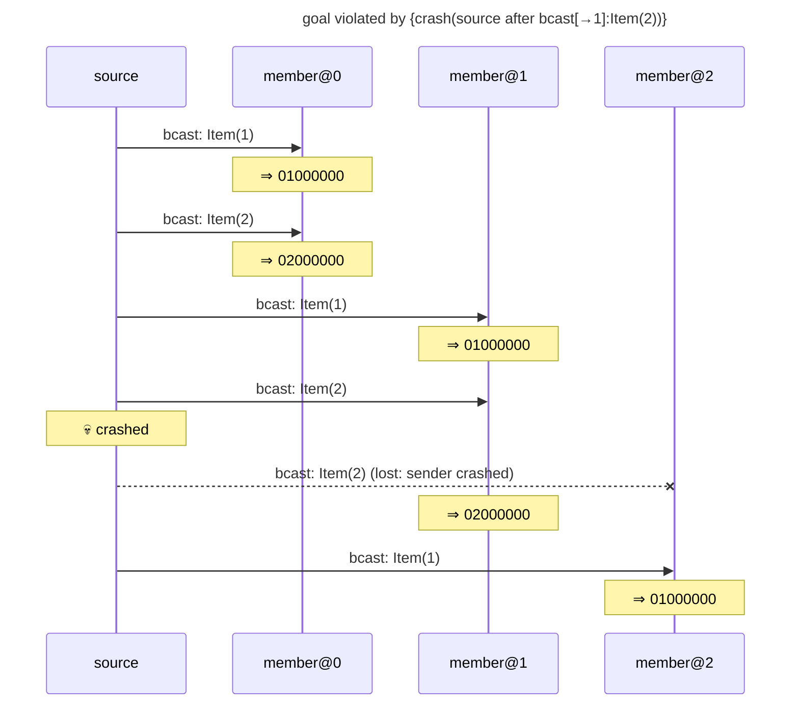

# goal violated by {crash(source after bcast[→1]:Item(2))}

Found after 5 hypothesis run(s), 5 schedule(s) explored.

## The failing run



## Why the goal held before

The goal's support in the last run in which it held: {bcast[→0]:Item(1)←source#0, bcast[→0]:Item(2)←source#3, bcast[→1]:Item(1)←source#1, bcast[→1]:Item(2)←source#4, observed[0→]:(0, [1, 0, 0, 0]) from member@0 through send #0←member@0#0, observed[0→]:(0, [2, 0, 0, 0]) from member@0 through send #0←member@0#0, observed[1→]:(0, [1, 0, 0, 0]) from member@1 through send #0←member@1#0, observed[1→]:(0, [2, 0, 0, 0]) from member@1 through send #0←member@1#0}

```mermaid
---
title: goal held under {crash(member@2 before any send)}: its support (★)
---
sequenceDiagram
    participant p0 as source
    participant p1 as member@0
    participant p2 as member@1
    participant p3 as member@2
    Note over p3: 💀 crashed before any send
    rect rgb(255, 243, 205)
    p0->>p1: ★ bcast: Item(1)
    end
    Note over p1: ⇒ 01000000
    rect rgb(255, 243, 205)
    p0->>p1: ★ bcast: Item(2)
    end
    Note over p1: ⇒ 02000000
    rect rgb(255, 243, 205)
    p0->>p2: ★ bcast: Item(1)
    end
    Note over p2: ⇒ 01000000
    rect rgb(255, 243, 205)
    p0->>p2: ★ bcast: Item(2)
    end
    Note over p2: ⇒ 02000000
    p0->>p3: bcast: Item(1)
    Note over p3: ⇒ 01000000 (suppressed: node crashed)
    p0->>p3: bcast: Item(2)
    Note over p3: ⇒ 02000000 (suppressed: node crashed)
```

