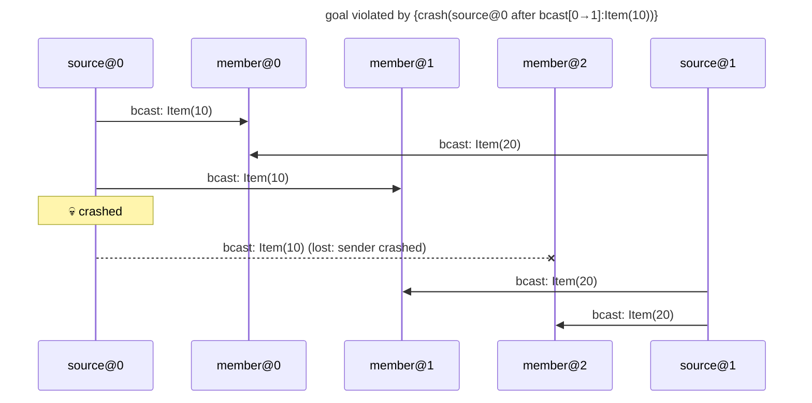

# goal violated by {crash(source@0 after bcast[0→1]:Item(10))}

Found after 5 hypothesis run(s), 5 schedule(s) explored.

## The failing run



## Why the goal held before

The goal's support in the last run in which it held: {bcast[0→0]:Item(10)←source@0#0, bcast[0→1]:Item(10)←source@0#1, bcast[1→0]:Item(20)←source@1#0, bcast[1→1]:Item(20)←source@1#1, observed[0→]:Item(10) from member@0 through send #0←member@0#0, observed[0→]:Item(20) from member@0 through send #0←member@0#0, observed[1→]:Item(10) from member@1 through send #0←member@1#0, observed[1→]:Item(20) from member@1 through send #0←member@1#0}

```mermaid
---
title: goal held under {crash(member@2 before any send)}: its support (★)
---
sequenceDiagram
    participant p0 as source@0
    participant p1 as member@0
    participant p2 as member@1
    participant p3 as member@2
    participant p4 as source@1
    Note over p3: 💀 crashed before any send
    rect rgb(255, 243, 205)
    p0->>p1: ★ bcast: Item(10)
    end
    rect rgb(255, 243, 205)
    p4->>p1: ★ bcast: Item(20)
    end
    rect rgb(255, 243, 205)
    p0->>p2: ★ bcast: Item(10)
    end
    rect rgb(255, 243, 205)
    p4->>p2: ★ bcast: Item(20)
    end
    p0->>p3: bcast: Item(10)
    p4->>p3: bcast: Item(20)
```

