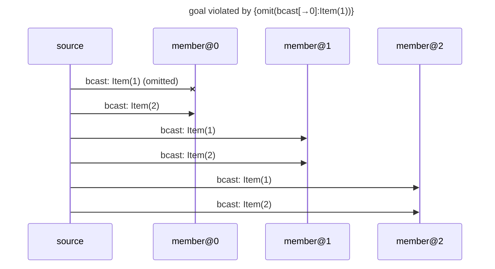

# goal violated by {omit(bcast[→0]:Item(1))}

Found after 2 hypothesis run(s), 2 schedule(s) explored.

## The failing run



## Why the goal held before

The goal's support in the last run in which it held: {bcast[→0]:Item(1)←source#0, bcast[→0]:Item(2)←source#3, bcast[→1]:Item(1)←source#1, bcast[→1]:Item(2)←source#4, bcast[→2]:Item(1)←source#2, bcast[→2]:Item(2)←source#5, observed[0→]:Item(1) from member@0 through send #0←member@0#0, observed[0→]:Item(2) from member@0 through send #0←member@0#0, observed[1→]:Item(1) from member@1 through send #0←member@1#0, observed[1→]:Item(2) from member@1 through send #0←member@1#0, observed[2→]:Item(1) from member@2 through send #0←member@2#0, observed[2→]:Item(2) from member@2 through send #0←member@2#0}

```mermaid
---
title: goal held under {}: its support (★)
---
sequenceDiagram
    participant p0 as source
    participant p1 as member@0
    participant p2 as member@1
    participant p3 as member@2
    rect rgb(255, 243, 205)
    p0->>p1: ★ bcast: Item(1)
    end
    rect rgb(255, 243, 205)
    p0->>p1: ★ bcast: Item(2)
    end
    rect rgb(255, 243, 205)
    p0->>p2: ★ bcast: Item(1)
    end
    rect rgb(255, 243, 205)
    p0->>p2: ★ bcast: Item(2)
    end
    rect rgb(255, 243, 205)
    p0->>p3: ★ bcast: Item(1)
    end
    rect rgb(255, 243, 205)
    p0->>p3: ★ bcast: Item(2)
    end
```

