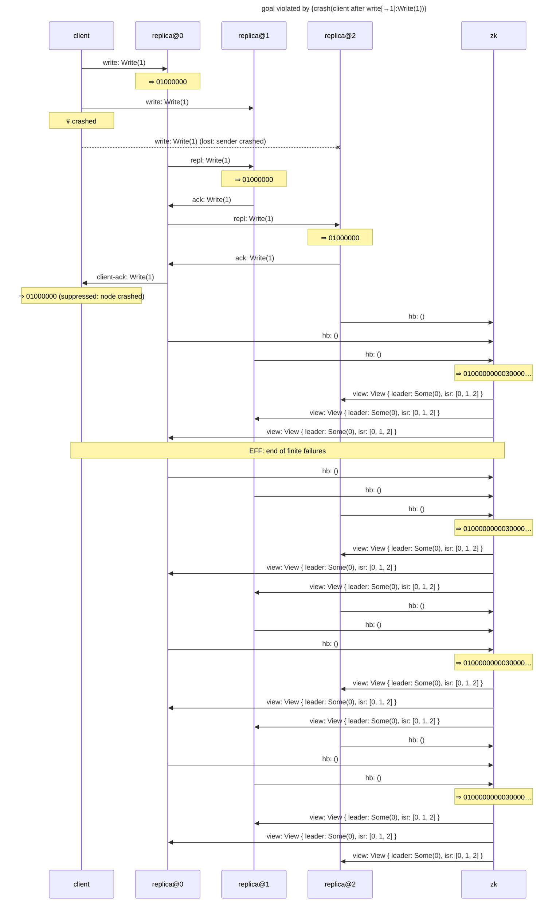

# goal violated by {crash(client after write[→1]:Write(1))}

Found after 2 hypothesis run(s), 16 schedule(s) explored.

## The failing run



## Why the goal held before

The goal's support in the last run in which it held: {write[→0]:Write(1)←client#0, write[→1]:Write(1)←client#1, write[→2]:Write(1)←client#2, observed[0→]:(1, [1, 0, 0, 0]) from replica@0 through send #0←replica@0#0, observed[1→]:(1, [1, 0, 0, 0]) from replica@1 through send #0←replica@1#0, observed[2→]:(1, [1, 0, 0, 0]) from replica@2 through send #0←replica@2#0}

```mermaid
---
title: goal held under {}: its support (★)
---
sequenceDiagram
    participant p0 as client
    participant p1 as replica@0
    participant p2 as replica@1
    participant p3 as replica@2
    participant p4 as zk
    rect rgb(255, 243, 205)
    p0->>p1: ★ write: Write(1)
    end
    Note over p1: ⇒ 01000000
    rect rgb(255, 243, 205)
    p0->>p2: ★ write: Write(1)
    end
    p1->>p2: repl: Write(1)
    Note over p2: ⇒ 01000000
    rect rgb(255, 243, 205)
    p0->>p3: ★ write: Write(1)
    end
    p1->>p3: repl: Write(1)
    Note over p3: ⇒ 01000000
    p2->>p1: ack: Write(1)
    p3->>p1: ack: Write(1)
    p1->>p0: client-ack: Write(1)
    Note over p0: ⇒ 01000000
    p3->>p4: hb: ()
    p1->>p4: hb: ()
    p2->>p4: hb: ()
    Note over p4: ⇒ 0100000000030000…
    p4->>p2: view: View { leader: Some(0), isr: [0, 1, 2] }
    p4->>p3: view: View { leader: Some(0), isr: [0, 1, 2] }
    p4->>p1: view: View { leader: Some(0), isr: [0, 1, 2] }
    Note over p0,p4: EFF: end of finite failures
    p2->>p4: hb: ()
    p3->>p4: hb: ()
    p1->>p4: hb: ()
    Note over p4: ⇒ 0100000000030000…
    p4->>p3: view: View { leader: Some(0), isr: [0, 1, 2] }
    p4->>p2: view: View { leader: Some(0), isr: [0, 1, 2] }
    p4->>p1: view: View { leader: Some(0), isr: [0, 1, 2] }
    p2->>p4: hb: ()
    p1->>p4: hb: ()
    p3->>p4: hb: ()
    Note over p4: ⇒ 0100000000030000…
    p4->>p3: view: View { leader: Some(0), isr: [0, 1, 2] }
    p4->>p1: view: View { leader: Some(0), isr: [0, 1, 2] }
    p4->>p2: view: View { leader: Some(0), isr: [0, 1, 2] }
    p2->>p4: hb: ()
    p1->>p4: hb: ()
    p3->>p4: hb: ()
    Note over p4: ⇒ 0100000000030000…
    p4->>p1: view: View { leader: Some(0), isr: [0, 1, 2] }
    p4->>p3: view: View { leader: Some(0), isr: [0, 1, 2] }
    p4->>p2: view: View { leader: Some(0), isr: [0, 1, 2] }
```

