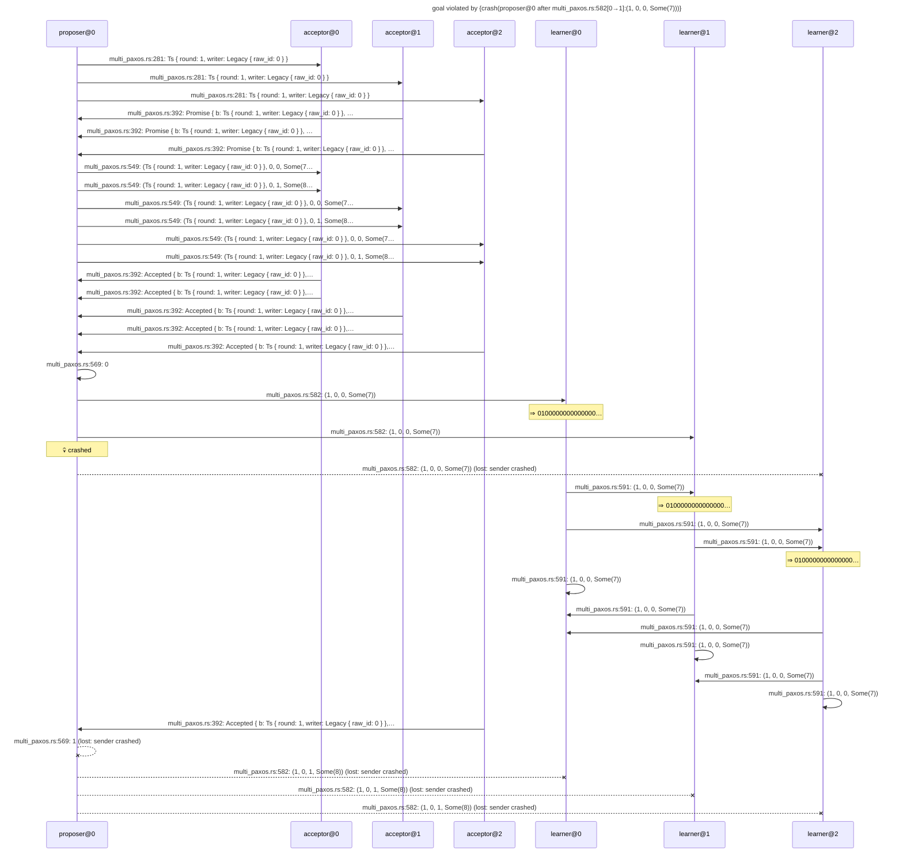

# goal violated by {crash(proposer@0 after multi_paxos.rs:582[0→1]:(1, 0, 0, Some(7)))}

Found after 10 hypothesis run(s), 80 schedule(s) explored.

## The failing run



## Why the goal held before

The goal's support in the last run in which it held: {multi_paxos.rs:281[0→0]:Ts { round: 1, writer: Legacy { raw_id: 0 } }←proposer@0#0, multi_paxos.rs:281[0→1]:Ts { round: 1, writer: Legacy { raw_id: 0 } }←proposer@0#1, multi_paxos.rs:281[0→2]:Ts { round: 1, writer: Legacy { raw_id: 0 } }←proposer@0#2, multi_paxos.rs:392[0→0]:Promise { b: Ts { round: 1, writer: Legacy { raw_id: 0 } }, accepted: [] }←acceptor@0#0, multi_paxos.rs:392[0→0]:Accepted { b: Ts { round: 1, writer: Legacy { raw_id: 0 } }, start: 0, slot: 0, value: Some(7) }←acceptor@0#2, multi_paxos.rs:392[0→0]:Accepted { b: Ts { round: 1, writer: Legacy { raw_id: 0 } }, start: 0, slot: 1, value: Some(8) }←acceptor@0#1, multi_paxos.rs:392[1→0]:Promise { b: Ts { round: 1, writer: Legacy { raw_id: 0 } }, accepted: [] }←acceptor@1#0, multi_paxos.rs:392[1→0]:Accepted { b: Ts { round: 1, writer: Legacy { raw_id: 0 } }, start: 0, slot: 0, value: Some(7) }←acceptor@1#1, multi_paxos.rs:392[1→0]:Accepted { b: Ts { round: 1, writer: Legacy { raw_id: 0 } }, start: 0, slot: 1, value: Some(8) }←acceptor@1#2, multi_paxos.rs:392[2→0]:Promise { b: Ts { round: 1, writer: Legacy { raw_id: 0 } }, accepted: [] }←acceptor@2#0, multi_paxos.rs:392[2→0]:Accepted { b: Ts { round: 1, writer: Legacy { raw_id: 0 } }, start: 0, slot: 0, value: Some(7) }←acceptor@2#1, multi_paxos.rs:392[2→0]:Accepted { b: Ts { round: 1, writer: Legacy { raw_id: 0 } }, start: 0, slot: 1, value: Some(8) }←acceptor@2#2, multi_paxos.rs:549[0→0]:(Ts { round: 1, writer: Legacy { raw_id: 0 } }, 0, 0, Some(7))←proposer@0#3, multi_paxos.rs:549[0→0]:(Ts { round: 1, writer: Legacy { raw_id: 0 } }, 0, 1, Some(8))←proposer@0#6, multi_paxos.rs:549[0→1]:(Ts { round: 1, writer: Legacy { raw_id: 0 } }, 0, 0, Some(7))←proposer@0#4, multi_paxos.rs:549[0→1]:(Ts { round: 1, writer: Legacy { raw_id: 0 } }, 0, 1, Some(8))←proposer@0#7, multi_paxos.rs:549[0→2]:(Ts { round: 1, writer: Legacy { raw_id: 0 } }, 0, 0, Some(7))←proposer@0#5, multi_paxos.rs:549[0→2]:(Ts { round: 1, writer: Legacy { raw_id: 0 } }, 0, 1, Some(8))←proposer@0#8, multi_paxos.rs:569[0→0]:0←proposer@0#9, multi_paxos.rs:569[0→0]:1←proposer@0#13, multi_paxos.rs:582[0→0]:(1, 0, 0, Some(7))←proposer@0#10, multi_paxos.rs:582[0→0]:(1, 0, 1, Some(8))←proposer@0#14, multi_paxos.rs:582[0→1]:(1, 0, 0, Some(7))←proposer@0#11, multi_paxos.rs:582[0→1]:(1, 0, 1, Some(8))←proposer@0#15, observed[0→]:(5, [0, 0, 0, 0, 0, 0, 0, 0, 1, 0, 0, 0, 0, 0, 0, 0, 0, 0, 0, 0, 0, 0, 0, 0, 0, 0, 0, 0, 0, 0, 0, 0, 1, 7, 0, 0, 0]) from learner@0 through send #0←learner@0#0, observed[0→]:(5, [0, 0, 0, 0, 0, 0, 0, 0, 1, 0, 0, 0, 0, 0, 0, 0, 0, 0, 0, 0, 0, 0, 0, 0, 1, 0, 0, 0, 0, 0, 0, 0, 1, 8, 0, 0, 0]) from learner@0 through send #3←learner@0#3, observed[1→]:(5, [0, 0, 0, 0, 0, 0, 0, 0, 1, 0, 0, 0, 0, 0, 0, 0, 0, 0, 0, 0, 0, 0, 0, 0, 0, 0, 0, 0, 0, 0, 0, 0, 1, 7, 0, 0, 0]) from learner@1 through send #0←learner@1#0, observed[1→]:(5, [0, 0, 0, 0, 0, 0, 0, 0, 1, 0, 0, 0, 0, 0, 0, 0, 0, 0, 0, 0, 0, 0, 0, 0, 1, 0, 0, 0, 0, 0, 0, 0, 1, 8, 0, 0, 0]) from learner@1 through send #3←learner@1#3}

```mermaid
---
title: goal held under {crash(learner@2 before any send)}: its support (★)
---
sequenceDiagram
    participant p0 as proposer@0
    participant p1 as acceptor@0
    participant p2 as acceptor@1
    participant p3 as acceptor@2
    participant p4 as learner@0
    participant p5 as learner@1
    participant p6 as learner@2
    Note over p6: 💀 crashed before any send
    rect rgb(255, 243, 205)
    p0->>p1: ★ multi_paxos.rs:281: Ts { round: 1, writer: Legacy { raw_id: 0 } }
    end
    rect rgb(255, 243, 205)
    p0->>p2: ★ multi_paxos.rs:281: Ts { round: 1, writer: Legacy { raw_id: 0 } }
    end
    rect rgb(255, 243, 205)
    p0->>p3: ★ multi_paxos.rs:281: Ts { round: 1, writer: Legacy { raw_id: 0 } }
    end
    rect rgb(255, 243, 205)
    p2->>p0: ★ multi_paxos.rs:392: Promise { b: Ts { round: 1, writer: Legacy { raw_id: 0 } }, …
    end
    rect rgb(255, 243, 205)
    p1->>p0: ★ multi_paxos.rs:392: Promise { b: Ts { round: 1, writer: Legacy { raw_id: 0 } }, …
    end
    rect rgb(255, 243, 205)
    p3->>p0: ★ multi_paxos.rs:392: Promise { b: Ts { round: 1, writer: Legacy { raw_id: 0 } }, …
    end
    rect rgb(255, 243, 205)
    p0->>p1: ★ multi_paxos.rs:549: (Ts { round: 1, writer: Legacy { raw_id: 0 } }, 0, 0, Some(7…
    end
    rect rgb(255, 243, 205)
    p0->>p2: ★ multi_paxos.rs:549: (Ts { round: 1, writer: Legacy { raw_id: 0 } }, 0, 0, Some(7…
    end
    rect rgb(255, 243, 205)
    p0->>p3: ★ multi_paxos.rs:549: (Ts { round: 1, writer: Legacy { raw_id: 0 } }, 0, 0, Some(7…
    end
    rect rgb(255, 243, 205)
    p0->>p1: ★ multi_paxos.rs:549: (Ts { round: 1, writer: Legacy { raw_id: 0 } }, 0, 1, Some(8…
    end
    rect rgb(255, 243, 205)
    p0->>p2: ★ multi_paxos.rs:549: (Ts { round: 1, writer: Legacy { raw_id: 0 } }, 0, 1, Some(8…
    end
    rect rgb(255, 243, 205)
    p0->>p3: ★ multi_paxos.rs:549: (Ts { round: 1, writer: Legacy { raw_id: 0 } }, 0, 1, Some(8…
    end
    rect rgb(255, 243, 205)
    p2->>p0: ★ multi_paxos.rs:392: Accepted { b: Ts { round: 1, writer: Legacy { raw_id: 0 } },…
    end
    rect rgb(255, 243, 205)
    p2->>p0: ★ multi_paxos.rs:392: Accepted { b: Ts { round: 1, writer: Legacy { raw_id: 0 } },…
    end
    rect rgb(255, 243, 205)
    p3->>p0: ★ multi_paxos.rs:392: Accepted { b: Ts { round: 1, writer: Legacy { raw_id: 0 } },…
    end
    rect rgb(255, 243, 205)
    p3->>p0: ★ multi_paxos.rs:392: Accepted { b: Ts { round: 1, writer: Legacy { raw_id: 0 } },…
    end
    rect rgb(255, 243, 205)
    p1->>p0: ★ multi_paxos.rs:392: Accepted { b: Ts { round: 1, writer: Legacy { raw_id: 0 } },…
    end
    rect rgb(255, 243, 205)
    p1->>p0: ★ multi_paxos.rs:392: Accepted { b: Ts { round: 1, writer: Legacy { raw_id: 0 } },…
    end
    rect rgb(255, 243, 205)
    p0->>p0: ★ multi_paxos.rs:569: 0
    end
    rect rgb(255, 243, 205)
    p0->>p4: ★ multi_paxos.rs:582: (1, 0, 0, Some(7))
    end
    Note over p4: ⇒ 0100000000000000…
    rect rgb(255, 243, 205)
    p0->>p5: ★ multi_paxos.rs:582: (1, 0, 0, Some(7))
    end
    p4->>p5: multi_paxos.rs:591: (1, 0, 0, Some(7))
    Note over p5: ⇒ 0100000000000000…
    p0->>p6: multi_paxos.rs:582: (1, 0, 0, Some(7))
    p4->>p6: multi_paxos.rs:591: (1, 0, 0, Some(7))
    p5->>p6: multi_paxos.rs:591: (1, 0, 0, Some(7))
    Note over p6: ⇒ 0100000000000000… (suppressed: node crashed)
    p6--xp4: multi_paxos.rs:591: (1, 0, 0, Some(7)) (lost: sender crashed)
    p6--xp5: multi_paxos.rs:591: (1, 0, 0, Some(7)) (lost: sender crashed)
    p6--xp6: multi_paxos.rs:591: (1, 0, 0, Some(7)) (lost: sender crashed)
    p4->>p4: multi_paxos.rs:591: (1, 0, 0, Some(7))
    p5->>p4: multi_paxos.rs:591: (1, 0, 0, Some(7))
    p5->>p5: multi_paxos.rs:591: (1, 0, 0, Some(7))
    rect rgb(255, 243, 205)
    p0->>p0: ★ multi_paxos.rs:569: 1
    end
    rect rgb(255, 243, 205)
    p0->>p4: ★ multi_paxos.rs:582: (1, 0, 1, Some(8))
    end
    Note over p4: ⇒ 0100000000000000…
    rect rgb(255, 243, 205)
    p0->>p5: ★ multi_paxos.rs:582: (1, 0, 1, Some(8))
    end
    p4->>p5: multi_paxos.rs:591: (1, 0, 1, Some(8))
    Note over p5: ⇒ 0100000000000000…
    p0->>p6: multi_paxos.rs:582: (1, 0, 1, Some(8))
    p4->>p6: multi_paxos.rs:591: (1, 0, 1, Some(8))
    p5->>p6: multi_paxos.rs:591: (1, 0, 1, Some(8))
    Note over p6: ⇒ 0100000000000000… (suppressed: node crashed)
    p6--xp4: multi_paxos.rs:591: (1, 0, 1, Some(8)) (lost: sender crashed)
    p6--xp5: multi_paxos.rs:591: (1, 0, 1, Some(8)) (lost: sender crashed)
    p6--xp6: multi_paxos.rs:591: (1, 0, 1, Some(8)) (lost: sender crashed)
    p4->>p4: multi_paxos.rs:591: (1, 0, 1, Some(8))
    p5->>p4: multi_paxos.rs:591: (1, 0, 1, Some(8))
    p5->>p5: multi_paxos.rs:591: (1, 0, 1, Some(8))
```

