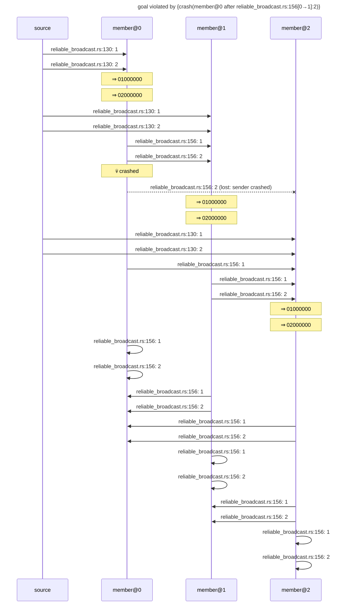

# goal violated by {crash(member@0 after reliable_broadcast.rs:156[0→1]:2)}

Found after 3 hypothesis run(s), 3 schedule(s) explored.

## The failing run



## Why the goal held before

The goal's support in the last run in which it held: {reliable_broadcast.rs:130[→0]:1←source#0, reliable_broadcast.rs:130[→0]:2←source#3, reliable_broadcast.rs:130[→1]:1←source#1, reliable_broadcast.rs:130[→1]:2←source#4, reliable_broadcast.rs:130[→2]:1←source#2, reliable_broadcast.rs:130[→2]:2←source#5, reliable_broadcast.rs:156[0→1]:1←member@0#1, reliable_broadcast.rs:156[0→1]:2←member@0#4, reliable_broadcast.rs:156[0→2]:1←member@0#2, reliable_broadcast.rs:156[0→2]:2←member@0#5, reliable_broadcast.rs:156[1→1]:1←member@1#1, reliable_broadcast.rs:156[1→1]:2←member@1#4, reliable_broadcast.rs:156[1→2]:1←member@1#2, reliable_broadcast.rs:156[1→2]:2←member@1#5, reliable_broadcast.rs:156[2→1]:1←member@2#1, reliable_broadcast.rs:156[2→1]:2←member@2#4, reliable_broadcast.rs:156[2→2]:1←member@2#2, reliable_broadcast.rs:156[2→2]:2←member@2#5, observed[1→]:(1, [0, 0, 0, 0, 0, 0, 0, 0, 1, 0, 0, 0]) from member@1 through send #0←member@1#0, observed[1→]:(1, [0, 0, 0, 0, 0, 0, 0, 0, 2, 0, 0, 0]) from member@1 through send #0←member@1#0, observed[1→]:(1, [0, 0, 0, 0, 1, 0, 0, 0, 1, 0, 0, 0]) from member@1 through send #6←member@1#6, observed[1→]:(1, [0, 0, 0, 0, 1, 0, 0, 0, 2, 0, 0, 0]) from member@1 through send #6←member@1#6, observed[1→]:(1, [0, 0, 0, 0, 2, 0, 0, 0, 1, 0, 0, 0]) from member@1 through send #6←member@1#6, observed[1→]:(1, [0, 0, 0, 0, 2, 0, 0, 0, 2, 0, 0, 0]) from member@1 through send #6←member@1#6, observed[2→]:(1, [0, 0, 0, 0, 0, 0, 0, 0, 1, 0, 0, 0]) from member@2 through send #0←member@2#0, observed[2→]:(1, [0, 0, 0, 0, 0, 0, 0, 0, 2, 0, 0, 0]) from member@2 through send #0←member@2#0, observed[2→]:(1, [0, 0, 0, 0, 1, 0, 0, 0, 1, 0, 0, 0]) from member@2 through send #0←member@2#0, observed[2→]:(1, [0, 0, 0, 0, 1, 0, 0, 0, 2, 0, 0, 0]) from member@2 through send #0←member@2#0, observed[2→]:(1, [0, 0, 0, 0, 2, 0, 0, 0, 1, 0, 0, 0]) from member@2 through send #6←member@2#6, observed[2→]:(1, [0, 0, 0, 0, 2, 0, 0, 0, 2, 0, 0, 0]) from member@2 through send #6←member@2#6, observed[1→]:(1, [0, 0, 0, 0, 0, 0, 0, 0]) from member@1 through send #0←member@1#0, observed[1→]:(1, [0, 0, 0, 0, 1, 0, 0, 0]) from member@1 through send #0←member@1#0, observed[1→]:(1, [0, 0, 0, 0, 2, 0, 0, 0]) from member@1 through send #0←member@1#0, observed[2→]:(1, [0, 0, 0, 0, 0, 0, 0, 0]) from member@2 through send #0←member@2#0, observed[2→]:(1, [0, 0, 0, 0, 1, 0, 0, 0]) from member@2 through send #0←member@2#0, observed[2→]:(1, [0, 0, 0, 0, 2, 0, 0, 0]) from member@2 through send #0←member@2#0}

```mermaid
---
title: goal held under {crash(member@0 after reliable_broadcast.rs:156[0→2]:2)}: its support (★)
---
sequenceDiagram
    participant p0 as source
    participant p1 as member@0
    participant p2 as member@1
    participant p3 as member@2
    rect rgb(255, 243, 205)
    p0->>p1: ★ reliable_broadcast.rs:130: 1
    end
    rect rgb(255, 243, 205)
    p0->>p1: ★ reliable_broadcast.rs:130: 2
    end
    Note over p1: ⇒ 01000000
    Note over p1: ⇒ 02000000
    rect rgb(255, 243, 205)
    p0->>p2: ★ reliable_broadcast.rs:130: 1
    end
    rect rgb(255, 243, 205)
    p0->>p2: ★ reliable_broadcast.rs:130: 2
    end
    rect rgb(255, 243, 205)
    p1->>p2: ★ reliable_broadcast.rs:156: 1
    end
    rect rgb(255, 243, 205)
    p1->>p2: ★ reliable_broadcast.rs:156: 2
    end
    Note over p2: ⇒ 01000000
    Note over p2: ⇒ 02000000
    rect rgb(255, 243, 205)
    p0->>p3: ★ reliable_broadcast.rs:130: 1
    end
    rect rgb(255, 243, 205)
    p0->>p3: ★ reliable_broadcast.rs:130: 2
    end
    rect rgb(255, 243, 205)
    p1->>p3: ★ reliable_broadcast.rs:156: 1
    end
    rect rgb(255, 243, 205)
    p1->>p3: ★ reliable_broadcast.rs:156: 2
    end
    Note over p1: 💀 crashed
    rect rgb(255, 243, 205)
    p2->>p3: ★ reliable_broadcast.rs:156: 1
    end
    rect rgb(255, 243, 205)
    p2->>p3: ★ reliable_broadcast.rs:156: 2
    end
    Note over p3: ⇒ 01000000
    Note over p3: ⇒ 02000000
    p1->>p1: reliable_broadcast.rs:156: 1
    p1->>p1: reliable_broadcast.rs:156: 2
    p2->>p1: reliable_broadcast.rs:156: 1
    p2->>p1: reliable_broadcast.rs:156: 2
    p3->>p1: reliable_broadcast.rs:156: 1
    p3->>p1: reliable_broadcast.rs:156: 2
    rect rgb(255, 243, 205)
    p2->>p2: ★ reliable_broadcast.rs:156: 1
    end
    rect rgb(255, 243, 205)
    p2->>p2: ★ reliable_broadcast.rs:156: 2
    end
    rect rgb(255, 243, 205)
    p3->>p2: ★ reliable_broadcast.rs:156: 1
    end
    rect rgb(255, 243, 205)
    p3->>p2: ★ reliable_broadcast.rs:156: 2
    end
    rect rgb(255, 243, 205)
    p3->>p3: ★ reliable_broadcast.rs:156: 1
    end
    rect rgb(255, 243, 205)
    p3->>p3: ★ reliable_broadcast.rs:156: 2
    end
```

