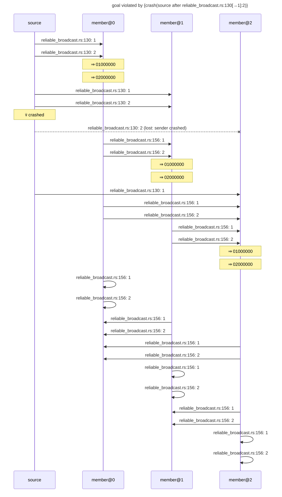

# goal violated by {crash(source after reliable_broadcast.rs:130[→1]:2)}

Found after 5 hypothesis run(s), 5 schedule(s) explored.

## The failing run



## Why the goal held before

The goal's support in the last run in which it held: {reliable_broadcast.rs:130[→0]:1←source#0, reliable_broadcast.rs:130[→0]:2←source#3, reliable_broadcast.rs:130[→1]:1←source#1, reliable_broadcast.rs:130[→1]:2←source#4, observed[0→]:(0, [1, 0, 0, 0]) from member@0 through send #0←member@0#0, observed[0→]:(0, [2, 0, 0, 0]) from member@0 through send #0←member@0#0, observed[1→]:(0, [1, 0, 0, 0]) from member@1 through send #0←member@1#0, observed[1→]:(0, [2, 0, 0, 0]) from member@1 through send #0←member@1#0}

```mermaid
---
title: goal held under {crash(member@2 before any send)}: its support (★)
---
sequenceDiagram
    participant p0 as source
    participant p1 as member@0
    participant p2 as member@1
    participant p3 as member@2
    Note over p3: 💀 crashed before any send
    rect rgb(255, 243, 205)
    p0->>p1: ★ reliable_broadcast.rs:130: 1
    end
    rect rgb(255, 243, 205)
    p0->>p1: ★ reliable_broadcast.rs:130: 2
    end
    Note over p1: ⇒ 01000000
    Note over p1: ⇒ 02000000
    rect rgb(255, 243, 205)
    p0->>p2: ★ reliable_broadcast.rs:130: 1
    end
    rect rgb(255, 243, 205)
    p0->>p2: ★ reliable_broadcast.rs:130: 2
    end
    p1->>p2: reliable_broadcast.rs:156: 1
    p1->>p2: reliable_broadcast.rs:156: 2
    Note over p2: ⇒ 01000000
    Note over p2: ⇒ 02000000
    p0->>p3: reliable_broadcast.rs:130: 1
    p0->>p3: reliable_broadcast.rs:130: 2
    p1->>p3: reliable_broadcast.rs:156: 1
    p1->>p3: reliable_broadcast.rs:156: 2
    p2->>p3: reliable_broadcast.rs:156: 1
    p2->>p3: reliable_broadcast.rs:156: 2
    Note over p3: ⇒ 01000000 (suppressed: node crashed)
    Note over p3: ⇒ 02000000 (suppressed: node crashed)
    p3--xp1: reliable_broadcast.rs:156: 1 (lost: sender crashed)
    p3--xp2: reliable_broadcast.rs:156: 1 (lost: sender crashed)
    p3--xp3: reliable_broadcast.rs:156: 1 (lost: sender crashed)
    p3--xp1: reliable_broadcast.rs:156: 2 (lost: sender crashed)
    p3--xp2: reliable_broadcast.rs:156: 2 (lost: sender crashed)
    p3--xp3: reliable_broadcast.rs:156: 2 (lost: sender crashed)
    p1->>p1: reliable_broadcast.rs:156: 1
    p1->>p1: reliable_broadcast.rs:156: 2
    p2->>p1: reliable_broadcast.rs:156: 1
    p2->>p1: reliable_broadcast.rs:156: 2
    p2->>p2: reliable_broadcast.rs:156: 1
    p2->>p2: reliable_broadcast.rs:156: 2
```

