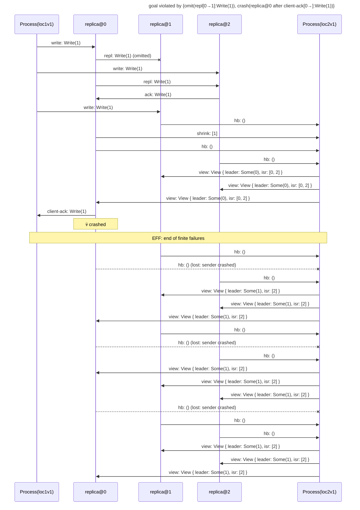

# goal violated by {omit(repl[0→1]:Write(1)), crash(replica@0 after client-ack[0→]:Write(1))}

Found after 14 hypothesis run(s), 112 schedule(s) explored.

## The failing run



## Why the goal held before

The goal's support in the last run in which it held: {shrink[0→]:[1, 2]←replica@0#2, hb[0→]:()←replica@0#3, hb[0→]:()←replica@0#5, hb[0→]:()←replica@0#6, hb[0→]:()←replica@0#7, hb[1→]:()←replica@1#0, hb[1→]:()←replica@1#1, hb[1→]:()←replica@1#2, hb[1→]:()←replica@1#3, hb[2→]:()←replica@2#0, hb[2→]:()←replica@2#1, hb[2→]:()←replica@2#2, hb[2→]:()←replica@2#3, client-ack[0→]:Write(1)←replica@0#4, observed[0→]:Write(1) from replica@0 through send #2←replica@0#2}

```mermaid
---
title: goal held under {omit(repl[0→1]:Write(1)), omit(repl[0→2]:Write(1))}: its support (★)
---
sequenceDiagram
    participant p0 as Process(loc1v1)
    participant p1 as replica@0
    participant p2 as replica@1
    participant p3 as replica@2
    participant p4 as Process(loc2v1)
    p0->>p1: write: Write(1)
    p1-xp2: repl: Write(1) (omitted)
    p1-xp3: repl: Write(1) (omitted)
    p0->>p3: write: Write(1)
    p0->>p2: write: Write(1)
    rect rgb(255, 243, 205)
    p1->>p4: ★ shrink: [1, 2]
    end
    rect rgb(255, 243, 205)
    p1->>p4: ★ hb: ()
    end
    rect rgb(255, 243, 205)
    p3->>p4: ★ hb: ()
    end
    rect rgb(255, 243, 205)
    p2->>p4: ★ hb: ()
    end
    p4->>p1: view: View { leader: Some(0), isr: [0] }
    rect rgb(255, 243, 205)
    p1->>p0: ★ client-ack: Write(1)
    end
    p4->>p3: view: View { leader: Some(0), isr: [0] }
    p4->>p2: view: View { leader: Some(0), isr: [0] }
    Note over p0,p4: EFF: end of finite failures
    rect rgb(255, 243, 205)
    p2->>p4: ★ hb: ()
    end
    rect rgb(255, 243, 205)
    p1->>p4: ★ hb: ()
    end
    rect rgb(255, 243, 205)
    p3->>p4: ★ hb: ()
    end
    p4->>p3: view: View { leader: Some(0), isr: [0] }
    p4->>p2: view: View { leader: Some(0), isr: [0] }
    p4->>p1: view: View { leader: Some(0), isr: [0] }
    rect rgb(255, 243, 205)
    p3->>p4: ★ hb: ()
    end
    rect rgb(255, 243, 205)
    p2->>p4: ★ hb: ()
    end
    rect rgb(255, 243, 205)
    p1->>p4: ★ hb: ()
    end
    p4->>p2: view: View { leader: Some(0), isr: [0] }
    p4->>p3: view: View { leader: Some(0), isr: [0] }
    p4->>p1: view: View { leader: Some(0), isr: [0] }
    rect rgb(255, 243, 205)
    p2->>p4: ★ hb: ()
    end
    rect rgb(255, 243, 205)
    p3->>p4: ★ hb: ()
    end
    rect rgb(255, 243, 205)
    p1->>p4: ★ hb: ()
    end
    p4->>p2: view: View { leader: Some(0), isr: [0] }
    p4->>p1: view: View { leader: Some(0), isr: [0] }
    p4->>p3: view: View { leader: Some(0), isr: [0] }
```

