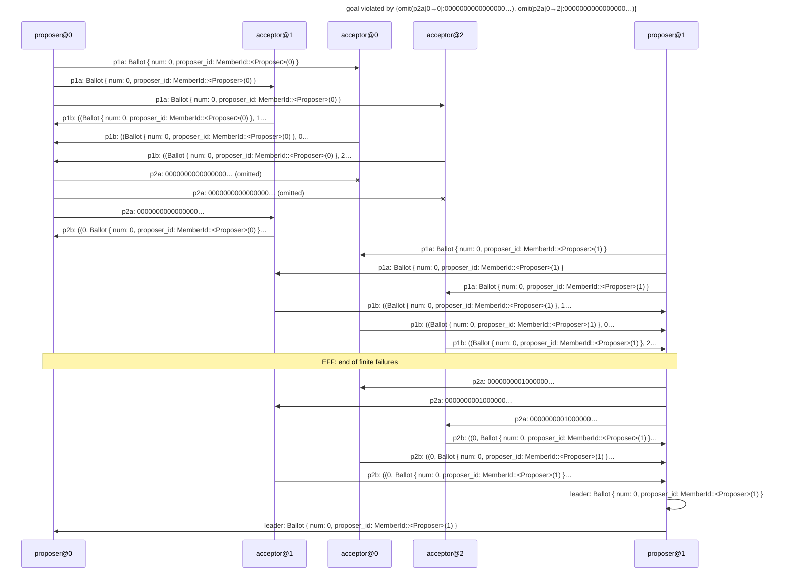

# goal violated by {omit(p2a[0→0]:0000000000000000…), omit(p2a[0→2]:0000000000000000…)}

Found after 37 hypothesis run(s), 148 schedule(s) explored.

## The failing run



## Why the goal held before

The goal's support in the last run in which it held: {p1a[0→0]:Ballot { num: 0, proposer_id: MemberId::<hydro_test::cluster::paxos::Proposer>(0) }←proposer@0#1, p1a[0→1]:Ballot { num: 0, proposer_id: MemberId::<hydro_test::cluster::paxos::Proposer>(0) }←proposer@0#0, p1a[0→2]:Ballot { num: 0, proposer_id: MemberId::<hydro_test::cluster::paxos::Proposer>(0) }←proposer@0#2, p1a[1→0]:Ballot { num: 0, proposer_id: MemberId::<hydro_test::cluster::paxos::Proposer>(1) }←proposer@1#1, p1a[1→1]:Ballot { num: 0, proposer_id: MemberId::<hydro_test::cluster::paxos::Proposer>(1) }←proposer@1#0, p1a[1→2]:Ballot { num: 0, proposer_id: MemberId::<hydro_test::cluster::paxos::Proposer>(1) }←proposer@1#2, p1b[0→0]:((Ballot { num: 0, proposer_id: MemberId::<hydro_test::cluster::paxos::Proposer>(0) }, 0), Ok((None, {})))←acceptor@0#0, p1b[0→1]:((Ballot { num: 0, proposer_id: MemberId::<hydro_test::cluster::paxos::Proposer>(1) }, 0), Ok((None, {})))←acceptor@0#1, p1b[1→0]:((Ballot { num: 0, proposer_id: MemberId::<hydro_test::cluster::paxos::Proposer>(0) }, 1), Ok((None, {})))←acceptor@1#0, p1b[1→1]:((Ballot { num: 0, proposer_id: MemberId::<hydro_test::cluster::paxos::Proposer>(1) }, 1), Ok((None, {0: LogValue { ballot: Ballot { num: 0, proposer_id: MemberId::<hydro_test::cluster::paxos::Proposer>(0) }, value: Some("x") }})))←acceptor@1#2, p1b[2→0]:((Ballot { num: 0, proposer_id: MemberId::<hydro_test::cluster::paxos::Proposer>(0) }, 2), Ok((None, {})))←acceptor@2#0, p1b[2→1]:((Ballot { num: 0, proposer_id: MemberId::<hydro_test::cluster::paxos::Proposer>(1) }, 2), Ok((None, {})))←acceptor@2#1, p2a[0→1]:0000000000000000…←proposer@0#3, p2a[1→0]:0000000001000000…←proposer@1#4, p2a[1→0]:0000000001000000…←proposer@1#7, p2a[1→1]:0000000001000000…←proposer@1#3, p2a[1→1]:0000000001000000…←proposer@1#6, p2a[1→2]:0000000001000000…←proposer@1#5, p2a[1→2]:0000000001000000…←proposer@1#8, p2b[0→1]:((0, Ballot { num: 0, proposer_id: MemberId::<hydro_test::cluster::paxos::Proposer>(1) }), Ok(()))←acceptor@0#2, p2b[0→1]:((1, Ballot { num: 0, proposer_id: MemberId::<hydro_test::cluster::paxos::Proposer>(1) }), Ok(()))←acceptor@0#3, p2b[1→0]:((0, Ballot { num: 0, proposer_id: MemberId::<hydro_test::cluster::paxos::Proposer>(0) }), Ok(()))←acceptor@1#1, p2b[1→1]:((0, Ballot { num: 0, proposer_id: MemberId::<hydro_test::cluster::paxos::Proposer>(1) }), Ok(()))←acceptor@1#3, p2b[1→1]:((1, Ballot { num: 0, proposer_id: MemberId::<hydro_test::cluster::paxos::Proposer>(1) }), Ok(()))←acceptor@1#4, p2b[2→1]:((0, Ballot { num: 0, proposer_id: MemberId::<hydro_test::cluster::paxos::Proposer>(1) }), Ok(()))←acceptor@2#2, p2b[2→1]:((1, Ballot { num: 0, proposer_id: MemberId::<hydro_test::cluster::paxos::Proposer>(1) }), Ok(()))←acceptor@2#3, observed[0→]:(0, Some("x")) from proposer@0 through send #6←proposer@0#6, observed[1→]:(0, Some("x")) from proposer@1 through send #6←proposer@1#6, observed[1→]:(1, Some("y")) from proposer@1 through send #9←proposer@1#9}

```mermaid
---
title: goal held under {omit(p2a[0→0]:0000000000000000…), omit(p2a[0→2]:0000000000000000…)}: its support (★)
---
sequenceDiagram
    participant p0 as proposer@0
    participant p1 as acceptor@1
    participant p2 as acceptor@0
    participant p3 as acceptor@2
    participant p4 as proposer@1
    rect rgb(255, 243, 205)
    p0->>p2: ★ p1a: Ballot { num: 0, proposer_id: MemberId::<Proposer>(0) }
    end
    rect rgb(255, 243, 205)
    p0->>p1: ★ p1a: Ballot { num: 0, proposer_id: MemberId::<Proposer>(0) }
    end
    rect rgb(255, 243, 205)
    p0->>p3: ★ p1a: Ballot { num: 0, proposer_id: MemberId::<Proposer>(0) }
    end
    rect rgb(255, 243, 205)
    p3->>p0: ★ p1b: ((Ballot { num: 0, proposer_id: MemberId::<Proposer>(0) }, 2…
    end
    rect rgb(255, 243, 205)
    p2->>p0: ★ p1b: ((Ballot { num: 0, proposer_id: MemberId::<Proposer>(0) }, 0…
    end
    rect rgb(255, 243, 205)
    p1->>p0: ★ p1b: ((Ballot { num: 0, proposer_id: MemberId::<Proposer>(0) }, 1…
    end
    p0-xp2: p2a: 0000000000000000… (omitted)
    p0-xp3: p2a: 0000000000000000… (omitted)
    rect rgb(255, 243, 205)
    p0->>p1: ★ p2a: 0000000000000000…
    end
    rect rgb(255, 243, 205)
    p1->>p0: ★ p2b: ((0, Ballot { num: 0, proposer_id: MemberId::<Proposer>(0) }…
    end
    rect rgb(255, 243, 205)
    p4->>p2: ★ p1a: Ballot { num: 0, proposer_id: MemberId::<Proposer>(1) }
    end
    rect rgb(255, 243, 205)
    p4->>p1: ★ p1a: Ballot { num: 0, proposer_id: MemberId::<Proposer>(1) }
    end
    rect rgb(255, 243, 205)
    p4->>p3: ★ p1a: Ballot { num: 0, proposer_id: MemberId::<Proposer>(1) }
    end
    rect rgb(255, 243, 205)
    p2->>p4: ★ p1b: ((Ballot { num: 0, proposer_id: MemberId::<Proposer>(1) }, 0…
    end
    rect rgb(255, 243, 205)
    p3->>p4: ★ p1b: ((Ballot { num: 0, proposer_id: MemberId::<Proposer>(1) }, 2…
    end
    rect rgb(255, 243, 205)
    p1->>p4: ★ p1b: ((Ballot { num: 0, proposer_id: MemberId::<Proposer>(1) }, 1…
    end
    rect rgb(255, 243, 205)
    p4->>p2: ★ p2a: 0000000001000000…
    end
    rect rgb(255, 243, 205)
    p4->>p1: ★ p2a: 0000000001000000…
    end
    rect rgb(255, 243, 205)
    p4->>p3: ★ p2a: 0000000001000000…
    end
    rect rgb(255, 243, 205)
    p1->>p4: ★ p2b: ((0, Ballot { num: 0, proposer_id: MemberId::<Proposer>(1) }…
    end
    rect rgb(255, 243, 205)
    p3->>p4: ★ p2b: ((0, Ballot { num: 0, proposer_id: MemberId::<Proposer>(1) }…
    end
    rect rgb(255, 243, 205)
    p2->>p4: ★ p2b: ((0, Ballot { num: 0, proposer_id: MemberId::<Proposer>(1) }…
    end
    Note over p0,p4: EFF: end of finite failures
    rect rgb(255, 243, 205)
    p4->>p2: ★ p2a: 0000000001000000…
    end
    rect rgb(255, 243, 205)
    p4->>p1: ★ p2a: 0000000001000000…
    end
    rect rgb(255, 243, 205)
    p4->>p3: ★ p2a: 0000000001000000…
    end
    rect rgb(255, 243, 205)
    p3->>p4: ★ p2b: ((1, Ballot { num: 0, proposer_id: MemberId::<Proposer>(1) }…
    end
    rect rgb(255, 243, 205)
    p1->>p4: ★ p2b: ((1, Ballot { num: 0, proposer_id: MemberId::<Proposer>(1) }…
    end
    rect rgb(255, 243, 205)
    p2->>p4: ★ p2b: ((1, Ballot { num: 0, proposer_id: MemberId::<Proposer>(1) }…
    end
    p4->>p4: leader: Ballot { num: 0, proposer_id: MemberId::<Proposer>(1) }
    p4->>p0: leader: Ballot { num: 0, proposer_id: MemberId::<Proposer>(1) }
```

