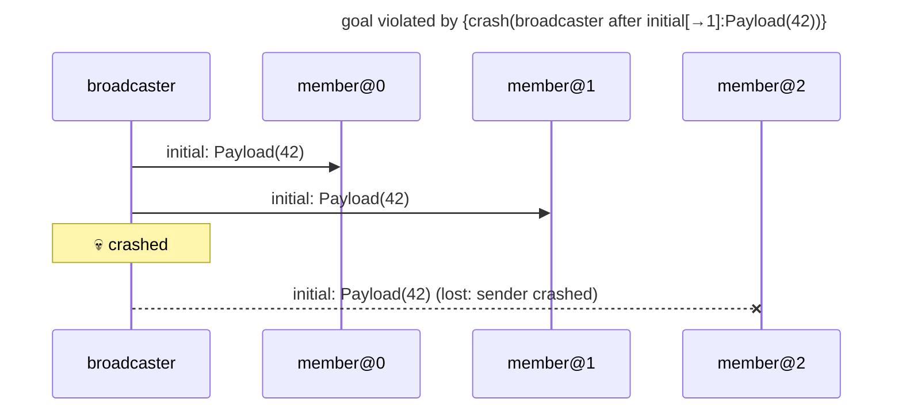

# goal violated by {crash(broadcaster after initial[→1]:Payload(42))}

Found after 2 hypothesis run(s), 8 schedule(s) explored.

## The failing run



## Why the goal held before

The goal's support in the last run in which it held: {initial[→0]:Payload(42)←broadcaster#0, initial[→1]:Payload(42)←broadcaster#1, initial[→2]:Payload(42)←broadcaster#2, observed[0→]:Payload(42) from member@0 through send #0←member@0#0, observed[1→]:Payload(42) from member@1 through send #0←member@1#0, observed[2→]:Payload(42) from member@2 through send #0←member@2#0}

```mermaid
---
title: goal held under {}: its support (★)
---
sequenceDiagram
    participant p0 as broadcaster
    participant p1 as member@0
    participant p2 as member@1
    participant p3 as member@2
    rect rgb(255, 243, 205)
    p0->>p3: ★ initial: Payload(42)
    end
    rect rgb(255, 243, 205)
    p0->>p2: ★ initial: Payload(42)
    end
    rect rgb(255, 243, 205)
    p0->>p1: ★ initial: Payload(42)
    end
```

