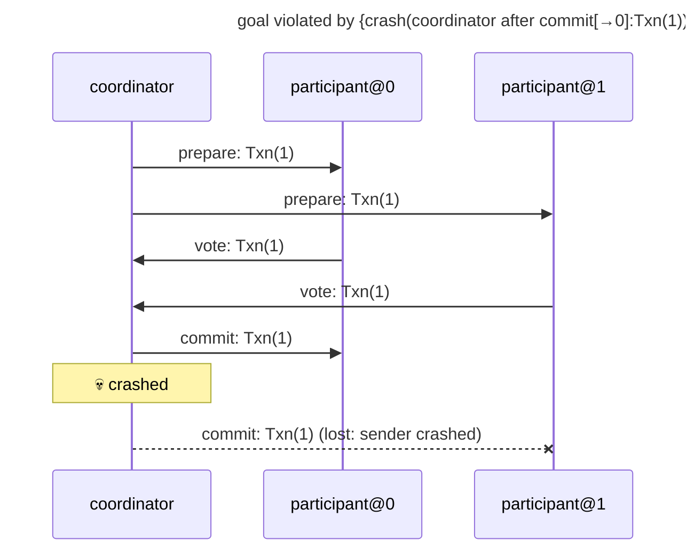

# goal violated by {crash(coordinator after commit[→0]:Txn(1))}

Found after 2 hypothesis run(s), 24 schedule(s) explored.

## The failing run



## Why the goal held before

The goal's support in the last run in which it held: {prepare[→0]:Txn(1)←coordinator#0, prepare[→1]:Txn(1)←coordinator#1, commit[→0]:Txn(1)←coordinator#2, commit[→1]:Txn(1)←coordinator#3, vote[0→]:Txn(1)←participant@0#0, vote[1→]:Txn(1)←participant@1#0, observed[0→]:Txn(1) from participant@0 through send #1←participant@0#1, observed[1→]:Txn(1) from participant@1 through send #1←participant@1#1}

```mermaid
---
title: goal held under {}: its support (★)
---
sequenceDiagram
    participant p0 as coordinator
    participant p1 as participant@0
    participant p2 as participant@1
    rect rgb(255, 243, 205)
    p0->>p2: ★ prepare: Txn(1)
    end
    rect rgb(255, 243, 205)
    p2->>p0: ★ vote: Txn(1)
    end
    rect rgb(255, 243, 205)
    p0->>p1: ★ prepare: Txn(1)
    end
    rect rgb(255, 243, 205)
    p1->>p0: ★ vote: Txn(1)
    end
    rect rgb(255, 243, 205)
    p0->>p2: ★ commit: Txn(1)
    end
    rect rgb(255, 243, 205)
    p0->>p1: ★ commit: Txn(1)
    end
```

