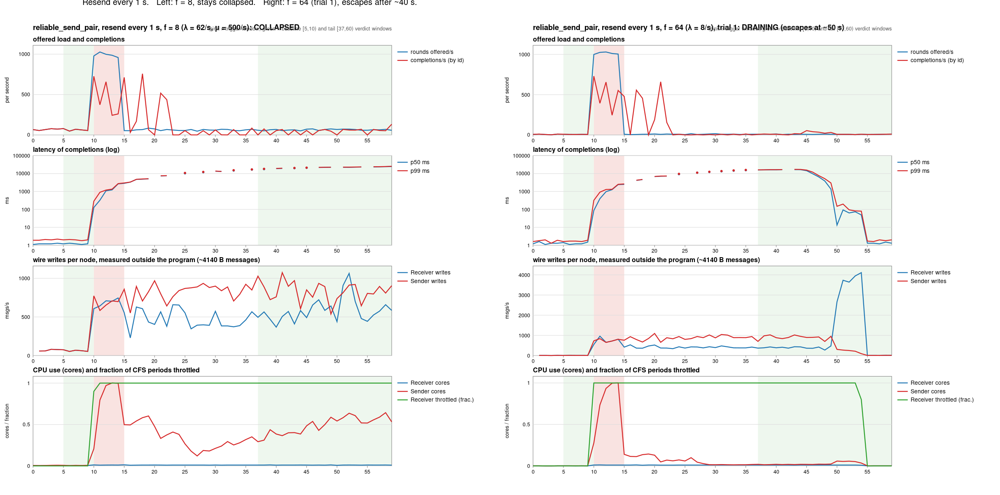
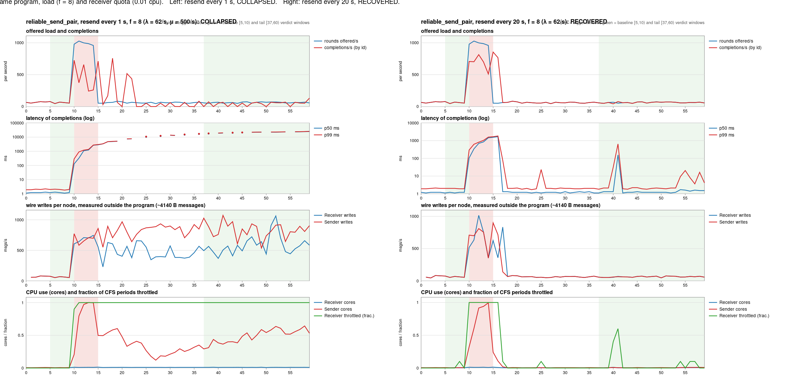
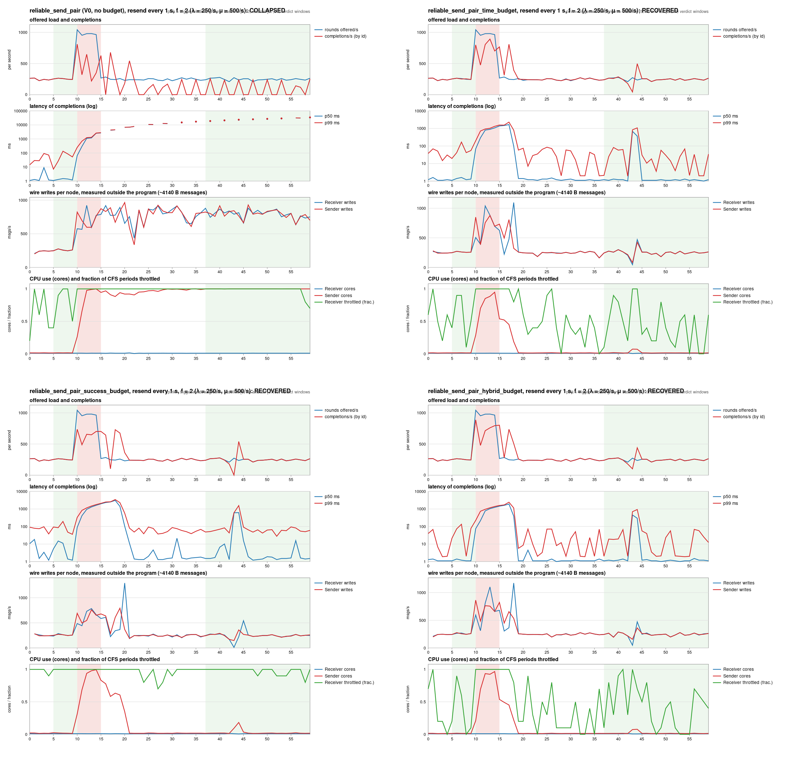
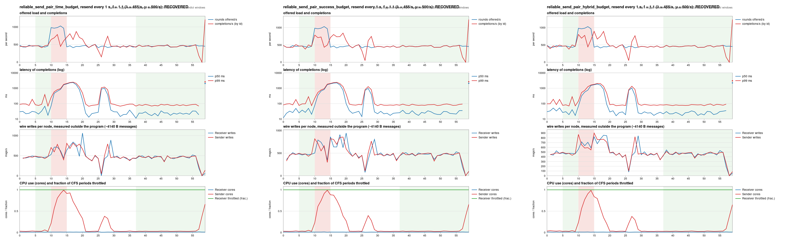
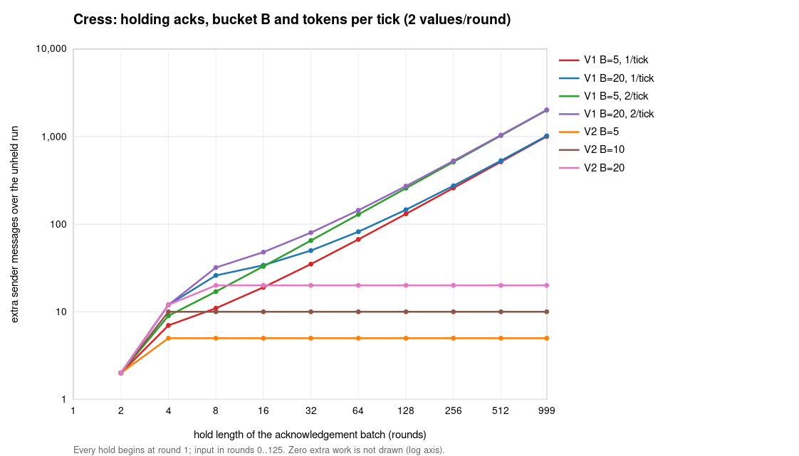
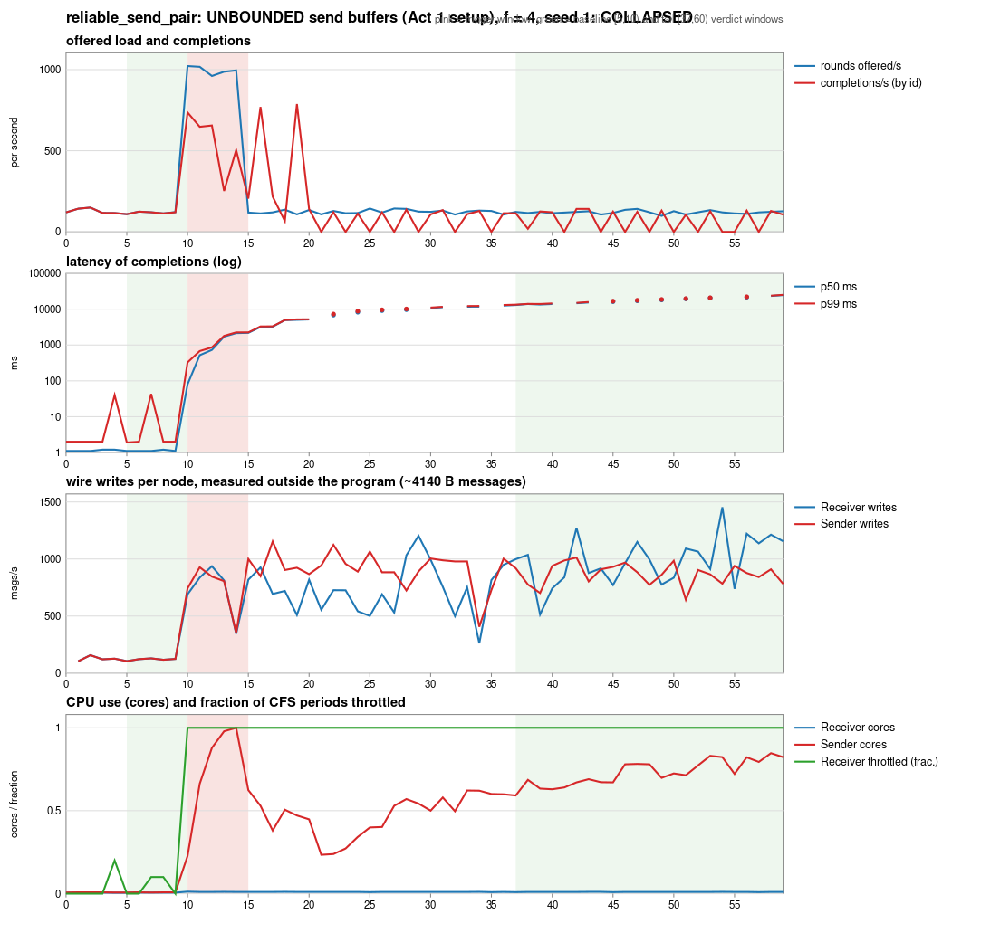

# Reliable delivery under hydrofrac, Cress and Sedge

This document follows one small protocol, a sender that resends until its messages are acknowledged, through three tools that each ask a different question about it. Hydrofrac asks whether the protocol is correct when messages are lost and nodes crash. Cress asks whether delay makes the protocol do work that its input did not require. Sedge asks whether the deployed protocol recovers from a burst of load when its receiver has a fixed, externally imposed CPU budget. The naive protocol passes the first question and fails the other two. We then add a token bucket to its resends in three different ways and let the tools judge the candidates. Each tool rejects or ranks something that the other two cannot see: hydrofrac rejects the bucket that only acknowledgements refill, Cress measures how much extra work each bucket allows, and Sedge shows which buckets let a capped receiver recover. A final experiment with real loss in deployment overturns part of the story. When the transport drops messages from full queues, the unbudgeted protocol recovers best and the time-refilled bucket did not recover its lost values within four minutes, so the right bucket depends on the transport. Only the hybrid bucket, which refills from both the timer and acknowledgements, did well on every axis that we tested.

Every number below comes from a named test or run. Claims are marked in the style of the hydrofrac guide:

- **DEMONSTRATED** means that a test or a run shows it, and the test or run is named.
- **ARGUED** means that it follows from the code or from a model, and nothing here measures it directly.
- **GUESSED** means that it is our reading of the data, and we have not checked it.

Contents:

1. [The question](#1-the-question)
2. [The three tools](#2-the-three-tools)
3. [The protocol](#3-the-protocol)
4. [Act 1: the naive protocol is correct and fragile](#4-act-1-the-naive-protocol-is-correct-and-fragile)
5. [The diagnosis](#5-the-diagnosis)
6. [Act 2: three token buckets](#6-act-2-three-token-buckets)
7. [Act 3: real loss in deployment](#7-act-3-real-loss-in-deployment)
8. [What the three tools found together](#8-what-the-three-tools-found-together)
9. [Limits of what we showed](#9-limits-of-what-we-showed)
10. [How to reproduce](#10-how-to-reproduce)

The code is on the local branch `demo/budget-runs` (commit `4f8b9ebbc5`), which sits on `integ/frac-cress-sedge` (`ebd4272032`), which in turn sits on upstream `hydro-project/hydro` `main` at `858ba1a6b2`. The Sedge runs used a 16-core host with Docker. The containers ran on cores 8–15, the harness ran on cores 0–7, and each node had a 6000 MB memory limit. A background Java process (`TPSGeneratorWorker`) was running on the host throughout.

## 1. The question

A reliable sender over a lossy link must keep resending until it hears an acknowledgement, because otherwise a single lost message is lost forever. Resending is also how such a sender hurts itself: when acknowledgements are late, the sender cannot tell a lost message from a slow one, so it resends messages that have already arrived, and those resends compete with new work for the receiver's capacity. The protocol must therefore be correct under loss and also well behaved under delay and overload. These are different properties, and no single tool checks all of them.

## 2. The three tools

**Hydrofrac** is lineage-driven fault injection in the Hydro simulator. It takes a rule of the form "if a record is in collection `A` at the nodes that the A-side chooses, then a record with the same key is in collection `B` at the nodes that the B-side chooses," and it searches for a set of lost messages and crashes that breaks the rule. It either returns a counterexample or certifies that no number of crashes or lost messages within its bounds breaks the rule. It knows nothing about time or load.

**Cress** checks schedule amplification in the simulator. It holds each batch of a program for longer and longer and counts the messages that the program sends compared with the run in which nothing is held. When the extra work grows with the length of the hold, the program turns delay into load. Cress reports the shape of that growth (a ceiling, or a rate per round of delay) and a multiplier. It never loses a message, so it knows nothing about faults.

**Sedge** deploys the program, imposes capacity from outside with Docker CPU quotas, and drives it with an open-loop Poisson load that has a baseline, a burst, and a tail. It reads the tail against the baseline and says whether the program recovered, is still draining, or collapsed. It measures wire traffic from outside the program, from each container's `/proc` write counters. Its deployments run over plain TCP and lose nothing, unless the transport is given lossy send queues, as in Act 3. Sedge reads Cress's classification of each output stream from Cress's result table, so Cress runs first on the same function and configuration.

## 3. The protocol

`reliable_send` in `hydro_std/src/reliable_send.rs` is `Stream::send` for a lossy network. The sender puts each new value on the wire at once and adds it to an outstanding set. An acknowledgement removes its value from the set. On every element of the timer stream `resend_ticks`, the sender resends every value that is still outstanding. The receiver acknowledges every arrival, including retransmissions, and delivers arrivals with duplicates removed. The value is its own identity, so the protocol needs no sequence numbers. Both channels are `TCP.lossy_delayed_forever()`. The whole sender is one `sliced!` block, and its state lives in Hydro collections:

```rust
let wire = sliced! {
    let new = use::batch(source, nondet!(/** ... */));
    let acked = use::batch(acks, nondet!(/** ... */));
    let ticks = use::batch(resend_ticks, nondet!(/** ... */));
    let mut outstanding = use::state_null::<Stream<T, Tick<_>, Bounded, NoOrder>>();

    let still = outstanding.filter_not_in(acked);
    let resent = still.clone().filter_if(ticks.first().is_some());
    outstanding = still.chain(new.clone()).unique();

    new.chain(resent)
};
```

All three tools run the same function, `hydro_test::cluster::reliable_send_check::reliable_send_pair`, which wires one sender to one receiver, numbers the input so that a load generator can match deliveries to requests, and returns the delivered stream. The function carries one attribute for each simulation or deployment tool, and both attributes use the configuration name `two_per_round` so that Sedge finds Cress's results:

```rust
#[cfg_attr(feature = "sedge", sedge::overload_check(
    name = two_per_round,
    T = super::rpc_retry::Payload<4096>,
    load = values,
    mu = 500,
    cpus(Sender = none, Receiver = 0.01),
    cpu_period_us = 100_000,
    timers(resend_ticks = std::time::Duration::from_secs(1)),
))]
#[cfg_attr(feature = "cress", cress::amplification_check(
    name = two_per_round,
    T = u64,
    workload(values = 2),
    workload_rounds = 125,
    test_safety_only,
))]
pub fn reliable_send_pair<'a, T>(
    _sender: &Process<'a, Sender>,
    receiver: &Process<'a, Receiver>,
    values: Stream<T, Process<'a, Sender>, Unbounded, TotalOrder, ExactlyOnce>,
    resend_ticks: Stream<(), Process<'a, Sender>, Unbounded, TotalOrder, ExactlyOnce>,
) -> ReliableSendOutputs<'a, T>
```

The Cress configuration offers two new values per round for the first 125 rounds of a 1000-round run, and the timer fires once per round for the whole run. The Sedge configuration gives the receiver one percent of a core and gives the sender no limit, feeds `values` open loop with 4 KiB payloads that are distinct per sequence number, and wires `resend_ticks` to a one-second `source_interval`. The receiver's work per arrival is real decoding, deduplication and acknowledgement, and the program contains no capacity code.

The hydrofrac rule is validity: every value that a correct sender sends, a correct receiver delivers. It is stated in `hydro_test/src/cluster/ec_reliable_send.rs` as a rule from the sender's input to the receiver's output:

```rust
vals.implies(
    "delivery",
    &delivered,
    q!(|v| v),
    q!(|v| v),
    ASide::Correct,
    BSide::AllCorrect,
);
```

The hydrofrac harness models a sender's life. In the fault phase the sender sends its values, the timer may fire, and the network may drop any message. After the network heals, the timer keeps firing once per round and each round settles before the next one starts (`EcCheck::run_then_recover`).

## 4. Act 1: the naive protocol is correct and fragile

### Hydrofrac: correct under loss and crashes

| test | what it checks | verdict | cost |
|---|---|---|---|
| `delivers_each_value_once_without_faults` | Two values, a tick after each, no faults, every schedule. | Each value is delivered exactly once. | 14,580 schedules |
| `reliable_send_delivers_despite_losses` | One value, with a resend before the heal that may itself be lost. | `delivery` holds under any number of crashes and lost messages. | 112 fault sets, 1.0 s |
| `reliable_send_delivers_three_values_despite_losses` | Three values, with any of their first copies and acknowledgements lost in any interleaving, and resends only after the heal. | `delivery` holds under any number of crashes and lost messages. | 576 fault sets, 8,544 schedules, 74 s |
| `plain_send_loses_a_message` | The same harness over plain `send`, as a negative control. | `delivery` is broken by one lost message and no crash. | 2 fault sets |

All four results are DEMONSTRATED by the named tests. The control shows that the harness can find a loss when there is one to find, so the certificates are not vacuous. Hydrofrac draws its counterexamples as Lamport diagrams, and the one for the control is a single lost message:


### Cress: delay turns into unbounded work

Holding the acknowledgement batch makes the sender's extra work grow without a ceiling. At a hold of 999 rounds the sender sends 232,252 more messages than in the unheld run, which is 248 extra messages per round of delay and a multiplier of 930. Holding the timer batch or the new-values batch adds no work. These results are DEMONSTRATED by `./scripts/cress hydro_test reliable_send_pair` and pinned by the test `holding_acks_amplifies_and_holding_ticks_does_not`. The rate of 248 is the size of the outstanding set, since every value that was sent after the hold began is resent on every tick (ARGUED from the code and matched by the count). The figure in §6 plots this growth against the budgeted variants.

### Sedge: collapse at every load we tried

Sedge calibrated the receiver's capacity at μ = 500 values per second under the one-percent quota: the receiver keeps up at 500 per second and falls behind at 545. We then swept the steady load λ = μ/f over the factors f below, with two trials per factor and a one-second resend timer.

| f | λ (values/s) | verdicts | tail goodput | sender wire messages/s, baseline to tail | sender memory at end |
|---|---|---|---|---|---|
| 2 | 250 | 2 COLLAPSED | 0% | 250 to about 770 | 0.84–0.90 GB |
| 4 | 125 | 2 COLLAPSED | 0% | 120 to about 750 | 0.38–0.43 GB |
| 8 | 62 | 2 COLLAPSED | 0% | 65 to about 820 | 0.21 GB |
| 16 | 31 | 2 COLLAPSED | 0% and 17% | 33 to about 850 | 0.10–0.13 GB |
| 32 | 16 | 2 COLLAPSED | 0% | 15 to about 800 | 0.11–0.12 GB |
| 64 | 8 | 1 COLLAPSED and 1 DRAINING | 0% and 100% | 7 to about 850 | 0.06–0.11 GB |

Eleven of twelve trials collapsed, and no trial was invalid (DEMONSTRATED by the Sedge sweep of `reliable_send_pair`). After the burst the receiver was throttled in 85–100% of CPU periods, while the sender used 0.37–0.79 cores and was never throttled. The sender wrote about 800 messages per second in the tail at every load, while the receiver delivered only 2–11% of that as new values. The rest of the traffic was resends.


The one trial that escaped, at f = 64, did so about 50 s into the run, when a catch-up of 3,590 acknowledgement messages per second cleared the backlog and latency fell back to 1.3 ms. The figure below sets that escape beside a trial that stayed collapsed.



We did not run more lossless trials of V0, so we report the eleven collapses in twelve trials as counts and do not estimate a collapse probability per factor. V0 did collapse again with unbounded send buffers in the later, separate session of Act 3 (§7), so the result reproduces across sessions.

## 5. The diagnosis

The sender writes about the same number of messages per second after the burst whether the steady load is 250 or 8 values per second, so the steady load does not set the storm. The burst does. During the five-second burst at twice the receiver's capacity, values arrive faster than the receiver can acknowledge them, and the backlog grows. Every one-second tick then resends everything outstanding, so the resend demand is at least the backlog divided by the resend period. While the receiver works through resends, acknowledgements stay late, the outstanding set stays large, and the next tick resends it again.

The traces let us measure a lower bound on that backlog from outside the program. We define the backlog B(t) as the number of values offered so far minus the number delivered so far. The sender's outstanding set contains every undelivered value and also every delivered value whose acknowledgement has not come back, so B is a lower bound on what each tick resends. The sender's wire writes cannot show the demand directly, because during a storm they saturate at the capped receiver's raw capacity of about 760–880 messages per second.

| resend period | f (λ/s) | B at the end of the burst | resend demand, at least B/P + λ (messages/s) | sender messages/s, just after the burst and in the tail | verdict |
|---|---|---|---|---|---|
| 1 s | 2 (250) | 2,210 and 2,373 | 2,460 and 2,620 | 819 and 755, then 793 and 773 | COLLAPSED, and B keeps growing |
| 1 s | 8 (62) | 2,028 and 2,228 | 2,090 and 2,290 | 768 and 695, then 833 and 835 | COLLAPSED |
| 1 s | 16 (31) | 2,181 and 2,764 | 2,210 and 2,795 | 713 and 709, then 841 and 875 | COLLAPSED |
| 1 s | 64 (8) | 2,596 and 2,023 | 2,600 and 2,030 | 762 and 802, then 880 and 559 | COLLAPSED and DRAINING |
| 20 s | 2 (250) | 729 | about 283 | 523, then 247, which equals λ | RECOVERED, with B at 0 from t = 18 s |
| 20 s | 8 (62) | 715 | about 99 | 381, then 63, which equals λ | RECOVERED, with B at 0 from t = 16 s |

These numbers are DEMONSTRATED by an analysis of the V0 traces (two trials per row with the one-second period, and one trial per row with the 20-second period). With a one-second period the demand is at least 2,000–2,800 messages per second against a capacity of about 800 at every load, so the wire saturates and the outcome does not depend on λ. With a 20-second period the demand is about 100–280 messages per second, which is below capacity, so the backlog drains within one to three seconds and the wire returns to exactly λ. The model holds qualitatively, and its 20-second estimates are good only to an order of magnitude, since the measured writes just after the burst (523 and 381 per second) exceed the estimates (283 and 99). A plausible reason, which we have not checked, is that the sender first drains copies queued in its unbounded user-space send buffer.

Two further effects appear in the traces. First, the burst feeds itself: the same burst leaves a backlog about three times larger with a one-second period than with a 20-second period, because resends already compete with first copies during the burst. Second, at f ≥ 16 the storm outlives the undelivered backlog. By t = 25 s that backlog has fallen to a few hundred values (about 100 at f = 64), yet the sender keeps writing 840–880 messages per second. The storm is then sustained by values that were delivered but whose acknowledgements have not returned, because the throttled receiver writes only 360–580 messages per second, one acknowledgement per arrival including duplicates. The sender's unacknowledged set, which is the true driver, does not appear in the traces, so this last point is ARGUED from the protocol and bounded by the traces.

The two 20-second rows are the direct test of the account: stretching the resend period shrinks the demand by the same factor, and with the demand below the receiver's capacity, f = 2 and f = 8 both recovered with full goodput and a median latency back at 1 ms (DEMONSTRATED by one trial at each factor; the committed attribute still uses one second).



This also explains a mismatch between the tools. Sedge's documentation predicts recovery when μ > λ + b for a protocol whose extra work grows at a rate b, and Cress measured b as the size of the outstanding set per tick. In the simulator that set is the steady input that arrived during the hold. In deployment it is whatever the burst left behind, so b is not a constant, and the threshold becomes a threshold on the backlog. Cress identified the right mechanism and the right shape, and Sedge showed how large the mechanism becomes in deployment. Our own first two predictions of the collapse threshold, f < 6 and then f < 31, were both wrong because they used the steady load, and the f = 32 runs refuted the second one.

A longer resend period is a blunt fix, because it also makes recovery from every real loss twenty times slower. What the protocol lacks is a limit on resends that does not depend on the backlog. A token bucket provides exactly that.

## 6. Act 2: three token buckets

### The variants

Each budgeted variant leaves first sends free and makes each resend spend one token. The bucket starts full with B = 10 tokens and never holds more than B. The variants differ only in where tokens come from.

| variant | function | tokens come from |
|---|---|---|
| V0 none | `reliable_send_pair` | No bucket; every tick resends everything outstanding. |
| V1 time | `reliable_send_pair_time_budget` | One token per timer tick. |
| V2 success | `reliable_send_pair_success_budget` | One token per four useful acknowledgements, that is, acknowledgements that clear an outstanding value. |
| V3 hybrid | `reliable_send_pair_hybrid_budget` | Both sources. |

The parameters (B = 10, one token per tick, four acknowledgements per token) are the constants of the retry-governance corpus in `hydro_test/src/cluster/witnesses/blind_budget/`. That corpus keeps its token state in a hand-written map inside a `fold`, which these variants do not do. The bucket here follows the pure-Hydro token bucket in `witnesses/blind/token_bucket.rs`, and it lives inside the same `sliced!` block as V0's sender. Tokens and the remainder of acknowledgement credit are `use::state` singletons. On a tick, the first `available` outstanding values are resent and move to the back of the outstanding FIFO, so resends go round robin and no value waits forever:

```rust
let fired = ticks.count();
let tick_grant = fired.clone().map(q!(move |n| n as u64 * tokens_per_tick));
let available = tokens
    .zip(tick_grant)
    .zip(ack_grant)
    .map(q!(move |((saved, by_tick), by_ack)| (saved + by_tick + by_ack).min(capacity)));

let placed = still
    .enumerate()
    .cross_singleton(available.clone())
    .cross_singleton(fired)
    .map(q!(|(((position, value), budget), fired)| {
        (fired > 0 && (position as u64) < budget, value)
    }));
let resent = placed.clone().filter_map(q!(|(resend, value)| resend.then_some(value)));
let waiting = placed.filter_map(q!(|(resend, value)| (!resend).then_some(value)));
let spent = resent.clone().count().map(q!(|n| n as u64));
tokens = available.zip(spent).map(q!(|(available, spent)| available - spent));
outstanding = waiting.chain(resent.clone()).chain(new.clone()).unique();
```

The FIFO needs an ordered input, so the budgeted variants take a `TotalOrder` source while V0 accepts any order. This matters for reliable broadcast, whose echo stream is unordered. The choice adds no `nondet!`, so it adds no schedule choices for hydrofrac to explore.

### What we predicted

Before running anything we wrote down what we expected from each tool. For V1 we expected hydrofrac to hold, because the timer always refills the bucket, and we expected Cress to report a rate of about one extra message per round, which is the refill rate. For V2 we expected hydrofrac to fail, because losses that drain the bucket leave no acknowledgement to refill it, and we expected Cress to report a ceiling. For V3 we expected hydrofrac to hold and Cress to look like V1. We expected all three budgeted variants to recover in Sedge whenever μ exceeds λ plus the refill rate.

### What the tools found

| | hydrofrac | Cress, holding acknowledgements | Sedge, at μ = 500 | calibrated μ under the same quota |
|---|---|---|---|---|
| V0 none | Holds (T2, T2b). | Grows at 248 per round; +232,252 at a hold of 999; 930×. | 11 of 12 trials collapsed, f = 2–64. | 500 |
| V1 time | Holds (T2, T2b). | Grows at 1.00 per round; +1,007 at a hold of 999; 5.03×. | 12 of 12 trials recovered, f = 1.1–16, settling in 3–6 s. | 841 |
| V2 success | **Broken** by starvation (see below). | **Stops at a ceiling of 10**; 1.04×. | 12 of 12 trials recovered, settling in 3–9 s; its slower cells are confounded by the host (see below). | 771 |
| V3 hybrid | Holds (T2, T2b). | Grows at 1.00 per round, the same as V1. | 12 of 12 trials recovered, settling in 3–6 s. | 771 |

The hydrofrac results are DEMONSTRATED by the tests in `ec_reliable_send.rs`. The single-value checks cost 112 fault sets and about 1.1 s for each variant, the three-value checks cost 576 fault sets and about 80 s for V1 and V3, and the fault-set counts match V0's exactly, so the bucket costs hydrofrac nothing. The Cress results are DEMONSTRATED by one run of `./scripts/cress hydro_test reliable_send_pair` over all four functions, which took 2.5 minutes, and every prediction held. The Sedge results are DEMONSTRATED by sweeps with μ pinned to V0's value of 500, so every variant saw the same absolute load, and the seeded generator produced identical arrivals across variants. "Settle" is the number of seconds after the burst until the median latency stays within five times its baseline (or 50 ms) for five consecutive seconds.


The curves in the figure come from the Cress reports of the run above, and the plotted values are exact. At a hold of two rounds all four variants send 2 extra messages. At a hold of four rounds V0, V1 and V3 send 12, while V2 has already reached its ceiling of 10, which fits a bucket that starts with ten tokens and earns none while acknowledgements are held (ARGUED). From a hold of eight rounds on, the time-refilled bucket binds as well: at a hold of 128 rounds V0 sends 16,244 extra messages, V1 and V3 send 136, and V2 sends 10, and at a hold of 999 rounds the numbers are 232,252, 1,007 and 10. A hold of one round adds no work in any variant.

**Only hydrofrac sees that V2 can lose data.** With a test-only bucket of one token that only acknowledgements refill, hydrofrac reports that "the loss of the message 1 from Sender to Receiver (on data) and the loss of the 2nd copy of the message 1 from Sender to Receiver (on data) leave Receiver@0 without 1," with no crash and two lost messages, after exploring three fault sets in 15 ms (DEMONSTRATED by `success_budget_starves_when_losses_drain_the_bucket`). The first tick spends the only token on a resend, the network drops both copies, and no acknowledgement can ever arrive to earn another token. The same bucket with one extra token per tick delivers (DEMONSTRATED by `hybrid_bucket_of_one_delivers`).

 Cress ranks V2 best of the four, and Sedge sees nothing wrong with it, because neither tool ever loses a message.

To see how starvation scales with the size of the bucket, we ran the same harness with one value, B timer ticks before the heal, and two recovery ticks, on a success budget of capacity B with no timer refill, and with crashes unbounded. The results are DEMONSTRATED by the `#[ignore]`d, environment-driven test `sweep` in `ec_reliable_send.rs` on the local branch `demo/frac-sweeps` (`e8fc46086d`), and the rows for one to four tokens are pinned by the test `success_budget_starvation_needs_one_more_loss_than_tokens`.

| bucket B | verdict | crashes and lost messages in the counterexample | hypotheses | schedules | time |
|---|---|---|---|---|---|
| 1 | broken | 0 crashes and 2 lost messages | 3 | 11 | under 0.1 s |
| 2 | broken | 0 crashes and 3 lost messages | 8 | 105 | 0.2 s |
| 3 | broken | 0 crashes and 4 lost messages | 31 | 1,257 | 1.7 s |
| 4 | broken | 0 crashes and 5 lost messages | 132 | 16,769 | 24.8 s |
| 5 | no verdict within the budget of 1,024 hypotheses | none found | 1,024 | | 232 s |
| 6 | timed out | none found | | | over 330 s |

The table was the same row for row with one acknowledgement per token and with four. For every bucket from one to four tokens, starving a success budget of B tokens takes exactly B + 1 lost messages, which are the first copy and the B resends that the bucket pays for, and no crash. The refill ratio does not matter, because when every copy is lost no acknowledgement arrives and no token is ever earned. The cost of the search grows by about a factor of four per token, since each token adds a resend and its acknowledgement, two more lossy messages, which is consistent with hydrofrac's cost of about 2^k fault sets for k lossy messages. The law of B + 1 lost messages is therefore DEMONSTRATED for B ≤ 4 and ARGUED beyond that. For the corpus bucket of ten tokens it predicts a counterexample with 11 lost messages, and extrapolating the cost gives roughly 540,000 hypotheses, which is out of reach for the current search.

Two further hydrofrac sweeps qualify these results, and both are DEMONSTRATED by tests on `demo/frac-sweeps`.

The first sweep gives V1 and V3 a bucket of a single token. With one value and a resend before the heal, delivery holds (112 hypotheses, 1.2 s). With three values and two recovery ticks, however, hydrofrac breaks delivery for both variants by losing the three first copies, with no crash (`tiny_time_budget_runs_out_of_recovery_ticks`). With three or four recovery ticks the same check holds (576 hypotheses, 73 s), and so does a bucket of two tokens with two recovery ticks (75 s; `tiny_time_budget_delivers_with_enough_recovery_ticks`). We read this as a property of the harness rather than a liveness bug (ARGUED). A bucket of one token that earns one token per tick pays for one resend per tick, so three lost values need three ticks, and a harness with only two recovery ticks ends too soon. The corpus bucket of ten tokens passes the same harness because ten tokens cover three values at once. V3 behaves exactly like V1 here, because the lost values are the ones whose acknowledgements would have refilled its bucket. The lesson for the reader is that hydrofrac's verdict on a rate-limited protocol depends on how long the harness lets it recover.

The second sweep asks whether a budget makes hydrofrac's search cheaper, and it does not. With two values and timer ticks before the heal, every variant used up the budget of 1,024 hypotheses without a verdict: V0 in 215 s and 161 s, V1 with one token in 163 s (and timed out at 330 s with a tick after each value), and V1 with ten tokens in 228 s. The bucket limits resends after the heal, while the search cost is set by the lossy messages sent before it, and those are unchanged (ARGUED).





Three more observations come from the Sedge runs. First, under the same one-percent quota the budgeted variants sustain 1.5–1.7 times V0's rate, because V0's resends consume receiver capacity even at steady load (DEMONSTRATED by one calibration per variant). The difference between V1's 841 and V2's and V3's 771 is a single probe step from a single calibration each, so we do not claim it. Second, in the tail the budgeted senders write about the offered load and end the run with about 20 MB of memory, while V0's sender writes 760–880 messages per second at every load and ends with 0.1–0.9 GB. Third, V2 settled more slowly than V1 and V3 at f = 1.25–4 (6–9 s against 3–5 s), but that difference is confounded and we do not attribute it to V2's protocol. The same cells show a throttling anomaly that is already present before the burst, when no protocol difference should matter. At f = 2 the V2 receiver was throttled in 95–99% of CPU periods before the burst and in 97% in the tail, against 39–62% for V1 and V3, at the same offered load and the same wire rate of 246–270 messages per second. Every variant's receiver used its whole quota, but V2's spent about 2.5 times as long throttled, wrote fewer and larger batches, and had a higher latency, and V2's uncapped sender spent 25–50% more CPU for the same message rate. Three facts argue against a protocol cause. The receiver code is identical in V1, V2 and V3. V3 shares V2's acknowledgement refill and still matches V1. The steady-state resends are at most 7% above the offered rate in every variant, which is far too few to double the receiver's throttling. Three facts point instead to the host during part of the V2 sweep. The anomaly appears at f = 1.25, 2 and 4 in that sweep and does not appear in V2's separate session at f = 1.1. The harness's feed lag in V2's runs was the largest of all 46 runs (11.4 ms and 6.0 ms, against 2.1–3.9 ms everywhere else). The host also ran a background Java process, and the runs thread interrupted one V2 sweep and removed a leftover sampler container. The data cannot name the cause, so we conclude only that the anomaly is real, that it predates the burst, and that V2's protocol does not explain it (DEMONSTRATED by the trace analysis in `target/sedge-demo-budget/ANALYSIS.md`, with the host explanation GUESSED).

We did not repeat this lossless comparison with the variants interleaved, so the question of whether V2 drains more slowly near capacity without loss remains open. The Act 3 session in §7 did interleave the variants trial by trial and logged the host, and under loss V2 drained as fast as V3.

### How sure we are

The separation between V0 and the budgeted variants is not noise in these runs. Every budgeted variant recovered in all 36 of its trials, while V0 collapsed in 11 of 12 and failed to recover in all 12. Fisher's exact test gives p = 5.3 × 10⁻¹⁰ for collapse (11 of 12 against 0 of 36), p = 1.4 × 10⁻¹¹ for failing to recover (12 of 12 against 0 of 36), and p = 9.5 × 10⁻⁸ when only the factors that both sides ran (f = 2, 4, 8 and 16) are counted. The most honest test pairs runs by factor and seed, since V0 and each variant saw identical arrivals. All eight pairs per variant go the same way, so the sign test gives p = 0.0078 for each variant, which is the smallest value that eight pairs can produce. More seeds would strengthen it. The mechanism agrees with the statistics: in the tail the wire rate equals λ in all 36 budgeted runs, while V0's is saturated at 760–880 messages per second at every load.

These p-values are bounded by the design. The two trials in each cell are two fixed load seeds that are reused in every cell and every variant, V0 ran in an earlier session than the budgeted variants, and every run shared one host with background load. The tests therefore show that the separation in these 48 runs is not plausibly scheduling noise, and they do not generalize beyond this host, these seeds and this burst shape.

Between the budgeted variants the data supports no ranking. V1 and V3 tie in 8 of 12 paired settle times at the metric's one-second resolution, and neither the sign test (p = 0.63) nor the Wilcoxon test (p = 0.25) finds a difference. V2's slower settling is borderline (p between 0.03 and 0.07 without correction for three comparisons) and sits in the confounded cells described above. The calibrated capacities (841 for V1 against 771 for V2 and V3) come from one calibration each and differ by one probe step, so they cannot be tested.

### How Cress's numbers depend on load and on the bucket

We repeated the Cress check over a range of input rates and bucket parameters, always holding the acknowledgement batch and reading the sender's extra messages at a hold of 999 rounds. These results are DEMONSTRATED by the runs on the local branch `demo/cress-sweeps` (`da7f1e8c39`), whose full table is in `target/cress-sweeps/SUMMARY.md`.

| variant and parameters | input rate (values per round) | growth | extra sender messages at a hold of 999 | multiplier |
|---|---|---|---|---|
| V0 | 1, 2, 4 | 124, 248 and 496 per round | 116,126, 232,252 and 464,504 | 930× at every rate |
| V1, B = 10, one token per tick | 1, 2, 4 | 1.00 per round | 1,007 at every rate | 9.06×, 5.03× and 3.01× |
| V1, B = 5 and 20, one token per tick | 2 | 1.00 per round | 1,002 and 1,017 | |
| V1, B = 5, 10 and 20, two tokens per tick | 2 | 2.00 per round | 1,999, 2,004 and 2,014 | |
| V2, B = 10, four acknowledgements per token | 1, 2, 4 | ceiling | 10 at every rate | |
| V2, B = 5 and 20 | 2 | ceiling | 5 and 20 | |
| V2, B = 10, one acknowledgement per token | 2 | ceiling | 10 | |
| V3, in every configuration above | | the same as V1 | the same as V1 | |

Three laws fit every row, and each is DEMONSTRATED for the parameters in the table. V0's rate is the input rate times the 124 rounds of input that arrive after the hold begins, which is the size of the outstanding set. A time budget's extra work is B + (tokens per tick) × 997, which means that the hold spends the full bucket once at its start and then resends at exactly the refill rate, whatever the load. A success budget's extra work is a ceiling of exactly B, whatever the input rate and whatever the number of acknowledgements per token. Holding the timer batch or the new-values batch added no work in any configuration.

Two consequences matter for reading Cress's output. First, V1's extra work does not depend on the load, and its multiplier falls from 9.06× to 3.01× as the load rises only because Cress divides by the number of messages in the unheld run, which grows with the load. Second, Cress cannot tell V3 from V1 in any configuration, because the hybrid's acknowledgement refill changes the outcome only when values are lost while acknowledgements still flow, and Cress's simulator never drops a message (ARGUED). Separating them needs loss, which only hydrofrac and the Act 3 experiment provide.




One side finding concerns the timer. With four timer elements per round, V0 still grows at 248 messages per round, because all of a round's ticks reach the sender in one batch and V0 resends once per batch in which any tick appears (`count() > 0`). V1 and V3 rise to 4.00 messages per round (3,996 extra messages each at a hold of 999 rounds), because the bucket grants a token for every tick element. A faster timer therefore raises a time budget's resend rate but leaves V0's unchanged in this simulator setting.

### What the comparison settles

V2 is ruled out, because it can lose a value forever, and only hydrofrac shows it. V1 and V3 both remove the storm while keeping the delivery guarantee. Our experiments cannot yet tell V1 from V3. Cress holds acknowledgements and never loses a message, so it gives them identical numbers in every configuration that we tried, and Sedge's deployments lose nothing, so the hybrid has no losses to recover from. The difference between them can only show up when acknowledgements flow while values are being lost, which is the subject of Act 3, and there the difference turns out to be large.

## 7. Act 3: real loss in deployment

Act 2 left one question open: does the hybrid's acknowledgement refill help a sender recover from real loss, at the same protection against storms as the time budget? Cress cannot answer it, because it never loses a message, and hydrofrac cannot answer it, because it knows nothing about rates. Sedge can answer it once the deployment is made lossy.

### The loss model and the design

Docker's host networking rules out `tc netem`, so the loss is imposed in the deployment's transport instead, which is still outside the program. The Sedge option `--send-buffer lossy:64:Sender,Receiver` puts a queue of 64 messages in front of every outgoing connection of both nodes, for data and for acknowledgements alike. A send that finds its queue full is dropped, and the transport counts the drop (`sendq_dropped_*`, from `HYDRO_DEPLOY_SEND_STATS`). This is congestion tail-drop: messages are dropped only while the burst backs up the queues, and no message was dropped before any burst.

Everything else matches Act 2: the receiver is capped at one percent of a core, the sender is uncapped, μ is pinned at 500, the resend timer fires every second, and the load profile is a 10 s baseline, a 5 s burst at twice μ and a 45 s tail. For each factor f ∈ {2, 4, 8} and each of three seeds, the four variants ran back to back in the order V1, V3, V0, V2, which gives 36 interleaved trials. Each trial logged its start and end time, the load average, `top` and `docker ps`, no leftover containers were found, and the load stayed open loop in all 42 trials of the session (no late records, and a worst feed lag of 12.8 ms). Cress ran first, and Sedge read `delivered` as conserved from its table. The results in this section are DEMONSTRATED by that session on the local branch `demo/act3-lossy` (`37d55d13c1`), whose summary is `target/sedge-demo-act3/SUMMARY.md`.

### What Sedge's verdict sees, and what it misses

Sedge labelled all 36 lossy trials RECOVERED, for every variant, with tail goodput between 96% and 100%. The verdict cannot tell the variants apart, because it judges only the values that are offered during its baseline and tail windows. Values that were lost during the burst and never delivered do not affect it. We therefore added a panel to the Sedge plots that shows the number of values offered so far and not yet delivered, and we read Act 3 through that backlog.

| variant | f | sender drops | undelivered at the end of the burst | undelivered at the end of the run |
|---|---|---|---|---|
| V0 none | 2, 4, 8 | 24–43 k, 46–58 k, 32–35 k | 1,342–2,348 | 0 in all nine trials |
| V1 time | 2, 4, 8 | 1.5–2.1 k | 1,382–2,175 | 1,353–2,110, barely changing |
| V2 success | 2, 4, 8 | 1.3–2.3 k | 1,223–2,292 | 1,189–1,875 |
| V3 hybrid | 2, 4, 8 | 1.3–2.3 k | 1,333–2,343 | 1,059–1,900 |

A 45-second tail is too short to see whether the budgeted variants ever deliver their lost values, so we repeated f = 4 with seed 1 and a 240-second tail.

| undelivered at t = | 15 s | 30 s | 60 s | 120 s | 180 s | 240 s | fully drained |
|---|---|---|---|---|---|---|---|
| V0 none | 1,338 | 801 | 0 | 0 | 0 | 0 | at t = 43 s, 28 s after the burst |
| V2 success | 1,402 | 1,401 | 1,124 | 592 | 44 | 0 | at t = 193 s, 178 s after the burst |
| V3 hybrid | 2,073 | 1,936 | 1,705 | 1,146 | 560 | 199 | not by the end of the run at t = 254 s, with 68 values left |
| V1 time | 1,377 | 1,376 | 1,378 | 1,414 | 1,384 | 1,530 | never; the backlog was flat and ended higher |


V1 resent about 0.9 messages per second between t = 30 s and t = 250 s, which is its budget of one token per tick, but two later episodes of drops (at t = 93 s and t = 207–209 s, about 280 messages) lost more than it resent, so its net recovery over the run was −140 values. V2 and V3 resent about 8.5 messages per second, close to their cap of ten tokens per tick, so their backlogs fell linearly. Resend rates are inferred as the sender's attempted sends minus the offered load, since the tokens themselves are not observable from outside.

### The control: Act 1 still collapses with unbounded buffers

In the same session we reran the setting of Act 1, in which the send buffers are unbounded, at f = 4 and seed 1. V0 collapsed again, with 0% goodput in the tail, and V1 recovered with an empty backlog one second after the burst. The collapse of Act 1 therefore reproduces in this session.



### What Act 3 shows

Under real loss the acknowledgement refill matters. V3 recovered lost values at about nine per second and V1 at less than one per second, which in our runs was not enough to make any net progress in four minutes (DEMONSTRATED for this loss model). The time budget that looked as good as the hybrid in Act 2 is too stingy once messages are actually lost.

V2 drained as fast as V3 here, and it did not starve. New load kept arriving, so acknowledgements kept flowing and kept refilling its bucket. Hydrofrac's starvation needs a pause in new values while every outstanding value is lost (ARGUED from the counterexample in §6), which a steady open-loop load never produces. That is exactly the case that only hydrofrac covers.

The largest surprise is that under tail-drop loss V0, the variant without any budget, recovered best, draining its whole backlog in 28 s. The lossy queues shed V0's resend storm inside the sender: V0 attempted about 2,000 resends per second, but only about 65 extra messages per second reached the wire, and the transport dropped the rest locally, so the receiver was never overloaded (DEMONSTRATED by the drop and wire counters). Act 1's collapse therefore depends on unbounded send buffers, which are Sedge's default and which model RPC stacks that queue every send. With a bounded, lossy transport, the network itself limits the resend rate (ARGUED from the counters and the control).

The cost of the buckets moves to the sender's CPU. While a backlog persists, the budgeted senders run at about 0.9 cores, because they rebuild an outstanding set of one to two thousand values on every tick, and V3's sender CPU falls as its backlog drains. V0's sender returns to its baseline as soon as its backlog is gone.

## 8. What the three tools found together

The table below collects the verdicts of every experiment in this document. Each entry is DEMONSTRATED by the section it cites, except where the section marks it otherwise.

| variant | hydrofrac, delivery under loss and crashes (§4, §6) | Cress, extra work when acknowledgements are delayed (§4, §6) | Sedge, capped receiver with unbounded send buffers (§4, §6) | Sedge, capped receiver with lossy send queues (§7) |
|---|---|---|---|---|
| V0 none | Holds. | Grows with the backlog, 930×. | Collapses in 11 of 12 trials. | Recovers best, draining its lost values in 28 s. |
| V1 time | Holds, given enough recovery ticks. | Grows at the refill rate, independent of the load. | Recovers in all 12 trials. | Never recovers its lost values in four minutes. |
| V2 success | Starves after B + 1 losses. | Stops at a ceiling of B. | Recovers in all 12 trials. | Drains its lost values in about three minutes. |
| V3 hybrid | Holds, given enough recovery ticks. | Grows at the refill rate, the same as V1. | Recovers in all 12 trials. | Drains its lost values at about nine per second. |

Each tool caught something that the other two could not. Hydrofrac alone found that V2 can lose a value forever, because only hydrofrac loses messages while nothing new arrives. Cress alone measured how each design turns delay into work, and it showed that a time budget bounds that work independently of the load. Sedge alone showed the collapse of V0 under an externally imposed capacity, the recovery of the budgeted variants, and, once the transport was made lossy, that V1's single token per tick is too few to recover lost work.

The answer to the question of which bucket to use depends on the transport. With unbounded send buffers, which queue every send the way an RPC stack does, the unbudgeted protocol turns a burst into a self-sustaining storm, and any of the three buckets prevents it. With bounded queues that drop when full, the transport itself sheds the storm, the unbudgeted protocol recovers fastest, and a bucket slows recovery; only the acknowledgement refill of V2 and V3 keeps that slowdown tolerable. Of the four designs, only V3 did well on every axis that we tested: hydrofrac certifies it, Cress bounds its extra work, it recovers with unbounded buffers, and it recovers its lost values under tail-drop loss. This conclusion is limited to the parameters, loss model and host described below (ARGUED from the table above).

## 9. Limits of what we showed

- Sedge ran two trials per factor with two fixed seeds that were reused in every cell, and one calibration per variant, on a host that also ran a background Java process. V0 ran in an earlier session than V1–V3, so the comparison between them is also a comparison between sessions.
- V2's starvation is demonstrated for buckets of one to four tokens, where it always takes B + 1 lost messages. For the corpus bucket of ten tokens it is argued from that law, because the search for 11 lost messages is out of reach.
- Hydrofrac cannot yet check the loss of resends of several values in one run, and the budgets do not change that. Its cost grows as about 2^k in the number k of lossy messages sent before the network heals, because the protocol's resend path passes through steps that hydrofrac treats as fragile. A possible remedy, treating `filter_not_in` as robust per key, is recorded as an open research item beside the soundness item R1 in `docs/design/hydrofrac-soundness.md` §18. Like every races certificate, the certificates here are subject to the open review items R1–R6, and R1 has this protocol's shape.
- When a search runs past its schedule budget it falls back to sampled schedules, and it can then miss a counterexample. With crashes disabled, success budgets of three and four tokens gave the same counterexamples at the same cost as before, but at five to seven tokens the search reported `Exhausted` without finding the starvation. `Exhausted` is correctly not a certificate, so the search lost power there but did not give an unsound verdict.
- Hydrofrac's verdicts on the rate-limited variants depend on the number of recovery ticks in the harness, as the single-token sweep in §6 shows.
- Cress labels every variant HAZARDOUS, because by design it labels any extra work at all as hazardous (`cress/src/lib.rs`). The severity is in the growth shape and the multiplier.
- Cress never loses a message, because the simulator does not drop on lossy channels, and Sedge's deployments lose messages only when they are given a lossy send buffer, as in Act 3. Loss is otherwise exercised only by hydrofrac.
- Act 3 used a single loss model, congestion tail-drop at a queue depth of 64 in both directions, with no random or independent loss. It ran three seeds per cell, and the 240-second tail ran one seed. Some late drop episodes happened at the same second in V1 and V3, which points to the shared seeded arrivals or to the host and away from the protocols.
- A bucket of ten tokens caps V2's and V3's resends at about ten per tick, which sets their drain rate under loss. We did not sweep the bucket size or tie the refill rate to the measured loss in deployment.
- The buckets' tokens are not observable from outside the program, so the resend rates in Act 3 are inferred from the sender's attempted sends minus the offered load.
- Under loss, Sedge's RECOVERED verdict covers only the values offered during the tail. Values that were lost during the burst and never recovered do not change the verdict, and they appear only in the tail of the completion-time distribution and in the count of values outstanding at the end of the run.
- Deploying `reliable_send` required a change to `hydro_lang` (commit `2ad28e7c5f`), because the deployment backend refused every TCP channel other than `fail_stop`. The change deploys `LossyDelayedForever` as plain TCP, which is sound because in-order delivery that stops at a failure is one of the behaviors that a delayed-forever, unordered channel allows. It still refuses plain `Lossy`.

## 10. How to reproduce

All commands run from the repository root on `demo/budget-runs`, with Rust 1.98.1.

```sh
# hydrofrac: every reliable_send test, including the variants and the starvation probe.
cargo test -p hydro_test --lib cluster::ec_reliable_send -- --test-threads=4 --nocapture

# Cress: the name is a substring match, so this runs all four functions and writes all four
# rows of target/cress/conservation.tsv. Run it immediately before Sedge, because each run
# clears the table.
./scripts/cress hydro_test reliable_send_pair

# Sedge, one variant at a time, with nothing else heavy on the machine. Pin --mu so that every
# variant sees the same absolute load; without it a variant calibrates its own capacity.
./scripts/sedge --backend docker --config two_per_round --mu 500 \
    --factors 1.1,1.25,2,4,8,16 --trials 2 \
    --memory-mb 6000 --node-cpus 8-15 --harness-cpus 0-7 \
    hydro_test reliable_send_pair_time_budget
```

The Sedge filter is also a substring match, so the plain name `reliable_send_pair` deploys all four functions. On the local branch `demo/act3-lossy` the filter also accepts `=exact_name`, which selects one function exactly. The Act 3 runs add `--send-buffer lossy:64:Sender,Receiver` to the Sedge command, use `--tail 240` for the long-tail runs, and pin the harness to cores 4–7 and the nodes to cores 8–15. Their traces, host snapshots, metric scripts (`tools/act3_metrics.py`) and plots are in `target/sedge-demo-act3/`. The per-variant traces, calibration tables and plots of the runs in this document are under `target/sedge-demo-reliable-send/` and `target/sedge-demo-budget/` on the host where they were produced, and they are not committed. The trace analysis and its scripts are in `target/sedge-demo-budget/ANALYSIS.md` and `target/sedge-demo-budget/tools/analysis/`. The directory `target/sedge-demo-reliable-send/traces/traces_sweep3_P20/` also contains stale copies of one-second traces, and only `factor2.trial0` and `factor8.trial0` there are real 20-second runs.
